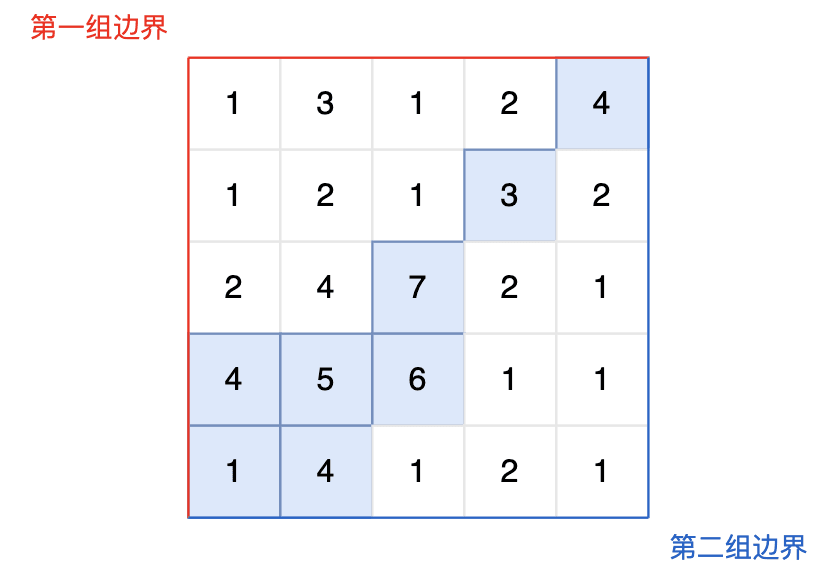
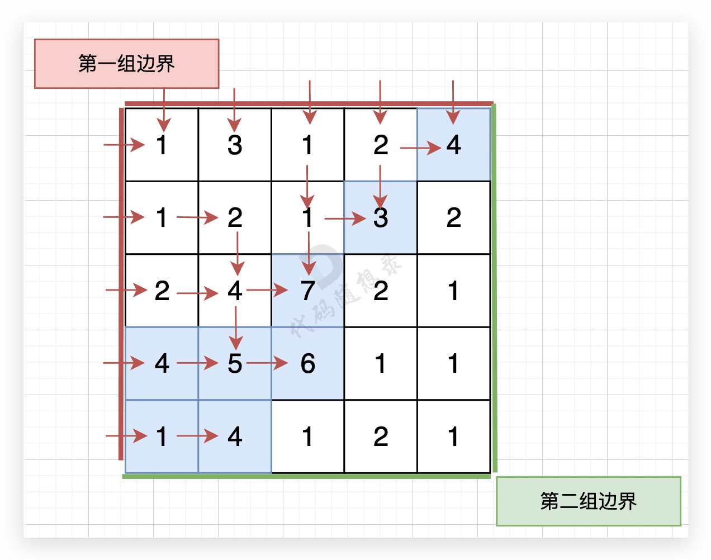
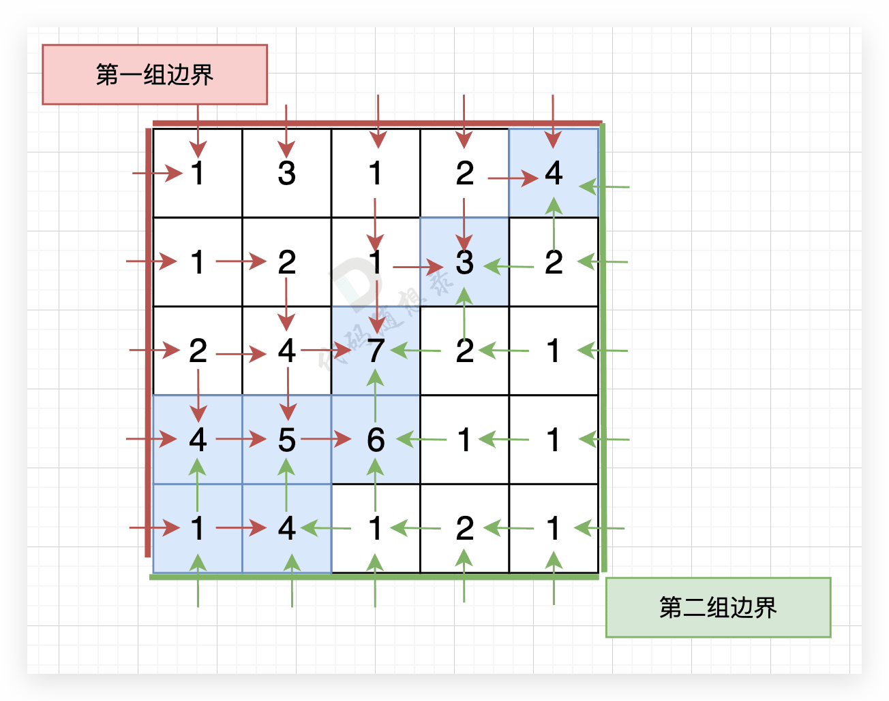

<p align="center"><strong><a href="./qita/join.md">參與本專案</a>，貢獻其他語言版本的程式碼，擁抱開放原始碼（open source），讓更多學習演算法的夥伴們受益！</strong></p>

# 103. 水流問題 

[KamaCoder 題目連結（ACM 模式）](https://kamacoder.com/problempage.php?pid=1175)

題目描述： 

現有一個 N × M 的矩陣（matrix），每個單元格包含一個數值，這個數值代表該位置的相對高度。矩陣的左邊界（boundary）和上邊界被認為是第一組邊界，而矩陣的右邊界和下邊界被視為第二組邊界。


矩陣模擬（simulation）了一個地形，當雨水落在上面時，水會根據地形的傾斜向低處流動，但只能從較高或等高的地點流向較低或等高並且相鄰（上下左右方向）的地點。我們的目標是確定那些單元格，從這些單元格出發的水可以達到第一組邊界和第二組邊界。

輸入描述：

第一列（row）包含兩個整數（integer） N 和 M，分別表示矩陣的列數和行（column）數。

後續 N 列，每列包含 M 個整數，表示矩陣中的每個單元格的高度。

輸出描述：

輸出共有多列，每列輸出兩個整數，用一個空格隔開，表示可達第一組邊界和第二組邊界的單元格的坐標（coordinate），輸出順序任意。

輸入範例： 

```
5 5
1 3 1 2 4
1 2 1 3 2
2 4 7 2 1
4 5 6 1 1
1 4 1 2 1
```

輸出範例：

```
0 4
1 3
2 2
3 0
3 1
3 2
4 0
4 1
```

提示資訊： 

 

圖中的藍色方塊上的雨水既能流向第一組邊界，也能流向第二組邊界。所以最終答案為所有藍色方塊的坐標。


資料範圍：

1 <= M, N <= 50 

## 解題思路

**[《代碼隨想錄》演算法影片公開課](https://programmercarl.com/other/gongkaike.html)：[圖論：水流向何方？ | 深度優先搜尋 DFS | 廣度優先搜尋 BFS | KamaCoder：103.水流問題](https://www.bilibili.com/video/BV1WNoEYrEio)，相信結合影片再看本篇題解，更有助於大家對本題的理解**。

一個比較直白的想法，其實就是遍歷（traversal）每個點，然後看這個點能不能同時到達第一組邊界和第二組邊界。

至於遍歷方式，可以用 dfs，也可以用 bfs，以下用 dfs 來舉例。 

那麼這種想法的實作程式碼如下：

```CPP 
#include <iostream>
#include <vector>
using namespace std;
int n, m;
int dir[4][2] = {-1, 0, 0, -1, 1, 0, 0, 1};

// 從 x，y 出發 把可以走的地方都標記上
void dfs(vector<vector<int>>& grid, vector<vector<bool>>& visited, int x, int y) {
    if (visited[x][y]) return;

    visited[x][y] = true;

    for (int i = 0; i < 4; i++) {
        int nextx = x + dir[i][0];
        int nexty = y + dir[i][1];
        if (nextx < 0 || nextx >= n || nexty < 0 || nexty >= m) continue;
        if (grid[x][y] < grid[nextx][nexty]) continue; // 高度不合適

        dfs (grid, visited, nextx, nexty);
    }
    return;
}
bool isResult(vector<vector<int>>& grid, int x, int y) {
    vector<vector<bool>> visited(n, vector<bool>(m, false));

    // 深搜，將x,y出發 能到的節點都標記上。
    dfs(grid, visited, x, y);
    bool isFirst = false;
    bool isSecond = false;

    // 以下就是判斷x，y出發，是否到達第一組邊界和第二組邊界
    // 第一邊界的上邊
    for (int j = 0; j < m; j++) {
        if (visited[0][j]) {
            isFirst = true;
            break;
        }
    }
    // 第一邊界的左邊
    for (int i = 0; i < n; i++) {
        if (visited[i][0]) {
            isFirst = true;
            break;
        }
    }
    // 第二邊界下邊
    for (int j = 0; j < m; j++) {
        if (visited[n - 1][j]) {
            isSecond = true;
            break;
        }
    }
    // 第二邊界右邊
    for (int i = 0; i < n; i++) {
        if (visited[i][m - 1]) {
            isSecond = true;
            break;
        }
    }
    if (isFirst && isSecond) return true;
    return false;
}


int main() {
    cin >> n >> m;
    vector<vector<int>> grid(n, vector<int>(m, 0));
    for (int i = 0; i < n; i++) {
        for (int j = 0; j < m; j++) {
            cin >> grid[i][j];
        }
    }
    // 遍歷每一個點，看是否能同時到達第一組邊界和第二組邊界
    for (int i = 0; i < n; i++) {
        for (int j = 0; j < m; j++) {
            if (isResult(grid, i, j)) {
                cout << i << " " << j << endl;
            }
        }
    }
}

```

這種想法很直白，但很明顯，以上程式碼逾時了。來看看時間複雜度（time complexity）。 

遍歷每一個節點（node），是 m * n，遍歷每一個節點的時候，都要做深搜，深搜的時間複雜度是：m * n 

那麼整體時間複雜度就是 O(m^2 * n^2)，這是一個四次方的時間複雜度。 

## 最佳化 

那麼我們可以反過來想，從第一組邊界上的節點逆流而上，將遍歷過的節點都標記上。 

同樣從第二組邊界的邊上節點逆流而上，將遍歷過的節點也標記上。 

然後**兩方都標記過的節點就是既可以流向第一組邊界也可以流向第二組邊界的節點**。

從第一組邊界邊上節點出發，如圖：（圖中並沒有把所有遍歷的方向都畫出來，只畫關鍵部分）



從第二組邊界上節點出發，如圖：（圖中並沒有把所有遍歷的方向都畫出來，只畫關鍵部分） 



最後，我們得到兩個方向交界的這些節點，就是我們最後要求的節點。

按照這樣的邏輯，就可以寫出如下遍歷程式碼：（詳細註解）


```CPP
#include <iostream>
#include <vector>
using namespace std;
int n, m;
int dir[4][2] = {-1, 0, 0, -1, 1, 0, 0, 1};
void dfs(vector<vector<int>>& grid, vector<vector<bool>>& visited, int x, int y) {
    if (visited[x][y]) return;

    visited[x][y] = true;

    for (int i = 0; i < 4; i++) {
        int nextx = x + dir[i][0];
        int nexty = y + dir[i][1];
        if (nextx < 0 || nextx >= n || nexty < 0 || nexty >= m) continue;
        if (grid[x][y] > grid[nextx][nexty]) continue; // 注意：這裡是從低向高遍歷

        dfs (grid, visited, nextx, nexty);
    }
    return;
}


int main() {

    cin >> n >> m;
    vector<vector<int>> grid(n, vector<int>(m, 0));

    for (int i = 0; i < n; i++) {
        for (int j = 0; j < m; j++) {
            cin >> grid[i][j];
        }
    }
    // 標記從第一組邊界上的節點出發，可以遍歷的節點
    vector<vector<bool>> firstBorder(n, vector<bool>(m, false));

    // 標記從第一組邊界上的節點出發，可以遍歷的節點
    vector<vector<bool>> secondBorder(n, vector<bool>(m, false));

    // 從最上和最下列的節點出發，向高處遍歷
    for (int i = 0; i < n; i++) {
        dfs (grid, firstBorder, i, 0); // 遍歷最左行，接觸第一組邊界
        dfs (grid, secondBorder, i, m - 1); // 遍歷最右行，接觸第二組邊界
    }

    // 從最左和最右行的節點出發，向高處遍歷
    for (int j = 0; j < m; j++) {
        dfs (grid, firstBorder, 0, j); // 遍歷最上列，接觸第一組邊界
        dfs (grid, secondBorder, n - 1, j); // 遍歷最下列，接觸第二組邊界
    }
    for (int i = 0; i < n; i++) {
        for (int j = 0; j < m; j++) {
            // 如果這個節點，從第一組邊界和第二組邊界出發都遍歷過，就是結果
            if (firstBorder[i][j] && secondBorder[i][j]) cout << i << " " << j << endl;;
        }
    }


}

```


時間複雜度分析，關於 dfs 函數（function）搜尋的過程，時間複雜度是 O(n * m)，這個大家比較容易想。 

關鍵看主函數，那麼每次 dfs 的時候，上面還是有 for 迴圈（for-loop）的。 

第一個 for 迴圈，時間複雜度是：n * (n * m)。

第二個 for 迴圈，時間複雜度是：m * (n * m)。 

所以本題看起來時間複雜度好像是：n * (n * m) + m * (n * m) = (m * n) * (m + n)。 

其實這是一個誤區，大家再自己看 dfs 函數的實作，其實有 visited 函數記錄走過的節點，而走過的節點是不會再走第二次的。 

所以呼叫 dfs 函數，**只要參數（parameter）傳入的是陣列（array） firstBorder，那麼地圖中每一個節點其實就遍歷一次，無論你呼叫多少次**。 

同理，呼叫 dfs 函數，只要參數傳入的是陣列 secondBorder，地圖中每個節點也只會遍歷一次。 

所以，以下這段程式碼的時間複雜度是 2 * n * m。地圖中每個節點就遍歷了兩次，參數傳入 firstBorder 的時候遍歷一次，參數傳入 secondBorder 的時候遍歷一次。

```CPP 
// 從最上和最下列的節點出發，向高處遍歷
for (int i = 0; i < n; i++) {
    dfs (grid, firstBorder, i, 0); // 遍歷最左行，接觸第一組邊界
    dfs (grid, secondBorder, i, m - 1); // 遍歷最右行，接觸第二組邊界
}

// 從最左和最右行的節點出發，向高處遍歷
for (int j = 0; j < m; j++) {
    dfs (grid, firstBorder, 0, j); // 遍歷最上列，接觸第一組邊界
    dfs (grid, secondBorder, n - 1, j); // 遍歷最下列，接觸第二組邊界
}
```

那麼本題整體的時間複雜度其實是：2 * n * m + n * m，所以最終時間複雜度為 O(n * m)。

空間複雜度（space complexity）為：O(n * m) 這個就不難理解了。開了幾個 n * m 的陣列。 


## 其他語言版本

### Java 
```Java
public class Main {

    // 採用 DFS 進行搜尋
    public static void dfs(int[][] heights, int x, int y, boolean[][] visited, int preH) {
        // 遇到邊界或者造訪過的點，直接返回
        if (x < 0 || x >= heights.length || y < 0 || y >= heights[0].length || visited[x][y]) return;
        // 不滿足水流入條件的直接返回
        if (heights[x][y] < preH) return;
        // 滿足條件，設定為true，表示可以從邊界到達此位置
        visited[x][y] = true;

        // 向下一層繼續搜尋
        dfs(heights, x + 1, y, visited, heights[x][y]);
        dfs(heights, x - 1, y, visited, heights[x][y]);
        dfs(heights, x, y + 1, visited, heights[x][y]);
        dfs(heights, x, y - 1, visited, heights[x][y]);
    }

    public static void main(String[] args) {
        Scanner sc = new Scanner(System.in);
        int m = sc.nextInt();
        int n = sc.nextInt();

        int[][] heights = new int[m][n];
        for (int i = 0; i < m; i++) {
            for (int j = 0; j < n; j++) {
                heights[i][j] = sc.nextInt();
            }
        }

        // 初始化兩個二維boolean陣列，代表兩個邊界
        boolean[][] pacific = new boolean[m][n];
        boolean[][] atlantic = new boolean[m][n];

        // 從左右邊界出發進行DFS
        for (int i = 0; i < m; i++) {
            dfs(heights, i, 0, pacific, Integer.MIN_VALUE);
            dfs(heights, i, n - 1, atlantic, Integer.MIN_VALUE);
        }

        // 從上下邊界出發進行DFS
        for (int j = 0; j < n; j++) {
            dfs(heights, 0, j, pacific, Integer.MIN_VALUE);
            dfs(heights, m - 1, j, atlantic, Integer.MIN_VALUE);
        }

        // 當兩個邊界二維陣列在某個位置都為true時，符合題目要求
        List<List<Integer>> res = new ArrayList<>();
        for (int i = 0; i < m; i++) {
            for (int j = 0; j < n; j++) {
                if (pacific[i][j] && atlantic[i][j]) {
                    res.add(Arrays.asList(i, j));
                }
            }
        }

        // 印出結果
        for (List<Integer> list : res) {
            for (int k = 0; k < list.size(); k++) {
                if (k == 0) {
                    System.out.print(list.get(k) + " ");
                } else {
                    System.out.print(list.get(k));
                }
            }
            System.out.println();
        }
    }
}

```

### Python
```Python
first = set()
second = set()
directions = [[-1, 0], [0, 1], [1, 0], [0, -1]]

def dfs(i, j, graph, visited, side):
    if visited[i][j]:
        return
    
    visited[i][j] = True
    side.add((i, j))
    
    for x, y in directions:
        new_x = i + x
        new_y = j + y
        if (
            0 <= new_x < len(graph)
            and 0 <= new_y < len(graph[0])
            and int(graph[new_x][new_y]) >= int(graph[i][j])
        ):
            dfs(new_x, new_y, graph, visited, side)

def main():
    global first
    global second
    
    N, M = map(int, input().strip().split())
    graph = []
    for _ in range(N):
        row = input().strip().split()
        graph.append(row)
    
    # 是否可到達第一邊界
    visited = [[False] * M for _ in range(N)]
    for i in range(M):
        dfs(0, i, graph, visited, first)
    for i in range(N):
        dfs(i, 0, graph, visited, first)
    
    # 是否可到達第二邊界
    visited = [[False] * M for _ in range(N)]
    for i in range(M):
        dfs(N - 1, i, graph, visited, second)
    for i in range(N):
        dfs(i, M - 1, graph, visited, second)

    # 可到達第一邊界和第二邊界
    res = first & second
    
    for x, y in res:
        print(f"{x} {y}")
    
    
if __name__ == "__main__":
    main()
```

### Go
```go
package main

import (
    "os"
    "fmt"
    "strings"
    "strconv"
    "bufio"
)

var directions = [][]int{{0, -1}, {0, 1}, {-1, 0}, {1, 0}} // 四個方向的偏移量

func main() {
    scanner := bufio.NewScanner(os.Stdin)
    
    scanner.Scan()
    lineList := strings.Fields(scanner.Text())
    N, _ := strconv.Atoi(lineList[0])
    M, _ := strconv.Atoi(lineList[1])
    
    grid := make([][]int, N)
    visited := make([][]bool, N) // 用於標記是否造訪過
    for i := 0; i < N; i++ {
        grid[i] = make([]int, M)
        visited[i] = make([]bool, M)
        scanner.Scan()
        lineList = strings.Fields(scanner.Text())
        
        for j := 0; j < M; j++ {
            grid[i][j], _ = strconv.Atoi(lineList[j])
        }
    }
    
    // 遍歷每個單元格，使用DFS檢查是否可達兩組邊界
    for i := 0; i < N; i++ {
        for j := 0; j < M; j++ {
            canReachFirst, canReachSecond := dfs(grid, visited, i, j)
            if canReachFirst && canReachSecond {
                fmt.Println(strconv.Itoa(i) + " " + strconv.Itoa(j))
            }
        }
    }
}

func dfs(grid [][]int, visited [][]bool, startx int, starty int) (bool, bool) {
    visited[startx][starty] = true
    canReachFirst := startx == 0 || starty == 0 || startx == len(grid)-1 || starty == len(grid[0])-1
    canReachSecond := startx == len(grid)-1 || starty == len(grid[0])-1 || startx == 0 || starty == 0
    
    if canReachFirst && canReachSecond {
        return true, true
    }
    
    for _, direction := range directions {
        nextx := startx + direction[0]
        nexty := starty + direction[1]
        
        if nextx < 0 || nextx >= len(grid) || nexty < 0 || nexty >= len(grid[0]) {
            continue
        }
        
        if grid[nextx][nexty] <= grid[startx][starty] && !visited[nextx][nexty] {
            hasReachFirst, hasReachSecond := dfs(grid, visited, nextx, nexty)
            if !canReachFirst {
                canReachFirst = hasReachFirst
            }
            if !canReachSecond {
                canReachSecond = hasReachSecond
            }
        }
    }
    return canReachFirst, canReachSecond
}
```

### Rust

### JavaScript

#### 深搜

```javascript
const r1 = require('readline').createInterface({ input: process.stdin });
// 建立readline介面
let iter = r1[Symbol.asyncIterator]();
// 建立非同步疊代器
const readline = async () => (await iter.next()).value;

let graph // 地圖
let N, M // 地圖大小
const dir = [[0, 1], [1, 0], [0, -1], [-1, 0]] //方向


// 讀取輸入，初始化地圖
const initGraph = async () => {
  let line = await readline();
  [N, M] = line.split(' ').map(Number);
  graph = new Array(N).fill(0).map(() => new Array(M).fill(0))

  for (let i = 0; i < N; i++) {
    line = await readline()
    line = line.split(' ').map(Number)
    for (let j = 0; j < M; j++) {
      graph[i][j] = line[j]
    }
  }
}


/**
 * @description: 從（x，y）開始 depth-first traversal 地圖
 * @param {*} graph 地圖
 * @param {*} visited 可造訪節點
 * @param {*} x 開始搜尋節點的下標
 * @param {*} y 開始搜尋節點的下標
 * @return {*}
 */
const dfs = (graph, visited, x, y) => {
  if (visited[x][y]) return
  visited[x][y] = true // 標記為可造訪

  for (let i = 0; i < 4; i++) {
    let nextx = x + dir[i][0]
    let nexty = y + dir[i][1]
    if (nextx < 0 || nextx >= N || nexty < 0 || nexty >= M) continue //越界,跳過
    if (graph[x][y] < graph[nextx][nexty]) continue //不能流過.跳過
    dfs(graph, visited, nextx, nexty)
  }
}


/**
 * @description: 判斷地圖上的(x, y)是否可以到達第一組邊界和第二組邊界
 * @param {*} x 坐標
 * @param {*} y 坐標
 * @return {*} true可以到達，false不可以到達
 */
const isResult = (x, y) => {
  let visited = new Array(N).fill(false).map(() => new Array(M).fill(false))

  let isFirst = false //是否可到達第一邊界
  let isSecond = false //是否可到達第二邊界

  // 深搜，將(x, y)可到達的所有節點做標記
  dfs(graph, visited, x, y)

  // 判斷能否到第一邊界左邊
  for (let i = 0; i < N; i++) {
    if (visited[i][0]) {
      isFirst = true
      break
    }
  }

  // 判斷能否到第一邊界上邊
  for (let j = 0; j < M; j++) {
    if (visited[0][j]) {
      isFirst = true
      break
    }
  }

  // 判斷能否到第二邊界右邊
  for (let i = 0; i < N; i++) {
    if (visited[i][M - 1]) {
      isSecond = true
      break
    }
  }

  // 判斷能否到第二邊界下邊
  for (let j = 0; j < M; j++) {
    if (visited[N - 1][j]) {
      isSecond = true
      break
    }
  }

  return isFirst && isSecond
}

(async function () {

  // 讀取輸入，初始化地圖
  await initGraph()

  // 遍歷地圖，判斷是否能到達第一組邊界和第二組邊界
  for (let i = 0; i < N; i++) {
    for (let j = 0; j < M; j++) {
      if (isResult(i, j)) console.log(i + ' ' + j);
    }
  }
})()
```


#### 廣搜-解法一

```java
const r1 = require('readline').createInterface({ input: process.stdin });
// 建立readline介面
let iter = r1[Symbol.asyncIterator]();
// 建立非同步疊代器
const readline = async () => (await iter.next()).value;

let graph // 地圖
let N, M // 地圖大小
const dir = [[0, 1], [1, 0], [0, -1], [-1, 0]] //方向


// 讀取輸入，初始化地圖
const initGraph = async () => {
  let line = await readline();
  [N, M] = line.split(' ').map(Number);
  graph = new Array(N).fill(0).map(() => new Array(M).fill(0))

  for (let i = 0; i < N; i++) {
    line = await readline()
    line = line.split(' ').map(Number)
    for (let j = 0; j < M; j++) {
      graph[i][j] = line[j]
    }
  }
}


/**
 * @description: 從（x，y）開始 breadth-first traversal 地圖
 * @param {*} graph 地圖
 * @param {*} visited 可造訪節點
 * @param {*} x 開始搜尋節點的下標
 * @param {*} y 開始搜尋節點的下標
 * @return {*}
 */
const bfs = (graph, visited, x, y) => {
  let queue = []
  queue.push([x, y])
  visited[x][y] = true

  while (queue.length) {
    const [xx, yy] = queue.shift()
    for (let i = 0; i < 4; i++) {
      let nextx = xx + dir[i][0]
      let nexty = yy + dir[i][1]
      if (nextx < 0 || nextx >= N || nexty < 0 || nexty >= M) continue //越界, 跳過

      // 可造訪或者不能流過, 跳過 (注意這裡是graph[xx][yy] < graph[nextx][nexty], 不是graph[x][y] < graph[nextx][nexty])
      if (visited[nextx][nexty] || graph[xx][yy] < graph[nextx][nexty]) continue

      queue.push([nextx, nexty])
      visited[nextx][nexty] = true

    }
  }
}


/**
 * @description: 判斷地圖上的(x, y)是否可以到達第一組邊界和第二組邊界
 * @param {*} x 坐標
 * @param {*} y 坐標
 * @return {*} true可以到達，false不可以到達
 */
const isResult = (x, y) => {
  let visited = new Array(N).fill(false).map(() => new Array(M).fill(false))

  let isFirst = false //是否可到達第一邊界
  let isSecond = false //是否可到達第二邊界

  // 深搜，將(x, y)可到達的所有節點做標記
  bfs(graph, visited, x, y)

  // console.log(visited);

  // 判斷能否到第一邊界左邊
  for (let i = 0; i < N; i++) {
    if (visited[i][0]) {
      isFirst = true
      break
    }
  }

  // 判斷能否到第一邊界上邊
  for (let j = 0; j < M; j++) {
    if (visited[0][j]) {
      isFirst = true
      break
    }
  }

  // 判斷能否到第二邊界右邊
  for (let i = 0; i < N; i++) {
    if (visited[i][M - 1]) {
      isSecond = true
      break
    }
  }

  // 判斷能否到第二邊界下邊
  for (let j = 0; j < M; j++) {
    if (visited[N - 1][j]) {
      isSecond = true
      break
    }
  }

  return isFirst && isSecond
}

(async function () {

  // 讀取輸入，初始化地圖
  await initGraph()

  // 遍歷地圖，判斷是否能到達第一組邊界和第二組邊界
  for (let i = 0; i < N; i++) {
    for (let j = 0; j < M; j++) {
      if (isResult(i, j)) console.log(i + ' ' + j);
    }
  }
})()
```


#### 廣搜-解法二

從第一邊界和第二邊界開始向高處流，標記可以流到的位置，兩個邊界都能到達的位置就是所求結果

```javascript
 const r1 = require('readline').createInterface({ input: process.stdin });
 // 建立readline介面
 let iter = r1[Symbol.asyncIterator]();
 // 建立非同步疊代器
 const readline = async () => (await iter.next()).value;
 
 let graph // 地圖
 let N, M // 地圖大小
 const dir = [[0, 1], [1, 0], [0, -1], [-1, 0]] //方向
 
 
 // 讀取輸入，初始化地圖
 const initGraph = async () => {
   let line = await readline();
   [N, M] = line.split(' ').map(Number);
   graph = new Array(N).fill(0).map(() => new Array(M).fill(0))
 
   for (let i = 0; i < N; i++) {
     line = await readline()
     line = line.split(' ').map(Number)
     for (let j = 0; j < M; j++) {
       graph[i][j] = line[j]
     }
   }
 }
 
 
 /**
  * @description: 從（x，y）開始 breadth-first traversal 地圖
  * @param {*} graph 地圖
  * @param {*} visited 可造訪節點
  * @param {*} x 開始搜尋節點的下標
  * @param {*} y 開始搜尋節點的下標
  * @return {*}
  */
 const bfs = (graph, visited, x, y) => {
   if(visited[x][y]) return
   
   let queue = []
   queue.push([x, y])
   visited[x][y] = true
 
   while (queue.length) {
     const [xx, yy] = queue.shift()
     for (let i = 0; i < 4; i++) {
       let nextx = xx + dir[i][0]
       let nexty = yy + dir[i][1]
       if (nextx < 0 || nextx >= N || nexty < 0 || nexty >= M) continue //越界, 跳過
 
       // 可造訪或者不能流過, 跳過 (注意因為是從邊界往高處流, 所以這裡是graph[xx][yy] >= graph[nextx][nexty], 還要注意不是graph[xx][yy] >= graph[nextx][nexty])
       if (visited[nextx][nexty] || graph[xx][yy] >= graph[nextx][nexty]) continue
 
       queue.push([nextx, nexty])
       visited[nextx][nexty] = true
     }
   }
 }
 
 (async function () {
 
   // 讀取輸入，初始化地圖
   await initGraph()
 
   // 記錄第一邊界可到達的節點
   let firstBorder = new Array(N).fill(false).map(() => new Array(M).fill(false))
 
   // 記錄第二邊界可到達的節點
   let secondBorder = new Array(N).fill(false).map(() => new Array(M).fill(false))
 
   // 第一邊界左邊和第二邊界右邊
   for (let i = 0; i < N; i++) {
     bfs(graph, firstBorder, i, 0)
     bfs(graph, secondBorder, i, M - 1)
   }
 
   // 第一邊界上邊和第二邊界下邊
   for (let j = 0; j < M; j++) {
     bfs(graph, firstBorder, 0, j)
     bfs(graph, secondBorder, N - 1, j)
   }
 
   // 遍歷地圖，判斷是否能到達第一組邊界和第二組邊界
   for (let i = 0; i < N; i++) {
     for (let j = 0; j < M; j++) {
       if (firstBorder[i][j] && secondBorder[i][j]) console.log(i + ' ' + j);
     }
   }
 })()
```


### TypeScript

### PhP

### Swift

### Scala

### C#

### Dart

### C


