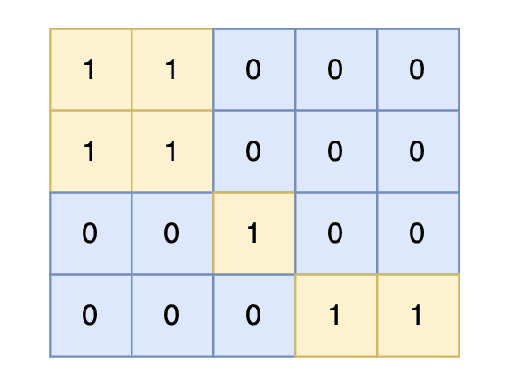
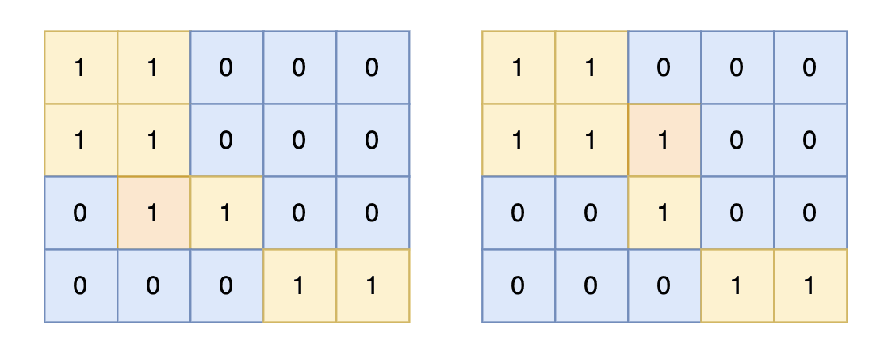
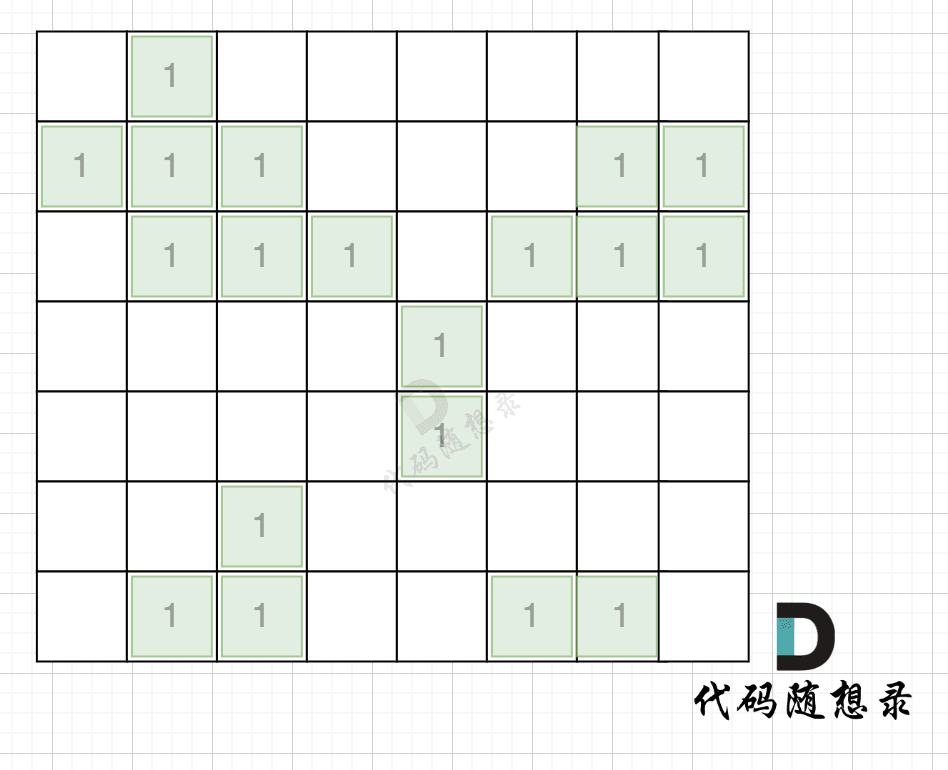
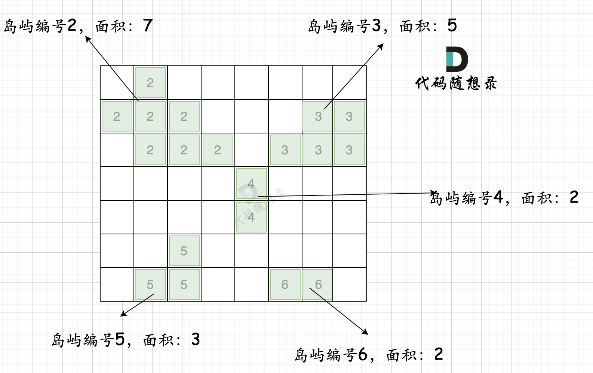
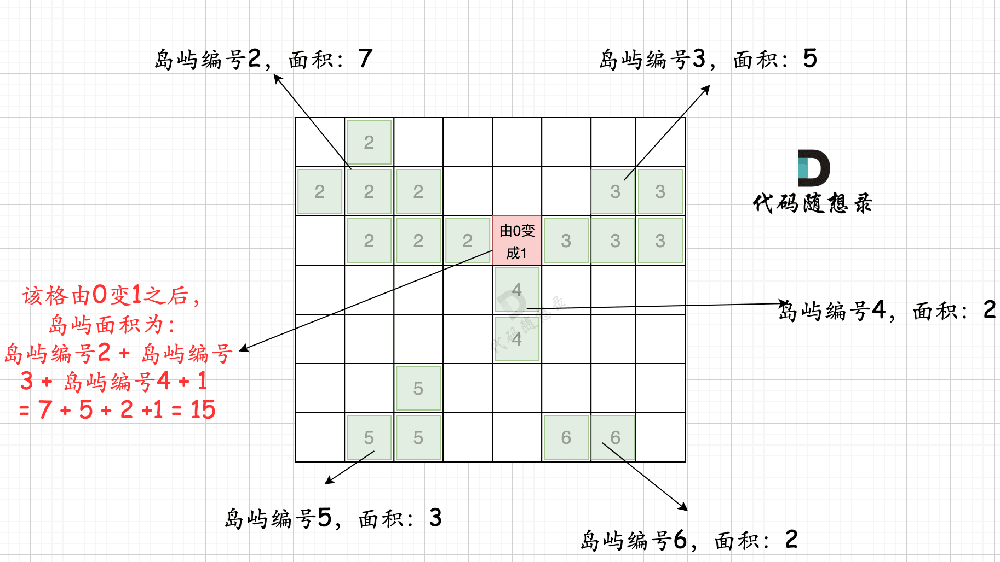

<p align="center"><strong><a href="./qita/join.md">參與本專案</a>，貢獻其他語言版本的程式碼，擁抱開放原始碼（open source），讓更多學習演算法的夥伴們受益！</strong></p>

# 104.建造最大島嶼

[KamaCoder 題目連結（ACM模式）](https://kamacoder.com/problempage.php?pid=1176)

題目描述： 

給定一個由 1（陸地）和 0（水）組成的矩陣（matrix），你最多可以將矩陣中的一格水變為一塊陸地，在執行了此操作之後，矩陣中最大的島嶼面積是多少。

島嶼面積的計算方式為組成島嶼的陸地的總數。島嶼是被水包圍，並且透過水平方向或垂直方向上相鄰的陸地連接而成的。你可以假設矩陣外均被水包圍。

輸入描述： 

第一行包含兩個整數（integer） N, M，表示矩陣的列（row）數和行（column）數。之後 N 列，每列包含 M 個數字，數字為 1 或者 0，表示島嶼的儲存格。

輸出描述：

輸出一個整數，表示最大的島嶼面積。

輸入範例：

```
4 5
1 1 0 0 0
1 1 0 0 0
0 0 1 0 0
0 0 0 1 1
```

輸出範例

6

提示資訊




對於上面的案例，有兩個位置可將 0 變成 1，使得島嶼的面積最大，即 6。




資料範圍：

1 <= M, N <= 50。


## 思路 

**[《程式碼隨想錄》演算法影片公開課](https://programmercarl.com/other/gongkaike.html)：[圖論（graph theory）：島嶼問題上難度了！ | 深度優先搜尋（depth-first search, DFS） | 廣度優先搜尋（breadth-first search, BFS） | KamaCoder：104.建造最大島嶼](https://www.bilibili.com/video/BV1Dn5CzZEw1/),相信結合影片再看本篇題解，更有助於大家對本題的理解**。

本題的一個蠻力（brute force）想法，應該是遍歷（traversal）地圖嘗試將每一個 0 改成 1，然後去搜尋地圖中的最大的島嶼面積。 

計算地圖的最大面積：遍歷地圖 + 深搜島嶼，時間複雜性（time complexity）為 n * n。 

（其實使用深搜還是廣搜都是可以的，其目的就是遍歷島嶼做一個標記，相當於染色，那麼使用哪個遍歷方式都行，以下我用深搜來講解） 

每改變一個 0 的方格，都需要重新計算一個地圖的最大面積，所以整體時間複雜性為：n^4。 

## 最佳化思路  

其實每次深搜遍歷計算最大島嶼面積，我們都做了很多重複的工作。 

只要用一次深搜把每個島嶼的面積記錄下來就好。 

第一步：一次遍歷地圖，得出各個島嶼的面積，並做編號記錄。可以使用 map 記錄，key 為島嶼編號，value 為島嶼面積

第二步：再遍歷地圖，遍歷 0 的方格（因為要將 0 變成 1），並統計該 1（由 0 變成的 1）周邊島嶼面積，將其相鄰面積相加在一起，遍歷所有 0 之後，就可以得出選一個 0 變成 1 之後的最大面積。 

拿如下地圖的島嶼情況來舉例：（1 為陸地）



第一步，則遍歷地圖，並將島嶼的編號和面積都統計好，過程如圖所示： 




本過程程式碼如下：

```CPP 
int dir[4][2] = {0, 1, 1, 0, -1, 0, 0, -1}; // 四個方向
void dfs(vector<vector<int>>& grid, vector<vector<bool>>& visited, int x, int y, int mark) {
    if (visited[x][y] || grid[x][y] == 0) return; // 終止條件：訪問過的節點 或者 遇到海水
    visited[x][y] = true; // 標記訪問過
    grid[x][y] = mark; // 給陸地標記新標籤
    count++;
    for (int i = 0; i < 4; i++) {
        int nextx = x + dir[i][0];
        int nexty = y + dir[i][1];
        if (nextx < 0 || nextx >= grid.size() || nexty < 0 || nexty >= grid[0].size()) continue;  // 越界了，直接跳過
        dfs(grid, visited, nextx, nexty, mark);
    }
}

int largestIsland(vector<vector<int>>& grid) {
    int n = grid.size(), m = grid[0].size();
    vector<vector<bool>> visited = vector<vector<bool>>(n, vector<bool>(m, false)); // 標記訪問過的點
    unordered_map<int ,int> gridNum;
    int mark = 2; // 記錄每個島嶼的編號
    bool isAllGrid = true; // 標記是否整個地圖都是陸地
    for (int i = 0; i < n; i++) {
        for (int j = 0; j < m; j++) {
            if (grid[i][j] == 0) isAllGrid = false;
            if (!visited[i][j] && grid[i][j] == 1) {
                count = 0;
                dfs(grid, visited, i, j, mark); // 將與其連結的陸地都標記上 true
                gridNum[mark] = count; // 記錄每一個島嶼的面積
                mark++; // 記錄下一個島嶼編號
            }
        }
    }
}
```


這個過程時間複雜性 n * n。可能有錄友想：分明是兩個 for 迴圈（for-loop）下面套著一個 dfs，時間複雜性怎麼會是 n * n 呢？ 

其實大家可以仔細看一下程式碼，**n * n 這個方格地圖中，每個節點（node）我們就遍歷一次，並不會重複遍歷**。

第二步過程如圖所示： 



也就是遍歷每一個 0 的方格，並統計其相鄰島嶼面積，最後取一個最大值。 

這個過程的時間複雜性也為 n * n。

所以整個解法的時間複雜性，為 n * n + n * n 也就是 n^2。 

當然這裡還有一個最佳化的點，就是可以不用 visited 陣列（array），因為有 mark 來標記，所以遍歷過的 grid[i][j] 是不等於 1 的。 

程式碼如下：

```CPP
int dir[4][2] = {0, 1, 1, 0, -1, 0, 0, -1}; // 四個方向
void dfs(vector<vector<int>>& grid, int x, int y, int mark) {
    if (grid[x][y] != 1 || grid[x][y] == 0) return; // 終止條件：訪問過的節點 或者 遇到海水
    grid[x][y] = mark; // 給陸地標記新標籤
    count++;
    for (int i = 0; i < 4; i++) {
        int nextx = x + dir[i][0];
        int nexty = y + dir[i][1];
        if (nextx < 0 || nextx >= n || nexty < 0 || nexty >= m) continue;  // 越界了，直接跳過
        dfs(grid, nextx, nexty, mark);
    }
}

int main() {
    cin >> n >> m;
    vector<vector<int>> grid(n, vector<int>(m, 0));

    for (int i = 0; i < n; i++) {
        for (int j = 0; j < m; j++) {
            cin >> grid[i][j];
        }
    }
    unordered_map<int ,int> gridNum;
    int mark = 2; // 記錄每個島嶼的編號
    bool isAllGrid = true; // 標記是否整個地圖都是陸地
    for (int i = 0; i < n; i++) {
        for (int j = 0; j < m; j++) {
            if (grid[i][j] == 0) isAllGrid = false;
            if (grid[i][j] == 1) {
                count = 0;
                dfs(grid, i, j, mark); // 將與其連結的陸地都標記上 true
                gridNum[mark] = count; // 記錄每一個島嶼的面積
                mark++; // 記錄下一個島嶼編號
            }
        }
    }
```

不過為了讓各個變數（variable）各司其事，程式碼清晰一些，完整程式碼還是使用 visited 陣列來標記。

最後，整體程式碼如下： 

```CPP 
#include <iostream>
#include <vector>
#include <unordered_set>
#include <unordered_map>
using namespace std;
int n, m;
int count;

int dir[4][2] = {0, 1, 1, 0, -1, 0, 0, -1}; // 四個方向
void dfs(vector<vector<int>>& grid, vector<vector<bool>>& visited, int x, int y, int mark) {
    if (visited[x][y] || grid[x][y] == 0) return; // 終止條件：訪問過的節點 或者 遇到海水
    visited[x][y] = true; // 標記訪問過
    grid[x][y] = mark; // 給陸地標記新標籤
    count++;
    for (int i = 0; i < 4; i++) {
        int nextx = x + dir[i][0];
        int nexty = y + dir[i][1];
        if (nextx < 0 || nextx >= n || nexty < 0 || nexty >= m) continue;  // 越界了，直接跳過
        dfs(grid, visited, nextx, nexty, mark);
    }
}

int main() {
    cin >> n >> m;
    vector<vector<int>> grid(n, vector<int>(m, 0));

    for (int i = 0; i < n; i++) {
        for (int j = 0; j < m; j++) {
            cin >> grid[i][j];
        }
    }
    vector<vector<bool>> visited(n, vector<bool>(m, false)); // 標記訪問過的點
    unordered_map<int ,int> gridNum;
    int mark = 2; // 記錄每個島嶼的編號
    bool isAllGrid = true; // 標記是否整個地圖都是陸地
    for (int i = 0; i < n; i++) {
        for (int j = 0; j < m; j++) {
            if (grid[i][j] == 0) isAllGrid = false;
            if (!visited[i][j] && grid[i][j] == 1) {
                count = 0;
                dfs(grid, visited, i, j, mark); // 將與其連結的陸地都標記上 true
                gridNum[mark] = count; // 記錄每一個島嶼的面積
                mark++; // 記錄下一個島嶼編號
            }
        }
    }
    if (isAllGrid) {
        cout << n * m << endl; // 如果都是陸地，回傳全面積
        return 0; // 結束程式
    }

    // 以下邏輯是根據添加陸地的位置，計算周邊島嶼面積之和
    int result = 0; // 記錄最後結果
    unordered_set<int> visitedGrid; // 標記訪問過的島嶼
    for (int i = 0; i < n; i++) {
        for (int j = 0; j < m; j++) {
            count = 1; // 記錄連接之後的島嶼數量
            visitedGrid.clear(); // 每次使用時，清空
            if (grid[i][j] == 0) {
                for (int k = 0; k < 4; k++) {
                    int neari = i + dir[k][1]; // 計算相鄰坐標
                    int nearj = j + dir[k][0];
                    if (neari < 0 || neari >= n || nearj < 0 || nearj >= m) continue;
                    if (visitedGrid.count(grid[neari][nearj])) continue; // 添加過的島嶼不要重複添加
                    // 把相鄰四面的島嶼數量加起來
                    count += gridNum[grid[neari][nearj]];
                    visitedGrid.insert(grid[neari][nearj]); // 標記該島嶼已經添加過
                }
            }
            result = max(result, count);
        }
    }
    cout << result << endl;

}
```


## 其他語言版本

### Java 
```Java
public class Main {
    // 該方法採用 DFS
    // 定義總體變數
    // 記錄每次每個島嶼的面積
    static int count;
    // 對每個島嶼進行標記
    static int mark;
    // 定義二維陣列表示四個方位
    static int[][] dirs = {{0, 1}, {0, -1}, {1, 0}, {-1, 0}};

    // DFS 進行搜尋，將每個島嶼標記為不同的數字
    public static void dfs(int[][] grid, int x, int y, boolean[][] visited) {
        // 當遇到邊界，直接 return
        if (x < 0 || x >= grid.length || y < 0 || y >= grid[0].length) return;
        // 遇到已經訪問過的或者遇到海水，直接回傳
        if (visited[x][y] || grid[x][y] == 0) return;

        visited[x][y] = true;
        count++;
        grid[x][y] = mark;

        // 繼續向下層搜尋
        dfs(grid, x, y + 1, visited);
        dfs(grid, x, y - 1, visited);
        dfs(grid, x + 1, y, visited);
        dfs(grid, x - 1, y, visited);
    }

    public static void main (String[] args) {
        // 接收輸入
        Scanner sc = new Scanner(System.in);
        int m = sc.nextInt();
        int n = sc.nextInt();

        int[][] grid = new int[m][n];
        for (int i = 0; i < m; i++) {
            for (int j = 0; j < n; j++) {
                grid[i][j] = sc.nextInt();
            }
        }

        // 初始化 mark 變數，從 2 開始（區別於 0 水，1 島嶼）
        mark = 2;

        // 定義二維 boolean 陣列記錄該位置是否被訪問
        boolean[][] visited = new boolean[m][n];

        // 定義一個 HashMap，記錄某片島嶼的標記號和面積
        HashMap<Integer, Integer> getSize = new HashMap<>();

        // 定義一個 HashSet，用來判斷某一位置水四周是否存在不同標記編號的島嶼
        HashSet<Integer> set = new HashSet<>();

        // 定義一個 boolean 變數，看看 DFS 之後，是否全是島嶼
        boolean isAllIsland = true;

        // 遍歷二維陣列進行 DFS 搜尋，標記每片島嶼的編號，記錄對應的面積
        for (int i = 0; i < m; i++) {
            for (int j = 0; j < n; j++) {
                if (grid[i][j] == 0) isAllIsland = false;
                if (grid[i][j] == 1) {
                    count = 0;
                    dfs(grid, i, j, visited);
                    getSize.put(mark, count);
                    mark++;
                }
            }
        }

        int result = 0;
        if (isAllIsland) result =  m * n;

        // 對標記完的 grid 繼續遍歷，判斷每個水位置四周是否有島嶼，並記錄下四周不同相鄰島嶼面積之和
        // 每次計算完一個水位置周圍可能存在的島嶼面積之和，更新下 result 變數
        for (int i = 0; i < m; i++) {
            for (int j = 0; j < n; j++) {
                if (grid[i][j] == 0) {
                    set.clear();
                    // 當前水位置變更為島嶼，所以初始化為 1
                    int curSize = 1;

                    for (int[] dir : dirs) {
                        int curRow = i + dir[0];
                        int curCol = j + dir[1];

                        if (curRow < 0 || curRow >= m || curCol < 0 || curCol >= n) continue;
                        int curMark = grid[curRow][curCol];
                        // 如果當前相鄰的島嶼已經遍歷過或者 HashMap 中不存在這個編號，繼續搜尋
                        if (set.contains(curMark) || !getSize.containsKey(curMark)) continue;
                        set.add(curMark);
                        curSize += getSize.get(curMark);
                    }

                    result = Math.max(result, curSize);
                }
            }
        }

        // 印出結果
        System.out.println(result);
    }
}

```

### Python


#### BFS
```Python
from typing import List
from collections import defaultdict

class Solution:
    def __init__(self):
        self.direction = [(1,0),(-1,0),(0,1),(0,-1)]
        self.res = 0
        self.count = 0
        self.idx = 1
        self.count_area = defaultdict(int)

    def max_area_island(self, grid: List[List[int]]) -> int:
        if not grid or len(grid) == 0 or len(grid[0]) == 0:
            return 0

        for i in range(len(grid)):
            for j in range(len(grid[0])):
                if grid[i][j] == 1:
                    self.count = 0
                    self.idx += 1
                    self.dfs(grid,i,j)
        # print(grid)
        self.check_area(grid)
        # print(self.count_area)
        
        if self.check_largest_connect_island(grid=grid):
            return self.res + 1
        return max(self.count_area.values())
    
    def dfs(self,grid,row,col):
        grid[row][col] = self.idx
        self.count += 1
        for dr,dc in self.direction:
            _row = dr + row 
            _col = dc + col 
            if 0<=_row<len(grid) and 0<=_col<len(grid[0]) and grid[_row][_col] == 1:
                self.dfs(grid,_row,_col)
        return

    def check_area(self,grid):
        m, n = len(grid), len(grid[0])
        for row in range(m):
            for col in range(n):
                  self.count_area[grid[row][col]] = self.count_area.get(grid[row][col],0) + 1
        return

    def check_largest_connect_island(self,grid):
        m, n = len(grid), len(grid[0])
        has_connect = False
        for row in range(m):
            for col in range(n):
                if grid[row][col] == 0:
                    has_connect = True
                    area = 0
                    visited = set()
                    for dr, dc in self.direction:
                        _row = row + dr 
                        _col = col + dc
                        if 0<=_row<len(grid) and 0<=_col<len(grid[0]) and grid[_row][_col] != 0 and grid[_row][_col] not in visited:
                            visited.add(grid[_row][_col])
                            area += self.count_area[grid[_row][_col]]
                            self.res = max(self.res, area)
                            
        return has_connect


def main():
    m, n = map(int, input().split())
    grid = []

    for i in range(m):
        grid.append(list(map(int,input().split())))

    
    sol = Solution()
    print(sol.max_area_island(grid))

if __name__ == '__main__':
    main()
```


```Python
import collections

directions = [[-1, 0], [0, 1], [0, -1], [1, 0]]
area = 0

def dfs(i, j, grid, visited, num):
    global area
    
    if visited[i][j]:
        return

    visited[i][j] = True
    grid[i][j] = num  # 標記島嶼號碼
    area += 1
    
    for x, y in directions:
        new_x = i + x
        new_y = j + y
        if (
            0 <= new_x < len(grid)
            and 0 <= new_y < len(grid[0])
            and grid[new_x][new_y] == "1"
        ):
            dfs(new_x, new_y, grid, visited, num)
    

def main():
    global area
    
    N, M = map(int, input().strip().split())
    grid = []
    for i in range(N):
        grid.append(input().strip().split())
    visited = [[False] * M for _ in range(N)]
    rec = collections.defaultdict(int)
    
    cnt = 2
    for i in range(N):
        for j in range(M):
            if grid[i][j] == "1":
                area = 0
                dfs(i, j, grid, visited, cnt)
                rec[cnt] = area  # 記錄島嶼面積
                cnt += 1
    
    res = 0
    for i in range(N):
        for j in range(M):
            if grid[i][j] == "0":
                max_island = 1  # 將水變為陸地，故從 1 開始計數
                v = set()
                for x, y in directions:
                    new_x = i + x
                    new_y = j + y
                    if (
                        0 <= new_x < len(grid)
                        and 0 <= new_y < len(grid[0])
                        and grid[new_x][new_y] != "0"
                        and grid[new_x][new_y] not in v  # 島嶼不可重複
                    ):
                        max_island += rec[grid[new_x][new_y]]
                        v.add(grid[new_x][new_y])
                res = max(res, max_island)

    if res == 0:
        return max(rec.values())  # 無水的情況
    return res
    
if __name__ == "__main__":
    print(main())
```

### Go

```go
package main

import "fmt"

func main() {
    var m, n int
    fmt.Scan(&m, &n)

    grid := make([][]int, m)
    for i := range grid {
        grid[i] = make([]int, n)
        for j := range grid[i] {
            fmt.Scan(&grid[i][j])
        }
    }

    sum := buildMaxIsland(grid)
    fmt.Println(sum)
}


func buildMaxIsland(grid [][]int) int {
	result := 0
	if grid == nil || len(grid) == 0 {
		return result
	}
	hashMap := make(map[int]int)
	islandArea := 0
	gridMark := 2
	for i := 0; i < len(grid); i++ {
		for j := 0; j < len(grid[0]); j++ {
			if grid[i][j] == 1 {
				islandArea = 0
				visitGrid4(grid, i, j, &islandArea, gridMark)
				hashMap[gridMark] = islandArea
				if islandArea > result {
					result = islandArea
				}
				gridMark++
			}
		}
	}

	for i := 0; i < len(grid); i++ {
		for j := 0; j < len(grid[0]); j++ {
			if grid[i][j] == 0 {
				sum := findNearByIsland(grid, i, j, hashMap)
				if sum > result {
					result = sum
				}
			}
		}
	}

	return result
}

func visitGrid4(grid [][]int, x int, y int, preValue *int, gridMark int) {
	if x < 0 || y < 0 || x >= len(grid) || y >= len(grid[0]) {
		return
	}
	//可以省略掉 visited 的原因是因為 grid 的每個位置如果被遍歷過就會被標記為 gridMark，能識別出來是不是被遍歷過
	if grid[x][y] != 1 {
		return
	}
	// visited[x][y] = true
	grid[x][y] = gridMark
	*preValue++
	visitGrid4(grid, x+1, y, preValue, gridMark)
	visitGrid4(grid, x-1, y, preValue, gridMark)
	visitGrid4(grid, x, y+1, preValue, gridMark)
	visitGrid4(grid, x, y-1, preValue, gridMark)
}

func findNearByIsland(grid [][]int, x, y int, hashMap map[int]int) int {
	markSet := make(map[int]bool)
	sum := 1
	coordinate := [][]int{{x + 1, y}, {x - 1, y}, {x, y + 1}, {x, y - 1}}
	for _, arr := range coordinate {
		if arr[0] < 0 || arr[1] < 0 || arr[0] >= len(grid) || arr[1] >= len(grid[0]) {
			continue
		}
		if grid[arr[0]][arr[1]] == 0 {
			continue
		}
		gridMark := grid[arr[0]][arr[1]]
		if !markSet[gridMark] {
			markSet[gridMark] = true
			sum += hashMap[gridMark]
		}
	}
	return sum
}
```


### Rust

### JavaScript

```javascript
const r1 = require('readline').createInterface({ input: process.stdin });
// 建立 readline 介面
let iter = r1[Symbol.asyncIterator]();
// 建立非同步疊代器
const readline = async () => (await iter.next()).value;

let graph // 地圖
let N, M // 地圖大小
let visited // 訪問過的節點, 標記島嶼
const dir = [[0, 1], [1, 0], [0, -1], [-1, 0]] //方向

let count = 0 // 統計島嶼面積
let areaMap = new Map() // 儲存島嶼面積


// 讀取輸入，初始化地圖
const initGraph = async () => {
  let line = await readline();
  [N, M] = line.split(' ').map(Number);
  graph = new Array(N).fill(0).map(() => new Array(M).fill(0))
  visited = new Array(N).fill(0).map(() => new Array(M).fill(0))

  for (let i = 0; i < N; i++) {
    line = await readline()
    line = line.split(' ').map(Number)
    for (let j = 0; j < M; j++) {
      graph[i][j] = line[j]
    }
  }
}

/**
 * @description: 從（x，y）開始深度優先遍歷地圖
 * @param {*} graph 地圖
 * @param {*} visited 可訪問節點
 * @param {*} x 開始搜尋節點的下標
 * @param {*} y 開始搜尋節點的下標
 * @param {*} mark 當前島嶼的標記
 * @return {*}
 */
const dfs = (graph, visited, x, y, mark) => {
  if (visited[x][y] != 0) return
  visited[x][y] = mark
  count++

  for (let i = 0; i < 4; i++) {
    let nextx = x + dir[i][0]
    let nexty = y + dir[i][1]
    if (nextx < 0 || nextx >= N || nexty < 0 || nexty >= M) continue //越界, 跳過

    // 已訪問過, 或者是海洋, 跳過
    if (visited[nextx][nexty] != 0 || graph[nextx][nexty] == 0) continue

    dfs(graph, visited, nextx, nexty, mark)
  }
}

(async function () {

  // 讀取輸入，初始化地圖
  await initGraph()

  let isAllLand = true //標記整個地圖都是陸地

  let mark = 2 // 標記島嶼
  for (let i = 0; i < N; i++) {
    for (let j = 0; j < M; j++) {
      if (graph[i][j] == 0 && isAllLand) isAllLand = false
      if (graph[i][j] === 1 && visited[i][j] === 0) {
        count = 0
        dfs(graph, visited, i, j, mark)
        areaMap.set(mark, count)
        mark++
      }
    }
  }

  // 如果全是陸地, 直接回傳面積
  if (isAllLand) {
    console.log(N * M);
    return
  }

  let result = 0  // 記錄最後結果
  let visitedIsland = new Map() //標記訪問過的島嶼, 因為海洋四周可能是同一個島嶼, 需要標記避免重複統計面積
  for (let i = 0; i < N; i++) {
    for (let j = 0; j < M; j++) {
      if (visited[i][j] === 0) {
        count = 1  // 記錄連接之後的島嶼數量
        visitedIsland.clear()  // 每次使用時，清空

        // 計算海洋周圍島嶼面積
        for (let m = 0; m < 4; m++) {
          const nextx = i + dir[m][0]
          const nexty = j + dir[m][1]
          if (nextx < 0 || nextx >= N || nexty < 0 || nexty >= M) continue //越界, 跳過

          const island = visited[nextx][nexty]
          if (island == 0 || visitedIsland.get(island)) continue// 四周是海洋或者訪問過的陸地 跳過

          // 標記為訪問, 計算面積
          visitedIsland.set(island, true)
          count += areaMap.get(visited[nextx][nexty])
        }

        result = Math.max(result, count)
      }
    }
  }

  console.log(result);
})()
```


### TypeScript

### PhP

### Swift

### Scala

### C#

### Dart

### C

