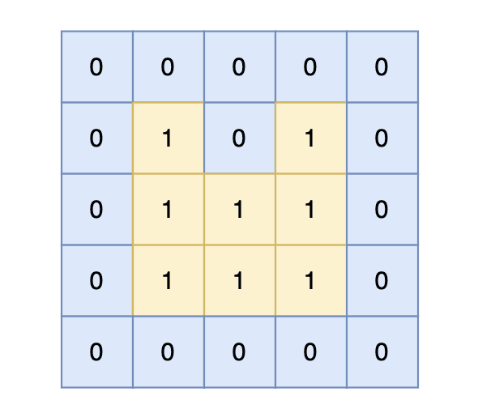
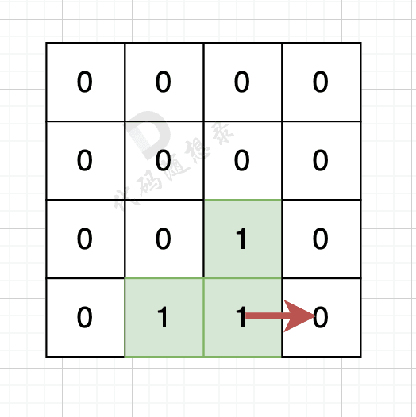
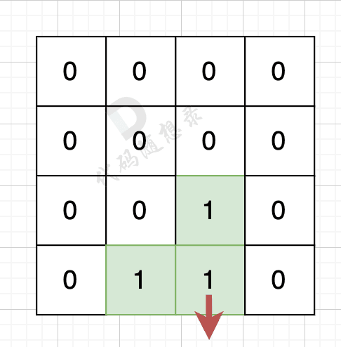
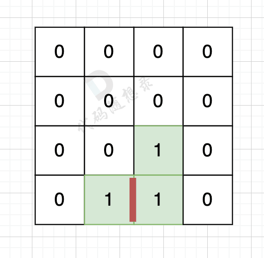

<p align="center"><strong><a href="./qita/join.md">參與本專案</a>，貢獻其他語言版本的程式碼，擁抱開放原始碼（open source），讓更多學習演算法的夥伴們受益！</strong></p>

# 106. 海岸線計算

[KamaCoder 題目連結（ACM模式）](https://kamacoder.com/problempage.php?pid=1178)

題目描述

給定一個由 1（陸地）和 0（水）組成的矩陣（matrix），島嶼是被水包圍，並且透過水平方向或垂直方向上相鄰的陸地連接而成的。


你可以假設矩陣外均被水包圍。在矩陣中恰好擁有一個島嶼，假設組成島嶼的陸地邊長都為 1，請計算島嶼的周長。島嶼內部沒有水域。

輸入描述

第一行包含兩個整數（integer） N, M，表示矩陣的列（row）數和行（column）數。之後 N 列，每列包含 M 個數字，數字為 1 或者 0，表示島嶼的儲存格。

輸出描述

輸出一個整數，表示島嶼的周長。

輸入範例

```
5 5
0 0 0 0 0
0 1 0 1 0
0 1 1 1 0
0 1 1 1 0
0 0 0 0 0
```

輸出範例

14

提示資訊 

 

島嶼的周長為 14。

資料範圍：

1 <= M, N <= 50。

## 思路

**[《程式碼隨想錄》演算法影片公開課](https://programmercarl.com/other/gongkaike.html)：[圖論（graph theory）：這次的島嶼問題有點簡單了。。 KamaCoder：106.島嶼的周長](https://www.bilibili.com/video/BV13fjczSEyV),相信結合影片再看本篇題解，更有助於大家對本題的理解**。

島嶼問題最容易讓人想到 廣度優先搜尋（breadth-first search, BFS） 或者 深度優先搜尋（depth-first search, DFS），但本題確實還用不上。 

為了避免大家慣性思維，所以給大家安排了這道題目。 

### 解法一：

遍歷（traversal）每一個空格，遇到島嶼則計算其上下左右的空格情況。

如果該陸地上下左右的空格是有水域，則說明是一條邊（edge），如圖：  

 

陸地的右邊空格是水域，則說明找到一條邊。 


如果該陸地上下左右的空格出界了，則說明是一條邊，如圖：   

 

該陸地的下邊空格出界了，則說明找到一條邊。 


C++ 程式碼如下：（詳細註解）

```CPP
#include <iostream>
#include <vector>
using namespace std;
int main() {
    int n, m;
    cin >> n >> m;
    vector<vector<int>> grid(n, vector<int>(m, 0));
    for (int i = 0; i < n; i++) {
        for (int j = 0; j < m; j++) {
            cin >> grid[i][j];
        }
    }
    int direction[4][2] = {0, 1, 1, 0, -1, 0, 0, -1};
    int result = 0;
    for (int i = 0; i < n; i++) {
        for (int j = 0; j < m; j++) {
            if (grid[i][j] == 1) {
                for (int k = 0; k < 4; k++) {       // 上下左右四個方向
                    int x = i + direction[k][0];
                    int y = j + direction[k][1];    // 計算周邊坐標 x,y
                    if (x < 0                       // x 在邊界上
                            || x >= grid.size()     // x 在邊界上
                            || y < 0                // y 在邊界上
                            || y >= grid[0].size()  // y 在邊界上
                            || grid[x][y] == 0) {   // x,y 位置是水域
                        result++;
                    }
                }
            }
        }
    }
    cout << result << endl;

}
```

### 解法二：

計算出總的島嶼數量，總的邊數為：島嶼數量 * 4

因為有一對相鄰兩個陸地，邊的總數就要減 2，如圖紅線部分，有兩個陸地相鄰，總邊數就要減 2



那麼只需要再計算出相鄰島嶼的數量就可以了，相鄰島嶼數量為 cover。

結果 result = 島嶼數量 * 4 - cover * 2;

C++ 程式碼如下：（詳細註解）

```CPP
#include <iostream>
#include <vector>
using namespace std;
int main() {
    int n, m;
    cin >> n >> m;
    vector<vector<int>> grid(n, vector<int>(m, 0));
    for (int i = 0; i < n; i++) {
        for (int j = 0; j < m; j++) {
            cin >> grid[i][j];
        }
    }
    int sum = 0;    // 陸地數量
    int cover = 0;  // 相鄰數量
    for (int i = 0; i < n; i++) {
        for (int j = 0; j < m; j++) {
            if (grid[i][j] == 1) {
                sum++; // 統計總的陸地數量
                // 統計上邊相鄰陸地
                if(i - 1 >= 0 && grid[i - 1][j] == 1) cover++;
                // 統計左邊相鄰陸地
                if(j - 1 >= 0 && grid[i][j - 1] == 1) cover++;
                // 為什麼沒統計下邊和右邊？ 因為避免重複計算
            }
        }
    }

    cout << sum * 4 - cover * 2 << endl;

}
```

## 其他語言版本

### Java
```Java
import java.util.*;

public class Main {
    // 每次遍歷到 1，探索其周圍 4 個方向，並記錄周長，最終合計
    // 宣告全域變數，dirs 表示 4 個方向
    static int[][] dirs = {{1, 0}, {-1, 0}, {0, 1}, {0, -1}};
    // 統計每單個 1 的周長
    static int count;
    
    // 探索其周圍 4 個方向，並記錄周長
    public static void helper(int[][] grid, int x, int y) {
        for (int[] dir : dirs) {
            int nx = x + dir[0];
            int ny = y + dir[1];
            
            // 遇到邊界或者水，周長加一
            if (nx < 0 || nx >= grid.length || ny < 0 || ny >= grid[0].length
                || grid[nx][ny] == 0) {
                count++;
            }
        }
    }

    public static void main(String[] args) {
        Scanner sc = new Scanner(System.in);
        
        // 接收輸入
        int M = sc.nextInt();
        int N = sc.nextInt();

        int[][] grid = new int[M][N];
        for (int i = 0; i < M; i++) {
            for (int j = 0; j < N; j++) {
                grid[i][j] = sc.nextInt();
            }
        }

        int result = 0; // 總周長
        for (int i = 0; i < M; i++) {
            for (int j = 0; j < N; j++) {
                if (grid[i][j] == 1) {
                    count = 0;
                    helper(grid, i, j);
                    // 更新總周長
                    result += count;
                }
            }
        }
        
        // 印出結果
        System.out.println(result);
    }
}
```

### Python

```python

def main():
    import sys
    input = sys.stdin.read
    data = input().split()
    
    # 讀取 n 和 m
    n = int(data[0])
    m = int(data[1])
    
    # 初始化 grid
    grid = []
    index = 2
    for i in range(n):
        grid.append([int(data[index + j]) for j in range(m)])
        index += m
    
    sum_land = 0    # 陸地數量
    cover = 0       # 相鄰數量

    for i in range(n):
        for j in range(m):
            if grid[i][j] == 1:
                sum_land += 1
                # 統計上邊相鄰陸地
                if i - 1 >= 0 and grid[i - 1][j] == 1:
                    cover += 1
                # 統計左邊相鄰陸地
                if j - 1 >= 0 and grid[i][j - 1] == 1:
                    cover += 1
                # 不統計下邊和右邊，避免重複計算
    
    result = sum_land * 4 - cover * 2
    print(result)

if __name__ == "__main__":
    main()


```

### Go

```go

package main

import (
	"bufio"
	"fmt"
	"os"
	"strconv"
	"strings"
)

func main() {
	scanner := bufio.NewScanner(os.Stdin)
	scanner.Scan()
	line := scanner.Text()
	
	n, m := parseInput(line)

	// 初始化 grid
	grid := make([][]int, n)
	for i := range grid {
		grid[i] = make([]int, m)
	}

	// 讀入 grid 資料
	for i := 0; i < n; i++ {
		scanner.Scan()
		line := scanner.Text()
		values := parseLine(line, m)
		for j := 0; j < m; j++ {
			grid[i][j] = values[j]
		}
	}

	sum := 0   // 陸地數量
	cover := 0 // 相鄰數量

	for i := 0; i < n; i++ {
		for j := 0; j < m; j++ {
			if grid[i][j] == 1 {
				sum++ // 統計總的陸地數量

				// 統計上邊相鄰陸地
				if i-1 >= 0 && grid[i-1][j] == 1 {
					cover++
				}
				// 統計左邊相鄰陸地
				if j-1 >= 0 && grid[i][j-1] == 1 {
					cover++
				}
				// 為什麼沒統計下邊和右邊？ 因為避免重複計算
			}
		}
	}

	fmt.Println(sum*4 - cover*2)
}

// parseInput 解析 n 和 m
func parseInput(line string) (int, int) {
	parts := strings.Split(line, " ")
	n, _ := strconv.Atoi(parts[0])
	m, _ := strconv.Atoi(parts[1])
	return n, m
}

// parseLine 解析一行中的多個值
func parseLine(line string, count int) []int {
	parts := strings.Split(line, " ")
	values := make([]int, count)
	for i := 0; i < count; i++ {
		values[i], _ = strconv.Atoi(parts[i])
	}
	return values
}


```


### Rust

### JavaScript

### TypeScript

### PhP

### Swift

### Scala

### C#

### Dart

### C

