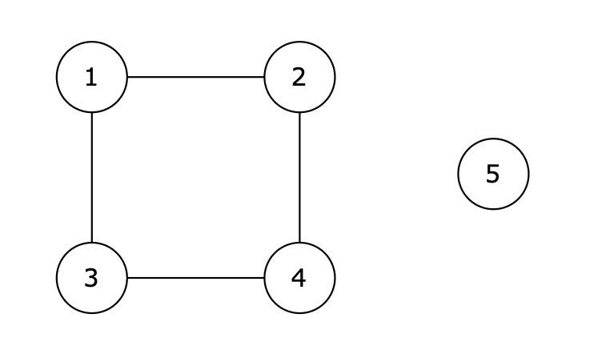

<p align="center"><strong><a href="./qita/join.md">參與本專案</a>，貢獻其他語言版本的程式碼，擁抱開放原始碼（open source），讓更多學習演算法的夥伴們受益！</strong></p>

# 107. 尋找存在的路線

[KamaCoder 題目連結（ACM模式）](https://kamacoder.com/problempage.php?pid=1179)

題目描述

給定一個包含 n 個節點（node）的無向圖（undirected graph）中，節點編號從 1 到 n （含 1 和 n ）。

你的任務是判斷是否有一條從節點 source 出發到節點 destination 的路徑（path）存在。

輸入描述

第一行包含兩個正整數（positive integer） N 和 M，N 代表節點的個數，M 代表邊（edge）的個數。 

後續 M 行，每行兩個正整數 s 和 t，代表從節點 s 與節點 t 之間有一條邊。

最後一行包含兩個正整數，代表起始節點 source 和目標節點 destination。

輸出描述

輸出一個整數（integer），代表是否存在從節點 source 到節點 destination 的路徑。如果存在，輸出 1；否則，輸出 0。

輸入範例

```
5 4
1 2
1 3
2 4
3 4
1 4
```

輸出範例

1

提示資訊



資料範圍：

1 <= M, N <= 100。

## 思路

**[《程式碼隨想錄》演算法影片公開課](https://programmercarl.com/other/gongkaike.html)：[圖論（graph theory）：沒想到互斥集（disjoint set）這麼簡單 ！](https://www.bilibili.com/video/BV1k3T7zWEVj),相信結合影片再看本篇題解，更有助於大家對本題的理解**。

本題是互斥集基礎題目。如果還不了解互斥集，可以看這裡：[互斥集理論基礎](./圖論並查集理論基礎.md)

互斥集可以解決什麼問題呢？

主要就是集合（set）問題，**兩個節點在不在一個集合，也可以將兩個節點添加到一個集合中**。

這裡整理出我的互斥集模板（template）如下：

```CPP
int n = 1005; // n 根據題目中節點數量而定，一般比節點數量大一點就好
vector<int> father = vector<int> (n, 0); // C++ 裡的一種陣列結構

// 互斥集初始化
void init() {
    for (int i = 0; i < n; ++i) {
        father[i] = i;
    }
}
// 互斥集裡尋根的過程
int find(int u) {
    return u == father[u] ? u : father[u] = find(father[u]); // 路徑壓縮
}

// 判斷 u 和 v 是否找到同一個根
bool isSame(int u, int v) {
    u = find(u);
    v = find(v);
    return u == v;
}

// 將 v->u 這條邊加入互斥集
void join(int u, int v) {
    u = find(u); // 尋找 u 的根
    v = find(v); // 尋找 v 的根
    if (u == v) return ; // 如果發現根相同，則說明在一個集合，不用兩個節點相連直接回傳
    father[v] = u;
}
```

以上模板中，只要修改 n 大小就可以。

互斥集主要有三個功能：

1. 尋找根節點（root node），函數（function）：find(int u)，也就是判斷這個節點的上代節點（ancestor node）是哪個
2. 將兩個節點串接到同一個集合，函數：join(int u, int v)，將兩個節點連在同一個根節點上
3. 判斷兩個節點是否在同一個集合，函數：isSame(int u, int v)，就是判斷兩個節點是不是同一個根節點

簡單介紹互斥集之後，我們再來看一下這道題目。

為什麼說這道題目是互斥集基礎題目，題目中各個點是 bidirectional graph 連結，那麼判斷一個頂點（vertex）到另一個頂點有沒有有效路徑其實就是看這兩個頂點是否在同一個集合裡。

如何算是同一個集合呢，有邊連在一起，就算是一個集合。

此時我們就可以直接套用互斥集模板。

使用 join(int u, int v) 將每條邊加入到互斥集。

最後 isSame(int u, int v) 判斷是否是同一個根就可以了。

C++ 程式碼如下：

```CPP
#include <iostream>
#include <vector>
using namespace std;

int n; // 節點數量
vector<int> father = vector<int> (101, 0); // 按照節點大小定義陣列大小

// 互斥集初始化
void init() {
    for (int i = 1; i <= n; i++)  father[i] = i;
}
// 互斥集裡尋根的過程
int find(int u) {
    return u == father[u] ? u : father[u] = find(father[u]);
}

// 判斷 u 和 v 是否找到同一個根
bool isSame(int u, int v) {
    u = find(u);
    v = find(v);
    return u == v;
}

// 將 v->u 這條邊加入互斥集
void join(int u, int v) {
    u = find(u); // 尋找 u 的根
    v = find(v); // 尋找 v 的根
    if (u == v) return ; // 如果發現根相同，則說明在一個集合，不用兩個節點相連直接回傳
    father[v] = u;
}

int main() {
    int m, s, t, source, destination;
    cin >> n >> m;
    init();
    while (m--) {
        cin >> s >> t;
        join(s, t);
    }
    cin >> source >> destination;
    if (isSame(source, destination)) cout << 1 << endl;
    else cout << 0 << endl;
}
```


## 其他語言版本

### Java

```Java

import java.util.*;
 
public class Main{
    public static void main(String[] args) {
        int N, M;
        Scanner scanner = new Scanner(System.in);
        N = scanner.nextInt();
        M = scanner.nextInt();
        DisJoint disJoint = new DisJoint(N + 1);
        for (int i = 0; i < M; ++i) {
            disJoint.join(scanner.nextInt(), scanner.nextInt());
        }
        if(disJoint.isSame(scanner.nextInt(), scanner.nextInt())) {
            System.out.println("1");
        } else {
            System.out.println("0");
        }
    }
 
}

//互斥集模板
class DisJoint{
    private int[] father;
 
    public DisJoint(int N) {
        father = new int[N];
        for (int i = 0; i < N; ++i){
            father[i] = i;
        }
    }
 
    public int find(int n) {
        return n == father[n] ? n : (father[n] = find(father[n]));
    }
 
    public void join (int n, int m) {
        n = find(n);
        m = find(m);
        if (n == m) return;
        father[m] = n;
    }
 
    public boolean isSame(int n, int m){
        n = find(n);
        m = find(m);
        return n == m;
    }
 
}

```

### Python

```python

class UnionFind:
    def __init__(self, size):
        self.parent = list(range(size + 1))  # 初始化互斥集

    def find(self, u):
        if self.parent[u] != u:
            self.parent[u] = self.find(self.parent[u])  # 路徑壓縮
        return self.parent[u]

    def union(self, u, v):
        root_u = self.find(u)
        root_v = self.find(v)
        if root_u != root_v:
            self.parent[root_v] = root_u

    def is_same(self, u, v):
        return self.find(u) == self.find(v)


def main():
    import sys
    input = sys.stdin.read
    data = input().split()
    
    index = 0
    n = int(data[index])
    index += 1
    m = int(data[index])
    index += 1
    
    uf = UnionFind(n)
    
    for _ in range(m):
        s = int(data[index])
        index += 1
        t = int(data[index])
        index += 1
        uf.union(s, t)
    
    source = int(data[index])
    index += 1
    destination = int(data[index])
    
    if uf.is_same(source, destination):
        print(1)
    else:
        print(0)

if __name__ == "__main__":
    main()


```


### Go

```go

package main

import (
    "fmt"
)

const MaxNodes = 101

var n int
var father [MaxNodes]int

// 初始化互斥集
func initialize() {
    for i := 1; i <= n; i++ {
        father[i] = i
    }
}

// 互斥集裡尋根的過程
func find(u int) int {
    if u == father[u] {
        return u
    }
    father[u] = find(father[u])
    return father[u]
}

// 判斷 u 和 v 是否找到同一個根
func isSame(u, v int) bool {
    return find(u) == find(v)
}

// 將 v->u 這條邊加入互斥集
func join(u, v int) {
    rootU := find(u)
    rootV := find(v)
    if rootU != rootV {
        father[rootV] = rootU
    }
}

func main() {
    var m, s, t, source, destination int
    fmt.Scan(&n, &m)
    initialize()
    for i := 0; i < m; i++ {
        fmt.Scan(&s, &t)
        join(s, t)
    }
    fmt.Scan(&source, &destination)
    if isSame(source, destination) {
        fmt.Println(1)
    } else {
        fmt.Println(0)
    }
}


```

### Rust

### JavaScript

```java
const r1 = require('readline').createInterface({ input: process.stdin });
// 建立 readline 介面
let iter = r1[Symbol.asyncIterator]();
// 建立非同步疊代器
const readline = async () => (await iter.next()).value;


let N, M // 節點數和邊數
let source, destination // 起點 終點
let father = []  // 互斥集


// 互斥集初始化
const init = () => {
  for (let i = 1; i <= N; i++)  father[i] = i;
}

// 互斥集裡尋根的過程
const find = (u) => {
  return u == father[u] ? u : father[u] = find(father[u])
}

// 將 v->u 這條邊加入互斥集
const join = (u, v) => {
  u = find(u)
  v = find(v)
  if (u == v) return // 如果發現根相同，則說明在一個集合，不用兩個節點相連直接回傳
  father[v] = u
}

// 判斷 u 和 v 是否找到同一個根
const isSame = (u, v) => {
  u = find(u)
  v = find(v)
  return u == v
}


(async function () {
  // 讀取第一行輸入
  let line = await readline();
  [N, M] = line.split(' ').map(Number);

  // 初始化互斥集
  father = new Array(N)
  init()

  // 讀取邊資訊, 加入互斥集
  for (let i = 0; i < M; i++) {
    line = await readline()
    line = line.split(' ').map(Number)
    join(line[0], line[1])
  }

  // 讀取起點和終點
  line = await readline(); //JS 注意這裡的冒號
  [source, destination] = line.split(' ').map(Number)

  if (isSame(source, destination)) return console.log(1);
  console.log(0);
})()
```


### TypeScript

### PhP

### Swift

### Scala

### C#

### Dart

### C

