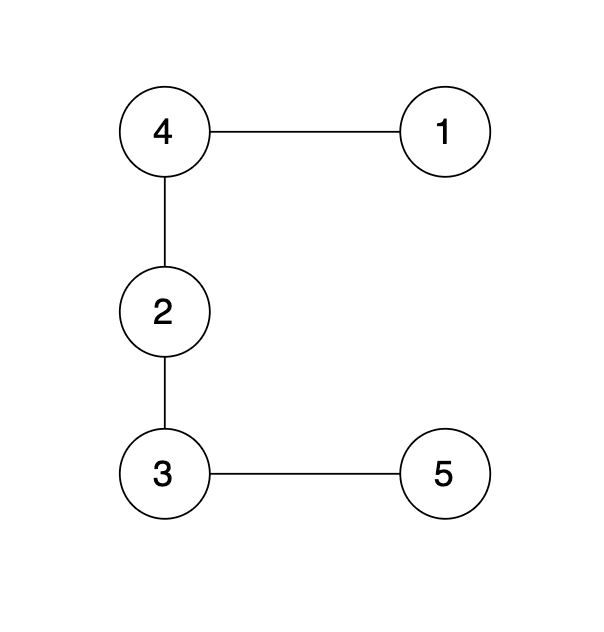
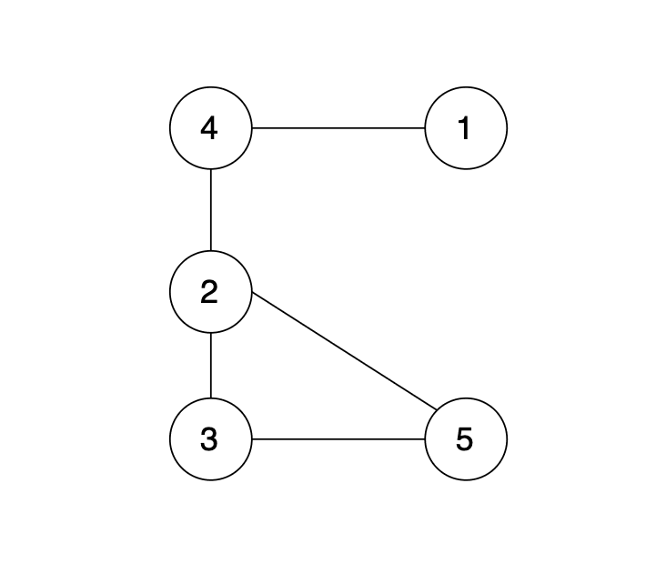
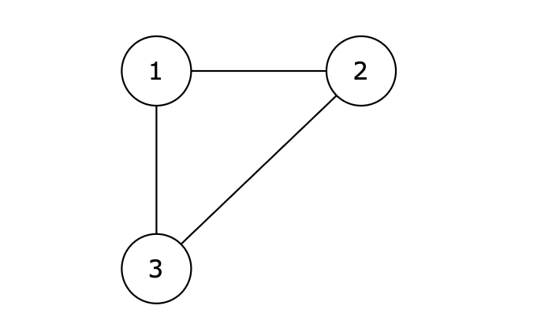
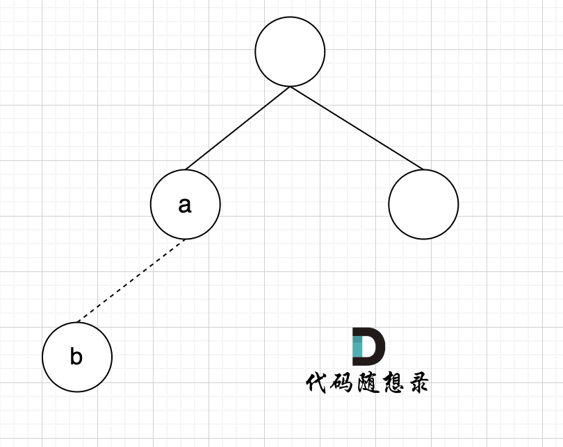
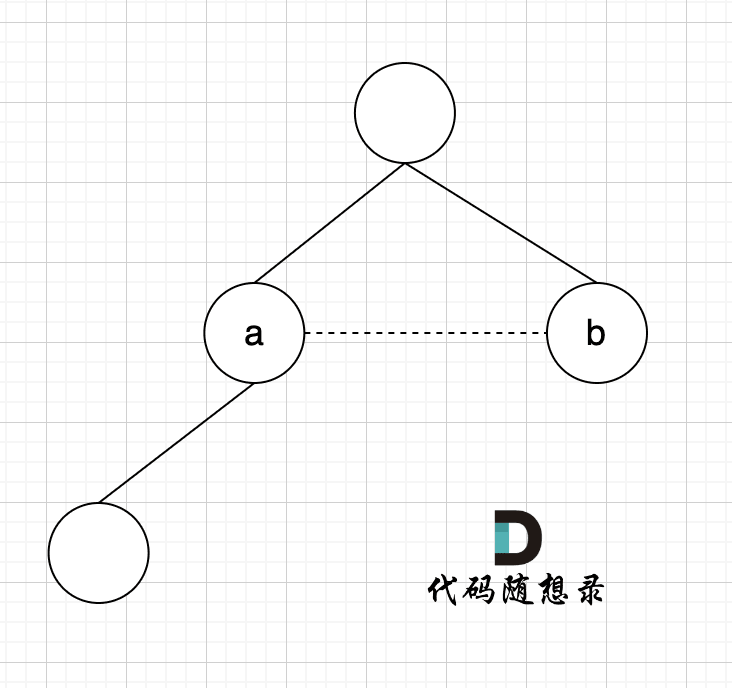

<p align="center"><strong><a href="./qita/join.md">參與本專案</a>，貢獻其他語言版本的程式碼，擁抱開放原始碼（open source），讓更多學習演算法的夥伴們受益！</strong></p>

# 108. 多餘的邊

[KamaCoder 題目連結（ACM模式）](https://kamacoder.com/problempage.php?pid=1181)

題目描述

有一個圖（graph），它是一棵樹（tree），它是擁有 n 個節點（node）（節點編號 1 到 n）和 n - 1 條邊（edge）的連接無環無向圖（connected acyclic undirected graph）（其實就是一個 linear graph），如圖：



現在在這棵樹的基礎上，添加一條邊（依然是 n 個節點，但有 n 條邊），使這個圖變成了循環圖（cyclic graph），如圖



先請你找出冗餘（redundant）邊，刪除後，使該圖可以重新變成一棵樹。

輸入描述

第一行包含一個整數（integer） N，表示圖的節點個數和邊的個數。

後續 N 行，每行包含兩個整數 s 和 t，表示圖中 s 和 t 之間有一條邊。

輸出描述

輸出一條可以刪除的邊。如果有多個答案，請刪除標準輸入（standard input）中最後出現的那條邊。

輸入範例

```
3
1 2
2 3
1 3
```

輸出範例

1 3

提示資訊



圖中的 1 2，2 3，1 3 等三條邊在刪除後都能使原圖變為一棵合法的樹。但是 1 3 由於是標準輸入裡最後出現的那條邊，所以輸出結果為 1 3

資料範圍：

1 <= N <= 1000.

## 思路

**[《程式碼隨想錄》演算法影片公開課](https://programmercarl.com/other/gongkaike.html)：[圖論（graph theory）：互斥集（disjoint set）有點不簡單了。。](https://www.bilibili.com/video/BV1gRM3z9EwZ),相信結合影片再看本篇題解，更有助於大家對本題的理解**。

這道題目也是互斥集基礎題目。

這裡我依然強調一下，互斥集可以解決什麼問題：兩個節點是否在一個集合（set），也可以將兩個節點添加到一個集合中。

如果還不了解互斥集，可以看這裡：[互斥集理論基礎](./圖論並查集理論基礎.md)

我們再來看一下這道題目。

題目說是無向圖（undirected graph），回傳一條可以刪去的邊，使得結果圖是一個有著 N 個節點的樹（即：只有一個根節點（root node））。

如果有多個答案，則回傳二維（2D）陣列（array）中最後出現的邊。

那麼我們就可以從前向後遍歷（traversal）每一條邊（因為優先讓前面的邊連上），邊的兩個節點如果不在同一個集合，就加入集合（即：同一個根節點）。


如圖所示，節點 A 和節點 B 不在同一個集合，那麼就可以將兩個節點連在一起。



如果邊的兩個節點已經出現在同一個集合裡，說明這條邊的兩個節點已經連在一起了，再加入這條邊一定就出現環了。

如圖所示： 



已經判斷節點 A 和節點 B 在同一個集合（同一個根），如果將節點 A 和節點 B 連在一起就一定會出現環。 

這個思路清晰之後，程式碼就很好寫了。

互斥集 C++ 程式碼如下：

```CPP
#include <iostream>
#include <vector>
using namespace std;
int n; // 節點數量
vector<int> father(1001, 0); // 按照節點大小範圍定義陣列

// 互斥集初始化
void init() {
    for (int i = 0; i <= n; ++i) {
        father[i] = i;
    }
}
// 互斥集裡尋根的過程
int find(int u) {
    return u == father[u] ? u : father[u] = find(father[u]);
}
// 判斷 u 和 v 是否找到同一個根
bool isSame(int u, int v) {
    u = find(u);
    v = find(v);
    return u == v;
}
// 將 v->u 這條邊加入互斥集
void join(int u, int v) {
    u = find(u); // 尋找 u 的根
    v = find(v); // 尋找 v 的根
    if (u == v) return ; // 如果發現根相同，則說明在一個集合，不用兩個節點相連直接回傳
    father[v] = u;
}

int main() {
    int s, t;
    cin >> n;
    init();
    for (int i = 0; i < n; i++) {
        cin >> s >> t;
        if (isSame(s, t)) {
            cout << s << " " << t << endl;
            return 0;
        } else {
            join(s, t);
        }
    }
}
```

可以看出，主函數的程式碼很少，就判斷一下邊的兩個節點在不在同一個集合就可以了。

## 拓展 

題目要求「請刪除 standard input 中最後出現的那條邊」，不少錄友疑惑，這程式碼分明是遇到在同一個根的兩個節點立刻就回傳了，怎麼就求出最後出現的那條邊了呢。 

有這種疑惑的錄友是認為發現一條冗餘邊後，後面還可能會有一條冗餘邊。 

其實並不會。

題目是在樹的基礎上添加一條邊，所以冗餘邊僅僅是一條。 

而這一條可能靠前出現，可能靠後出現。 

例如，題目輸入範例： 

輸入範例

```
3
1 2
2 3
1 3
```

圖： 


輸出範例

1 3

當我們從前向後遍歷，優先讓前面的邊連上，最後判斷冗餘邊就是 1 3。 

如果我們從後向前遍歷，優先讓後面的邊連上，最後判斷的冗餘邊就是 1 2。 

題目要求「請刪除 standard input 中最後出現的那條邊」，所以 1 3 這條邊才是我們要求的。 


## 其他語言版本

### Java 

```java
import java.util.Scanner;

public class Main {
    private static int[] father;

    public static void main(String[] args) {
        Scanner scanner = new Scanner(System.in);
        int pointNum = scanner.nextInt();
        father = new int[pointNum + 1];
        init();
        for (int i = 0; i < pointNum; i++) {
            join(scanner.nextInt(), scanner.nextInt());
        }
    }

    /**
     * 互斥集初始化
     */
    private static void init() {
        for (int i = 1; i < father.length; i++) {
            //讓每個元素指向自己
            father[i] = i;
        }
    }

    /**
     * 互斥集尋根
     *
     * @param u
     * @return
     */
    private static int find(int u) {
        // 判斷 u 是否等於自己，如果是的話，直接回傳自己
        // 如果不等於自己，就尋找根，尋找的時候，反覆進行路徑壓縮
        return u == father[u] ? u : (father[u] = find(father[u]));
    }

    /**
     * 判斷 u 和 v 是否同根
     *
     * @param u
     * @param v
     * @return
     */
    private static boolean isSame(int u, int v) {
        return find(u) == find(v);
    }

    /**
     * 添加邊到互斥集，v 指向 u
     *
     * @param u
     * @param v
     */
    private static void join(int u, int v) {
        // --if-- 如果兩個點已經同根，說明他們的資訊已經儲存到互斥集中了，直接回傳即可
        // 尋找 u 的根
        int uRoot = find(u);
        // 尋找 v 的根
        int vRoot = find(v);
        if (uRoot == vRoot) {
            // --if-- 如果 u,v 的根相同，說明兩者已經連接了，直接輸出
            System.out.println(u + " " + v);
            return;
        }
        // --if-- 將資訊添加到互斥集
        father[vRoot] = uRoot;
    }

}
```


### Python

```python
father = list()

def find(u):
    if u == father[u]:
        return u
    else:
        father[u] = find(father[u])
        return father[u]
        
def is_same(u, v):
    u = find(u)
    v = find(v)
    return u == v
    
def join(u, v):
    u = find(u)
    v = find(v)
    if u != v:
        father[u] = v
        
if __name__ == "__main__":
    # 輸入
    n = int(input())
    for i in range(n + 1):
        father.append(i)
    # 尋找冗餘邊    
    result = None
    for i in range(n):
        s, t = map(int, input().split())
        if is_same(s, t):
            result = str(s) + ' ' + str(t)
        else:
            join(s, t)
        
    # 輸出
    print(result)
```

### Go

### Rust

### JavaScript

```javascript
const r1 = require('readline').createInterface({ input: process.stdin });
// 建立 readline 介面
let iter = r1[Symbol.asyncIterator]();
// 建立非同步疊代器
const readline = async () => (await iter.next()).value;


let N // 節點數和邊數
let father = []  // 互斥集


// 互斥集初始化
const init = () => {
  for (let i = 1; i <= N; i++)  father[i] = i;
}

// 互斥集裡尋根的過程
const find = (u) => {
  return u == father[u] ? u : father[u] = find(father[u])
}

// 將 v->u 這條邊加入互斥集
const join = (u, v) => {
  u = find(u)
  v = find(v)
  if (u == v) return // 如果發現根相同，則說明在一個集合，不用兩個節點相連直接回傳
  father[v] = u
}

// 判斷 u 和 v 是否找到同一個根
const isSame = (u, v) => {
  u = find(u)
  v = find(v)
  return u == v
}


(async function () {
  // 讀取第一行輸入
  let line = await readline();
  N = Number(line);

  // 初始化互斥集
  father = new Array(N)
  init()

  // 讀取邊資訊, 加入互斥集
  for (let i = 0; i < N; i++) {
    line = await readline()
    line = line.split(' ').map(Number)

    if (!isSame(line[0], line[1])) {
      join(line[0], line[1])
    }else{
      console.log(line[0], line[1]);
      break
    }
  }
})()
```


### TypeScript

### PhP

### Swift

### Scala

### C#

### Dart

### C

