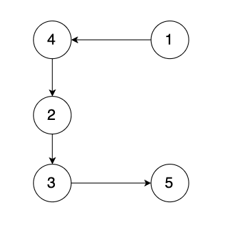
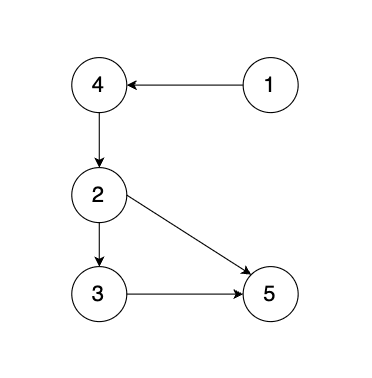
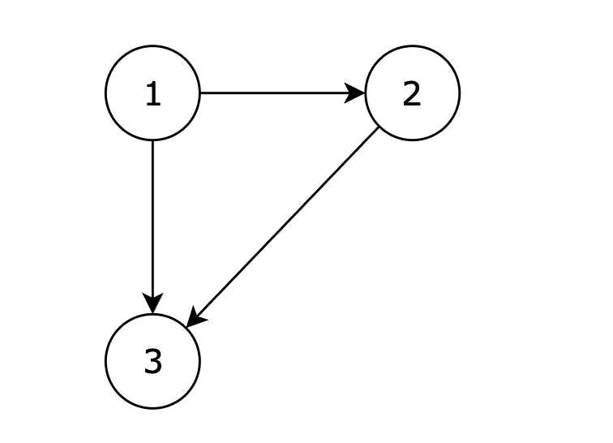
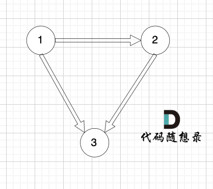
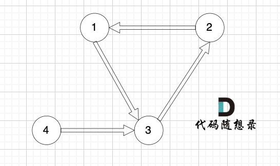
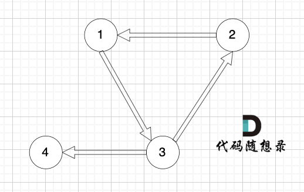

<p align="center"><strong><a href="./qita/join.md">參與本專案</a>，貢獻其他語言版本的程式碼，擁抱開放原始碼（open source），讓更多學習演算法的夥伴們受益！</strong></p>

# 109. 多餘的邊 II 

[KamaCoder 題目連結（ACM模式）](https://kamacoder.com/problempage.php?pid=1182)

題目描述

有一種有向樹（directed tree），該樹（tree）只有一個根節點（root node），所有其他節點（node）都是該根節點的後繼子（successor）。該樹除了根節點之外的每一個節點都有且只有一個父節點（father node），而根節點沒有父節點。有向樹擁有 n 個節點和 n - 1 條邊（edge）。如圖： 



現在有一個有向圖（directed graph），有向圖是在有向樹中的兩個沒有直接連結的節點中間添加一條有向邊。如圖：



輸入一個有向圖，該圖由一個有著 n 個節點(節點編號從 1 到 n)，n 條邊，請回傳一條可以刪除的邊，使得刪除該條邊之後該有向圖可以被當作一棵有向樹。

輸入描述

第一行輸入一個整數（integer） N，表示有向圖中節點和邊的個數。

後續 N 行，每行輸入兩個整數 s 和 t，代表這是 s 節點連接並指向 t 節點的單向邊

輸出描述

輸出一條可以刪除的邊，若有多條邊可以刪除，請輸出標準輸入（standard input）中最後出現的一條邊。

輸入範例

```
3
1 2
1 3
2 3
```

輸出範例 

2 3 

提示資訊 



在刪除 2 3 後有向圖可以變為一棵合法的有向樹，所以輸出 2 3

資料範圍：

1 <= N <= 1000.

## 思路

**[《程式碼隨想錄》演算法影片公開課](https://programmercarl.com/other/gongkaike.html)：[圖論（graph theory）：互斥集（disjoint set）這次要上難度了](https://www.bilibili.com/video/BV1t2NEzaEMR),相信結合影片再看本篇題解，更有助於大家對本題的理解**。

本題與 [108.冗餘（redundant）連接](./0108.冗餘連接.md) 類似，但本題是一個有向圖，有向圖相對要複雜一些。

本題的本質是：有一個有向圖，是由一棵 directed tree + 一條有向邊組成的（所以此時這個圖就不能稱之為 directed tree），現在讓我們找到那條邊，把這條邊刪了，讓這個圖恢復為 directed tree。

還有「**若有多條邊可以刪除，請輸出 standard input 中最後出現的一條邊**」，這說明在兩條邊都可以刪除的情況下，要刪順序靠後的邊！

我們來想一下 directed tree 的性質，如果是 directed tree 的話，只有根節點輸入度（in degree）為 0，其他節點輸入度都為 1（因為該樹除了根節點之外的每一個節點都有且只有一個父節點，而根節點沒有父節點）。  

所以情況一：如果我們找到輸入度為 2 的點，那麼刪一條指向該節點的邊就行了。  

如圖： 

 

找到了節點 3 的輸入度為 2，刪 1 -> 3 或者 2 -> 3。選擇刪順序靠後便可。 

但輸入度為 2 還有一種情況，情況二，只能刪特定的一條邊，如圖：  



節點 3 的輸入度為 2，但在刪除邊的時候，只能刪這條邊（節點 1 -> 節點 3），如果刪這條邊（節點 4 -> 節點 3），那麼刪後本圖也不是有向樹了（因為找不到根節點）。 

綜上，如果發現輸入度為 2 的節點，我們需要判斷刪除哪一條邊，刪除後本圖能成為有向樹。如果是刪哪個都可以，優先刪順序靠後的邊。


情況三：如果沒有輸入度為 2 的點，說明圖中有環了（注意是 directed cycle）。

如圖： 



對於情況三，刪掉構成環的邊就可以了。 


## 寫程式碼

把每條邊記錄下來，並統計節點輸入度：

```cpp
    int s, t;
    vector<vector<int>> edges;
    cin >> n;
    vector<int> inDegree(n + 1, 0); // 記錄節點輸入度
    for (int i = 0; i < n; i++) {
        cin >> s >> t;
        inDegree[t]++;
        edges.push_back({s, t});
    }


```

前兩種輸入度為 2 的情況，一定是刪除指向輸入度為 2 的節點的兩條邊其中的一條，如果刪了一條，判斷這個圖是一個樹，那麼這條邊就是答案。

同時注意要從後向前遍歷（traversal），因為如果兩條邊刪哪一條都可以成為樹，就刪最後那一條。

程式碼如下：

```cpp
vector<int> vec; // 記錄輸入度為 2 的邊（如果有的話就兩條邊）
// 找輸入度為 2 的節點所對應的邊，注意要倒序，因為優先刪除最後出現的一條邊
for (int i = n - 1; i >= 0; i--) {
    if (inDegree[edges[i][1]] == 2) {
        vec.push_back(i);
    }
}
if (vec.size() > 0) {
    // 放在 vec 裡的邊已經按照倒序放的，所以這裡就優先刪 vec[0] 這條邊
    if (isTreeAfterRemoveEdge(edges, vec[0])) {
        cout << edges[vec[0]][0] << " " << edges[vec[0]][1];
    } else {
        cout << edges[vec[1]][0] << " " << edges[vec[1]][1];
    }
    return 0;
}
```

再來看情況三，明確沒有輸入度為 2 的情況，那麼一定有有向環（directed cycle），找到構成環的邊就是要刪除的邊。

可以定義一個函數（function），程式碼如下：

```cpp
// 在有向圖裡找到刪除的那條邊，使其變成樹 
void getRemoveEdge(const vector<vector<int>>& edges)
```

大家應該知道了，我們要解決本題要實作兩個最為關鍵的函數：

* `isTreeAfterRemoveEdge()` 判斷刪一個邊之後是不是有向樹
* `getRemoveEdge()` 確定圖中一定有了有向環，那麼要找到需要刪除的那條邊

此時就用到**互斥集**了。  

如果還不了解互斥集，可以看這裡：[互斥集理論基礎](https://programmercarl.com/kamacoder/图论并查集理论基础.html)

`isTreeAfterRemoveEdge()` 判斷刪一個邊之後是不是有向樹：將所有邊的兩端節點分別加入互斥集，遇到要刪除的邊則跳過，如果遇到即將加入互斥集的邊的兩端節點本來就在互斥集了，說明構成了環。 

如果順利將所有邊的兩端節點（除了要刪除的邊）加入了互斥集，則說明刪除該條邊還是一個有向樹 

`getRemoveEdge()` 確定圖中一定有了有向環，那麼要找到需要刪除的那條邊：將所有邊的兩端節點分別加入互斥集，如果遇到即將加入互斥集的邊的兩端節點本來就在互斥集了，說明構成了環。

本題 C++ 程式碼如下：（詳細註解了）


```cpp
#include <iostream>
#include <vector>
using namespace std;
int n;
vector<int> father (1001, 0);
// 互斥集初始化
void init() {
    for (int i = 1; i <= n; ++i) {
        father[i] = i;
    }
}
// 互斥集裡尋根的過程
int find(int u) {
    return u == father[u] ? u : father[u] = find(father[u]);
}
// 將 v->u 這條邊加入互斥集
void join(int u, int v) {
    u = find(u);
    v = find(v);
    if (u == v) return ;
    father[v] = u;
}
// 判斷 u 和 v 是否找到同一個根
bool same(int u, int v) {
    u = find(u);
    v = find(v);
    return u == v;
}

// 在有向圖裡找到刪除的那條邊，使其變成樹
void getRemoveEdge(const vector<vector<int>>& edges) {
    init(); // 初始化互斥集
    for (int i = 0; i < n; i++) { // 遍歷所有的邊
        if (same(edges[i][0], edges[i][1])) { // 構成有向環了，就是要刪除的邊
            cout << edges[i][0] << " " << edges[i][1];
            return;
        } else {
            join(edges[i][0], edges[i][1]);
        }
    }
}

// 刪一條邊之後判斷是不是樹
bool isTreeAfterRemoveEdge(const vector<vector<int>>& edges, int deleteEdge) {
    init(); // 初始化互斥集
    for (int i = 0; i < n; i++) {
        if (i == deleteEdge) continue;
        if (same(edges[i][0], edges[i][1])) { // 構成有向環了，一定不是樹
            return false;
        }
        join(edges[i][0], edges[i][1]);
    }
    return true;
}

int main() {
    int s, t;
    vector<vector<int>> edges;
    cin >> n;
    vector<int> inDegree(n + 1, 0); // 記錄節點輸入度
    for (int i = 0; i < n; i++) {
        cin >> s >> t;
        inDegree[t]++;
        edges.push_back({s, t});
    }

    vector<int> vec; // 記錄輸入度為 2 的邊（如果有的話就兩條邊）
    // 找輸入度為 2 的節點所對應的邊，注意要倒序，因為優先刪除最後出現的一條邊
    for (int i = n - 1; i >= 0; i--) {
        if (inDegree[edges[i][1]] == 2) {
            vec.push_back(i);
        }
    }
    // 情況一、情況二
    if (vec.size() > 0) {
        // 放在 vec 裡的邊已經按照倒序放的，所以這裡就優先刪 vec[0] 這條邊
        if (isTreeAfterRemoveEdge(edges, vec[0])) {
            cout << edges[vec[0]][0] << " " << edges[vec[0]][1];
        } else {
            cout << edges[vec[1]][0] << " " << edges[vec[1]][1];
        }
        return 0;
    }

    // 處理情況三
    // 明確沒有輸入度為 2 的情況，那麼一定有有向環，找到構成環的邊回傳就可以了
    getRemoveEdge(edges);
}
```

## 其他語言版本

### Java 

```java
import java.util.*;

/* 
 * 冗餘連接 II。主要問題是存在輸入度為 2 或者成環，也可能兩個問題同時存在。
 * 1.判斷輸入度為 2 的邊 
 * 2.判斷是否成環（互斥集）
 */
 
public class Main {
    /**
     * 互斥集模板
     */
    static class Disjoint {

        private final int[] father;

        public Disjoint(int n) {
            father = new int[n];
            for (int i = 0; i < n; i++) {
                father[i] = i;
            }
        }

        public void join(int n, int m) {
            n = find(n);
            m = find(m);
            if (n == m) return;
            father[n] = m;
        }

        public int find(int n) {
            return father[n] == n ? n : (father[n] = find(father[n]));
        }

        public boolean isSame(int n, int m) {
            return find(n) == find(m);
        }
    }

    static class Edge {
        int s;
        int t;

        public Edge(int s, int t) {
            this.s = s;
            this.t = t;
        }
    }

    static class Node {
        int id;
        int in;
        int out;
    }

    public static void main(String[] args) {
        Scanner scanner = new Scanner(System.in);
        int n = scanner.nextInt();
        List<Edge> edges = new ArrayList<>();
        Node[] nodeMap = new Node[n + 1];
        for (int i = 1; i <= n; i++) {
            nodeMap[i] = new Node();
        }
        Integer doubleIn = null;
        for (int i = 0; i < n; i++) {
            int s = scanner.nextInt();
            int t = scanner.nextInt();
            //記錄輸入度
            nodeMap[t].in++;
            if (!(nodeMap[t].in < 2)) doubleIn = t;
            Edge edge = new Edge(s, t);
            edges.add(edge);
        }
        Edge result = null;
        //存在輸入度為 2 的節點，既要消除輸入度為 2 的問題同時解除可能存在的環
        if (doubleIn != null) {
            List<Edge> doubleInEdges = new ArrayList<>();
            for (Edge edge : edges) {
                if (edge.t == doubleIn) doubleInEdges.add(edge);
                if (doubleInEdges.size() == 2) break;
            }
            Edge edge = doubleInEdges.get(1);
            if (isTreeWithExclude(edges, edge, nodeMap)) {
                result = edge;
            } else {
                result = doubleInEdges.get(0);
            }
        } else {
            //不存在輸入度為 2 的節點,則只需要解除環即可
            result = getRemoveEdge(edges, nodeMap);
        }

        System.out.println(result.s + " " + result.t);
    }

    public static boolean isTreeWithExclude(List<Edge> edges, Edge exculdEdge, Node[] nodeMap) {
        Disjoint disjoint = new Disjoint(nodeMap.length + 1);
        for (Edge edge : edges) {
            if (edge == exculdEdge) continue;
            //成環則不是樹
            if (disjoint.isSame(edge.s, edge.t)) {
                return false;
            }
            disjoint.join(edge.s, edge.t);
        }
        return true;
    }

    public static Edge getRemoveEdge(List<Edge> edges, Node[] nodeMap) {
        int length = nodeMap.length;
        Disjoint disjoint = new Disjoint(length);

        for (Edge edge : edges) {
            if (disjoint.isSame(edge.s, edge.t)) return edge;
            disjoint.join(edge.s, edge.t);
        }
        return null;
    }

}

```

### Python

```python
from collections import defaultdict

father = list()


def find(u):
    if u == father[u]:
        return u
    else:
        father[u] = find(father[u])
        return father[u]
        
        
def is_same(u, v):
    u = find(u)
    v = find(v)
    return u == v
    
    
def join(u, v):
    u = find(u)
    v = find(v)
    if u != v:
        father[u] = v
    
    
def is_tree_after_remove_edge(edges, edge, n):
    # 初始化互斥集
    global father 
    father = [i for i in range(n + 1)]
    
    for i in range(len(edges)):
        if i == edge:
            continue
        s, t = edges[i]
        if is_same(s, t): # 成環，即不是有向樹
            return False
        else: # 將 s,t 放入集合中
            join(s, t)
    return True
    

def get_remove_edge(edges):
    # 初始化互斥集
    global father
    father = [i for i in range(n + 1)]
    
    for s, t in edges:
        if is_same(s, t):
            print(s, t)
            return
        else:
            join(s, t)
        

if __name__ == "__main__":
    # 輸入
    n = int(input())
    edges = list()
    in_degree = defaultdict(int)
    
    for i in range(n):
        s, t = map(int, input().split())
        in_degree[t] += 1
        edges.append([s, t])
        
    # 尋找輸入度為 2 的邊，並記錄其下標(index)
    vec = list()
    for i in range(n - 1, -1, -1):
        if in_degree[edges[i][1]] == 2:
            vec.append(i)
            
    # 輸出
    if len(vec) > 0:
        # 情況一：刪除輸出順序靠後的邊 
        if is_tree_after_remove_edge(edges, vec[0], n):
            print(edges[vec[0]][0], edges[vec[0]][1])
        # 情況二：只能刪除特定的邊
        else:
            print(edges[vec[1]][0], edges[vec[1]][1])
    else:
        # 情況三： 原圖有環
        get_remove_edge(edges)
```

### Go

### Rust

### JavaScript

```javascript
const r1 = require('readline').createInterface({ input: process.stdin });
// 建立 readline 介面
let iter = r1[Symbol.asyncIterator]();
// 建立非同步疊代器
const readline = async () => (await iter.next()).value;


let N // 節點數和邊數
let father = []  // 互斥集
let edges = [] // 邊集
let inDegree = [] // 輸入度


// 互斥集初始化
const init = () => {
  for (let i = 1; i <= N; i++)  father[i] = i;
}

// 互斥集裡尋根的過程
const find = (u) => {
  return u == father[u] ? u : father[u] = find(father[u])
}

// 將 v->u 這條邊加入互斥集
const join = (u, v) => {
  u = find(u)
  v = find(v)
  if (u == v) return // 如果發現根相同，則說明在一個集合，不用兩個節點相連直接回傳
  father[v] = u
}

// 判斷 u 和 v 是否找到同一個根
const isSame = (u, v) => {
  u = find(u)
  v = find(v)
  return u == v
}

// 判斷刪除一條邊後是不是樹
const isTreeAfterRemoveEdge = (edges, edge) => {
  // 初始化互斥集
  init()

  for (let i = 0; i < N; i++) {
    if (i == edge) continue
    if (isSame(edges[i][0], edges[i][1])) { // 構成有向環了，一定不是樹
      return false
    }
    join(edges[i][0], edges[i][1])
  }
  return true
}

// 在有向圖裡找到刪除的那條邊, 使其成為樹
const getRemoveEdge = (edges) => {
  // 初始化互斥集
  init()

  for (let i = 0; i < N; i++) {
    if (isSame(edges[i][0], edges[i][1])) { // 構成有向環了，就是要刪除的邊
      console.log(edges[i][0], edges[i][1]);
      return
    } else {
      join(edges[i][0], edges[i][1])
    }
  }
}


(async function () {
  // 讀取第一行輸入
  let line = await readline();
  N = Number(line);

  // 讀取邊資訊, 統計輸入度
  for (let i = 0; i < N; i++) {
    line = await readline()
    line = line.split(' ').map(Number)

    edges.push(line)

    inDegree[line[1]] = (inDegree[line[1]] || 0) + 1
  }

  // 找到輸入度為 2 的節點
  let vec = []  // 記錄輸入度為 2 的邊（如果有的話就兩條邊）
  // 找輸入度為 2 的節點所對應的邊，注意要倒序，因為優先刪除最後出現的一條邊
  for (let i = N - 1; i >= 0; i--) {
    if (inDegree[edges[i][1]] == 2) {
      vec.push(i)
    }
  }

  // 情況一、情況二
  if (vec.length > 0) {
     // 放在 vec 裡的邊已經按照倒序放的，所以這裡就優先刪 vec[0] 這條邊
    if (isTreeAfterRemoveEdge(edges, vec[0])) {
      console.log(edges[vec[0]][0], edges[vec[0]][1]);
    } else {
      console.log(edges[vec[1]][0], edges[vec[1]][1]);
    }
    return 0
  }

  // 情況三
  // 明確沒有輸入度為 2 的情況，那麼一定有有向環，找到構成環的邊回傳就可以了
  getRemoveEdge(edges)
})()
```


### TypeScript

### PhP

### Swift

### Scala

### C#

### Dart

### C

