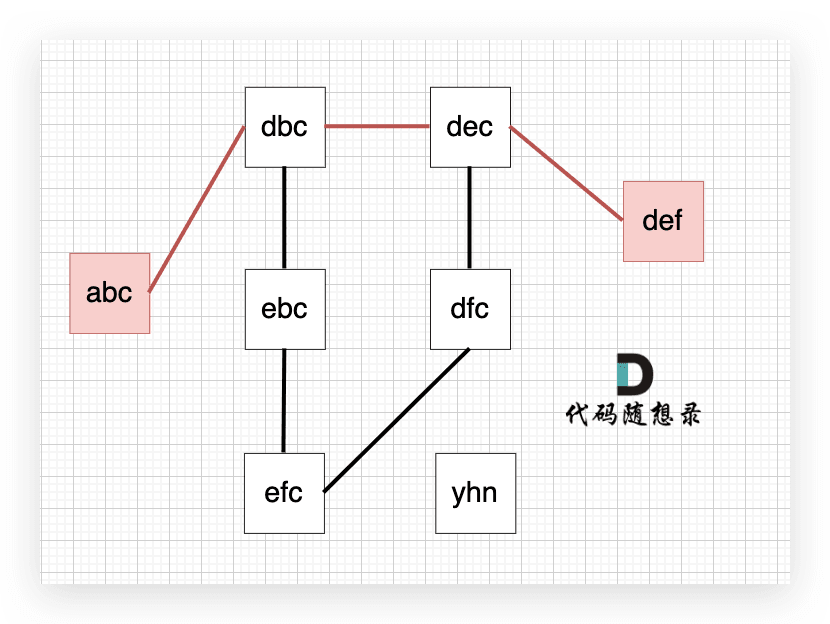

<p align="center"><strong><a href="./qita/join.md">參與本專案</a>，貢獻其他語言版本的程式碼，擁抱開放原始碼（open source），讓更多學習演算法（algorithm）的夥伴們受益！</strong></p>

# 110. 字串遷移

[KamaCoder 題目連結（ACM模式）](https://kamacoder.com/problempage.php?pid=1183)

題目描述

字典（dictionary） strList 中從字串（string） beginStr 和 endStr 的轉換序列（sequence）是一個按下述規格形成的序列：

1. 序列中第一個字串是 beginStr。

2. 序列中最後一個字串是 endStr。

3. **每次轉換只能改變一個位置的字元（character）**（例如 ftr 可以轉化 fty ，但 ftr 不能轉化 frx）。

4. 轉換過程中的中間字串必須是字典 strList 中的字串。

5. beginStr 和 endStr 不在字典 strList 中

6. 字串中只有小寫的 26 個字母

給你兩個字串 beginStr 和 endStr 和一個字典 strList，找到從 beginStr 到 endStr 的最短轉換序列中的字串數目。如果不存在這樣的轉換序列，回傳 0。

輸入描述

第一行包含一個整數（integer） N，表示字典 strList 中的字串數量。第二行包含兩個字串，用空白隔開，分別代表 beginStr 和 endStr。後續 N 行，每行一個字串，代表 strList 中的字串。

輸出描述

輸出一個整數，代表從 beginStr 轉換到 endStr 需要的最短轉換序列中的字串數量。如果不存在這樣的轉換序列，則輸出 0。

輸入範例

```
6
abc def
efc
dbc
ebc
dec
dfc
yhn
```

輸出範例

4

提示資訊

從 startStr 到 endStr，在 strList 中最短的路徑（path）為 abc -> dbc -> dec -> def，所以輸出結果為 4

資料範圍：

2 <= N <= 500

<p>
	
</p>


## 思路

**[《程式碼隨想錄》演算法影片公開課](https://programmercarl.com/other/gongkaike.html)：[圖論（graph theory）：樸實無華的廣搜這麼難？ | 廣度優先搜尋（breadth-first search, BFS） | KamaCoder：110.字串接龍](https://www.bilibili.com/video/BV1QEEizDEC4),相信結合影片再看本篇題解，更有助於大家對本題的理解**。

以範例 1 為例，從這個圖（graph）中可以看出 abc 到 def 的路線不止一條，但最短的一條路徑上是 4 個節點（node）。


本題只需要求出最短路徑（shortest path）的長度就可以了，不用找出具體路徑。

所以這道題要解決兩個問題：

1、圖中的線是如何連在一起的 

在搜尋的過程中，我們可以列舉（enumeration），用 26 個字母替換當前字串的每一個字元，再看替換後是否在 strList 裡出現過，就可以判斷兩個字串是否是連結的。

2、起點和終點的最短路徑長度

首先題目中並沒有給出點與點之間的連線，而是要我們自己去連，條件是字元只能差一個。

所以判斷點與點之間的關係，需要判斷是不是差一個字元，**如果差一個字元，那就是有連結**。

然後就是求起點和終點的最短路徑長度，在 unweighted graph 中，求最短路徑，用深搜或者廣搜就行，沒必要用最短路徑演算法。 

**在 unweighted graph 中，用廣搜求最短路徑最為合適，廣搜只要搜到了終點，那麼一定是最短的路徑**。因為廣搜就是以起點為中心向四周擴散的搜尋。

**本題如果用深搜，會比較麻煩，要在到達終點的不同路徑中選擇一條最短路徑**。 

而廣搜只要到達終點，一定是最短路徑。

另外需要有一個注意點：

* 本題是一個無向圖（undirected graph），需要用旗標（flag），標記著節點是否走過，否則就會無限迴路（infinite loop）！
* 使用 set 來檢查字串是否出現在字串集合（set）裡更快一些

C++ 程式碼如下：（詳細註解）

```CPP
#include <iostream>
#include <vector>
#include <string>
#include <unordered_set>
#include <unordered_map>
#include <queue>
using namespace std;
int main() {
    string beginStr, endStr, str;
    int n;
    cin >> n;
    unordered_set<string> strSet;
    cin >> beginStr >> endStr;
    for (int i = 0; i < n; i++) {
        cin >> str;
        strSet.insert(str);
    }

    // 記錄 strSet 裡的字串是否被訪問過，同時記錄路徑長度
    unordered_map<string, int> visitMap; // <記錄的字串，路徑長度>

    // 初始化佇列
    queue<string> que;
    que.push(beginStr);

    // 初始化 visitMap
    visitMap.insert(pair<string, int>(beginStr, 1));

    while(!que.empty()) {
        string word = que.front();
        que.pop();
        int path = visitMap[word]; // 這個字串在路徑中的長度

        // 開始在這個 str 中，挨個字元去替換
        for (int i = 0; i < word.size(); i++) {
            string newWord = word; // 用一個新字串替換 str，因為每次要置換一個字元

            // 遍歷 26 個字母
            for (int j = 0 ; j < 26; j++) {
                newWord[i] = j + 'a';
                if (newWord == endStr) { // 發現替換字母後，字串與終點字串相同
                    cout <<  path + 1 << endl; // 找到了路徑 
                    return 0;
                }
                // 字串集合裡出現了 newWord，並且 newWord 沒有被訪問過
                if (strSet.find(newWord) != strSet.end()
                        && visitMap.find(newWord) == visitMap.end()) {
                    // 添加訪問資訊，並將新字串放到佇列中
                    visitMap.insert(pair<string, int>(newWord, path + 1));
                    que.push(newWord);
                }
            }
        }
    }

    // 沒找到輸出 0
    cout << 0 << endl;

}
```

當然本題也可以用 bidirectional BFS，就是從頭尾兩端進行搜尋，大家感興趣，可以自己去實作，這裡就不再做詳細講解了。 


## 其他語言版本

### Java

```Java
import java.util.*;

public class Main {
    public static void main(String[] args) {
        Scanner scanner = new Scanner(System.in);
        int n = scanner.nextInt();
        scanner.nextLine();
        String beginStr = scanner.next();
        String endStr = scanner.next();
        scanner.nextLine();
        List<String> wordList = new ArrayList<>();
        wordList.add(beginStr);
        wordList.add(endStr);
        for (int i = 0; i < n; i++) {
            wordList.add(scanner.nextLine());
        }
        int count = bfs(beginStr, endStr, wordList);
        System.out.println(count);
    }

    /**
     * 廣度優先搜尋-尋找最短路徑
     */
    public static int bfs(String beginStr, String endStr, List<String> wordList) {
        int len = 1;
        Set<String> set = new HashSet<>(wordList);
        Set<String> visited = new HashSet<>();
        Queue<String> q = new LinkedList<>();
        visited.add(beginStr);
        q.add(beginStr);
        q.add(null);
        while (!q.isEmpty()) {
            String node = q.remove();
            //上一層結束，若下一層還有節點進入下一層
            if (node == null) {
                if (!q.isEmpty()) {
                    len++;
                    q.add(null);
                }
                continue;
            }
            char[] charArray = node.toCharArray();
            //尋找鄰接節點
            for (int i = 0; i < charArray.length; i++) {
                //記錄舊值，用於回滾修改
                char old = charArray[i];
                for (char j = 'a'; j <= 'z'; j++) {
                    charArray[i] = j;
                    String newWord = new String(charArray);
                    if (set.contains(newWord) && !visited.contains(newWord)) {
                        q.add(newWord);
                        visited.add(newWord);
                        //找到結尾
                        if (newWord.equals(endStr)) return len + 1;
                    }
                }
                charArray[i] = old;
            }
        }
        return 0;
    }
}

```

### Python
```Python
def judge(s1,s2):
    count=0
    for i in range(len(s1)):
        if s1[i]!=s2[i]:
            count+=1
    return count==1

if __name__=='__main__':
    n=int(input())
    beginstr,endstr=map(str,input().split())
    if beginstr==endstr:
        print(0)
        exit()
    strlist=[]
    for i in range(n):
        strlist.append(input())
    
    # use bfs
    visit=[False for i in range(n)]
    queue=[[beginstr,1]]
    while queue:
        str,step=queue.pop(0)
        if judge(str,endstr):
            print(step+1)
            exit()
        for i in range(n):
            if visit[i]==False and judge(strlist[i],str):
                visit[i]=True
                queue.append([strlist[i],step+1])
    print(0)
```

### Go

```go
package main

import (
	"bufio"
	"fmt"
	"os"
	"strconv"
	"strings"
)

func connectWord(words []string, startWord string, endWord string) int {
	if words == nil || len(words) == 0 {
		return 0
	}
	var allWord = make(map[string]bool)
	for _, word := range words {
		allWord[word] = true
	}
	visitedWord := make(map[string]bool)
	queue := make([]string, 0)
	result := 1
	queue = append(queue, startWord)
	queue = append(queue, "")
	for len(queue) > 0 {
		word := queue[0]
		queue = queue[1:]
		if word == "" {
			if len(queue) > 0 {
				result++
				queue = append(queue, "")
			}
            continue
		}
		arr := []rune(word)
		for i := 0; i < len(arr); i++ {
			old := arr[i]
			for j := 'a'; j <= 'z'; j++ {
				arr[i] = j
				newWord := string(arr)
				if allWord[newWord] && !visitedWord[newWord] {
					visitedWord[newWord] = true
					queue = append(queue, newWord)
					if newWord == endWord {
						return result + 1
					}
				}
			}
			arr[i] = old
		}
	}
	return 0
}

func main() {
	scanner := bufio.NewScanner(os.Stdin)
	scanner.Scan()
	n, _ := strconv.Atoi(scanner.Text())
	scanner.Scan()
	input := strings.Split(scanner.Text(), " ")
	beginStr := input[0]
	endStr := input[1]

	wordList := []string{beginStr, endStr}
	for i := 0; i < n; i++ {
		scanner.Scan()
		wordList = append(wordList, scanner.Text())
	}
	count := connectWord(wordList, beginStr, endStr)
	fmt.Println(count)
}

```


### Rust

### JavaScript

```javascript
const r1 = require('readline').createInterface({ input: process.stdin });
// 建立 readline 介面
let iter = r1[Symbol.asyncIterator]();
// 建立非同步疊代器
const readline = async () => (await iter.next()).value;

let N //輸入字串個數
let beginStr //開始字串
let endStr //結束字串
let strSet = new Set() //字串集合
let visitedMap = new Map() //訪問過的字串

// 讀取輸入，初始化地圖
const init = async () => {
  let line = await readline();
  line = line.trim()
  N = Number(line);

  line = await readline();
  line = line.trim().split(' ')
  beginStr = line[0]
  endStr = line[1]

  for (let i = 0; i < N; i++) {
    line = await readline()
    line = line.trim()
    strSet.add(line.trim())
  }
}

(async function () {

  // 讀取輸入，初始化資料
  await init()

  // 初始化佇列
  let queue = []
  queue.push(beginStr)

  // 初始化 visitMap
  visitedMap.set(beginStr, 1)

  while (queue.length) {
    let word = queue.shift()
    let path = visitedMap.get(word)

    // 遍歷 26 個字母
    for (let i = 0; i < word.length; i++) {
      let newWord = word.split('') // 用一個新字串替換 str，因為每次要置換一個字元
      for (let j = 0; j < 26; j++) {
        newWord[i] = String.fromCharCode('a'.charCodeAt() + j)
        // 發現替換字母後，字串與終點字串相同
        if (newWord.join('') === endStr) {
          console.log(path + 1);
          return 0;   // 找到了路徑 
        }

        // 字串集合裡出現了 newWord，並且 newWord 沒有被訪問過
        if (strSet.has(newWord.join('')) && !visitedMap.has(newWord.join(''))) {
          // 添加訪問資訊，並將新字串放到佇列中
          queue.push(newWord.join(''))
          visitedMap.set(newWord.join(''), path + 1)
        }
      }
    }
  }

  console.log(0);
})()
```


### TypeScript

### PhP

### Swift

### Scala

### C#

### Dart

### C

