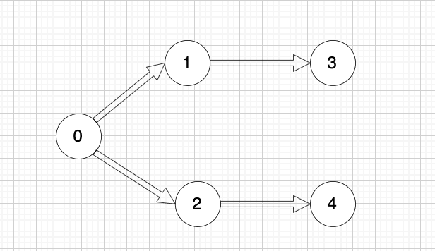
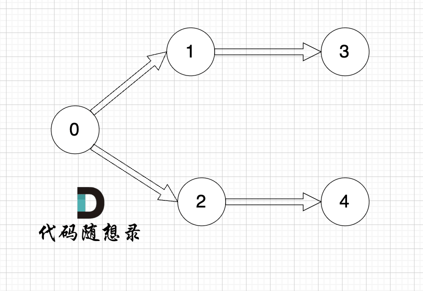
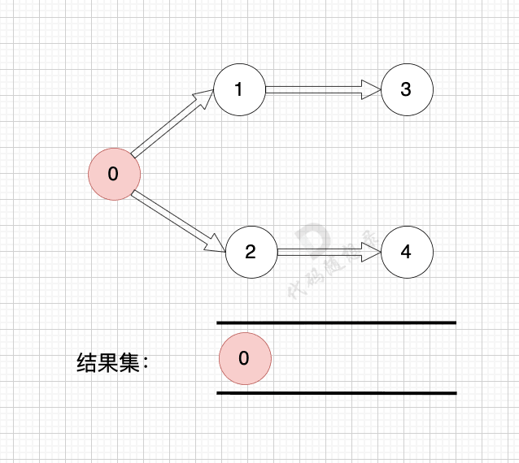
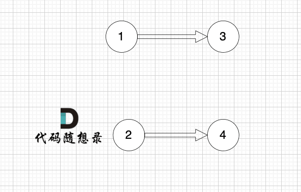
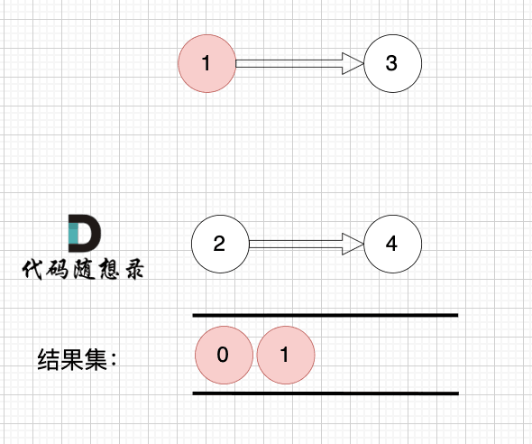
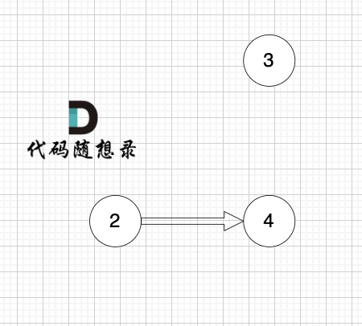
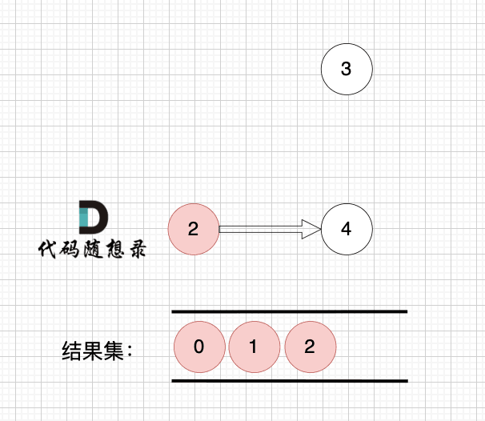
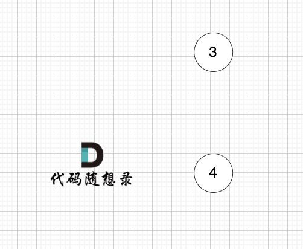
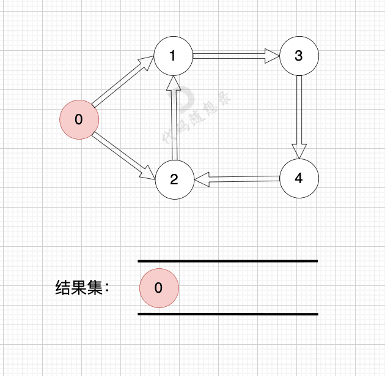

<p align="center"><strong><a href="./qita/join.md">參與本專案</a>，貢獻其他語言版本的程式碼，擁抱開放原始碼（open source），讓更多學習演算法（algorithm）的夥伴們受益！</strong></p>

# 拓蹼排序（topological sort）精講 

[KamaCoder：117. 軟體建置](https://kamacoder.com/problempage.php?pid=1191) 

題目描述：

某個大型軟體專案的建置系統擁有 N 個檔案，檔案編號從 0 到 N - 1，在這些檔案中，某些檔案依賴於其他檔案的內容，這意味著如果檔案 A 依賴於檔案 B，則必須在處理檔案 A 之前處理檔案 B（0 <= A, B <= N - 1）。請編寫一個演算法，用於確定檔案處理的順序。

輸入描述：

第一行輸入兩個正整數（positive integer）N, M。表示 N 個檔案之間擁有 M 條依賴關係。

後續 M 行，每行兩個正整數 S 和 T，表示 T 檔案依賴於 S 檔案。

輸出描述：

輸出共一行，如果能處理成功，則輸出檔案順序，用空白隔開。

如果不能成功處理（相互依賴），則輸出 -1。

輸入範例：

```
5 4
0 1
0 2
1 3
2 4
```

輸出範例：

0 1 2 3 4

提示資訊： 

檔案依賴關係如下：



所以，檔案處理的順序除了範例中的順序，還存在

0 2 4 1 3

0 2 1 3 4

等等合法的順序。

資料範圍：

* 0 <= N <= 10 ^ 5
* 1 <= M <= 10 ^ 9


## 拓蹼排序的背景 

本題是拓蹼排序的經典題目。

一聊到拓蹼排序，一些錄友可能會想這是排序，不會想到這是圖論（graph theory）演算法。 

其實拓蹼排序是經典的圖論問題。 

先說說拓蹼排序的應用場景。 

大學排課，例如先上 A 課，才能上 B 課，上了 B 課才能上 C 課，上了 A 課才能上 D 課，等等一系列這樣的依賴順序。問給規劃出一條完整的上課順序。  

拓蹼排序在檔案處理上也有應用，我們在做專案安裝套件（package）的時候，經常發現複雜的檔案依賴關係，A 依賴 B，B 依賴 C，B 依賴 D，C 依賴 E 等等。

如果給出一條線性的依賴順序來下載這些檔案呢？

有錄友想上面的例子都很簡單啊，我一眼就能排序出來。 

那如果上面的依賴關係是一百對呢，一千對甚至上萬個依賴關係，這些依賴關係中可能還有循環依賴，你如何發現循環依賴呢，又如何排出線性順序呢。 

所以拓蹼排序就是專門解決這類問題的。 

概括來說，**給出一個有向圖（directed graph），把這個有向圖轉成線性的排序（sorting）就叫拓蹼排序**。 

當然拓蹼排序也要檢測這個有向圖是否有 cycle，即存在循環依賴的情況，因為這種情況是不能做線性排序的。 

所以**拓蹼排序也是圖論中判斷有向非循環圖（directed acyclic graph, DAG）的常用方法**。

------------


## 拓蹼排序的思路

拓蹼排序指的是一種解決問題的大體思路，而具體演算法，可能是廣度優先搜尋（breadth-first search, BFS）也可能是深度優先搜尋（depth-first search, DFS）。

大家可能發現各式各樣的解法，糾結哪個是拓蹼排序？ 

其實只要能把有向非循環圖進行線性排序的演算法都可以叫做拓蹼排序。

實作拓蹼排序的演算法有兩種：Kahn's algorithm（BFS）和 DFS

> Kahn 於 1962 年提出這種解決拓蹼排序的思路 

一般來說我們只需要掌握 BFS 就可以了，清晰易懂，如果還想多了解一些，可以再去學一下 DFS 的思路，但 DFS 不是本篇重點。 

接下來我們來講解 BFS 的實作思路。 

以題目中範例為例如圖： 

 

做拓蹼排序的話，如果肉眼去找開頭的節點（node），一定能找到節點 0 吧，都知道要從節點 0 開始。 

但為什麼我們能找到節點 0 呢，因為我們肉眼看著這個圖就是從節點 0 出發的。 

作為出發節點，它有什麼特徵？ 

你看節點 0 的輸入度（in degree）為 0、外度數（out degree）為 2，也就是沒有邊（edge）指向它，而它有兩條邊是指出去的。

> 節點的輸入度表示有多少條邊指向它，節點的外度數表示有多少條邊從該節點出發。 

所以當我們做拓蹼排序的時候，應該優先找輸入度為 0 的節點，只有輸入度為 0，它才是出發節點。 
**理解以上內容很重要**！  

接下來我給出拓蹼排序的過程，其實就兩步： 

1. 找到輸入度為 0 的節點，加入結果集（result set）
2. 將該節點從圖中移除  

迴圈（loop）以上兩步，直到所有節點都在圖中被移除了。 

結果集的順序，就是我們想要的拓蹼排序順序（結果集裡順序可能不唯一） 

## 模擬過程

用本題的範例來模擬（simulation）這一過程： 


1、找到輸入度為 0 的節點，加入結果集 



2、將該節點從圖中移除 

 

----------------

1、找到輸入度為 0 的節點，加入結果集 



這裡大家會發現，節點 1 和節點 2 輸入度都為 0，選哪個呢？ 

選哪個都行，所以這也是為什麼拓蹼排序的結果是不唯一的。

2、將該節點從圖中移除 



---------------

1、找到輸入度為 0 的節點，加入結果集 



節點 2 和節點 3 輸入度都為 0，選哪個都行，這裡選節點 2 

2、將該節點從圖中移除 

 

--------------

後面的過程一樣的，節點 3 和節點 4，輸入度都為 0，選哪個都行。 

最後結果集為：0 1 2 3 4。當然結果是不唯一的。 

## 判斷有環

如果有 directed cycle 怎麼辦呢？例如這個圖：  



這個圖，我們只能將輸入度為 0 的節點 0 放入結果集。

之後，節點 1、2、3、4 形成了 cycle，找不到輸入度為 0 的節點了，所以此時結果集裡只有一個元素（element）。 

那麼如果我們發現結果集元素個數不等於圖中節點個數，我們就可以認定圖中一定有 directed cycle！ 

這也是拓蹼排序判斷 directed cycle 的方法。 

透過以上過程的模擬大家會發現這個拓蹼排序好像不難，還有點簡單。 

## 寫程式碼

理解思想後，確實不難，但程式碼寫起來也不容易。 

為了每次可以找到所有節點的輸入度資訊，我們要在初始化（initialization）的時候，就把每個節點的輸入度和每個節點的依賴關係做統計。 

程式碼如下： 

```CPP 
cin >> n >> m;
vector<int> inDegree(n, 0); // 記錄每個檔案的輸入度
vector<int> result; // 記錄結果
unordered_map<int, vector<int>> umap; // 記錄檔案依賴關係

while (m--) {
    // s->t，先有 s 才能有 t
    cin >> s >> t;
    inDegree[t]++; // t 的輸入度加一
    umap[s].push_back(t); // 記錄 s 指向哪些檔案
}

```

找輸入度為 0 的節點，我們需要用一個佇列（queue）存放。  

因為每次尋找輸入度為 0 的節點，不一定只有一個節點，可能很多節點輸入度都為 0，所以要將這些輸入度為 0 的節點放到佇列裡，依次去處理。 

程式碼如下： 

```CPP 

queue<int> que;
for (int i = 0; i < n; i++) {
    // 輸入度為 0 的節點，可以作為開頭，先加入佇列
    if (inDegree[i] == 0) que.push(i);
}
```

開始從佇列裡遍歷（traversal）輸入度為 0 的節點，將其放入結果集。

```CPP 

while (que.size()) {
    int  cur = que.front(); // 目前選中的節點
    que.pop();
    result.push_back(cur);
    // 將該節點從圖中移除 

}
```

這裡面還有一個很重要的過程，如何把這個輸入度為 0 的節點從圖中移除呢？ 

首先我們為什麼要把節點從圖中移除？ 

為的是將該節點作為出發點所連接的邊刪掉。 

刪掉的目的是什麼呢？ 

要把該節點作為出發點所連接的節點的輸入度減一。 

如果這裡不理解，看上面的模擬過程第一步：

 

這時節點 1 和節點 2 的輸入度為 1。

將節點 0 刪除後，圖為這樣： 

 

那麼節點 0 作為出發點所連接的節點的輸入度就都做了減一的操作。

此時節點 1 和節點 2 的輸入度都為 0，這樣才能作為下一輪選取的節點。 

所以，我們在程式碼實作的過程中，本質是要將該節點作為出發點所連接的節點的輸入度減一就可以了，這樣才能根據輸入度找下一個節點，不用真的在圖裡把這個節點刪掉。 

該過程程式碼如下： 


```CPP 

while (que.size()) {
    int  cur = que.front(); // 目前選中的節點
    que.pop();
    result.push_back(cur);
    // 將該節點從圖中移除 
    vector<int> files = umap[cur]; // 取得 cur 指向的節點
    if (files.size()) { // 如果 cur 有指向的節點
        for (int i = 0; i < files.size(); i++) { // 遍歷 cur 指向的節點
            inDegree[files[i]] --; // cur 指向的節點輸入度都做減一操作
            // 如果指向的節點減一之後，輸入度為 0，說明是我們要選取的下一個節點，放入佇列。
            if(inDegree[files[i]] == 0) que.push(files[i]); 
        }
    }

}
```

最後程式碼如下：


```CPP 
#include <iostream>
#include <vector>
#include <queue>
#include <unordered_map>
using namespace std;
int main() {
    int m, n, s, t;
    cin >> n >> m;
    vector<int> inDegree(n, 0); // 記錄每個檔案的輸入度

    unordered_map<int, vector<int>> umap;// 記錄檔案依賴關係
    vector<int> result; // 記錄結果

    while (m--) {
        // s->t，先有 s 才能有 t
        cin >> s >> t;
        inDegree[t]++; // t 的輸入度加一
        umap[s].push_back(t); // 記錄 s 指向哪些檔案
    }
    queue<int> que;
    for (int i = 0; i < n; i++) {
        // 輸入度為 0 的檔案，可以作為開頭，先加入佇列
        if (inDegree[i] == 0) que.push(i);
        //cout << inDegree[i] << endl;
    }
    // int count = 0;
    while (que.size()) {
        int  cur = que.front(); // 目前選中的檔案
        que.pop();
        //count++;
        result.push_back(cur);
        vector<int> files = umap[cur]; // 取得該檔案指向的檔案
        if (files.size()) { // cur 有後續檔案
            for (int i = 0; i < files.size(); i++) {
                inDegree[files[i]] --; // cur 指向的檔案輸入度 -1
                if(inDegree[files[i]] == 0) que.push(files[i]);
            }
        }
    }
    if (result.size() == n) {
        for (int i = 0; i < n - 1; i++) cout << result[i] << " ";
        cout << result[n - 1];
    } else cout << -1 << endl;


}
```

## 其他語言版本

### Java 

```java
import java.util.*;


public class Main {
    public static void main(String[] args) {
        Scanner scanner = new Scanner(System.in);
        int n = scanner.nextInt();
        int m = scanner.nextInt();

        List<List<Integer>> umap = new ArrayList<>(); // 記錄檔案依賴關係
        int[] inDegree = new int[n]; // 記錄每個檔案的輸入度

        for (int i = 0; i < n; i++)
            umap.add(new ArrayList<>());

        for (int i = 0; i < m; i++) {
            int s = scanner.nextInt();
            int t = scanner.nextInt();
            umap.get(s).add(t); // 記錄 s 指向哪些檔案
            inDegree[t]++; // t 的輸入度加一
        }

        Queue<Integer> queue = new LinkedList<>();
        for (int i = 0; i < n; i++) {
            if (inDegree[i] == 0) {
                // 輸入度為 0 的檔案，可以作為開頭，先加入佇列
                queue.add(i);
            }
        }

        List<Integer> result = new ArrayList<>();

        // 拓蹼排序
        while (!queue.isEmpty()) {
            int cur = queue.poll(); // 目前選中的檔案
            result.add(cur);
            for (int file : umap.get(cur)) {
                inDegree[file]--; // cur 指向的檔案輸入度 -1
                if (inDegree[file] == 0) {
                    queue.add(file);
                }
            }
        }

        if (result.size() == n) {
            for (int i = 0; i < result.size(); i++) {
                System.out.print(result.get(i));
                if (i < result.size() - 1) {
                    System.out.print(" ");
                }
            }
        } else {
            System.out.println(-1);
        }
    }
}
```


### Python

```python
from collections import deque, defaultdict

def topological_sort(n, edges):
    inDegree = [0] * n # inDegree 記錄每個檔案的輸入度
    umap = defaultdict(list) # 記錄檔案依賴關係

    # 建構圖與輸入度表
    for s, t in edges:
        inDegree[t] += 1
        umap[s].append(t)

    # 初始化佇列，加入所有輸入度為 0 的節點
    queue = deque([i for i in range(n) if inDegree[i] == 0])
    result = []

    while queue:
        cur = queue.popleft()  # 目前選中的檔案
        result.append(cur)
        for file in umap[cur]:  # 取得該檔案指向的檔案
            inDegree[file] -= 1  # cur 指向的檔案輸入度 -1
            if inDegree[file] == 0:
                queue.append(file)

    if len(result) == n:
        print(" ".join(map(str, result)))
    else:
        print(-1)


if __name__ == "__main__":
    n, m = map(int, input().split())
    edges = [tuple(map(int, input().split())) for _ in range(m)]
    topological_sort(n, edges)
```


### Go

### Rust

### JavaScript

```javascript
const r1 = require('readline').createInterface({ input: process.stdin });
// 建立 readline 介面
let iter = r1[Symbol.asyncIterator]();
// 建立非同步疊代器
const readline = async () => (await iter.next()).value;


let N, M // 節點數和邊數
let inDegrees = [] // 輸入度
let umap = new Map() // 記錄檔案依賴關係
let result = [] // 結果


// 根據輸入，初始化資料
const init = async () => {
  // 讀取第一行輸入
  let line = await readline();
  [N, M] = line.split(' ').map(Number)

  inDegrees = new Array(N).fill(0)

  // 讀取邊集
  while (M--) {
    line = await readline();
    let [x, y] = line.split(' ').map(Number)

    // 記錄輸入度
    inDegrees[y]++

    // 記錄 x 指向哪些檔案
    if (!umap.has(x)) {
      umap.set(x, [y])
    } else {
      umap.get(x).push(y)
    }
  }
}

(async function () {
  // 根據輸入，初始化資料
  await init()

  let queue = [] // 輸入度為 0 的節點
  for (let i = 0; i < N; i++) {
    if (inDegrees[i] == 0) {
      queue.push(i)
    }
  }

  while (queue.length) {
    let cur = queue.shift() // 目前檔案

    result.push(cur)

    let files = umap.get(cur) // 目前檔案指向的檔案

    // 目前檔案指向的檔案輸入度減 1
    if (files && files.length) {
      for (let i = 0; i < files.length; i++) {
        inDegrees[files[i]]--
        if (inDegrees[files[i]] == 0) queue.push(files[i])
      }
    }
  }

  // 這裡 result.length == N 一定要判斷，因為可能存在 cycle
  if (result.length == N) return console.log(result.join(' '))
  console.log(-1)
})()
```


### TypeScript

### PhP

### Swift

### Scala

### C#

### Dart

### C

