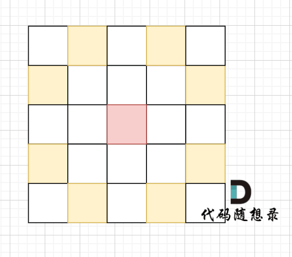
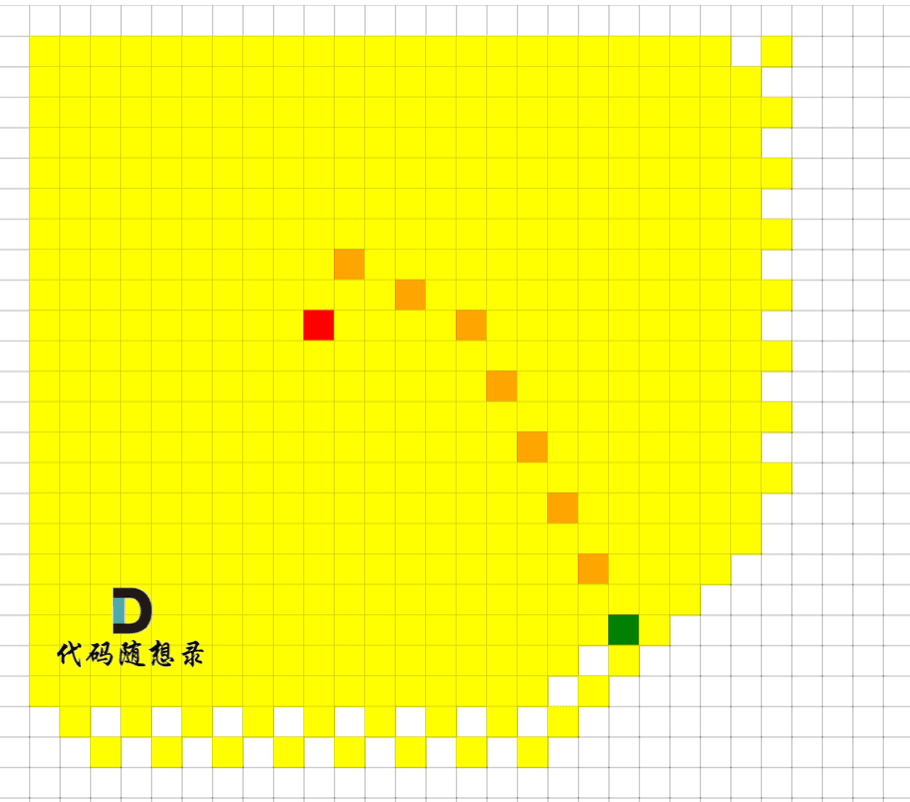
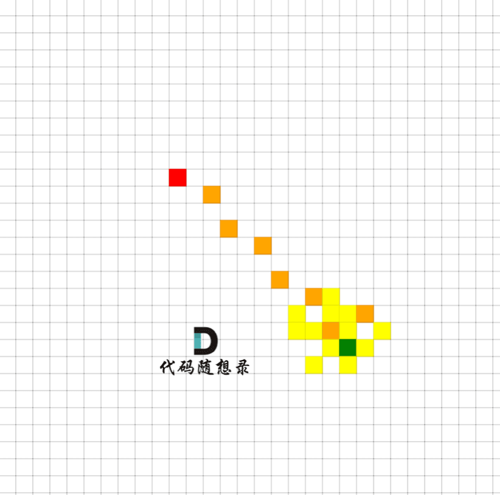

# A*演算法（A* algorithm）精講（A star 演算法）

[KamaCoder：126. 騎士的攻擊](https://kamacoder.com/problempage.php?pid=1203)

題目描述

在西洋棋中，馬和象的移動規則分別是「馬走日」和「象走田」。現給定騎士的起始坐標（coordinate）和目標坐標，要求根據騎士的移動規則，計算從起點到達目標點所需的最短步數。

騎士移動規則如圖，紅色是起始位置，黃色是騎士可以走的地方。 



棋盤大小 1000 x 1000（棋盤的 x 和 y 坐標均在 [1, 1000] 區間（interval）內，包含邊界（boundary））

輸入描述

第一行包含一個整數（integer）n，表示測試案例（test case）的數量。

接下來的 n 行，每行包含四個整數 a1, a2, b1, b2，分別表示騎士的起始位置 (a1, a2) 和目標位置 (b1, b2)。

輸出描述

輸出共 n 行，每行輸出一個整數，表示騎士從起點到目標點的最短路徑（shortest path）長度。

輸入範例

```
6
5 2 5 4
1 1 2 2
1 1 8 8
1 1 8 7
2 1 3 3
4 6 4 6
```

輸出範例

```
2
4
6
5
1
0
```


## 思路 

我們看到這道題目的第一個想法就是廣度優先搜尋（breadth-first search, BFS），這也是最經典的BFS類型題目。 

這裡我直接給出BFS的 C++ 程式碼： 

```CPP 
#include<iostream>
#include<queue>
#include<string.h>
using namespace std;
int moves[1001][1001];
int dir[8][2]={-2,-1,-2,1,-1,2,1,2,2,1,2,-1,1,-2,-1,-2};
void bfs(int a1,int a2, int b1, int b2)
{
	queue<int> q;
	q.push(a1);
	q.push(a2);
	while(!q.empty())
	{
		int m=q.front(); q.pop();
		int n=q.front(); q.pop();
		if(m == b1 && n == b2)
		break;
		for(int i=0;i<8;i++)
		{
			int mm=m + dir[i][0];
			int nn=n + dir[i][1];
			if(mm < 1 || mm > 1000 || nn < 1 || nn > 1000)
			continue;
			if(!moves[mm][nn])
			{
				moves[mm][nn]=moves[m][n]+1;
				q.push(mm);
				q.push(nn);
			}
		}
	}
}

int main()
{
    int n, a1, a2, b1, b2;
    cin >> n;
    while (n--) {
        cin >> a1 >> a2 >> b1 >> b2;
        memset(moves,0,sizeof(moves));
		bfs(a1, a2, b1, b2);
		cout << moves[b1][b2] << endl;
	}
	return 0;
}

```

提交後，大家會發現，逾時了。 

因為本題地圖足夠大，且 n 也有可能很大，導致有非常多的查詢。 

我們來看一下BFS的搜尋過程，如圖，紅色是起點，綠色是終點，黃色是要遍歷（traversal）的點，最後從起點找到到達終點的最短路徑是棕色。 



可以看出BFS中，做了很多無用的遍歷，黃色的格子（grid）是BFS遍歷到的點。 

這裡我們能不能讓遍歷方向，朝著終點的方向去遍歷呢？ 

這樣我們就可以避免很多無用遍歷。


## Astar

Astar 是一種BFS的改良版。有的說 Astar 是 Dijkstra 演算法（Dijkstra algorithm）的改良版。 

其實只是場景不同而已。我們在搜尋最短路徑的時候，如果是 無權圖（unweighted graph）（邊（edge）的權重（weight）都是 1）那就用BFS，程式碼簡潔，時間效率和 Dijkstra 差不多（具體要取決於圖（graph）的稠密） 

如果是加權圖形（weighted graph）（邊有不同的權重），優先考慮 Dijkstra。 

而 Astar 關鍵在於 試探函數（heuristic function），也就是影響BFS或者 Dijkstra 從容器（container）（佇列（queue））裡取元素（element）的優先順序。

以下，我用 BFS 版本的 A* 來進行講解。  

在 BFS 中，我們想搜尋從起點到終點的最短路徑，要一層一層去遍歷。


如果使用 A* 的話，其搜尋過程是這樣的，如圖，圖中著色的都是我們要遍歷的點。 




（上面兩圖中最短路徑長度都是 8，只是走的方式不同而已）

大家可以發現 **BFS 是沒有目的性地一圈一圈去搜尋，而 A* 是有方向性地去搜尋**。 

看出 A* 可以節省很多沒有必要的遍歷步驟。 

為了讓大家可以明顯看到區別，我將 BFS 和 A* 製作成視覺化動圖，大家可以自己看看動圖，效果更好。 

位址（address）：https://kamacoder.com/tools/knight.html 

那麼 A* 為什麼可以有方向性地去搜尋，它是如何知道方向的呢？ 

**其關鍵在於 試探函數**。 

那麼 試探函數 落實到程式碼處，如何指引搜尋的方向？ 

在本篇開篇中給出了 BFS 程式碼，指引搜尋方向的關鍵程式碼在這裡： 

```CPP
int m=q.front();q.pop();
int n=q.front();q.pop();
```

從佇列裡取出什麼元素，接下來就是從哪裡開始搜尋。 

**所以 試探函數 要影響的就是佇列裡元素的排序（sorting）**！

這是影響 BFS 搜尋方向的關鍵。 

對佇列裡節點（node）進行排序，就需要給每一個節點權重，如何計算權重呢？ 

每個節點的權重為 F，給出公式為：F = G + H 

G：起點達到目前遍歷節點的距離 

H：目前遍歷的節點到達終點的距離

起點達到目前遍歷節點的距離 + 目前遍歷的節點到達終點的距離 就是起點到達終點的距離。 

本題的圖是無權網格狀，在計算兩點距離通常有如下三種計算方式：  

1. 曼哈坦距離（Manhattan distance），計算方式：d = abs(x1-x2)+abs(y1-y2) 
2. 歐幾里德距離（Euclidean distance），計算方式：d = sqrt( (x1-x2)^2 + (y1-y2)^2 )
3. 切比雪夫距離（Chebyshev distance），計算方式：d = max(abs(x1 - x2), abs(y1 - y2))

x1, x2 為起點坐標，y1, y2 為終點坐標，abs 為求絕對值（absolute value），sqrt 為求開根號，

選擇哪一種距離計算方式也會導致 A* 演算法的結果不同。 

本題，採用 歐幾里德距離 才能最大程度體現點與點之間的距離。 

所以使用 歐幾里德距離 計算和BFS搜出來的最短路徑的節點數是一樣的。（路徑（path）可能不同，但路徑上的節點數是相同的）

我在製作動畫演示的過程中，分別給出了 曼哈坦距離、歐幾里德距離 以及 切比雪夫距離 三種計算方式下，A* 演算法的尋路過程，大家可以自己看看其區別。

動畫位址：https://kamacoder.com/tools/knight.html 

計算出來 F 之後，按照 F 的大小，來選取出佇列的節點。 

可以使用優先佇列（priority queue）幫我們排好序，每次出佇列，就是 F 最小的節點。 

實作程式碼如下：（heuristic function 採用 Euclidean distance 計算方式）

```CPP
#include<iostream>
#include<queue>
#include<string.h>
using namespace std;
int moves[1001][1001];
int dir[8][2]={-2,-1,-2,1,-1,2,1,2,2,1,2,-1,1,-2,-1,-2};
int b1, b2;
// F = G + H
// G = 從起點到該節點路徑消耗
// H = 該節點到終點的預估消耗

struct Knight{
    int x,y;
    int g,h,f;
    bool operator < (const Knight & k) const{  // 重載運算子，從小到大排序
     return k.f < f;
    }
};

priority_queue<Knight> que;

int Heuristic(const Knight& k) { // Euclidean distance
    return (k.x - b1) * (k.x - b1) + (k.y - b2) * (k.y - b2); // 統一不開根號，這樣可以提高精度
}
void astar(const Knight& k)
{
    Knight cur, next;
	que.push(k);
	while(!que.empty())
	{
		cur=que.top(); que.pop();
		if(cur.x == b1 && cur.y == b2)
		break;
		for(int i = 0; i < 8; i++)
		{
			next.x = cur.x + dir[i][0];
			next.y = cur.y + dir[i][1];
			if(next.x < 1 || next.x > 1000 || next.y < 1 || next.y > 1000)
			continue;
			if(!moves[next.x][next.y])
			{
				moves[next.x][next.y] = moves[cur.x][cur.y] + 1;

                // 開始計算 F
				next.g = cur.g + 5; // 統一不開根號，這樣可以提高精度，馬走日，1 * 1 + 2 * 2 = 5
                next.h = Heuristic(next);
                next.f = next.g + next.h;
                que.push(next);
			}
		}
	}
}

int main()
{
    int n, a1, a2;
    cin >> n;
    while (n--) {
        cin >> a1 >> a2 >> b1 >> b2;
        memset(moves,0,sizeof(moves));
        Knight start;
        start.x = a1;
        start.y = a2;
        start.g = 0;
        start.h = Heuristic(start);
        start.f = start.g + start.h;
		astar(start);
        while(!que.empty()) que.pop(); // 佇列清空
		cout << moves[b1][b2] << endl;
	}
	return 0;
}

```

## 複雜度分析   

A* 演算法的時間複雜度（time complexity）其實是不容易量化的，這取決於怎麼寫 試探函數。

最壞情況下，A* 演算法退化成 BFS，時間複雜度是 O(n^2)，n 為節點的數量。

一般情況下，搜尋路徑是從起點直接到終點，while(!que.empty()) 需要執行 d 次，d 為起點到終點的深度（depth），而優先佇列每次新增元素都要進行錐形排序法（heap sort），時間複雜度是 O(logk)，k 為佇列中元素的數量。所以時間複雜度為 O(dlogk)。

也可以非常粗略地認為 A* 演算法的時間複雜度是 O(nlogn)，n 為節點的數量。

本題中 A* 演算法的空間複雜度（space complexity）是 O(k)，k 為佇列中元素的數量，空間消耗主要是佇列裡需要存放遍歷的節點。


## 拓展 

如果本題大家使用 曼哈坦距離 或者 切比雪夫距離 計算的話，可以提交試一試，有的最短路徑結果並不是最短的。

原因也是 曼哈坦距離 和 切比雪夫距離 這兩種計算方式在本題的網格地圖中，都沒有體現出點到點的真正距離！

可能有些錄友找到類似的題目，例如 [poj 2243](http://poj.org/problem?id=2243)，使用 曼哈坦距離 提交也過了，那是因為題目中的地圖太小了，僅僅是一張 8 * 8 的地圖，根本看不出來不同 試探函數 寫法的區別。 

A* 演算法並不是一個明確的最短路徑演算法，**A* 演算法搜的路徑如何，完全取決於 試探函數 怎麼寫**。 

**A* 演算法並不能保證一定是最短路徑**，因為在設計 試探函數 的時候，要考慮時間效率與準確度之間的一個權衡。 

雖然本題中，A* 演算法得到是最短路徑，也是因為本題 試探函數 和地圖結構都是最簡單的。

例如在遊戲中，在地圖很大、不同路徑權重不同、有障礙且多個遊戲單位在地圖中尋路的情況，如果要計算準確最短路徑，耗時很大，會給玩家一種卡頓的感覺。 

而真實玩家在玩遊戲的時候，並不要求一定是最短路徑，次短路徑（second shortest path） 也是可以的（玩家不一定能感受出來，即使感受出來也不是很在意），只要奔著目標走過去大體就可以接受。 

所以 在遊戲開發設計中，**保證執行效率的情況下，A* 演算法中的 試探函數 設計往往不是最短路徑，而是接近最短路徑的 次短路徑 設計**。 

大家如果玩 LOL，或者 王者榮耀 可以回憶一下：如果從很遠的地方點擊讓英雄直接跑過去，跑的路徑是不靠譜的，所以玩家們才會在距離英雄盡可能近的位置去點擊讓英雄跑過去。 

## A* 的缺點 

大家看上述 A* 程式碼的時候，可以看到我們向佇列裡新增了很多節點，但真正從佇列裡取出來的僅僅是靠 試探函數 判斷距離終點最近的節點。

相對於普通 BFS，A* 演算法只從佇列裡取出距離終點最近的節點。 

那麼問題來了，A* 在一次路徑搜尋中，大量不需要存取的節點都在佇列裡，會造成空間的過度消耗。  

IDA* algorithm 對這一空間增長問題進行了最佳化，關於 IDA* algorithm，本篇不再做講解，感興趣的錄友可以自行找資料學習。 

另外還有一種場景是 A* 解決不了的。 

如果題目中，給出多個可能的目標，然後在這多個目標中選擇最近的目標，這種 A* 就不擅長了，A* 只擅長給出明確的目標然後找到最短路徑。 

如果是多個目標找最近目標（特別是潛在目標數量很多的時候），可以考慮 Dijkstra、BFS 或者 Floyd。 


## 其他語言版本

### Java 

```java
import java.util.PriorityQueue;
import java.util.Scanner;
 
class Knight implements Comparable<Knight> {
    int x, y;
    int g, h, f;
 
    public Knight(int x, int y, int g, int h, int f) {
        this.x = x;
        this.y = y;
        this.g = g;
        this.h = h;
        this.f = f;
    }
 
    @Override
    public int compareTo(Knight k) {
        return Integer.compare(this.f, k.f);
    }
}
 
public class Main {
    static int[][] moves = new int[1001][1001];
    static int[][] dir = { {-2, -1}, {-2, 1}, {-1, 2}, {1, 2}, {2, 1}, {2, -1}, {1, -2}, {-1, -2} };
    static int b1, b2;
 
    static int Heuristic(Knight k) {
        return (k.x - b1) * (k.x - b1) + (k.y - b2) * (k.y - b2);
    }
 
    static void astar(Knight k) {
        PriorityQueue<Knight> que = new PriorityQueue<>();
        que.add(k);
        while (!que.isEmpty()) {
            Knight cur = que.poll();
            if (cur.x == b1 && cur.y == b2) {
                break;
            }
            for (int i = 0; i < 8; i++) {
                int nextX = cur.x + dir[i][0];
                int nextY = cur.y + dir[i][1];
                if (nextX < 1 || nextX > 1000 || nextY < 1 || nextY > 1000) {
                    continue;
                }
                if (moves[nextX][nextY] == 0) {
                    moves[nextX][nextY] = moves[cur.x][cur.y] + 1;
                    Knight next = new Knight(nextX, nextY, cur.g + 5, Heuristic(new Knight(nextX, nextY, 0, 0, 0)), 0);
                    next.f = next.g + next.h;
                    que.add(next);
                }
            }
        }
    }
 
    public static void main(String[] args) {
        Scanner scanner = new Scanner(System.in);
        int n = scanner.nextInt();
        while (n-- > 0) {
            int a1 = scanner.nextInt();
            int a2 = scanner.nextInt();
            b1 = scanner.nextInt();
            b2 = scanner.nextInt();
            for (int i = 0; i < 1001; i++) {
                for (int j = 0; j < 1001; j++) {
                    moves[i][j] = 0;
                }
            }
            Knight start = new Knight(a1, a2, 0, Heuristic(new Knight(a1, a2, 0, 0, 0)), 0);
            start.f = start.g + start.h;
            astar(start);
            System.out.println(moves[b1][b2]);
        }
        scanner.close();
    }
}    
```


### Python

```Python 
import heapq
 
n = int(input())
 
moves = [(1, 2), (2, 1), (-1, 2), (2, -1), (1, -2), (-2, 1), (-1, -2), (-2, -1)]
 
def distance(a, b):
    return ((a[0] - b[0]) ** 2 + (a[1] - b[1]) ** 2) ** 0.5
 
def bfs(start, end):
    q = [(distance(start, end), start)]
    step = {start: 0}
     
    while q:
        d, cur = heapq.heappop(q)
        if cur == end:
            return step[cur]
        for move in moves:
            new = (move[0] + cur[0], move[1] + cur[1])
            if 1 <= new[0] <= 1000 and 1 <= new[1] <= 1000:
                step_new = step[cur] + 1
                if step_new < step.get(new, float('inf')):
                    step[new] = step_new
                    heapq.heappush(q, (distance(new, end) + step_new, new))
    return False
                     
for _ in range(n):
    a1, a2, b1, b2 = map(int, input().split())
    print(bfs((a1, a2), (b1, b2)))
```

### Go

### Rust

### JavaScript

```js
class MinHeap {
  constructor() {
    this.val = []
  }
  push(val) {
    this.val.push(val)
    if (this.val.length > 1) {
      this.bubbleUp()
    }
  }
  bubbleUp() {
    let pi = this.val.length - 1
    let pp = Math.floor((pi - 1) / 2)
    while (pi > 0 && this.val[pp][0] > this.val[pi][0]) {
      ;[this.val[pi], this.val[pp]] = [this.val[pp], this.val[pi]]
      pi = pp
      pp = Math.floor((pi - 1) / 2)
    }
  }
  pop() {
    if (this.val.length > 1) {
        let pp = 0
        let pi = this.val.length - 1
        ;[this.val[pi], this.val[pp]] = [this.val[pp], this.val[pi]]
        const min = this.val.pop()
        if (this.val.length > 1) {
          this.sinkDown(0)
        }
        return min        
    } else if (this.val.length == 1) {
        return this.val.pop()
    }

  }
  sinkDown(parentIdx) {
    let pp = parentIdx
    let plc = pp * 2 + 1
    let prc = pp * 2 + 2
    let pt = pp // temp pointer
    if (plc < this.val.length && this.val[pp][0] > this.val[plc][0]) {
        pt = plc
    }
    if (prc < this.val.length && this.val[pt][0] > this.val[prc][0]) {
        pt = prc
    }
    if (pt != pp) {
        ;[this.val[pp], this.val[pt]] = [this.val[pt], this.val[pp]]
        this.sinkDown(pt)
    }
  }
}

const moves = [
    [1, 2], 
    [2, 1], 
    [-1, -2], 
    [-2, -1],
    [-1, 2], 
    [-2, 1],
    [1, -2], 
    [2, -1]
]

function dist(a, b) {
    return ((a[0] - b[0])**2 + (a[1] - b[1])**2)**0.5
}

function isValid(x, y) {
    return x >= 1 && y >= 1 && x < 1001 && y < 1001
}

function bfs(start, end) {
    const step = new Map()
    step.set(start.join(" "), 0)
    const q = new MinHeap()
    q.push([dist(start, end), start[0], start[1]])
    
    while(q.val.length) {
        const [d, x, y] = q.pop()
        // if x and y correspond to end position output result
        if (x == end[0] && y == end[1]) {
            console.log(step.get(end.join(" ")))
            break;
        }
        for (const [dx, dy] of moves) {
            const nx = dx + x
            const ny = dy + y
            if (isValid(nx, ny)) {
                const newStep = step.get([x, y].join(" ")) + 1
                const newDist = dist([nx, ny], [...end])
                const s = step.get([nx, ny].join(" ")) ? 
                    step.get([nx, ny]) : 
                    Number.MAX_VALUE
                if (newStep < s) {
                    q.push(
                        [
                            newStep + newDist, 
                            nx, 
                            ny
                        ]
                    )
                    step.set([nx, ny].join(" "), newStep)
                } 
            }
        }
    }
}

async function main() {
    const rl = require('readline').createInterface({ input: process.stdin })
    const iter = rl[Symbol.asyncIterator]()
    const readline = async () => (await iter.next()).value
    const n = Number((await readline()))
    
    // find min step
    for (let i = 0 ; i < n ; i++) {
        const [s1, s2, t1, t2] = (await readline()).split(" ").map(Number)
        bfs([s1, s2], [t1, t2])
    }
}

main()
```

### TypeScript

### PhP

### Swift

### Scala

### C#

### Dart

### C

```C
#include <stdio.h>
#include <stdlib.h>
#include <string.h>

// 定義一個結構，表示棋盤上騎士的位置和相關的 A* 演算法參數
typedef struct {
    int x, y; // 騎士在棋盤上的坐標
    int g;    // 從起點到目前節點的實際消耗
    int h;    // 從目前節點到目標節點的估計消耗（heuristic function 值）
    int f;    // 總的估計消耗（f = g + h）
} Knight;

#define MAX_HEAP_SIZE 2000000 // 假設優先佇列的最大容量

// 定義一個優先佇列，使用最小堆積來實作 A* 演算法中的 Open 列表
typedef struct {
    Knight data[MAX_HEAP_SIZE];
    int size;
} PriorityQueue;

// 初始化優先佇列
void initQueue(PriorityQueue *pq) {
    pq->size = 0;
}

// 將騎士節點插入優先佇列
void push(PriorityQueue *pq, Knight k) {
    if (pq->size >= MAX_HEAP_SIZE) {
        // 堆積已滿，無法插入新節點
        return;
    }
    int i = pq->size++;
    pq->data[i] = k;
    // 上濾操作，維護最小堆積的性質，使得 f 值最小的節點在堆積頂
    while (i > 0) {
        int parent = (i - 1) / 2;
        if (pq->data[parent].f <= pq->data[i].f) {
            break;
        }
        // 交換父節點和目前節點
        Knight temp = pq->data[parent];
        pq->data[parent] = pq->data[i];
        pq->data[i] = temp;
        i = parent;
    }
}

// 從優先佇列中彈出 f 值最小的騎士節點
Knight pop(PriorityQueue *pq) {
    Knight min = pq->data[0];
    pq->size--;
    pq->data[0] = pq->data[pq->size];
    // 下濾操作，維護最小堆積的性質
    int i = 0;
    while (1) {
        int left = 2 * i + 1;
        int right = 2 * i + 2;
        int smallest = i;
        if (left < pq->size && pq->data[left].f < pq->data[smallest].f) {
            smallest = left;
        }
        if (right < pq->size && pq->data[right].f < pq->data[smallest].f) {
            smallest = right;
        }
        if (smallest == i) {
            break;
        }
        // 交換目前節點與最小子節點
        Knight temp = pq->data[smallest];
        pq->data[smallest] = pq->data[i];
        pq->data[i] = temp;
        i = smallest;
    }
    return min;
}

// 判斷優先佇列是否為空
int isEmpty(PriorityQueue *pq) {
    return pq->size == 0;
}

// heuristic function：計算從目前位置到目標位置的 Euclidean distance 的平方（避免開方，提高效率）
int heuristic(int x, int y, int goal_x, int goal_y) {
    int dx = x - goal_x;
    int dy = y - goal_y;
    return dx * dx + dy * dy; // Euclidean distance 的平方
}

// 用於記錄從起點到棋盤上每個位置的最小移動次數
int moves[1001][1001];

// 騎士在棋盤上的 8 個可能移動方向
int dir[8][2] = {
    {-2, -1}, {-2, 1}, {-1, 2}, {1, 2},
    {2, 1}, {2, -1}, {1, -2}, {-1, -2}
};

// 使用 A* 演算法尋找從起點到目標點的最短路徑
int astar(int start_x, int start_y, int goal_x, int goal_y) {
    PriorityQueue pq;
    initQueue(&pq);

    // 初始化 moves 陣列，-1 表示未存取過的位置
    memset(moves, -1, sizeof(moves));
    moves[start_x][start_y] = 0; // 起點位置的移動次數為 0

    // 初始化起始節點
    Knight start;
    start.x = start_x;
    start.y = start_y;
    start.g = 0; 
    start.h = heuristic(start_x, start_y, goal_x, goal_y);
    start.f = start.g + start.h; // 總的估計消耗

    push(&pq, start); // 將起始節點加入優先佇列

    while (!isEmpty(&pq)) {
        Knight current = pop(&pq); // 取出 f 值最小的節點

        // 如果已經到達目標位置，回傳所需的最小移動次數
        if (current.x == goal_x && current.y == goal_y) {
            return moves[current.x][current.y];
        }

        // 遍歷目前節點的所有可能移動方向
        for (int i = 0; i < 8; i++) {
            int nx = current.x + dir[i][0];
            int ny = current.y + dir[i][1];

            // 檢查新位置是否在棋盤範圍內且未被存取過
            if (nx >= 1 && nx <= 1000 && ny >= 1 && ny <= 1000 && moves[nx][ny] == -1) {
                moves[nx][ny] = moves[current.x][current.y] + 1; // 更新移動次數

                // 建立新節點，表示騎士移動到的新位置
                Knight neighbor;
                neighbor.x = nx;
                neighbor.y = ny;
                neighbor.g = current.g + 5; // 每次移動的消耗為 5（騎士移動的距離平方）
                neighbor.h = heuristic(nx, ny, goal_x, goal_y);
                neighbor.f = neighbor.g + neighbor.h;

                push(&pq, neighbor); // 將新節點加入優先佇列
            }
        }
    }

    return -1; // 如果無法到達目標位置，回傳 -1
}

int main() {
    int n; 
    scanf("%d", &n);
    while (n--) {
        int a1, a2, b1, b2; // 起點和目標點的坐標
        scanf("%d %d %d %d", &a1, &a2, &b1, &b2);

        int result = astar(a1, a2, b1, b2); // 使用 A* 演算法計算最短路徑
        printf("%d\n", result); // 輸出最小移動次數
    }
    return 0;
}

```


