# 互斥集（disjoint set）理論基礎 

**[《程式碼隨想錄》演算法影片公開課](https://programmercarl.com/other/gongkaike.html)：[圖論（graph theory）：互斥集理論基礎！](https://www.bilibili.com/video/BV1pFjUzvES2/)，相信結合影片再看本篇題解，更有助於大家對本題的理解**。

接下來我們來講解一下互斥集，首先當然是互斥集理論基礎。

## 背景

首先要知道互斥集可以解決什麼問題呢？

互斥集常用來解決 connectivity 問題。

大白話就是當我們需要判斷兩個元素（element）是否在同一個集合（set）裡的時候，我們就要想到用互斥集。

互斥集主要有兩個功能：

* 將兩個元素新增到一個集合中。
* 判斷兩個元素在不在同一個集合

接下來圍繞互斥集的這兩個功能來展開講解。

## 原理講解

從程式碼層面，我們如何將兩個元素新增到同一個集合中呢。

此時有錄友會想到：可以把它放到同一個陣列（array）裡或者 set 或者 map 中，這樣就表述兩個元素在同一個集合。

那麼問題來了，對這些元素分門別類，可不止一個集合，可能是很多集合，成百上千，那麼要定義這麼多個陣列嗎？

有錄友想，那可以定義一個二維（2D）陣列。

但如果我們要判斷兩個元素是否在同一個集合裡的時候我們又能怎麼辦？只能把二維陣列都遍歷（traversal）一遍。

而且每當想新增一個元素到某集合的時候，依然需要把二維陣列都遍歷一遍，才知道要放在哪個集合裡。

這僅僅是一個粗略的思路，如果沿著這個思路去實作程式碼，非常複雜，因為管理集合還需要很多邏輯。

那麼我們來換一個思路來看看。

我們將三個元素 A、B、C（分別是數字）放在同一個集合，其實就是將三個元素連通在一起，如何連通呢。

只需要用一個一維陣列（one dimensional array）來表示，即：`father[A] = B`，`father[B] = C` 這樣就表述 A 與 B 與 C 連通了（directed connected graph）。

程式碼如下：

``` CPP
// 將 v，u 這條邊加入互斥集
void join(int u, int v) {
    u = find(u); // 尋找 u 的根
    v = find(v); // 尋找 v 的根
    if (u == v) return; // 如果發現根相同，則說明在一個集合，不用兩個節點相連直接回傳
    father[v] = u;
}
```

可能有錄友想，這樣我可以知道 A 連通 B，因為 A 是索引（index）下標（subscript），根據 `father[A]` 的數值就知道 A 連通 B。那怎麼知道 B 連通 A 呢？

我們的目的是判斷這三個元素是否在同一個集合裡，知道 A 連通 B 就已經足夠了。

這裡要講到尋根思路，只要 A、B、C 在同一個根下就是同一個集合。

給出 A 元素，就可以透過 `father[A] = B`，`father[B] = C`，找到根為 C。

給出 B 元素，就可以透過 `father[B] = C`，找到根也為 C，說明 A 和 B 是在同一個集合裡。
大家會想第一段程式碼裡 `find` 函數（function）是如何實作的呢？其實就是透過陣列下標找到陣列元素，一層一層尋根過程，程式碼如下：

```CPP
// 互斥集裡尋根的過程
int find(int u) {
    if (u == father[u]) return u; // 如果根就是自己，直接回傳
    else return find(father[u]); // 如果根不是自己，就根據陣列下標一層一層向下找
}

```


如何表示 C 也在同一個集合裡呢？我們需要 `father[C] = C`，即 C 的根也為 C，這樣就方便表示 A、B、C 都在同一個集合裡了。

所以 `father` 陣列初始化（initialization）的時候要 `father[i] = i`，預設（default）自己指向自己。

程式碼如下：

```CPP
// 互斥集初始化
void init() {
    for (int i = 0; i < n; ++i) {
        father[i] = i;
    }
}
```

最後我們如何判斷兩個元素是否在同一個集合裡，如果透過 `find` 函數找到兩個元素屬於同一個根的話，那麼這兩個元素就是同一個集合，程式碼如下：


```CPP
// 判斷 u 和 v 是否找到同一個根
bool isSame(int u, int v) {
    u = find(u);
    v = find(v);
    return u == v;
}
```

## 路徑壓縮（path compression）

在實作 `find` 函數的過程中，我們知道，透過遞迴（recursion）的方式，不斷取得 `father` 陣列下標對應的數值，最終找到這個集合的根。

搜尋過程像是一個多元樹中從葉節點（leaf node）到根節點（root node）的過程，如圖：

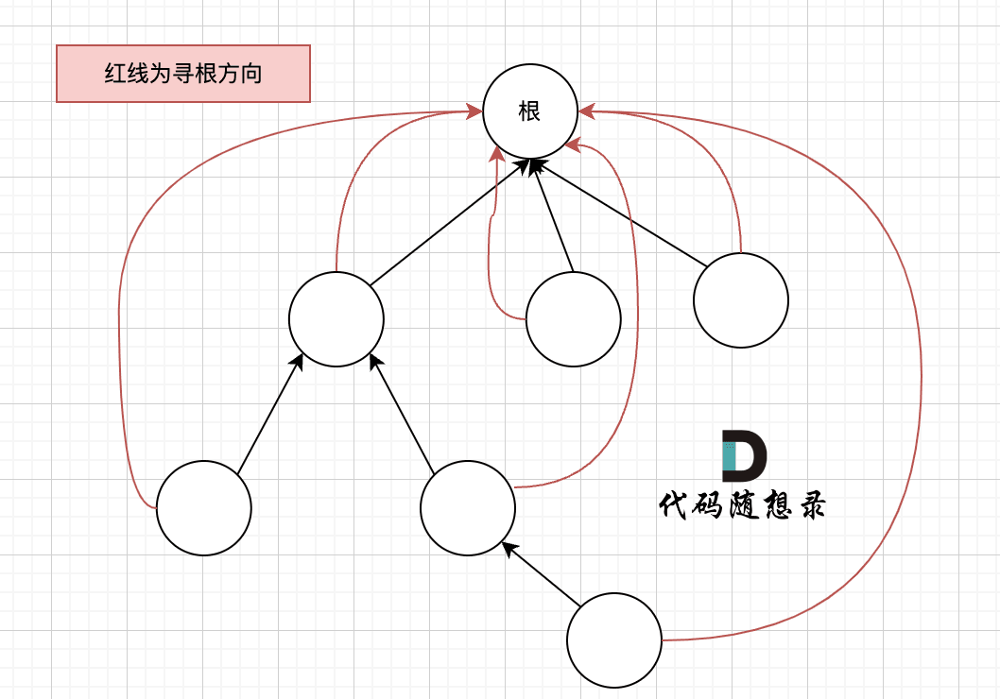

如果這棵多元樹高度（height）很深的話，每次 `find` 函數去尋找根的過程就要遞迴很多次。

我們的目的只需要知道這些節點（node）在同一個根下就可以，所以對這棵多元樹的建構只需要這樣就可以了，如圖：

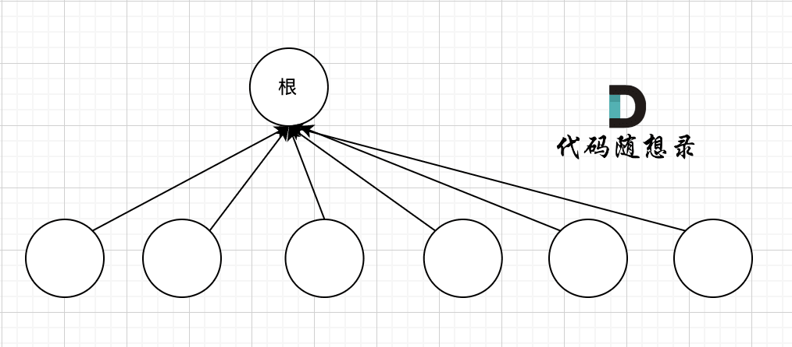

除了根節點其他所有節點都掛載根節點下，這樣我們在尋根的時候就很快，只需要一步，

如果我們想達到這樣的效果，就需要 **路徑壓縮**，將非根節點的所有節點直接指向根節點。
那麼在程式碼層面如何實作呢？

我們只需要在遞迴的過程中，讓 `father[u]` 接住遞迴函數（recursive function）`find(father[u])` 的回傳結果。

因為 `find` 函數向上尋找根節點，`father[u]` 表述 `u` 的父節點（father node），那麼讓 `father[u]` 直接取得 `find` 函數回傳的根節點，這樣就讓節點 `u` 的父節點變成根節點。

程式碼如下，注意看註解，路徑壓縮就一行程式碼：

```CPP
// 互斥集裡尋根的過程
int find(int u) {
    if (u == father[u]) return u;
    else return father[u] = find(father[u]); // 路徑壓縮
}
```

以上程式碼在 C++ 中，可以用 ternary expression 來精簡一下，程式碼如下：

```CPP
int find(int u) {
    return u == father[u] ? u : father[u] = find(father[u]);
}

```

相信不少錄友在學習互斥集的時候，對上面這三行程式碼實作的 `find` 函數很熟悉，但理解上卻不夠深入，僅僅知道這行程式碼很好用，不知道這裡藏著路徑壓縮的過程。

所以對於演算法初學者來說，直接看精簡程式碼學習是不太友好的，往往忽略了很多細節。

## 程式碼模板（template）

那麼此時互斥集的模板就出來了，整體模板 C++ 程式碼如下：

```CPP
int n = 1005; // n 根據題目中節點數量而定，一般比節點數量大一點就好
vector<int> father = vector<int> (n, 0); // C++ 裡的一種陣列結構

// 互斥集初始化
void init() {
    for (int i = 0; i < n; ++i) {
        father[i] = i;
    }
}
// 互斥集裡尋根的過程
int find(int u) {
    return u == father[u] ? u : father[u] = find(father[u]); // 路徑壓縮
}

// 判斷 u 和 v 是否找到同一個根
bool isSame(int u, int v) {
    u = find(u);
    v = find(v);
    return u == v;
}

// 將 v->u 這條邊加入互斥集
void join(int u, int v) {
    u = find(u); // 尋找 u 的根
    v = find(v); // 尋找 v 的根
    if (u == v) return ; // 如果發現根相同，則說明在一個集合，不用兩個節點相連直接回傳
    father[v] = u;
}
```
透過模板，我們可以知道，互斥集主要有三個功能。

1. 尋找根節點，函數：`find(int u)`，也就是判斷這個節點的上代節點（ancestor node）是哪個
2. 將兩個節點串接到同一個集合，函數：`join(int u, int v)`，將兩個節點連在同一個根節點上
3. 判斷兩個節點是否在同一個集合，函數：`isSame(int u, int v)`，就是判斷兩個節點是不是同一個根節點

## 常見誤區

這裡估計有錄友會想，模板中的 `join` 函數裡的這段程式碼：

```CPP
u = find(u); // 尋找 u 的根
v = find(v); // 尋找 v 的根
if (u == v) return ; // 如果發現根相同，則說明在一個集合，不用兩個節點相連直接回傳

```

與 `isSame` 函數的實作是不是重複了？如果抽象一下呢，程式碼如下：

```CPP
// 判斷 u 和 v 是否找到同一個根
bool isSame(int u, int v) {
    u = find(u);
    v = find(v);
    return u == v;
}

// 將 v->u 這條邊加入互斥集
void join(int u, int v) {
    if (isSame(u, v)) return ; // 如果發現根相同，則說明在一個集合，不用兩個節點相連直接回傳
    father[v] = u;
}
```

這樣寫可以嗎？好像看上去沒問題，而且程式碼更精簡了。

**其實這麼寫是有問題的**，在 `join` 函數中我們需要尋找 `u` 和 `v` 的根，然後再進行連線在一起，而不是直接用 `u` 和 `v` 連線在一起。

舉一個例子：

```CPP
join(1, 2);
join(3, 2);
```

此時構成的圖（graph）是這樣的：

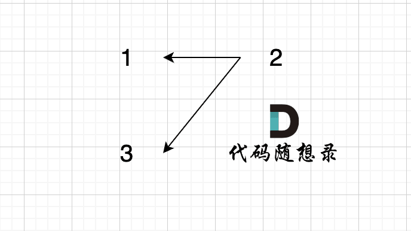

此時問 1，3 是否在同一個集合，我們呼叫 `join(1, 2); join(3, 2);` 很明顯本意要表示 1，3 是在同一個集合。

但我們來看一下程式碼邏輯，當我們呼叫 `isSame(1, 3)` 的時候，`find(1)` 回傳的是 1，`find(3)` 回傳的是 3。`return 1 == 3` 回傳的是 false，程式碼告訴我們 1 和 3 不在同一個集合，這明顯不符合我們的預期，所以問題出在哪裡？

問題出在我們精簡的程式碼上，即 `join` 函數一定要先透過 `find` 函數尋根再進行關聯。

如果 `find` 函數是這麼實作，再來看一下邏輯過程。

```CPP
void join(int u, int v) {
    u = find(u); // 尋找 u 的根
    v = find(v); // 尋找 v 的根
    if (u == v) return ; // 如果發現根相同，則說明在一個集合，不用兩個節點相連直接回傳
    father[v] = u;
}
```

分別將這兩對元素加入集合。

```CPP
join(1, 2);
join(3, 2);
```

當執行 `join(3, 2)` 的時候，會先透過 `find` 函數尋找 3 的根為 3，2 的根為 1（第一個 `join(1, 2)`，將 2 的根設定為 1），所以最後是將 1 指向 3。

構成的圖是這樣的：

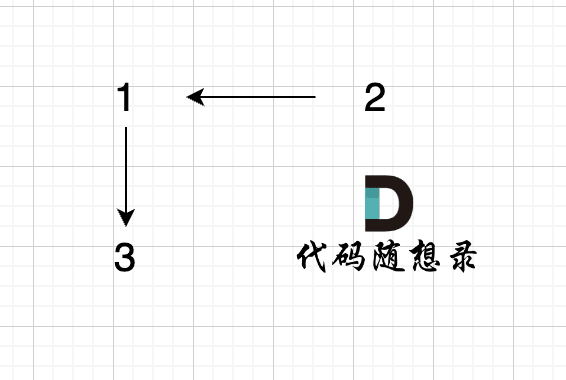

因為在 `join` 函數裡，我們有 `find` 函數進行尋根的過程，這樣就保證元素 1，2，3 在這個有向圖（directed graph）裡是強連接（strongly connected）的。

此時我們再呼叫 `isSame(1, 3)` 的時候，`find(1)` 回傳的是 3，`find(3)` 回傳的也是 3，`return 3 == 3` 回傳的是 true，即告訴我們元素 1 和元素 3 是在同一個集合裡的。


## 模擬（simulation）過程

（**凸顯途徑合併的過程，每一個 join 都要畫圖**）

不少錄友在接觸互斥集模板之後，用起來很嫻熟，因為模板確實相對固定，但是對互斥集內部資料組織方式以及如何判斷是否是同一個集合的原理很模糊。

透過以上講解之後，我再帶大家一步一步去畫一下，互斥集內部資料連接方式。

1、`join(1, 8);` 

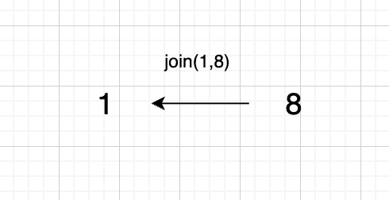 


2、`join(3, 8);` 

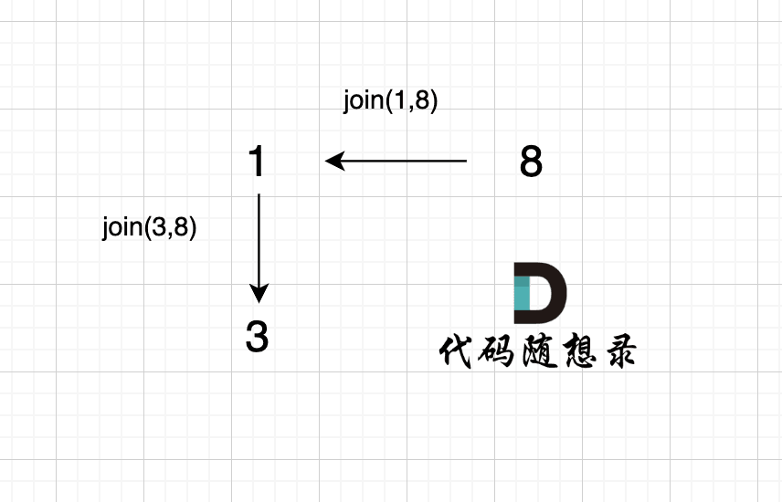 

有錄友可能想，`join(3, 8)` 在圖中為什麼將元素 1 連向元素 3 而不是將元素 8 連向元素 3 呢？

這一點我在「常見誤區」標題下已經詳細講解了，因為在 `join(int u, int v)` 函數裡要分別對 u 和 v 尋根之後再進行關聯。

3、`join(1, 7);` 

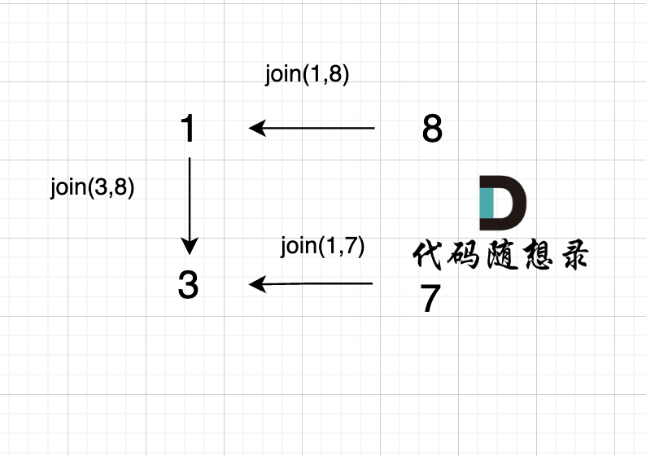 


4、`join(8, 5);` 

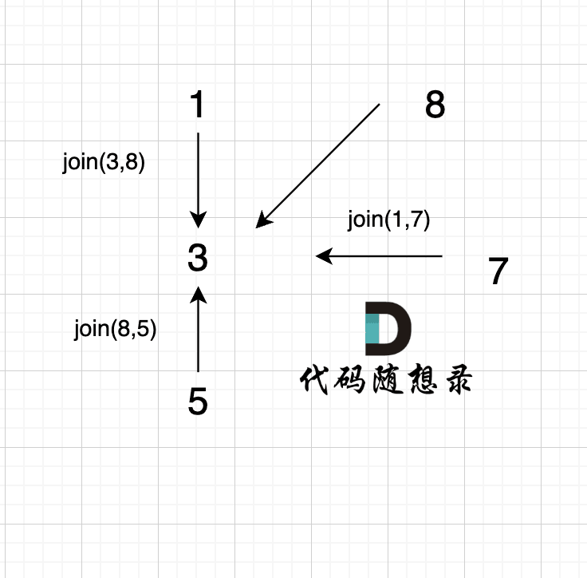

這裡 8 的根是 3，那麼 5 應該指向 8 的根 3，這裡的原因，我們在上面「常見誤區」已經講過了。但為什麼圖中 8 又直接指向了 3 了呢？

**因為路徑壓縮了** 

即如下程式碼在尋找根的過程中，會有路徑壓縮，減少下次查詢的路徑（path）長度。 

```CPP
// 互斥集裡尋根的過程
int find(int u) {
    return u == father[u] ? u : father[u] = find(father[u]); // 路徑壓縮
}
```

5、`join(2, 9);`

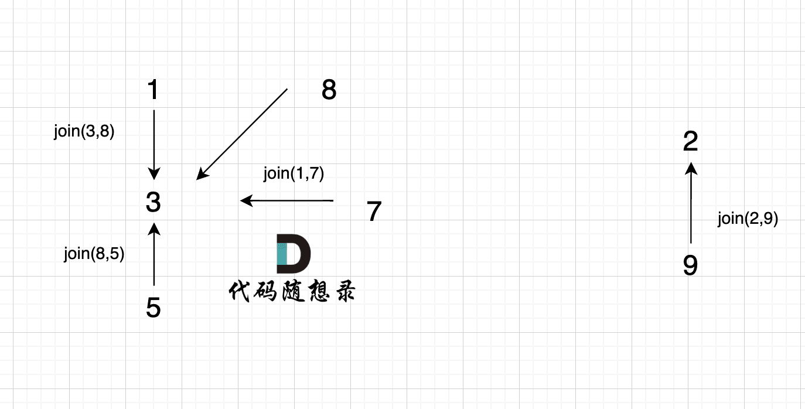

6、`join(6, 9);`

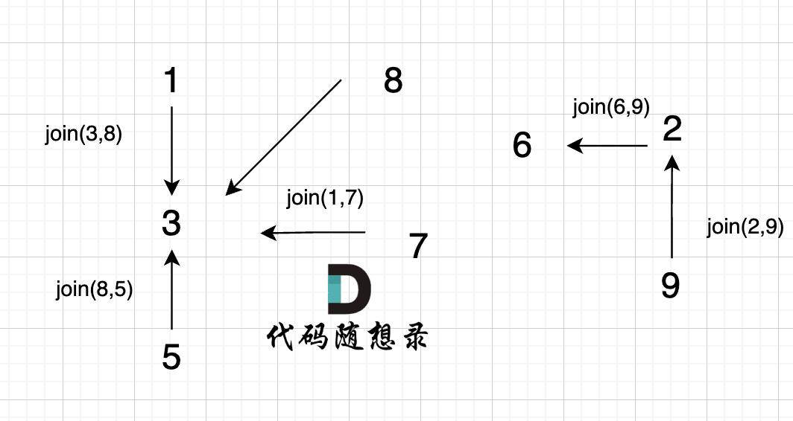 

這裡為什麼是 2 指向了 6，因為 9 的根為 2，所以用 2 指向 6。


大家看懂這個有向圖後，相信應該知道如下函數的回傳值（return value）了。

```CPP
cout << isSame(8, 7) << endl;
cout << isSame(7, 2) << endl;
```

回傳值分別如下，表示 8 和 7 是同一個集合，而 7 和 2 不是同一個集合。

```
true
false
```


## 拓展


在「路徑壓縮」講解中，我們知道如何靠壓縮路徑來縮短查詢根節點的時間。

其實還有另一種方法：按秩合併（union by rank）。

rank 表示樹（tree）的高度，即樹中結點層次的最大值。

例如兩個集合（multi-way tree）需要合併，如圖所示：

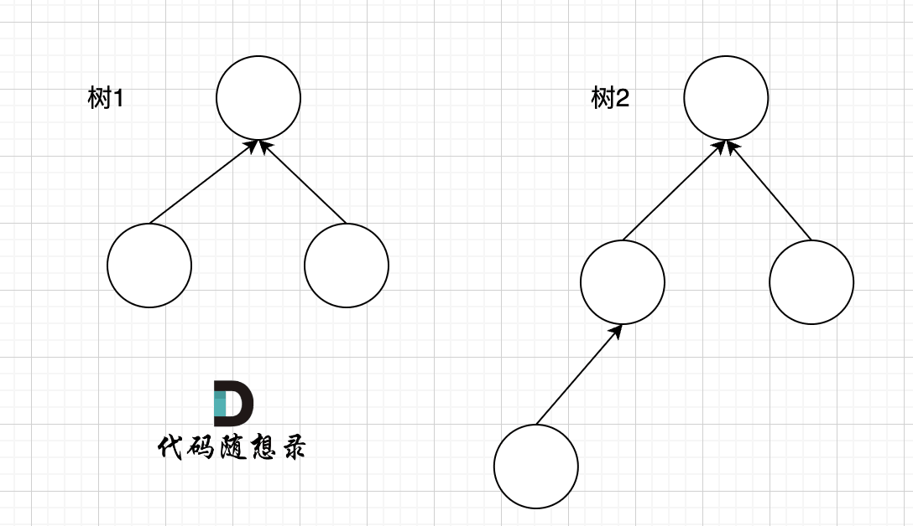

樹 1 rank 為 2，樹 2 rank 為 3。那麼合併兩個集合，是樹 1 合入樹 2，還是樹 2 合入樹 1 呢？

我們來看兩個不同方式合入的效果。

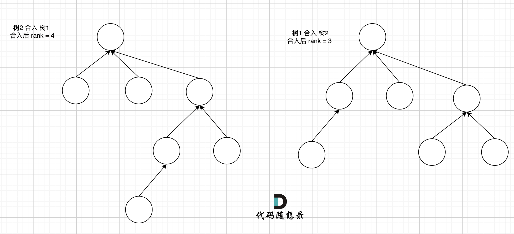

這裡可以看出，樹 2 合入樹 1 會導致整棵樹的高度變得更高，而樹 1 合入樹 2 整棵樹的高度和樹 2 保持一致。

所以在 `join` 函數中如何合併兩棵樹呢？

一定是 rank 小的樹合入到 rank 大的樹，這樣可以保證最後合成的樹 rank 最小，降低在樹上查詢的路徑長度。

按秩合併的程式碼如下：

```CPP
int n = 1005; // n 根據題目中節點數量而定，一般比節點數量大一點就好
vector<int> father = vector<int> (n, 0); // C++ 裡的一種陣列結構
vector<int> rank = vector<int> (n, 1); // 初始每棵樹的高度都為 1

// 互斥集初始化
void init() {
    for (int i = 0; i < n; ++i) {
        father[i] = i;
        rank[i] = 1; // 也可以不寫
    }
}
// 互斥集裡尋根的過程
int find(int u) {
    return u == father[u] ? u : find(father[u]);// 注意這裡不做路徑壓縮
}

// 判斷 u 和 v 是否找到同一個根
bool isSame(int u, int v) {
    u = find(u);
    v = find(v);
    return u == v;
}

// 將 v->u 這條邊加入互斥集
void join(int u, int v) {
    u = find(u); // 尋找 u 的根
    v = find(v); // 尋找 v 的根

    if (rank[u] <= rank[v]) father[u] = v; // rank 小的樹合入到 rank 大的樹
    else father[v] = u;

    if (rank[u] == rank[v] && u != v) rank[v]++; // 如果兩棵樹高度相同，則 v 的高度 +1，因為上面 if (rank[u] <= rank[v]) father[u] = v; 注意是 <=
}
```

可以注意到在上面的模板程式碼中，我是沒有做路徑壓縮的，因為一旦做路徑壓縮，rank 記錄的高度就不準了，根據 rank 來判斷如何合併就沒有意義。

也可以在路徑壓縮的時候，再去即時修正 rank 的數值，但這樣在程式碼實作上麻煩了不少，關鍵是收益很小。

其實我們在最佳化互斥集查詢效率的時候，只用路徑壓縮的思路就夠了，不僅程式碼實作精簡，而且效率足夠高。

按秩合併的思路並沒有將樹狀結構（tree structure）盡可能地扁平化，所以在整體效率上是沒有路徑壓縮高的。

說到這裡可能有錄友會想，那在路徑壓縮的程式碼中，只有查詢的過程即 `find` 函數的執行過程中會有路徑壓縮，如果一直沒有使用 `find` 函數，是不是相當於這棵樹就沒有路徑壓縮，導致查詢效率依然很低呢？

大家可以再去回顧使用路徑壓縮的互斥集模板，在 `isSame` 函數和 `join` 函數中，我們都呼叫了 `find` 函數來進行尋根操作。

也就是說，無論使用互斥集模板裡哪一個函數（除了 `init` 函數），都會有路徑壓縮的過程，第二次存取相同節點的時候，這個節點就是直連根節點的，即第一次存取的時候它的路徑就被壓縮了。

**所以這裡推薦大家直接使用路徑壓縮的互斥集模板就好**，但按秩合併的最佳化思路我依然給大家講清楚，有助於更深一步理解互斥集的最佳化過程。

## 複雜度分析


這裡對路徑壓縮版互斥集來做分析。

空間複雜度（space complexity）：O(n)，申請一個 `father` 陣列。

關於時間複雜度（time complexity），如果想精確表達出來需要繁瑣的數學證明，就不在本篇講解範圍內了，大家感興趣可以自己去深入研究。

這裡做一個簡單的分析思路。

路徑壓縮後的互斥集時間複雜度在 O(logn) 與 O(1) 之間，且隨著查詢或者合併操作的增加，時間複雜度會越來越趨於 O(1)。

了解到這個程度對於求職面試來說就夠了。

在第一次查詢的時候，相當於是 n 元樹（n-ary tree）上從葉節點到根節點的查詢過程，時間複雜度是 logn，但路徑壓縮後，後面的查詢操作都是 O(1)，而 `join` 函數和 `isSame` 函數裡涉及的查詢操作也是一樣的過程。


## 總結

本篇我們講解了互斥集的背景、原理、兩種最佳化方式（路徑壓縮、union by rank）、程式碼模板、常見誤區，以及模擬過程。

要知道互斥集解決什麼問題，在什麼場景下我們要想到使用互斥集。


接下來進一步最佳化互斥集的執行效率，重點介紹了路徑壓縮的方式，另一種方法：按秩合併，我們在「拓展」中講解。

透過一步一步的原理講解，最後給出互斥集的模板，所有的互斥集題目都在這個模板的基礎上進行操作或者適當修改。

但只給出模板還是不夠的，針對大家學習互斥集的常見誤區，詳細講解了模板程式碼的細節。

為了讓錄友們進一步了解互斥集的執行過程，我們再透過具體測試案例（test case）模擬一遍程式碼過程並畫出對應的內部資料連接圖（有向圖）。

這裡也建議大家去模擬一遍才能對互斥集理解得更到位。

如果對模板程式碼還是有點陌生，不用擔心，接下來我會講解對應 LeetCode 上的互斥集題目，透過一系列題目練習，大家就會感受到這套模板有多麼的好用！

敬請期待互斥集題目精講系列。

