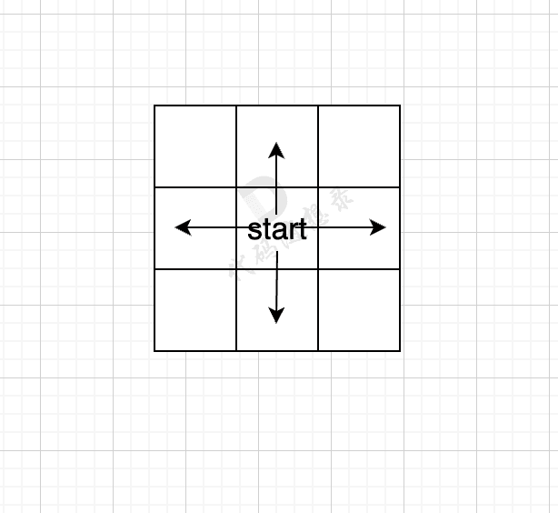
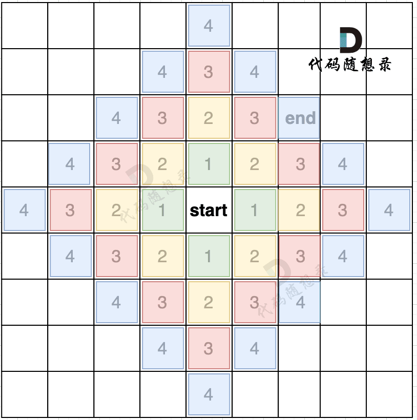
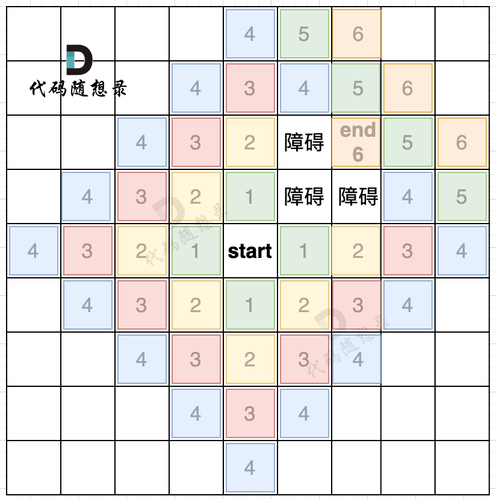

# 廣度優先搜尋（breadth-first search, BFS）理論基礎

**[《代碼隨想錄》演算法影片公開課](https://programmercarl.com/other/gongkaike.html)：[廣度優先搜尋理論基礎](https://www.bilibili.com/video/BV1M19iY4EL9)，相信結合影片再看本篇題解，更有助於大家對本題的理解**。

在[深度優先搜尋（depth-first search, DFS）](./圖論深搜理論基礎.md)的講解中，我們就講過深度優先搜尋和廣度優先搜尋的區別。

廣度優先搜尋（bfs）是一圈一圈的搜尋過程，和深度優先搜尋（dfs）是一條路跑到黑然後再回溯（backtracking）。

## 廣度優先搜尋的使用場景

廣度優先搜尋的搜尋方式就適合於解決兩個點之間的最短路徑（shortest path）問題。

因為廣度優先搜尋是從起點出發，以起始點為中心一圈一圈進行搜尋，一旦遇到終點，記錄之前走過的節點（node）就是一條最短路徑。

當然，也有一些問題是廣度優先搜尋和深度優先搜尋都可以解決的，例如島嶼問題，**這類問題的特徵就是不涉及具體的遍歷（traversal）方式，只要能把相鄰且相同屬性的節點標記上就行**。（我們會在具體題目講解中詳細來說）

## 廣度優先搜尋的過程

上面我們提過，BFS 是一圈一圈的搜尋過程，但具體是怎麼一圈一圈來搜呢。

我們用一個方格地圖，假如每次搜尋的方向為上下左右（不包含斜上方），那麼給出一個 `start` 起始位置，那麼 BFS 就是從四個方向走出第一步。



如果加上一個 `end` 終止位置，那麼使用 BFS 的搜尋過程如圖所示：



我們從圖中可以看出，從 `start` 起點開始，是一圈一圈向外搜尋，方格編號 1 為第一步遍歷的節點，方格編號 2 為第二步遍歷的節點，第四步的時候我們找到終止點 `end`。

正是因為 BFS 一圈一圈的遍歷方式，所以一旦遇到終止點，那麼一定是一條最短路徑。

而且地圖還可以有障礙，如圖所示：



在第五步、第六步我只把關鍵的節點染色了，其他方向周邊沒有去染色，大家只要關注關鍵地方染色的邏輯就可以。

從圖中可以看出，如果添加了障礙，我們是第六步才能走到 `end` 終點。

只要 BFS 搜到終點一定是一條最短路徑，大家可以參考上面的圖，自己再去模擬（simulation）一下。

## 程式碼框架（framework）

大家應該好奇，這一圈一圈的搜尋過程是怎麼做到的，是放在什麼容器（container）裡，才能這樣去遍歷。

很多網上的資料都是直接說用佇列（queue）來實作。

其實，我們僅僅需要一個容器，能保存我們要遍歷過的元素（element）就可以，**那麼用佇列，還是用堆疊（stack），甚至用陣列（array），都是可以的**。

**用佇列的話，就是保證每一圈都是一個方向去轉，例如統一順時針（clockwise）或者逆時針**。

因為佇列是先進先出（first in first out, FIFO），加入元素和彈出元素的順序是沒有改變的。

**如果用堆疊的話，就是第一圈順時針遍歷，第二圈逆時針遍歷，第三圈又順時針遍歷**。

因為堆疊是先進後出（first in last out, FILO），加入元素和彈出元素的順序改變了。

那麼廣度優先搜尋需要注意轉圈搜尋的順序嗎？不需要！

所以用佇列，還是用堆疊都是可以的，但大家都習慣用佇列了，**所以下面的講解我也用佇列來講，只不過要給大家說清楚，並不是非要用佇列，用堆疊也可以**。

下面給出廣度優先搜尋程式碼模板（template），該模板針對的就是上面的四方格的地圖：（詳細註解）

```CPP
int dir[4][2] = {0, 1, 1, 0, -1, 0, 0, -1}; // 表示四個方向
// grid 是地圖，也就是一個二維陣列
// visited 標記存取過的節點，不要重複存取
// x,y 表示開始搜尋節點的下標
void bfs(vector<vector<char>>& grid, vector<vector<bool>>& visited, int x, int y) {
    queue<pair<int, int>> que; // 定義佇列
    que.push({x, y}); // 起始節點加入佇列
    visited[x][y] = true; // 只要加入佇列，立刻標記為存取過的節點
    while(!que.empty()) { // 開始遍歷佇列裡的元素
        pair<int ,int> cur = que.front(); que.pop(); // 從佇列取元素
        int curx = cur.first;
        int cury = cur.second; // 目前節點坐標
        for (int i = 0; i < 4; i++) { // 開始向目前節點的四個方向左右上下去遍歷
            int nextx = curx + dir[i][0];
            int nexty = cury + dir[i][1]; // 取得周邊四個方向的坐標
            if (nextx < 0 || nextx >= grid.size() || nexty < 0 || nexty >= grid[0].size()) continue;  // 坐標越界了，直接跳過
            if (!visited[nextx][nexty]) { // 如果節點沒被存取過
                que.push({nextx, nexty});  // 佇列新增該節點為下一輪要遍歷的節點
                visited[nextx][nexty] = true; // 只要加入佇列立刻標記，避免重複存取
            }
        }
    }

}
```


## 總結

當然廣度優先搜尋還有很多細節需要注意的地方，後面我會針對廣度優先搜尋的題目再做針對性的講解。

**因為在理論篇講太多細節，可能會讓剛學廣度優先搜尋的錄友們越看越懵**，所以細節方面針對具體題目再做講解。

本篇我們重點講解了廣度優先搜尋的使用場景，廣度優先搜尋的過程以及廣度優先搜尋的程式碼框架。

其實在二元樹（binary tree）章節的[層次序走訪（level order traversal）](https://programmercarl.com/0102.%E4%BA%8C%E5%8F%89%E6%A0%91%E7%9A%84%E5%B1%82%E5%BA%8F%E9%81%8D%E5%8E%86.html)中，我們也講過一次廣度優先搜尋，相當於是廣度優先搜尋在二元樹這種資料結構上的應用。

這次則從圖論（graph theory）的角度上再詳細講解一次 breadth-first traversal。

相信看完本篇，大家會對廣度優先搜尋有一個基礎性的認識，後面再來做對應的題目就會得心應手一些。

