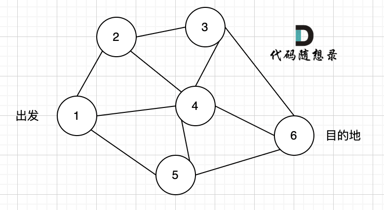
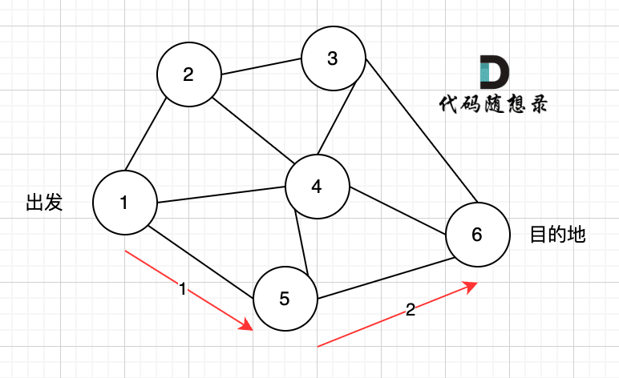
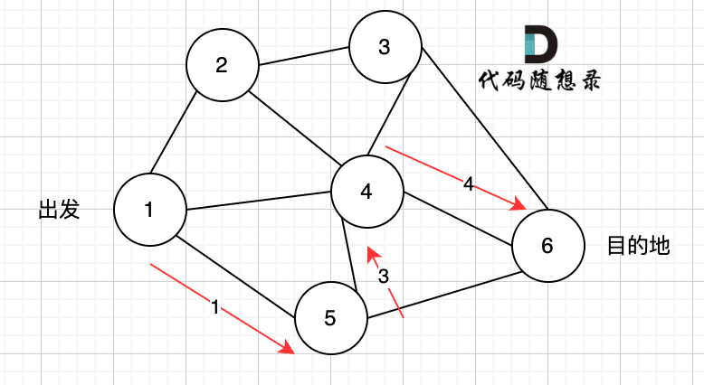
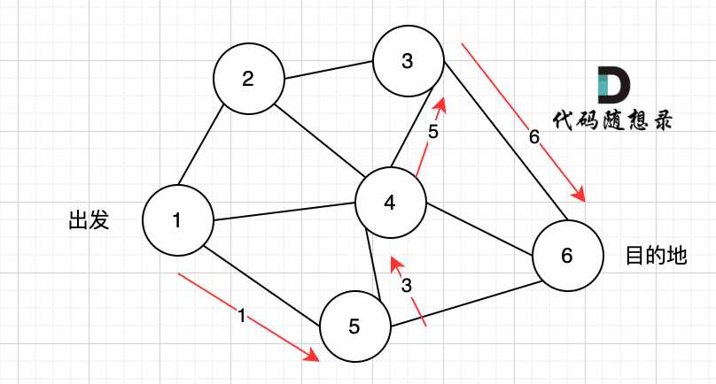
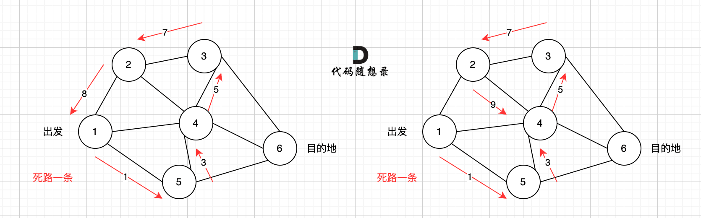
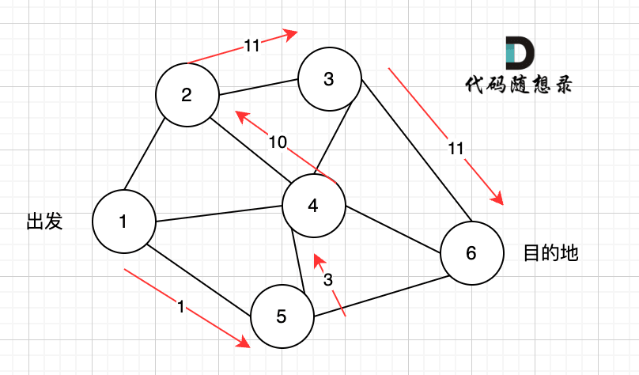
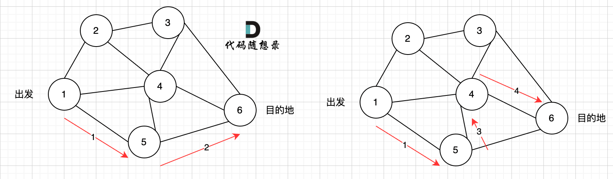

# 深度優先搜尋（depth-first search, DFS）理論基礎 

**[《程式碼隨想錄》演算法影片公開課](https://programmercarl.com/other/gongkaike.html)：[深度優先搜尋理論基礎](https://www.bilibili.com/video/BV1hFA8eKE6C)，相信結合影片再看本篇題解，更有助於大家對本題的理解**。

錄友們期待圖論（graph theory）內容已久了，為什麼拖了這麼久，主要是最近半年開始更新[程式碼隨想錄演算法公開課](https://www.bilibili.com/video/BV1fA4y1o715/)，是開放原始碼（open source）在 B 站的演算法影片，已經幫助非常多基礎不好的錄友學習演算法。 

錄影片其實是非常累的，也要花很多時間，所以圖論這邊就沒抽出時間來。 

後面計畫先給大家講圖論裡大家特別需要的深度優先搜尋（depth-first search, DFS）和廣度優先搜尋（breadth-first search, BFS）。 

以下，開始講解DFS理論基礎：

## DFS 與 BFS 區別 

提到DFS，就不得不說和BFS有什麼區別

先來了解 DFS 的過程，很多錄友可能對 DFS（DFS）、BFS（BFS）分不清。

先給大家說一下兩者大概的區別：

* DFS 是朝一個方向去搜，不到黃河心不死，直到遇到絕境了、搜不下去了，再換方向（換方向的過程就涉及到了回溯（backtracking））。 
* BFS 是先把本節點（node）所連接的所有節點遍歷（traversal）一遍，走到下一個節點的時候，再把連接節點的所有節點遍歷一遍，搜尋方向更像是廣度，四面八方的搜尋過程。 

當然以上講的是大體可以這麼理解，接下來我們詳細講解 DFS（BFS 會再用單獨一篇文章詳細講解）。 

## DFS 搜尋過程

上面說到 DFS 是朝一個方向搜，不到黃河心不死。那麼我們來舉一個例子。 

如圖一，是一個無向圖（undirected graph），我們要搜尋從節點 1 到節點 6 的所有路徑（path）。 

 

那麼 DFS 搜尋的第一條路徑是這樣的：（假設第一次沿預設（default）方向，就找到了節點 6），圖二

 

此時我們找到了節點 6（遇到黃河了，是不是應該回頭了），那麼應該再去搜尋其他方向了。如圖三： 

 

路徑 2 撤銷了，改變了方向，走路徑 3（紅色線），接著也找到終點 6。那麼撤銷路徑 2、改為路徑 3，在 DFS 中其實就是回溯的過程（這一點很重要，很多錄友不理解 DFS 程式碼中回溯是用來幹什麼的）

又找到了一條從節點 1 到節點 6 的路徑，又到黃河了，此時再回頭，下圖圖四中，路徑 4 撤銷（回溯的過程），改為路徑 5。



又找到了一條從節點 1 到節點 6 的路徑，又到黃河了，此時再回頭，下圖圖五，路徑 6 撤銷（回溯的過程），改為路徑 7、路徑 8 和路徑 7、路徑 9，結果發現死路一條，都走到了自己走過的節點。



那麼節點 2 所連接路徑和節點 3 所連接的路徑都走過了，撤銷路徑只能向上回退，去選擇撤銷當初節點 4 的選擇，也就是撤銷路徑 5，改為路徑 10。如圖六： 

 


上圖演示中，其實我並沒有把所有的從節點 1 到節點 6 的 DFS（DFS）過程都畫出來，那樣太冗餘（redundant）了，但已經把 DFS 關鍵的地方都涉及到了，關鍵就兩點： 

* 搜尋方向，是認準一個方向搜，直到碰壁之後再換方向 
* 換方向是撤銷原路徑，改為節點連接的下一個路徑，即回溯的過程。  

## 程式碼框架 

正是因為 DFS 搜尋朝一個方向，並需要回溯，所以用遞迴（recursion）的方式來實作是最方便的。 

很多錄友對回溯很陌生，建議先看看《程式碼隨想錄》的[回溯演算法章節](../回溯演算法理論基礎.md)。 

有遞迴的地方就有回溯，那麼回溯在哪裡呢？ 

就在遞迴函數（recursive function）的下面，例如如下程式碼： 

```cpp
void dfs(參數) {
    處理節點
    dfs(圖, 選擇的節點); // 遞迴
    回溯，撤銷處理結果
}
```

可以看到回溯操作就在遞迴函數的下面，遞迴和回溯是相輔相成的。 

在講解[二元樹章節](../二叉樹理論基礎.md)的時候，二元樹（binary tree）的遞迴法其實就是 DFS，而二元樹的疊代（iteration）法，就是 BFS（BFS）

所以 **DFS、BFS 其實是基礎搜尋演算法，也廣泛應用於其他資料結構與演算法中**。  

我們再回顧一下[回溯法](../回溯演算法理論基礎.md)的程式碼框架：

```cpp
void backtracking(參數) {
    if (終止條件) {
        存放結果;
        return;
    }
    for (選擇：本層集合中元素（樹中節點孩子的數量就是集合的大小）) {
        處理節點;
        backtracking(路徑, 選擇列表); // 遞迴
        回溯，撤銷處理結果
    }
}

```

回溯演算法（backtracking algorithm），其實就是 DFS 的過程，這裡給出 DFS 的程式碼框架： 

```cpp
void dfs(參數) {
    if (終止條件) {
        存放結果;
        return;
    }

    for (選擇：本節點所連接的其他節點) {
        處理節點;
        dfs(圖, 選擇的節點); // 遞迴
        回溯，撤銷處理結果
    }
}

```

可以發現 DFS 的程式碼框架和回溯演算法的程式碼框架是差不多的。

下面我再用深搜三部曲，來解讀 DFS 的程式碼框架。

## 深搜三部曲 

在[二元樹遞迴講解](../二叉樹的遞迴遍歷.md)中，給出了遞迴三部曲。 

[回溯演算法](../回溯演算法理論基礎.md)講解中，給出了回溯三部曲。

其實深搜也是一樣的，深搜三部曲如下： 

1. 確認遞迴函數、參數（parameter） 

```cpp
void dfs(參數)
```

通常我們遞迴的時候，需要了解哪些參數，其實也可以在寫遞迴函數的時候，發現需要什麼參數再去補充就可以。 

一般情況，深搜需要二維（2D）陣列（array）結構保存所有路徑，需要一維陣列（one dimensional array）保存單一路徑，這種保存結果的陣列，我們可以定義一個全域變數（global variable），避免讓我們的函數（function）參數過多。 

例如這樣： 

```cpp
vector<vector<int>> result; // 保存符合條件的所有路徑
vector<int> path; // 起點到終點的路徑
void dfs (圖, 目前搜尋的節點)  
```

但這種寫法看個人習慣，不強求。 

2. 確認終止條件（termination condition） 

終止條件很重要，很多同學寫 DFS 的時候，之所以容易無限迴路（infinite loop）、堆疊溢出（stack overflow）等等這些問題，都是因為終止條件沒有想清楚。 

```cpp
if (終止條件) {
    存放結果;
    return;
}
```

終止條件不僅是結束本層遞迴，同時也是我們收穫結果的時候。 

另外，其實很多 DFS 寫法沒有寫終止條件，其實終止條件隱藏在下面 DFS 遞迴的邏輯裡了，也就是不符合條件直接不會向下遞迴。這裡如果大家不理解的話沒關係，後面會有具體題目來講解。

3. 處理目前搜尋節點出發的路徑 

一般這裡就是一個 for 迴圈（for-loop）的操作，去遍歷目前搜尋節點所能到達的所有節點。 

```cpp
for (選擇：本節點所連接的其他節點) {
    處理節點;
    dfs(圖, 選擇的節點); // 遞迴
    回溯，撤銷處理結果
}
```

不少錄友疑惑的地方，都是 DFS 程式碼框架中 for 迴圈裡分明已經處理節點了，那麼 DFS 函數下面為什麼還要撤銷呢？ 

如圖七所示，路徑 2 已經走到了目的地節點 6，那麼路徑 2 是如何撤銷，然後改為路徑 3 呢？其實這就是回溯的過程，撤銷路徑 2，換下一個方向走。 




## 總結 

我們講解了 DFS 和 BFS 的大體區別（BFS 詳細過程下篇來講），DFS 的搜尋過程以及程式碼框架。

最後還有深搜三部曲來解讀這份程式碼框架。 

以上如果大家都能理解了，其實搜尋的程式碼就很好寫，具體題目套用具體場景就可以了。

後面我也會給大家安排具體練習的題目，依舊是《程式碼隨想錄》的風格，循序漸進、由淺入深！


