# 圖論（graph theory）理論基礎 

**[《程式碼隨想錄》演算法影片公開課](https://programmercarl.com/other/gongkaike.html)：[圖論理論基礎](https://www.bilibili.com/video/BV1hYNBeYEvb/)，相信結合影片再看本篇題解，更有助於大家對本題的理解**。

這一篇我們正式開始圖論！ 

《程式碼隨想錄》圖論中的演算法題目將統一使用 ACM 模式，[為什麼要使用 ACM 模式](./圖論為什麼用ACM模式.md)

## 圖（graph）的基本概念 

二維（two-dimensional）坐標（coordinate）中，兩點可以連成線，多個點連成的線就構成了圖。

當然圖也可以就一個節點（node），甚至沒有節點（空圖（empty graph））

### 圖的種類

整體上一般分為有向圖（directed graph）和無向圖（undirected graph）。 

有向圖是指圖中邊（edge）是有方向的： 

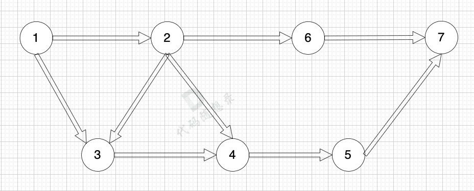

無向圖是指圖中邊沒有方向： 

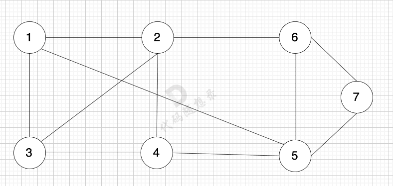

加權有向圖，就是圖中邊是有權重（weight）的，例如： 

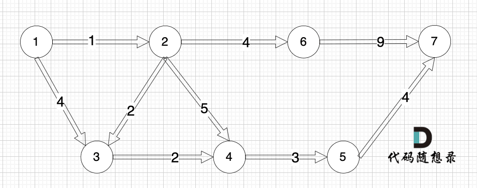 

加權無向圖也是同理。 

### 度（degree） 

無向圖中有幾條邊連接該節點，該節點就有幾度。 

例如，該無向圖中，節點 4 的度為 5，節點 6 的度為 3。

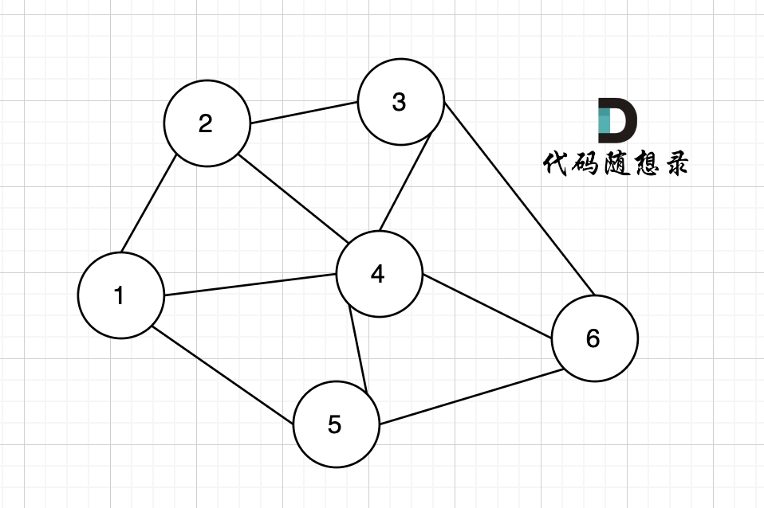 

在有向圖中，每個節點有外度數（out degree）和輸入度（in degree）。 

外度數：從該節點出發的邊的個數。

輸入度：指向該節點邊的個數。 

例如，該有向圖中，節點 3 的輸入度為 2，外度數為 1，節點 1 的輸入度為 0，外度數為 2。

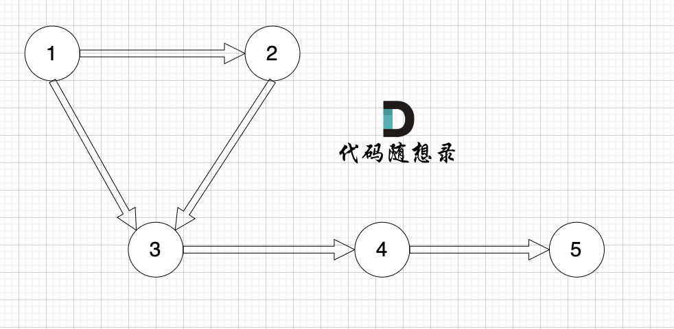

## 連通性（connectivity） 

在圖中表示節點的連通情況，我們稱之為連通性。 

### 連接圖（connected graph） 

在無向圖中，任何兩個節點都是可以到達的，我們稱之為連接圖，如圖： 

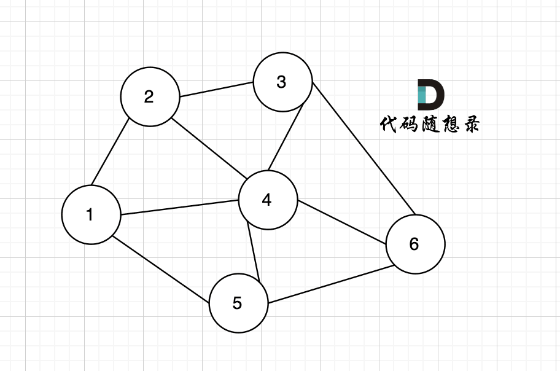 

如果有節點不能到達其他節點，則為非連接圖（disconnected graph），如圖： 

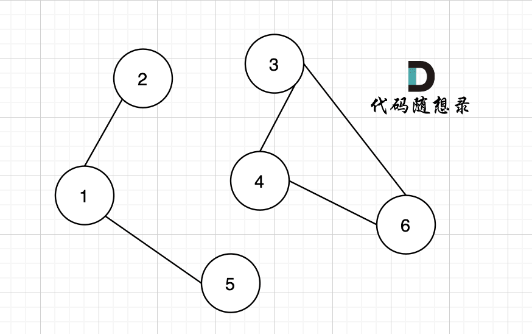 

節點 1 不能到達節點 4。 

### 強連接圖（strongly connected graph） 

在有向圖中，任何兩個節點是可以相互到達的，我們稱之為強連接圖。 

這裡有錄友可能想，這和無向圖中的連接圖有什麼區別，不是一樣的嗎？ 

我們來看這個有向圖：  

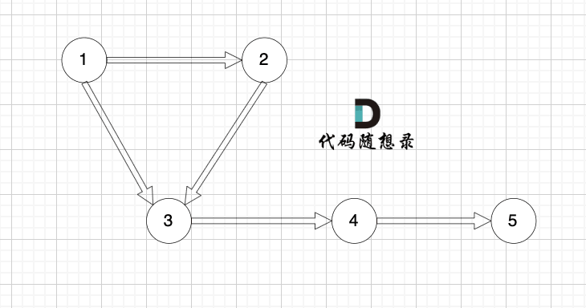 

這個圖是強連接圖嗎？ 

初步一看，好像這節點都連著呢，但這不是強連接圖，節點 1 可以到節點 5，但節點 5 不能到節點 1。

強連接圖是在有向圖中**任何兩個節點是可以相互到達**  

下面這個有向圖才是強連接圖：

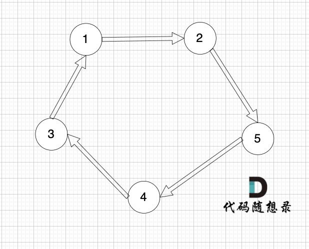

### 連接組件（connected components）

在無向圖中的極大連接子圖（subgraph）稱之為該圖的一個連接組件。 

只看概念大家可能不理解，我來畫個圖： 

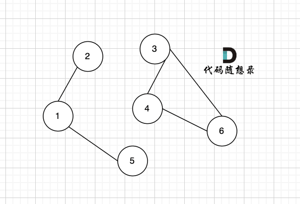 

該無向圖中節點 1、節點 2、節點 5 構成的子圖就是該無向圖中的一個連接組件，該子圖所有節點都是相互可到達的。 

同理，節點 3、節點 4、節點 6 構成的子圖也是該無向圖中的一個連接組件。  

那麼無向圖中節點 3、節點 4 構成的子圖是該無向圖的連接組件嗎？ 

不是！

因為必須是極大連接子圖才能是連接組件，所以必須是節點 3、節點 4、節點 6 構成的子圖才是連接組件。 

在圖論中，連接組件是一個很重要的概念，例如島嶼問題（後面章節會有專門講解）其實就是求連接組件。 

### 強連接組件（strongly connected component） 

在有向圖中極大強連接子圖稱之為該圖的強連接組件。 

如圖： 

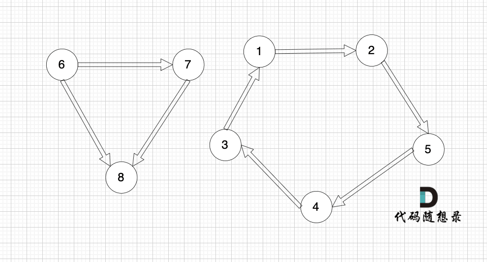

節點 1、節點 2、節點 3、節點 4、節點 5 構成的子圖是強連接組件，因為這是強連接圖，也是極大圖。 

節點 6、節點 7、節點 8 構成的子圖不是強連接組件，因為這不是強連接圖，節點 8 不能到達節點 6。 

節點 1、節點 2、節點 5 構成的子圖也不是強連接組件，因為這不是極大圖。 

## 圖的建構

我們如何用程式碼來表示一個圖呢？ 

一般使用相鄰串列（adjacency list）、相鄰矩陣（adjacency matrix），或者用類別（class）來表示。 

主要是樸素儲存、相鄰串列和相鄰矩陣。 

關於樸素儲存，這是我自創的名字，因為這種儲存方式，就是將所有邊存下來。 

例如圖：  

圖中有 8 條邊，我們就定義 8 * 2 的陣列（array），即有 n 條邊就申請 n * 2 這麼大的陣列： 

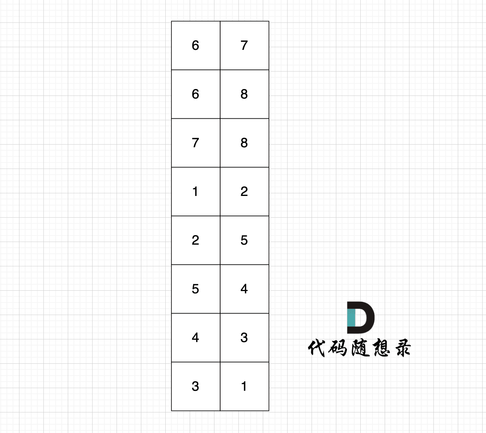

陣列第一列（row）：6 7，就表示節點 6 指向節點 7，以此類推。 

當然可以不用陣列，用 map，或者用類別都可以表示出這種邊的關係。

這種表示方式的好處就是直觀，把節點與節點之間關係很容易展現出來。

但如果我們想知道節點 1 和節點 6 是否相連，我們就需要把儲存空間都列舉（enumeration）一遍才行。

這是明顯的缺點，同時，我們在深度優先搜尋（depth-first search, DFS）和廣度優先搜尋（breadth-first search, BFS）的時候，都不會使用這種儲存方式。

因為搜尋中，需要知道節點與其他節點的連接情況，而這種樸素儲存，都需要全部列舉才知道連接情況。 

在圖論章節的後面文章講解中，我會舉例說明的。大家先有個印象。

### 相鄰矩陣 

相鄰矩陣使用二維（2D）陣列來表示圖結構。相鄰矩陣是從節點的角度來表示圖，有多少節點就申請多大的二維陣列。

例如：grid[2][5] = 6，表示節點 2 連接節點 5，為有向圖，節點 2 指向節點 5，邊的權重為 6。

如果想表示無向圖，即：grid[2][5] = 6，grid[5][2] = 6，表示節點 2 與節點 5 相互連通，權重為 6。

如圖： 

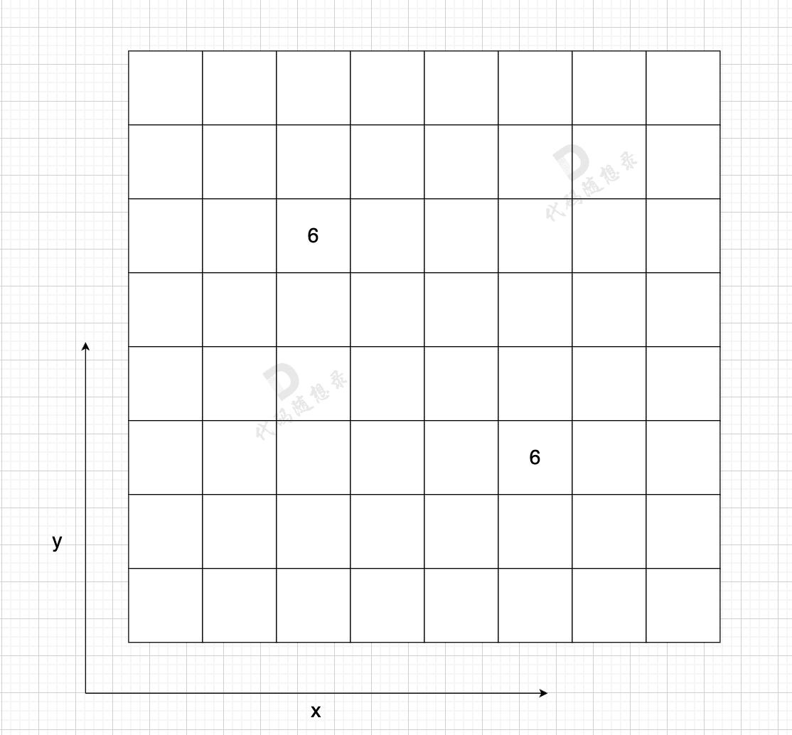 

在一個 n（節點數）為 8 的圖中，就需要申請 8 * 8 這麼大的空間。

圖中有一條雙向邊，即：grid[2][5] = 6，grid[5][2] = 6

這種表達方式（相鄰矩陣）在邊少、節點多的情況下，會導致申請過大的二維陣列，造成空間浪費。 

而且在尋找節點連接情況的時候，需要遍歷（traversal）整個矩陣（matrix），即 n * n 的時間複雜性（time complexity），同樣造成時間浪費。 

相鄰矩陣的優點： 

* 表達方式簡單，易於理解
* 檢查任意兩個頂點（vertex）間是否存在邊的操作非常快
* 適合密集圖（dense graph），在邊數接近頂點數平方的圖中，相鄰矩陣是一種空間效率較高的表示方法。 

缺點： 

* 遇到稀疏圖形（sparse graph），會導致申請過大的二維陣列造成空間浪費，且遍歷邊的時候需要遍歷整個 n * n 矩陣，造成時間浪費 

### 相鄰串列

相鄰串列使用陣列 + 鏈接串列（linked list）的方式來表示。相鄰串列是從邊的數量來表示圖，有多少邊才會申請對應大小的鏈接串列。 

相鄰串列的建構如圖： 

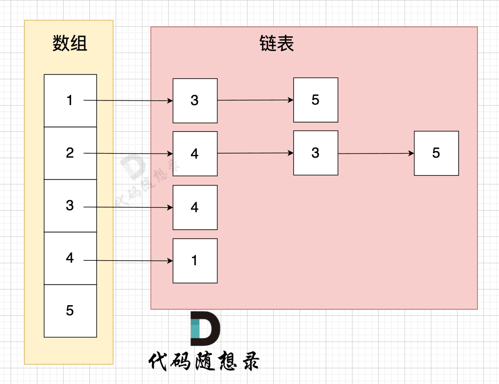 

這裡表達的圖是： 

* 節點 1 指向節點 3 和節點 5 
* 節點 2 指向節點 4、節點 3、節點 5 
* 節點 3 指向節點 4 
* 節點 4 指向節點 1 

有多少邊，相鄰串列才會申請多少個對應的鏈接串列節點。 

從圖中可以直觀看出使用陣列 + 鏈接串列來表達邊的連接情況。 

相鄰串列的優點： 

* 對於稀疏圖形的儲存，只需要儲存邊，空間利用率高 
* 遍歷節點連接情況相對容易

缺點： 

* 檢查任意兩個節點間是否存在邊，效率相對低，需要 O(V) 時間，V 表示某節點連接其他節點的數量。
* 實作相對複雜，不易理解 

**以上大家可能理解比較模糊，沒關係**，因為大家還沒做過圖論的題目，對於圖的表達沒有概念。 

這裡我先不給出具體的實作程式碼，大家先有個初步印象，在後面演算法題實戰中，我還會講到具體程式碼實作，等帶大家做演算法題、寫了程式碼之後，自然就理解了。

## 圖的遍歷方式

圖的遍歷方式基本是兩大類：

* 深度優先搜尋（DFS）
* 廣度優先搜尋（BFS） 

在講解二元樹（binary tree）章節的時候，其實就已經講過這兩種遍歷方式。 

二元樹的遞迴（recursion）遍歷，是 DFS 在二元樹上的遍歷方式。 

二元樹的層次序走訪（level order traversal），是 BFS 在二元樹上的遍歷方式。 

DFS 和 BFS 是一種搜尋演算法，可以在不同的資料結構上進行搜尋，在二元樹章節裡是在二元樹這樣的資料結構上搜尋。 

而在圖論章節，則是在圖（相鄰串列或相鄰矩陣）上進行搜尋。 

## 總結 

以上知識點大家先有個印象，上面提到的每個知識點，其實都需要大篇幅才能講明白的。

我這裡先給大家做一個概括，後面章節會針對每個知識點都有對應的演算法題和針對性的講解，大家再去深入學習。 

圖論是非常龐大的知識體系，上面的內容還不足以概括圖論內容，僅僅是理論基礎而已。 

在圖論章節我會帶大家深入講解深度優先搜尋（DFS）、廣度優先搜尋（BFS）、互斥集（disjoint set）、拓蹼排序（topological sort）、最小生成樹（minimum spanning tree, MST）、最短路徑（shortest path）演算法系列等等。 

敬請期待！

