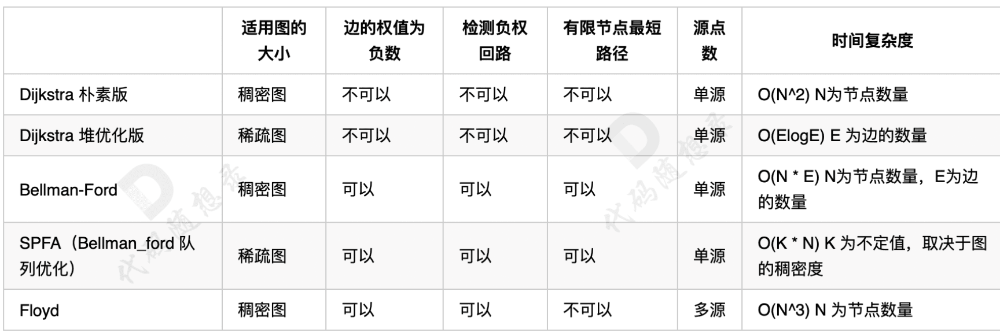

# 最短路徑（shortest path）演算法總結篇 

至此已經講解了四大最短路徑演算法，分別是 Dijkstra、Bellman_ford、SPFA 和 Floyd。 

針對這四大最短路徑演算法，我用了七篇長文才徹底講清楚，分別是：

* Dijkstra 樸素版 
* Dijkstra 堆積（heap）最佳化版 
* Bellman_ford
* Bellman_ford 佇列（queue）最佳化演算法（又名 SPFA）
* bellman_ford 演算法判斷 負環（negative cycle）
* bellman_ford 之單源有限最短路徑
* Floyd 演算法精講  
* 啟發式搜尋（heuristic search）：A * 演算法  

最短路徑演算法比較複雜，而且各自有各自的應用場景，我來用一張表把講過的最短路徑演算法的使用場景都展現出來： 

（因為 A * 屬於啟發式搜尋，和上面最短路徑演算法並不是一類，不適合一起對比，所以沒有放在一起）

可能有同學感覺：這個表太複雜了，我記也記不住。 

其實記不住的原因還是對這幾個最短路徑演算法沒有深刻的理解。 

這裡我給大家一個大體使用場景的分析： 

**如果遇到單源且邊（edge）為正數（positive number），直接 Dijkstra**。 

至於**使用樸素版還是堆積最佳化版，還是取決於圖（graph）的稠密度**，多少節點（node）多少邊算是密集圖（dense graph），多少算是稀疏圖形（sparse graph），這個沒有量化，如果想量化只能寫出兩個版本然後做實驗去測試，不同的評測機得出的結果還不太一樣。 

一般情況下，可以直接用堆積最佳化版本。 

**如果遇到單源邊可為負數（negative number），直接 Bellman-Ford**，同樣 SPFA 還是 Bellman-Ford 取決於圖的稠密度。 

一般情況下，直接用 SPFA。

**如果有 負環，優先 Bellman-Ford**，如果是有限節點最短路徑也優先 Bellman-Ford，理由是寫程式碼比較方便。  

**如果是遇到多源點求最短路徑，直接 Floyd**。

除非源點特別少，且邊都是正數，那可以多次 Dijkstra 求出最短路徑，但這種情況很少，一般出現多個源點了，就是想讓你用 Floyd 了。 

對於 A *，由於其高效性，所以在實際工程應用中使用最為廣泛，由於其結果的不唯一性，也就是可能是次短路的特性，一般不適合作為演算法題。 

遊戲開發、地圖導航、封包（packet）路由（routing）等都廣泛使用 A * 演算法。

