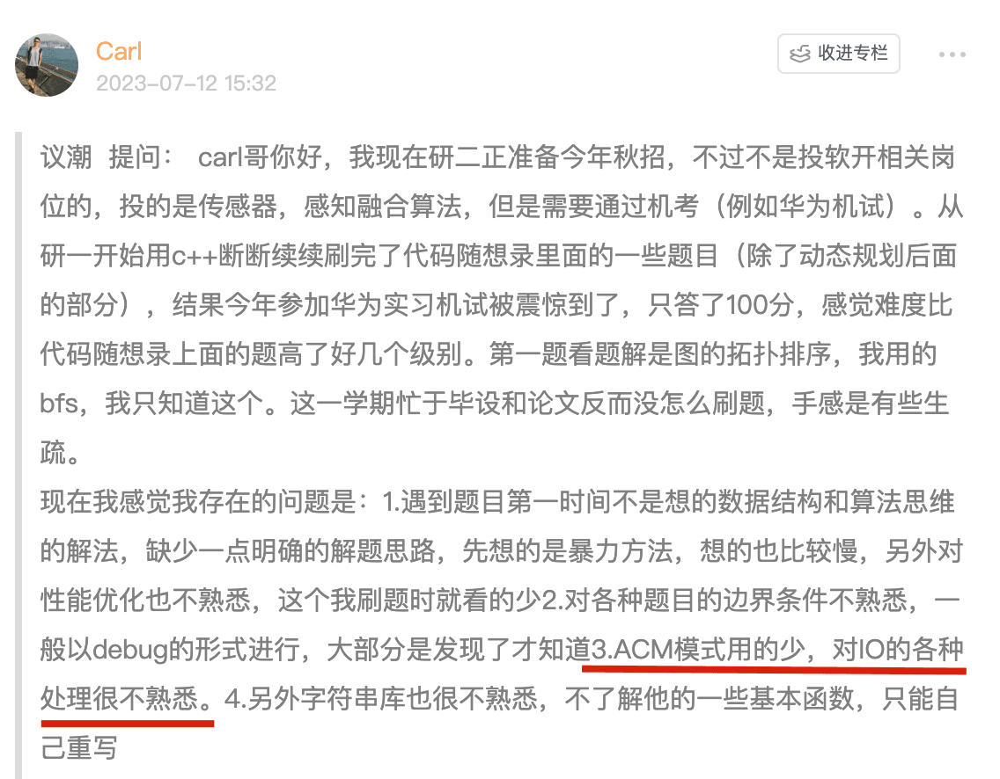
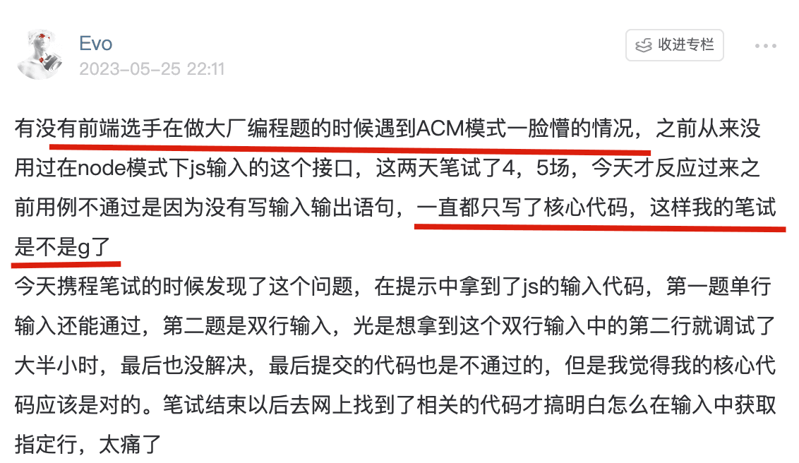
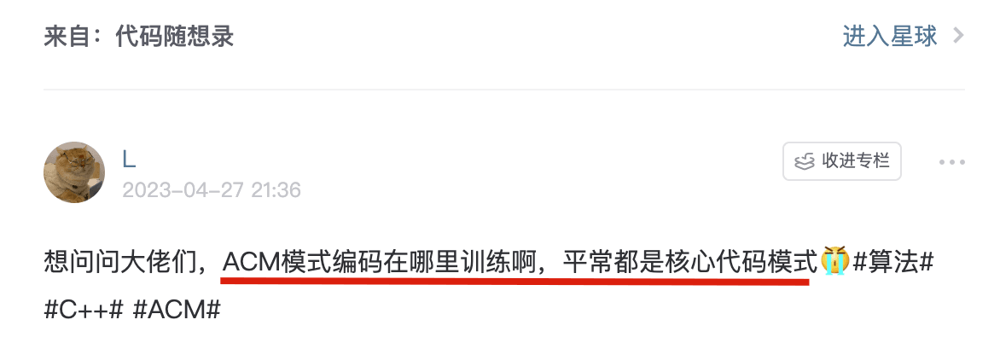
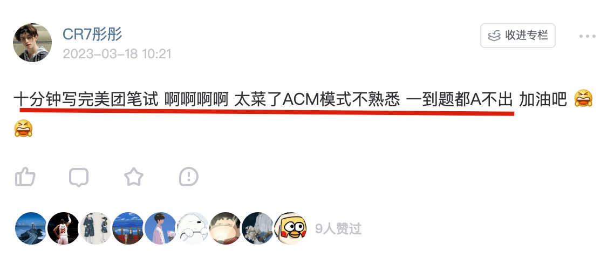
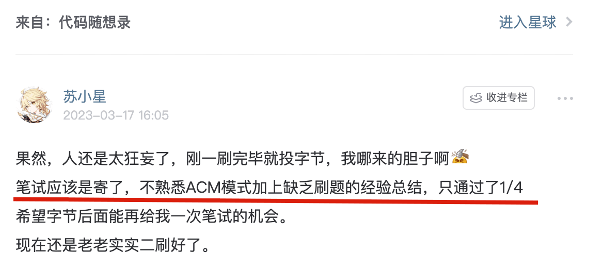
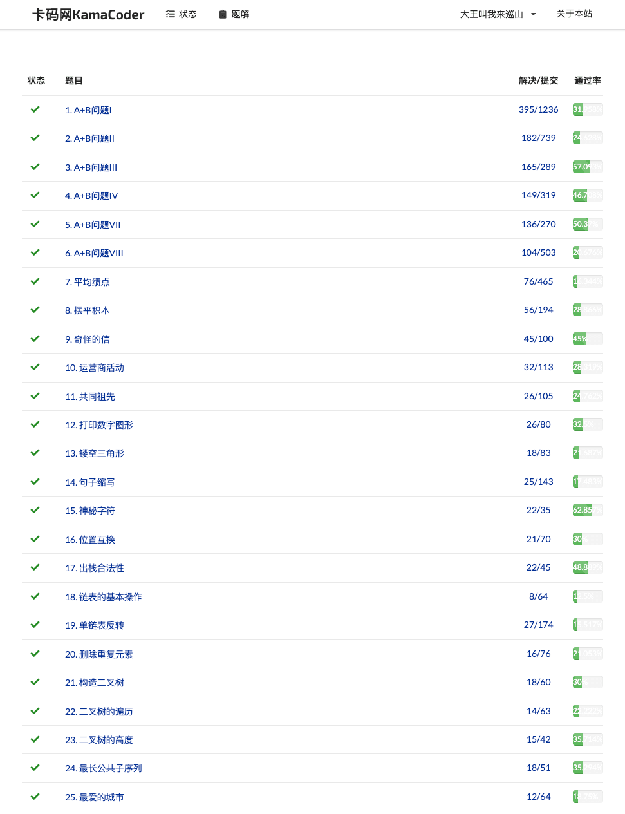
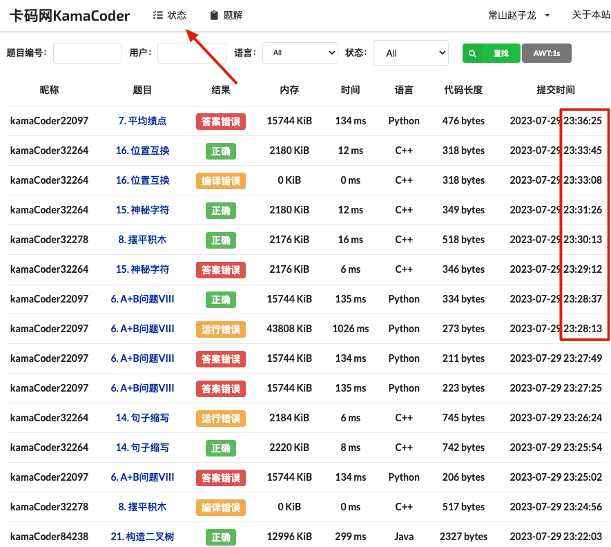
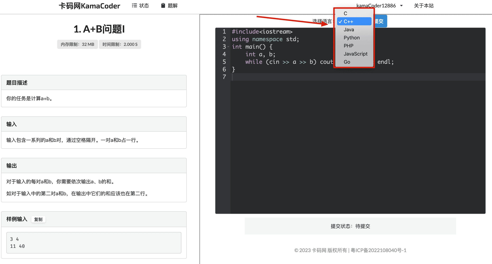
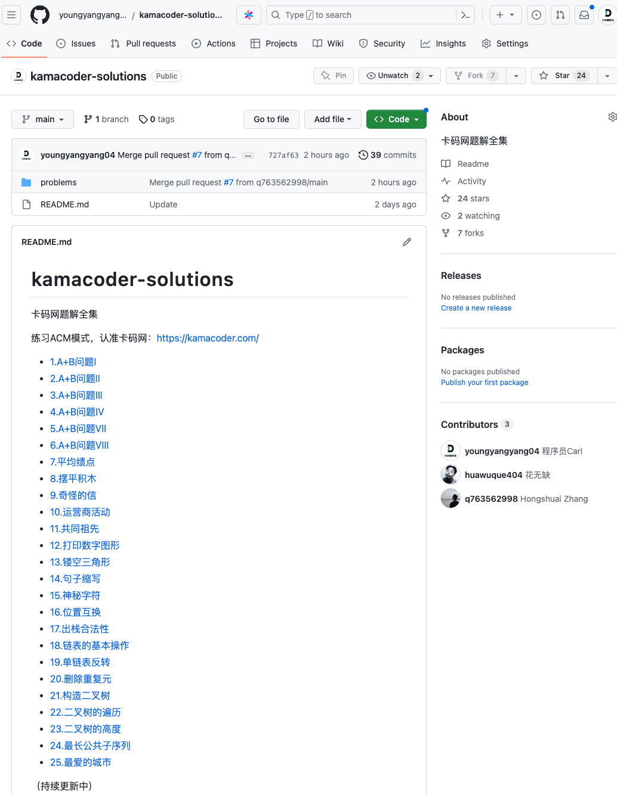
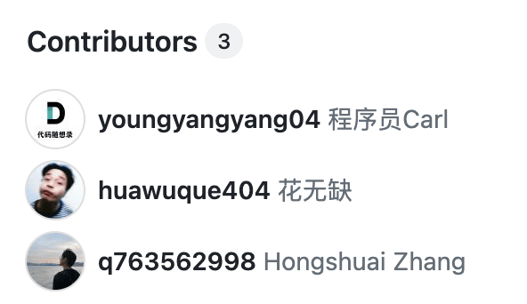

# 如何練習 ACM 輸入輸出模式 | 如何準備筆試 | KamaCoder

KamaCoder 網址：[https://kamacoder.com](https://kamacoder.com)

## 為什麼做 KamaCoder

錄友們在求職的時候會發現，很多公司的筆試題和面試題都是 ACM 模式，而大家習慣去 LeetCode 刷題，LeetCode 是核心程式碼模式。

當大家在做 ACM 模式的演算法（algorithm）題時，需要自己處理資料的輸入輸出，**如果沒有接觸過的話，還是挺難的**。

[知識星球](https://programmercarl.com/other/kstar.html)裡很多錄友的日常打卡中，都表示被 ACM 模式折磨過：

</img>

</img>

</img>

</img>

</img>

所以我正式推出：**KamaCoder**（[https://kamacoder.com](https://kamacoder.com)），**專門幫助大家練習 ACM 模式**。

那麼之前大家去哪裡練習 ACM 模式呢？

去牛客做筆試真題，結果發現 ACM 模式沒練出來，題目倒是超難，一點解題思路都沒有，程式碼更沒寫出來，ACM 模式無從練起。

去洛谷、POJ 上練習？結果發現題目超多，不知道從哪裡開始刷，也沒有一個循序漸進的刷題順序。

**而 KamaCoder 上有我精選＋製作的 25 道題目**！我還把 25 題的後台測試資料（test data）重新製作了一遍，保證大家練習的效果。

為什麼題目不多，只有 25 道？

因為大家練習 ACM 模式不需要那麼多題目，有一個循序漸進的練習過程就好了。

這 25 道題目包含了陣列（array）、鏈接串列（linked list）、雜湊表（hash table）、字串（string）、二元樹（binary tree）、動態規劃（dynamic programming, DP）以及圖（graph）的題目，常見的輸入輸出方式都涵蓋了。

**這是最精華的 25 道題目**！

## KamaCoder 長什麼樣

來看看這極簡的介面，沒有亂七八糟的功能，只有刷題！

</img>

在「狀態」這裡可以看到大家提交的程式碼和評測記錄，目前 KamaCoder（[https://kamacoder.com](https://kamacoder.com)）幾乎無時無刻都有卡友在提交程式碼。
看看大家週六晚上都在做什麼，刷哪些題目。

</img>

提交程式碼的介面是這樣的，**目前支援所有主流刷題語言**。

</img>

## 題解

基本大家來 KamaCoder（[https://kamacoder.com](https://kamacoder.com)）練習 ACM 模式，都是對輸入輸出不夠了解的，所以想看現成的題解，看看究竟是怎麼處理的。

所以我用 C++ 把 KamaCoder 上 25 道題目的題解都寫了，並發佈到 GitHub 上：

[https://github.com/youngyangyang04/kamacoder-solutions](https://github.com/youngyangyang04/kamacoder-solutions)

</img>

**歡迎去 GitHub 上 star，歡迎 fork，也歡迎來 GitHub 儲存庫（repository）貢獻其他語言版本，成為 contributor**。

如果不懂如何向開放原始碼（open source）專案提交程式碼，[可以看這裡](https://www.programmercarl.com/qita/join.html)

目前已經有兩位錄友貢獻 C 和 Java 版本了。

</img>

期待在 GitHub（https://github.com/youngyangyang04/kamacoder-solutions）的 contributors 上也出現你的頭像。

目前題解只有 C++ 程式碼嗎？

當然不是，大多數題目已經有了 Java、Python、C 版本。**其他語言版本，就給錄友們成為 contributor 的機會了**。

## 最後

KamaCoder 網址：[https://kamacoder.com](https://kamacoder.com)

快去體驗吧，筆試之前最好把 KamaCoder 25 道題目都刷完。

期待錄友們成為最早一批把 KamaCoder 刷爆的 coder！

