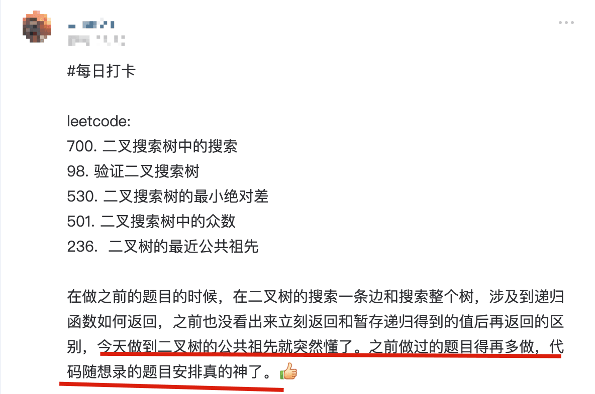
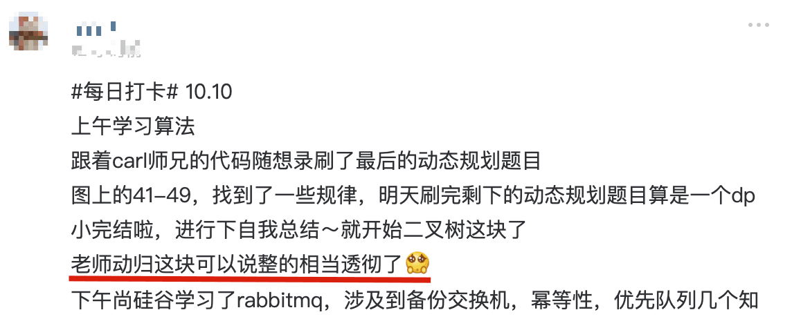
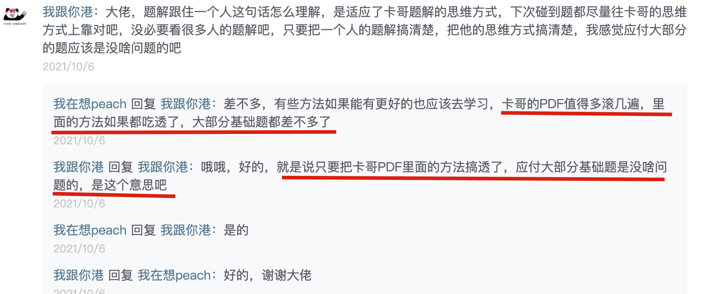
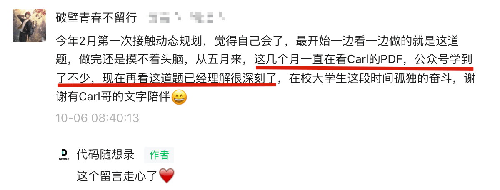
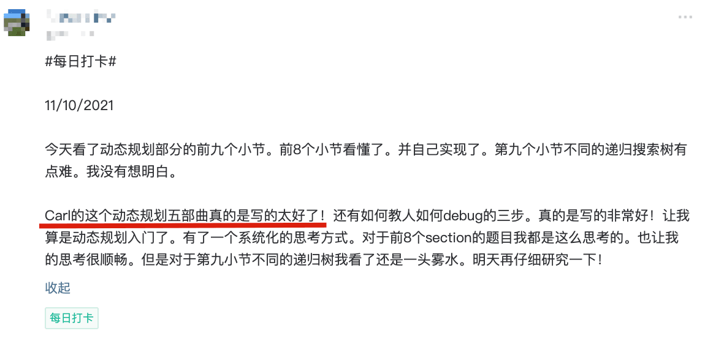
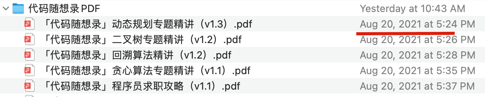
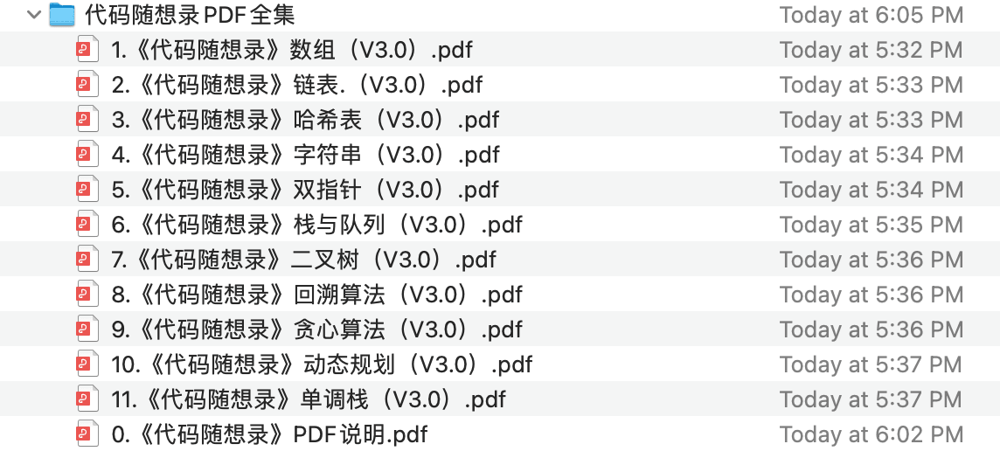
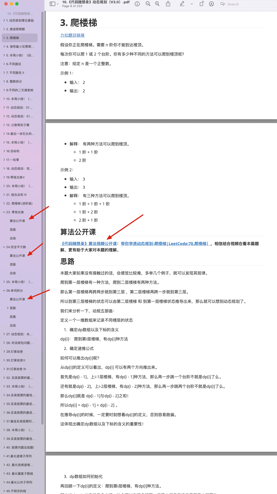

# 《程式碼隨想錄》完整版 PDF 下載 | 合集下載 | 百度雲 |

《程式碼隨想錄》已經是很多學習演算法（algorithm）的小夥伴刷題必備的資料，也得到非常多的好評，這是 Carl 繼續創作的動力。

 </img>

 </img>

 </img>

 </img>

 </img>

 </img>

 </img>

 </img>

 </img>

 </img>

 </img>

 </img>

 </img>

 </img>

 </img>

估計絕大多數錄友之前也都下載過《程式碼隨想錄》PDF，但是那是我兩年前整理的了。

如今，很多題目的講解都改了上十遍，很多圖都重畫過。

之前的 PDF 一直都沒有全集，而且章節也不全，主要是重點章節：二元樹（binary tree）、回溯演算法（backtracking algorithm）、貪心法（greedy）、動態規劃（dynamic programming, DP）的整理。

也有太多錄友和我回饋過：由於 XXX 原因，自己不能上網，看不了網站，PDF 有完整版嗎？

其實錄友們的需求我都記下來了，就是工作太多，我只能慢慢一項一項去處理。

**雖然慢，但我一直在做**！

現在《程式碼隨想錄》網站最新的內容以及全集整理完畢。

 </img>

這份 PDF 整理得非常精細，並把我的[演算法公開課](./gongkaike.md)影片、對應題目的連結都放上去了：

 </img>

這份《程式碼隨想錄》PDF 和《程式碼隨想錄》紙本版和《程式碼隨想錄》網站基本一致，大家選一個適合自己的閱讀方式就好。

不過這裡我依然建議大家盡量看《程式碼隨想錄》網站（programmercarl.com），因為網站一直都是最新的，也是經常更新的。

PDF 可以作為輔助，例如不能上網的時候。

昨天我在[知識星球](./kstar.md)裡第一時間公佈這份全版《程式碼隨想錄》PDF 下載的消息

 </img>

同時有我企業微信的錄友，都接到了這份 PDF 的推播：

 </img>

 </img>

 </img>

 </img>

 </img>

現在我把它免費分享給錄友們，大家可以加我的企業微信，備註：簡單自我介紹+pdf，例如：XX 大學碩二-pdf 或者 XX 城市後端（back end）開發-pdf，通過之後，會直接發給大家的。

</img>

