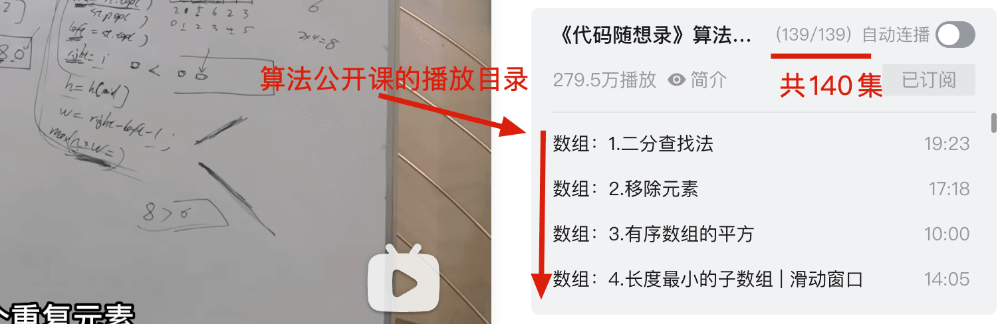
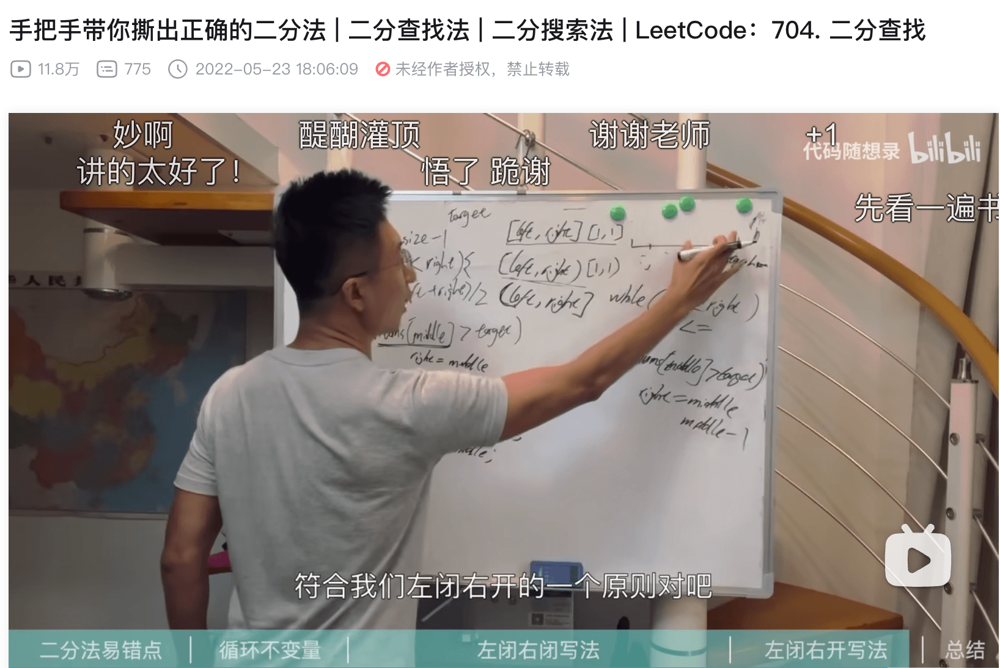
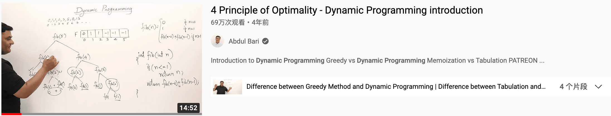
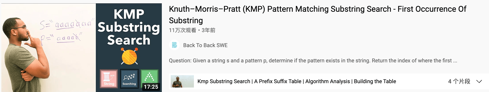
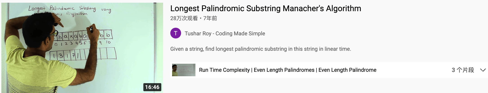
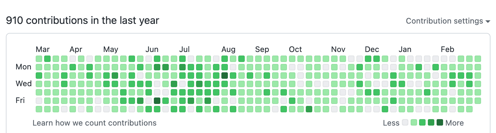
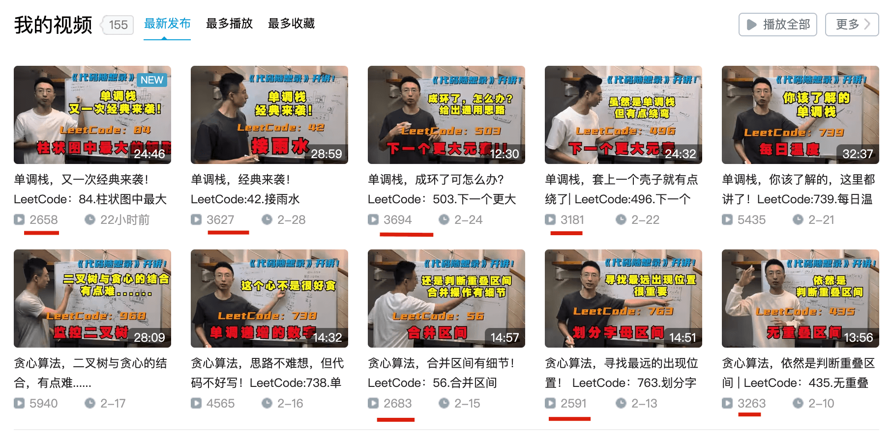

# 程式碼隨想錄演算法公開課 | 最強演算法公開課

和錄友們報告一下，**程式碼隨想錄演算法（algorithm）公開課**已經更新完畢了。

由我親自錄製了 140 期演算法影片，涵蓋了[《程式碼隨想錄》紙本版](./publish.md)上全部題目的講解。

影片全部免費開放在 [B 站：程式碼隨想錄](https://www.bilibili.com/video/BV1fA4y1o715)

目錄就在影片播放器的右邊，完全按照程式碼隨想錄的順序講解，搭配《程式碼隨想錄》或者程式碼隨想錄網站一起學習，效果更佳！

 </img>

從 2022 年 5 月份開始決定把《程式碼隨想錄》上的演算法題都由我親自講解一遍。

當時錄了第一期演算法影片「二元搜尋（binary search）」：

 </img>

別看現在這期影片有 10 萬的播放量，那是因為後續錄友們自己找到我的影片來看，一年後才達到 10 萬播放量。

當時這個影片發出去，播放量就幾百。

畢竟這種演算法影片和普通娛樂或泛技術類影片沒法比，平台也不會推薦。

我的影片播放量雖然低，但只要看過影片的錄友，評價都很高。隨便找了幾個最新的留言：

當初也是看到大家的留言，我才下定決心繼續更新下去，從去年 5 月份開始，每週堅持更新四期演算法影片，風雨無阻，一直堅持到現在。

一晃眼大半年過去了，足足更新了 140 期演算法影片，已經涵蓋了[《程式碼隨想錄》紙本版](./publish.md)上全部題目的講解。

**我應該是目前為數不多（至少目前我還沒看到）能親自把書中全部內容以影片的方式講解出來並免費分享給大家的技術書籍作者**

大家可以想一想這些年買過哪些技術書籍，有作者親自為大家把每章每一節都做成影片講解並免費開放的嗎？

**那麼看[《程式碼隨想錄》](./publish.md)的錄友們就有這個待遇**！

講課錄影片其實是很耗費精力的，大家看影片可能覺得我講得行雲流水，其實我都是做足了功課。

**我平時養成了只要有空就模擬（simulation）一遍某個演算法執行過程的習慣，板書更是擦了寫、寫了再擦**，反覆嘗試哪種方式能為大家講清楚，然後才開拍影片。

可能大家會想，都出書了照著書講不就好了嗎？應該不難吧？

如果這麼簡單的話，可能市面上很多技術書籍的作者們就都親自講解一遍了。

寫出來和講出來還不是同一個維度。

講出來需要很綜合的能力，包括表達力，而且大家看我的演算法影片會發現：我是脫稿的，我沒有提詞機，攝影機開了就開講，一鏡到底。

**我是做了非常多練習才達到這個程度**。

很多人看到攝影機就會緊張，沒有提示詞就不知道自己下一句該說什麼了，瞬間就會：我是誰，我在哪，我在幹什麼？

## 演算法公開課品質如何

目前中國演算法影片的講解風格，一般是螢幕錄影在 LeetCode 寫程式碼或者 PPT 簡報。這樣其實錄製影片難度低了很多。

但大家上 YouTube 的話，會發現海外經典演算法影片的創作者，都是用一個小白板直接開講。

 </img>

 </img>

 </img>

這種講課方式容易走兩個極端，**一種就是非常好，成為經典系列；一種就是被罵講得像垃圾一樣**。

如果是螢幕錄影或者 PPT 簡報，這樣至少有稿件照著讀，或者有提示詞，就算差也不會差到哪去。

所以呢，我選擇這種白板模擬思路、直接手寫程式碼的講課方式，也是給自己一個挑戰，目前的口碑來看，還是走向了好的那個極端。

關於品質究竟如何、學習效果如何，大家可以去 B 站上看（B 站同名：[程式碼隨想錄](https://www.bilibili.com/video/BV1fA4y1o715)），有口皆碑！

## 辛苦錄影片為了什麼

再說說這個辛苦錄影片，一忙就忙大半年，投入這麼多時間和精力，最後為什麼還免費開放。

書 + 付費影片講解，或者免費網站內容 + 付費影片講解，或者免費網站內容 + 部分影片免費 + 部分影片付費，**這些都是非常好的盈利模式**，而且還能持續變現。

以程式碼隨想錄目前的影響力來說，我這套 140 集影片課程，不用很貴，定價 99 元，每年賣出上萬份問題不大。

這可是一筆非常可觀的收入！（真的很香！）而且還是持續收入，後期還不用怎麼去維護，不像[知識星球](./kstar.md)或者[演算法訓練營](./xunlianying.md)我需要花大量時間給錄友們答疑。

那我為什麼不這麼做呢？

**「程式碼隨想錄」這五個字，我是會用一生去經營的**，凡事要看得長遠，不是什麼賺錢就立刻要去幹什麼。

這套演算法公開課影片，不僅造福錄友們，也放大了程式碼隨想錄的品牌影響力，這是雙贏的。

**免費硬核的演算法內容是程式碼隨想錄的立身之本**，也是大家為什麼學演算法、學程式設計首選程式碼隨想錄的根本所在。

如果有一點影響力了，就暗插各種付費，這樣不持久！**也會傷了很多錄友的心**。

所以目前程式碼隨想錄網站（programmercarl.com）、程式碼隨想錄 GitHub（https://github.com/youngyangyang04/leetcode-master）、程式碼隨想錄演算法公開課（B 站：程式碼隨想錄），**都是完全免費**，也足夠大家學習演算法所用。

**我的免費演算法影片內容，要比絕大多數平台上大家付費的演算法影片課、演算法訓練營品質高得多**，影片課程基於《程式碼隨想錄》的刷題順序來錄製，會讓影片內容非常有系統，而不是東一塊、西一塊的。

至於《程式碼隨想錄》紙本版的內容其實和程式碼隨想錄網站是一樣的，很多錄友買紙本版是因為習慣看紙本書，有的則是僅僅為了留念和收藏。

而且以上開放原始碼（open source）內容，我還會持續最佳化與疊代（iteration），不會做完了就放著不管，如果一年前刷完程式碼隨想錄的錄友現在再重看一遍程式碼隨想錄網站，**你會發現很多題解裡又多了很多圖解，又最佳化了很多講解內容**。

這是我的 GitHub 提交紀錄：（https://github.com/youngyangyang04）

 </img>

每天或多或少都要最佳化一點點。**每天的量可能不多，但每天都在最佳化**！

如果感覺程式碼隨想錄網站和程式碼隨想錄演算法公開課對大家確實有幫助，不用買書，歡迎去[豆瓣](https://book.douban.com/subject/35680544/)給一個好評就好，感謝錄友們的支持。

## 公開課

再回頭說說目前演算法公開課，其實直到現在我新發的影片播放量也就兩三千。

 </img>

（大家現在去 B 站上看，可能已經上萬播放量，但新發的時候播放量一直都很慘淡）

但為什麼發影片就兩三千播放量，就可以在 B 站聚集 10 萬錄友。

 </img>

對於 B 站十萬粉絲的頻道主來說，好像都得有幾個百萬播放的爆紅影片。

**但我的影片從來沒有爆紅過，也沒有被平台推薦過，都是非常穩定的幾千播放量**。

很多錄友都是主動搜尋找過來就關注了，或者身邊的人推薦來的。

只要是真正能為大家帶來價值的、真正能讓大家學明白演算法，就會得到認可。

所以，**酒香不怕巷子深，真正有價值的內容，不需要蹭熱度，想學習的人一定會找到你**。

目前《程式碼隨想錄》上的演算法講解影片終於更新完了，後面就有足夠的精力去更新圖論（graph theory）、排序（sorting）、進階資料結構（data structure）了。

演算法公開課全部發佈在 B 站上，連結直達：[《程式碼隨想錄》演算法公開課](https://www.bilibili.com/video/BV1fA4y1o715)

最後，**認準程式碼隨想錄，學習演算法不迷路**。加油💪🏻

