# 十年所學，終成《程式碼隨想錄》

**《程式碼隨想錄》終於正式出版上市了！**（文末附購買連結，直接五折！）

[B 站介紹](https://www.bilibili.com/video/BV13L4y1E7s4/)

最近這一年不少錄友都問我，程式碼隨想錄什麼時候出版啊？

**其實我比大家還期待這一刻的到來！**

先奉上幾張書的照片：（封面最終選定為梵谷的畫作《阿姆斯特丹，聖馬迪拉莫，1888，海景》）

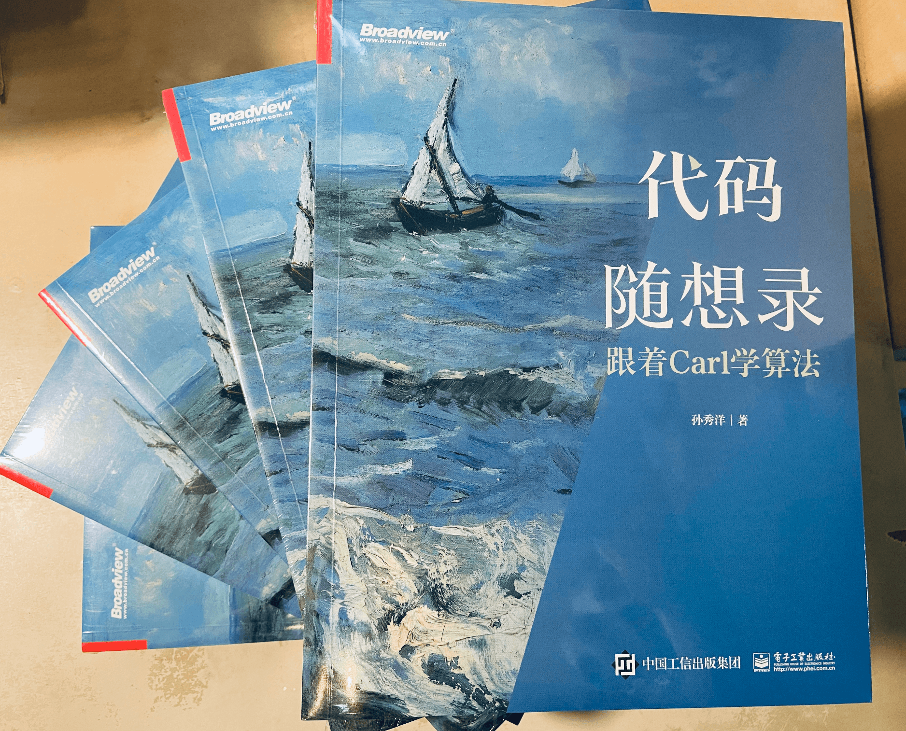 </img>

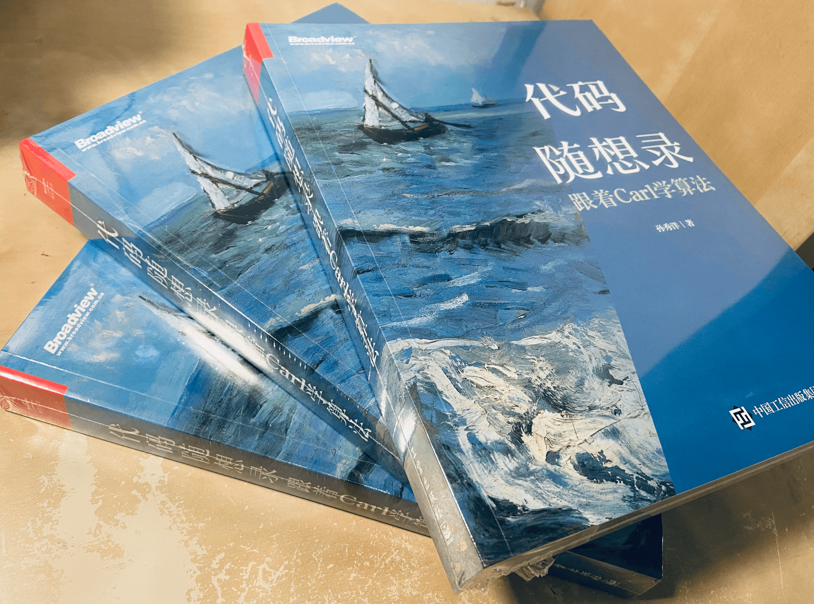 </img>

其實在去年，也就是 2020 年我就已經將這本書的內容寫好了，本以為可以很快出版，但我還是嚴重低估了寫書的工作量。

因為自己對品質的追求，一直在不斷打磨，所以又是一年快過去了。

**《程式碼隨想錄》總共將近 500 頁、70 萬字、200 多個插圖，真的處處都是心血**。

出書是一件浩大工程，比寫文章難太多了，**真的字字斟酌，大家看書裡可能平平淡淡的一句話、一個詞語、一個概念，我可能就查閱了很多資料，反覆推敲：表達是否準確、用詞是否到位，深怕辜負了大家的期待**。

這是我自己平時書桌的場景：

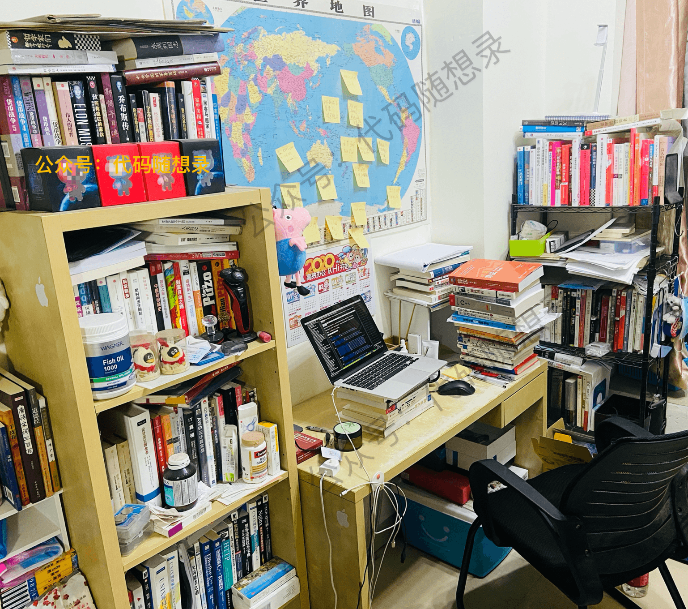 </img>

這兩年可以說我沒有什麼娛樂活動，業餘生活極其枯燥，都花費在這本書上了，其中艱辛只有自己知道。

而此時當大家都能看到《程式碼隨想錄》這部作品的時候，其滿足感對我來說已經足夠了。

寫這本書用了兩年，**而真正消化、理解、研究這些演算法知識，我用了整整十年**，十年前我就開始寫演算法文章，試圖闖進演算法的大門，這一寫就是十年。

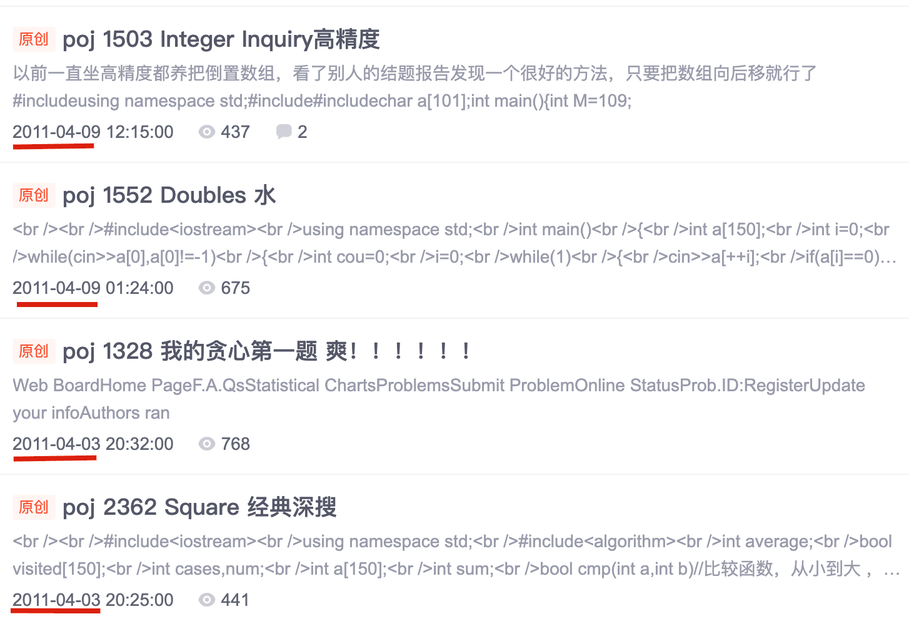 </img>

**真的是十年所學，兩年打磨，終成《程式碼隨想錄》！**

所以當堅持一件事情的時候，一年、兩年，甚至三年、五年，不足以看出其效果，但也許堅持十年的時候，才等到真正收穫的時刻。

## 程式碼隨想錄的故事

《程式碼隨想錄》不是兩年憋大招來個橫空出世。

而是一點一點打磨出來的，其刷題順序、題解內容、思考深度，都是經過了上 10 萬錄友的共同見證。

也正是這些內容，把大家匯聚在一起，一起攻克演算法的一座又一座高山。

與此同時，也幾乎每天都會有錄友專門私訊我來表達自己的感激：

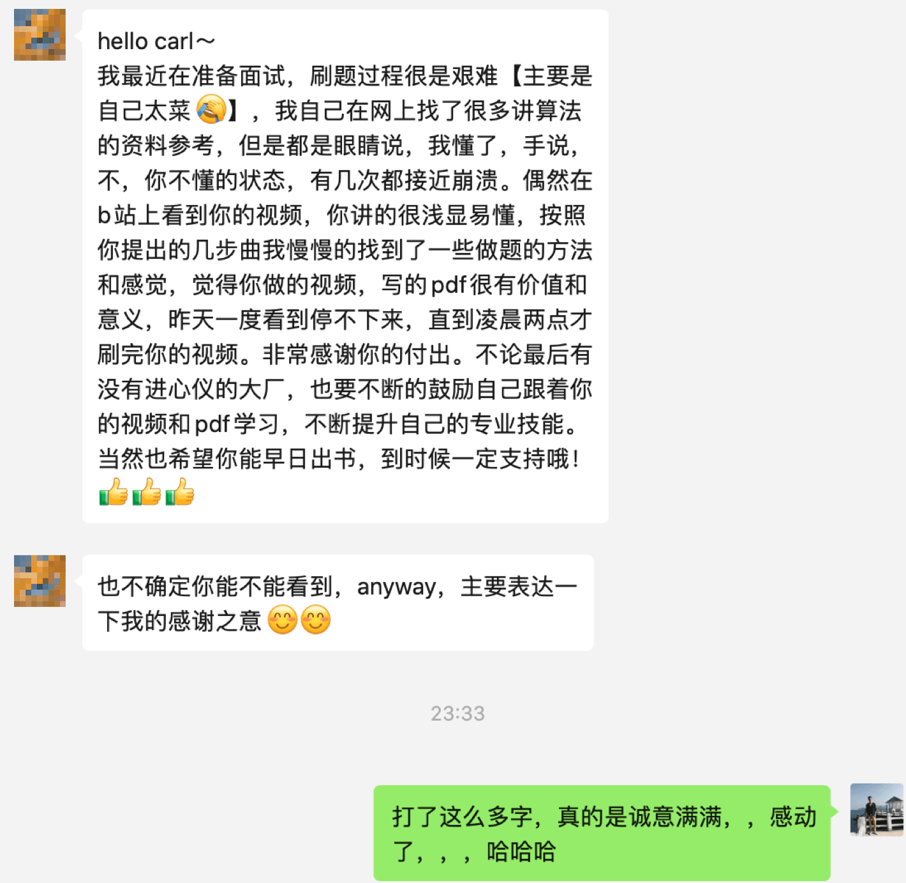 </img>

 </img>

 </img>

 </img>

 </img>

 </img>

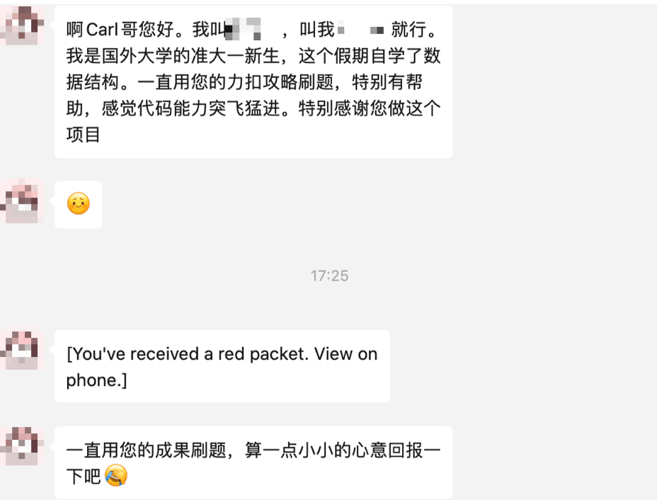 </img>

 </img>

 </img>

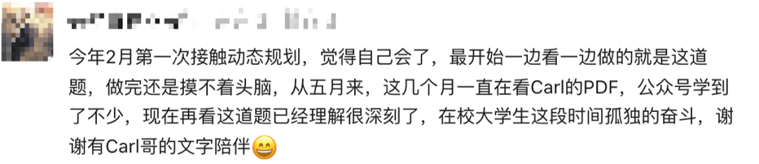 </img>

 </img>

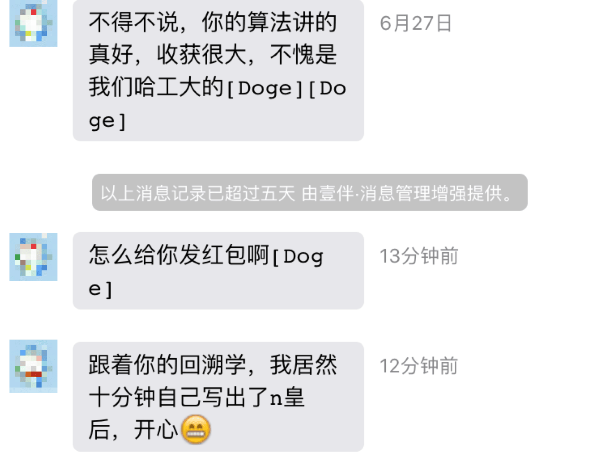 </img>

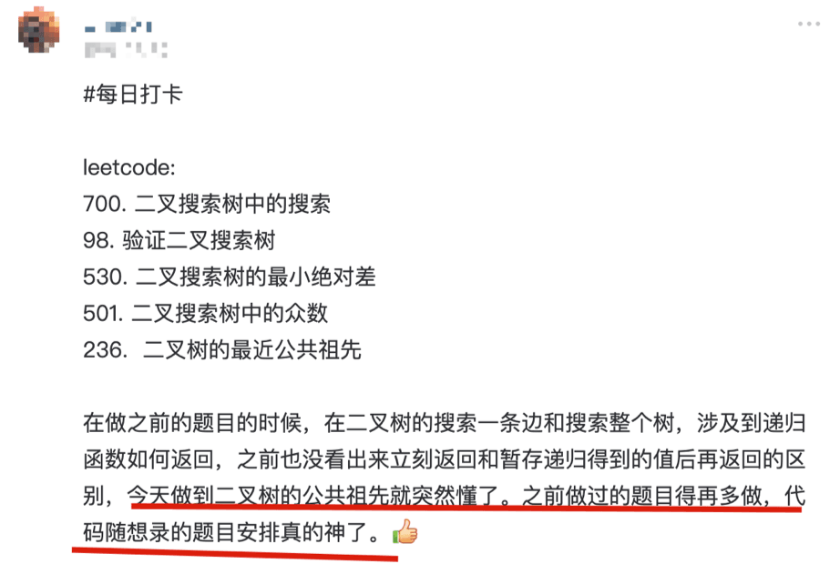 </img>

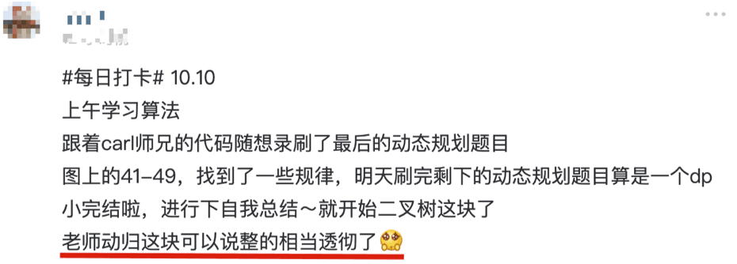 </img>

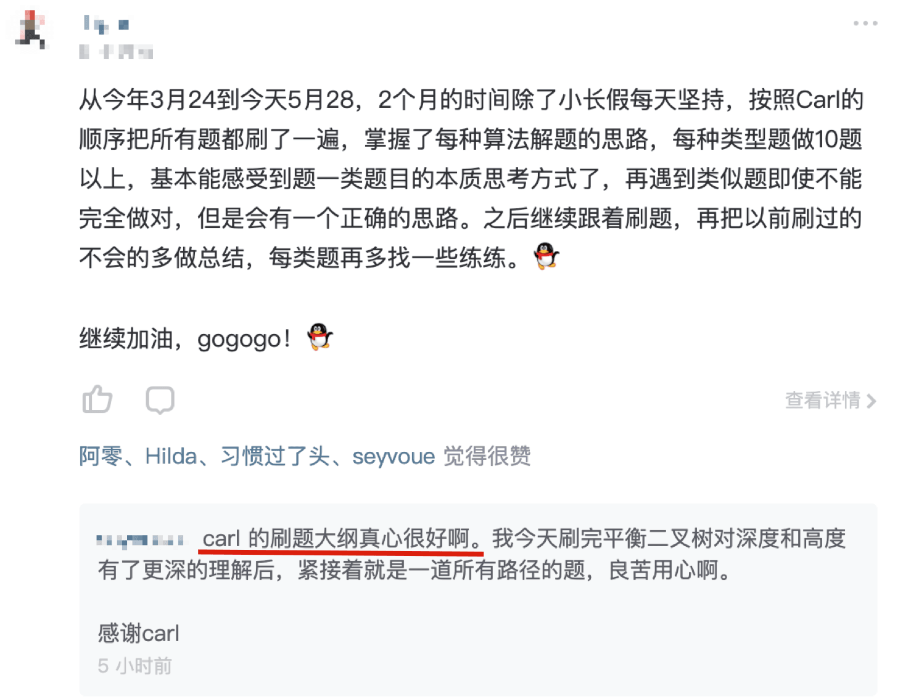 </img>

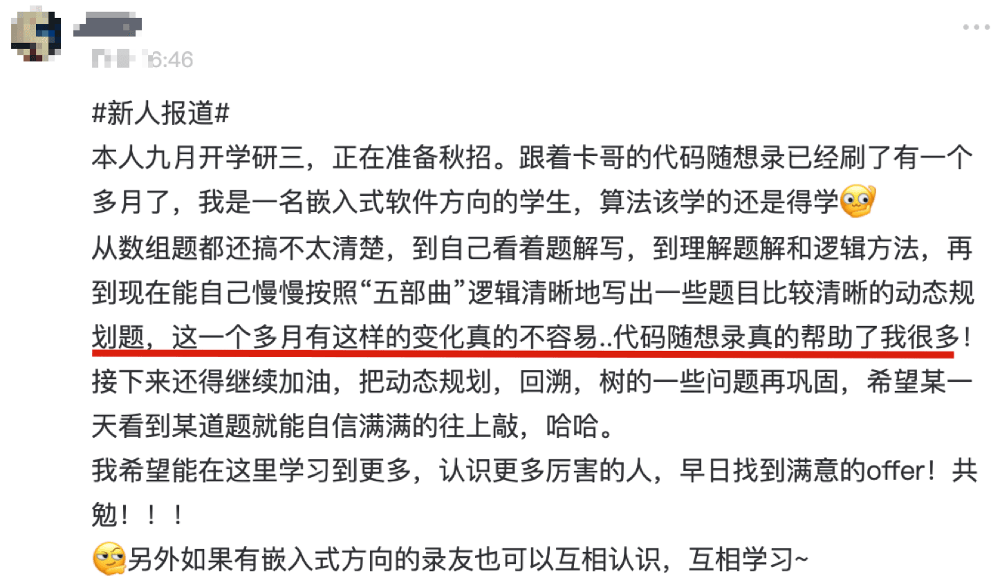 </img>

這些都是大家與「程式碼隨想錄」之間的故事，也歡迎大家在文章留言，說一說自己和「程式碼隨想錄」之間的故事。

## 《程式碼隨想錄》有何不同？

大家在學習程式設計、演算法、刷題的時候，**真正的苦惱在於沒有一套行之有效的刷題順序**。

從何學起，先學什麼，再學什麼。LeetCode 上兩千道題目，怎麼刷？很多人刷題的效率低，主要體現在如下三點：

* 找題
* 找到了不適合現階段做的題
* 沒有全套的優質題解可以參考

而市面上基本找不到真正能解決以上痛點的演算法書籍。

一些書籍是每個知識點蜻蜓點水，然後就叫大家舉一反三。

一些書籍是一堆題解堆在一起，讓大家學起來感受不到知識的連貫性和系統性。

片段式的學習，效率怎麼能高呢？

當初我在學習演算法的時候，就深感其中的艱難，當我的題量達到一定數量時，隨著反覆的琢磨和深入的思考，我再去回顧這些演算法題目，**發現如果要是按照合理的順序來刷題，那效果一定是事半功倍！**

所以我將每一個專題中的**題目按照由易到難的順序進行編排，每一道題目所涉及的知識，前面都會有相應的題目做知識鋪墊，做到環環相扣**。

**建議大家按照章節順序閱讀本書**，在閱讀的過程中會發現我在題目編排上的良苦用心！

本書不僅在題目編排上精心設計，而且在針對讀者最頭痛的演算法問題上做了詳細且深入的講解。

* 關於動態規劃（dynamic programming, DP），都知道遞迴公式（recurrence formula）的重要性，但 dp 陣列（array）的含義、dp 陣列的初始化（initialization）、遍歷（traversal）順序以及如何印出 dp 陣列來排查 Bug，這些都很重要。例如，解決背包問題（knapsack problem）的時候，遍歷順序才是最關鍵的，也是最難理解的。

* 關於回溯演算法（backtracking algorithm），題目要求集合（set）之間不可重複，那麼就需要去重，各種資料都說要去重，但沒有說清楚是「樹層去重」還是「樹枝去重」——這是我為了說明去重的過程而創造的兩個詞彙。

* 關於 KMP 演算法（KMP algorithm），都知道使用前綴（prefix）表進行回退，可什麼是前綴表，為什麼一定要用前綴表，根據前綴表回退有幾種方式，這些卻沒有說清楚，導致最後大家看得一頭霧水。

* 關於二元樹（binary tree），不同的遍歷順序其遞迴函數（recursive function）究竟如何安排，遞迴函數什麼時候需要轉回值（return value），什麼時候不用轉回值，什麼情況下分別使用前序遍歷（preorder traversal）、中序橫過（inorder traversal）、後序遍歷（post-order traversal），疊代（iteration）法又要如何實作，這些都決定了對二元樹的理解是否到位。

同時我針對每一個專題的特點，整理出其通用的解法套路。

例如：

* 在二元樹專題中，總結了遞迴（recursion）「三部曲」來幫助讀者掌握二元樹中各種遍歷方式的寫法。
* 回溯演算法中的回溯（backtracking）「三部曲」可以幫助讀者理解回溯演算法晦澀難懂的過程。
* 動態規劃中的動規「五部曲」可以幫助讀者在一套思考框架下去解決動態規劃題目。

再來說一說動態規劃，在程式設計師面試中，動態規劃是公認的最難掌握的演算法，也是出現頻率最高的演算法。

**如果僅僅講解幾道題目，即使再舉一反三也遠遠達不到真正理解動態規劃的程度**。

**如果把動態規劃的題目單純地堆砌在一起，也只會讓人越學越懵，陷入「一看就會，一寫就廢」的怪圈**。

講清楚一道題容易，講清楚兩道題也容易，但把整個動態規劃的各個分支講清楚，把每道題目講透徹，並用一套方法論把整個動態規劃的題目貫徹始終就有難度了。

**而幫助大家解決這個問題，這也是這本書的使命所在**。

購買方式，可以掃描下方 QR Code，也可以直接[點擊這裡，京東直達](https://union-click.jd.com/jdc?e=&p=JF8BAMQJK1olXg8EUVhVCkkWAV8IGV8WVAICU24ZVxNJXF9RXh5UHw0cSgYYXBcIWDoXSQVJQwYAUF1UDEsQHDZNRwYlGFh6NVkPcRdyHWwMZRlLHlQDUj02eEcbM244GFIXWQYAUV5VOHsXBF9edVsUXAcDVVtdDUgnAl8IHFkdXw4BU1lfCkoRM2gIEmtIFVpKAxVtOHsUM184G2sWbURsUVpcCEMVAjgIHAxBWFYAAVdfXE8QBGkBGQsdCQEFVgttCkoWB2Y4)

 </img>

## 目錄

 </img>

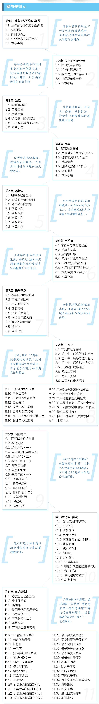 </img>

這裡不少錄友會問，書的內容和 GitHub：https://github.com/youngyangyang04/leetcode-master，以及網站：programmercarl.com 有什麼區別呢？

其實寫文章相對來說是隨意一些的，但書一定要非常嚴謹。

正如我本篇開頭所說，書的內容其實一年前就寫好的，但排版、勘誤、打磨、重新畫圖，又花費了一年，所以書一定是更精細、更嚴謹的。

**《程式碼隨想錄》的排版看起來非常舒服，會讓你發現原來學演算法會上癮！**

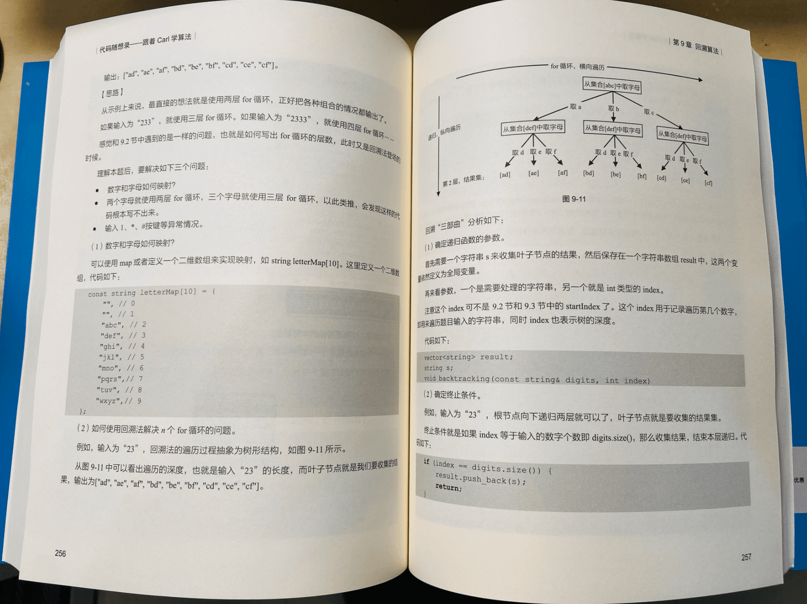 </img>

《程式碼隨想錄》的推薦語，我都是頗為用心，不是隨隨便便找個人寫一寫推薦語來湊數的。

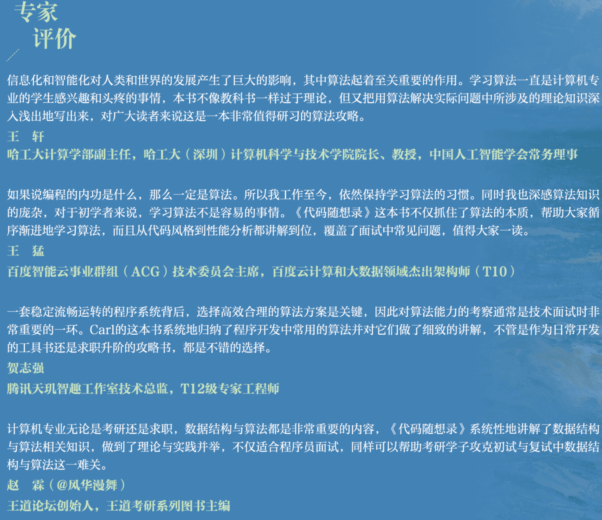 </img>

哈工大計算機王院長，百度傑出架構師猛哥，騰訊專家工程師強哥，王道論壇創辦人風華哥，**他們是在我學習工作的不同階段裡對我影響非常大的頂級大神**。

他們的學習方法、做事風格，都是值得每一位技術人學習的。同時他們也是每一位技術人的榜樣。

特別感謝大神們能在百忙之中閱讀了本書的書稿，並為本書寫了評語。

## 最後

我希望這本書，不僅僅是可以幫助大家學習程式設計，循序漸進地去學習演算法，高效刷題，進大公司。

**同時當你把這本書放在自己的書桌前、床頭前的時候，它也會給你一種乘風破浪的勇氣！**

正如封面（梵谷，《阿姆斯特丹，聖馬迪拉莫，1888，海景》），一隻帆船在波濤洶湧的大海裡揚帆遠航！

《程式碼隨想錄》這就要和大家見面了，其實很多錄友已經迫不及待：

 </img>

 </img>

 </img>

 </img>

這本書原價還挺貴的（畢竟比較厚），但這裡申請到了京東五折優惠，大家可以趕快下手了。

點擊下方連結直接五折購買，全網最低價格了。海外的錄友們可以再等幾天，廣州有貨之後，就可以配送到海外了。

《程式碼隨想錄》使用的語言是 C++，使用其他語言的錄友可以看本書的講解思路、刷題順序，然後搭配看網站：programmercarl.com，網站上都有對應的 Java、Python、Go、JS、C、Swift 版本，基本可以滿足大家的學習需求。

購買方式，可以掃描下方 QR Code，也可以直接[點擊這裡，京東直達](https://union-click.jd.com/jdc?e=&p=JF8BAMQJK1olXg8EUVhVCkkWAV8IGV8WVAICU24ZVxNJXF9RXh5UHw0cSgYYXBcIWDoXSQVJQwYAUF1UDEsQHDZNRwYlGFh6NVkPcRdyHWwMZRlLHlQDUj02eEcbM244GFIXWQYAUV5VOHsXBF9edVsUXAcDVVtdDUgnAl8IHFkdXw4BU1lfCkoRM2gIEmtIFVpKAxVtOHsUM184G2sWbURsUVpcCEMVAjgIHAxBWFYAAVdfXE8QBGkBGQsdCQEFVgttCkoWB2Y4)

 </img>

最後也感謝錄友們的陪伴，真心希望大家都有一個好的前程！

正如《程式碼隨想錄》正式出版一樣，**你所期盼，終將到來！加油💪**

