# 圖論正式發佈！

錄友們！今天和大家正式宣布：大家期盼已久的「程式碼隨想錄圖論（graph theory）」正式發佈了。

**一年多來，日日夜夜，伏案編碼、思考、寫作，就為了今天給錄友們一個交代**！

我知道錄友們在等圖論等太久了，其實我比大家都著急。

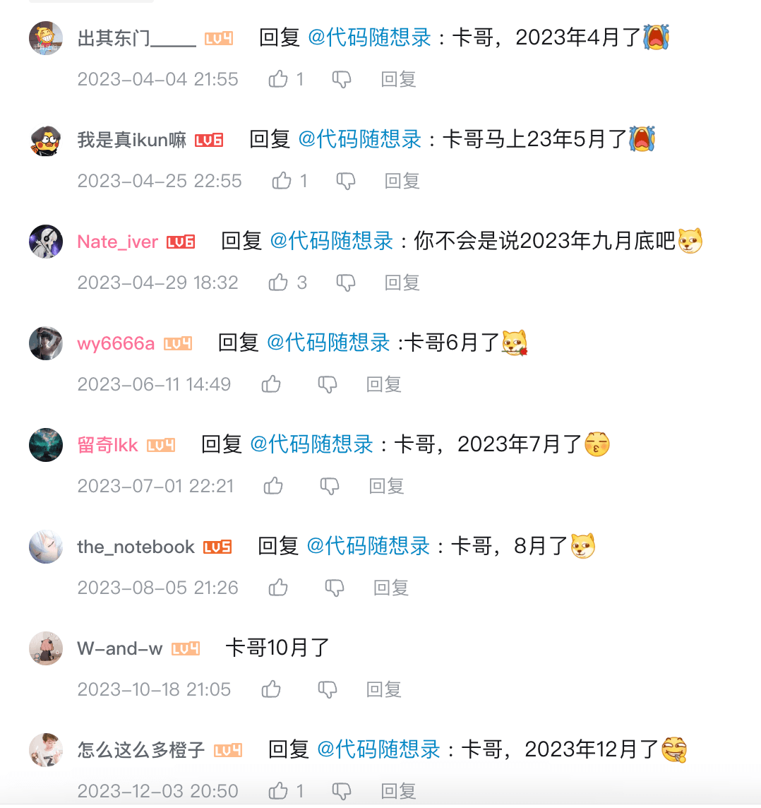

圖論完整版目前已經開放在程式碼隨想錄網站：programmercarl.com

**「程式碼隨想錄圖論」共分為五大模組（module）**，共有三十一篇長文講解：

* 深度優先搜尋（depth-first search, DFS）與廣度優先搜尋（breadth-first search, BFS）
* 互斥集（disjoint set）
* 最小生成樹（minimum spanning tree, MST）
* 拓蹼排序（topological sort）
* 最短路徑（shortest path）演算法

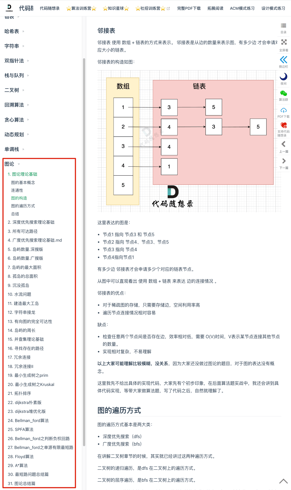

**耗時一年之久，程式碼隨想錄圖論終於面世了**!

一年前 2023 年的 3 月份我剛剛更新完了[程式碼隨想錄演算法公開課](https://mp.weixin.qq.com/s/xsKjrnB4GyWApm4BYxshvg)，這是我親自錄製的 140 期演算法影片講解，目前口碑極佳。

錄完公開課之後，我就開始籌劃更新圖論內容了，無奈圖論內容真的很龐大。

關於圖論章節，**可以說是程式碼隨想錄所有章節裡畫圖數量最多、工程量最大的一個章節**，整個圖論畫圖就 400 多幅。

隨便截一些圖，大家感受一下：

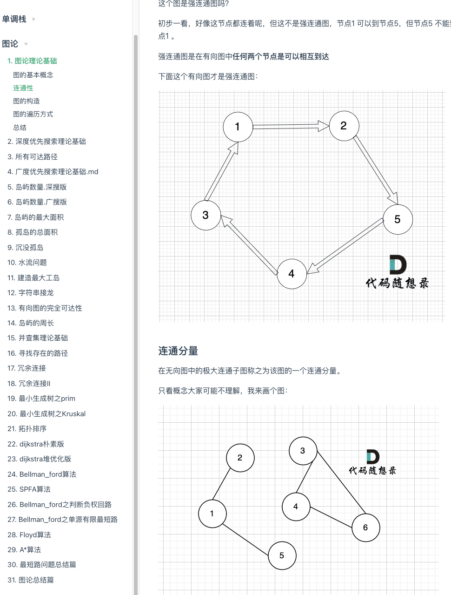

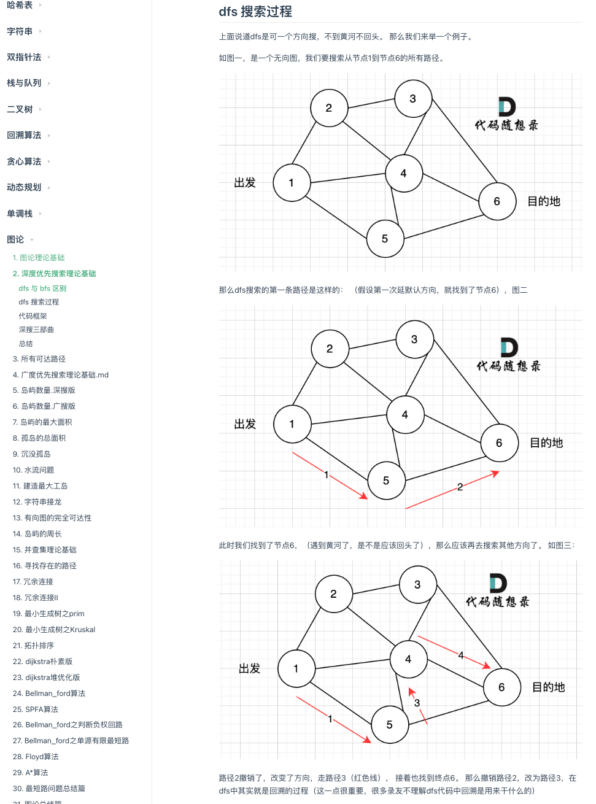

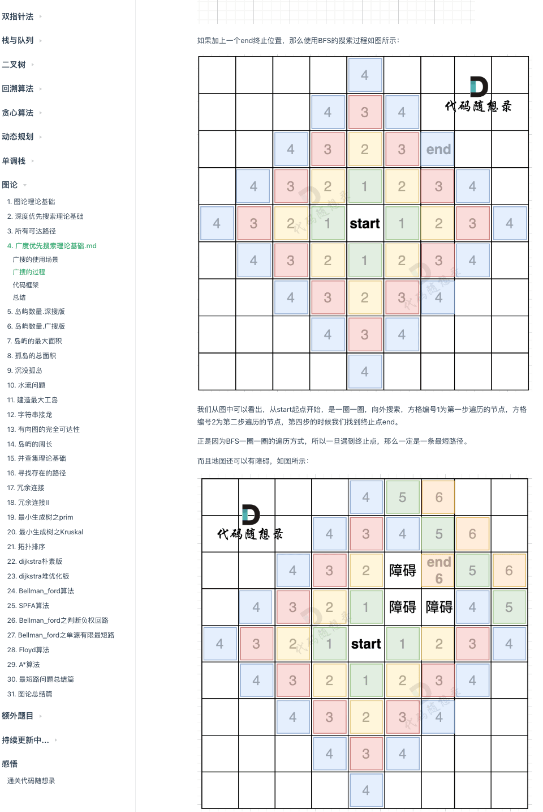

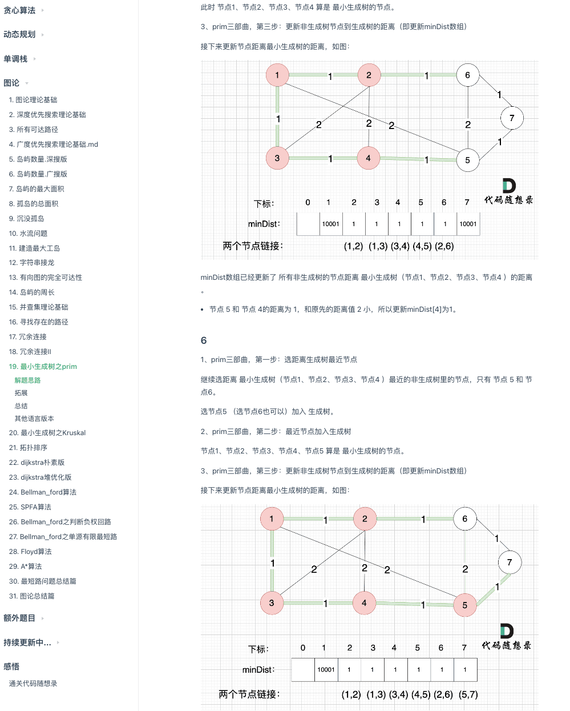

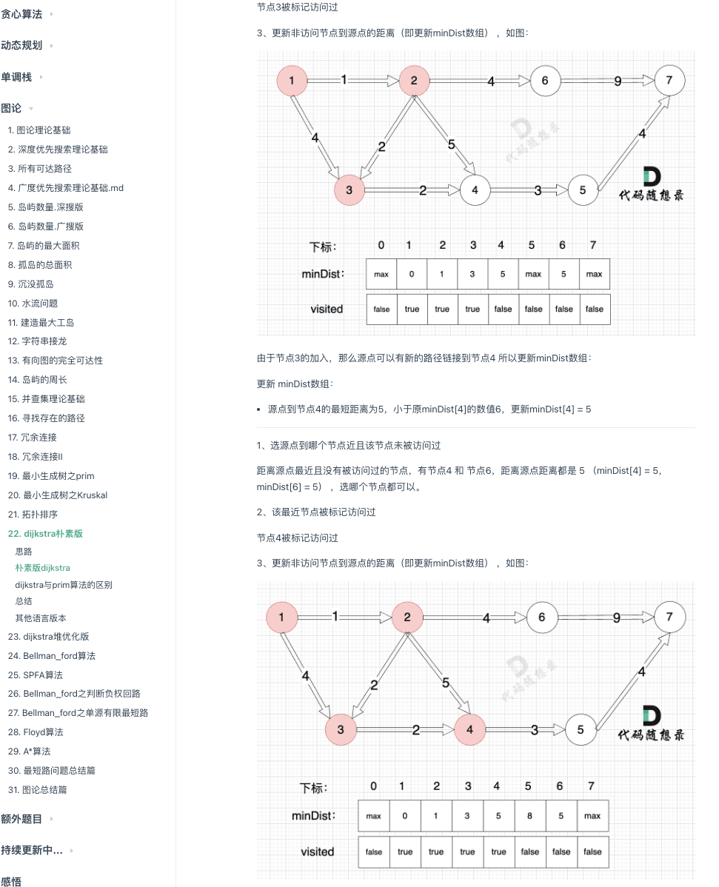

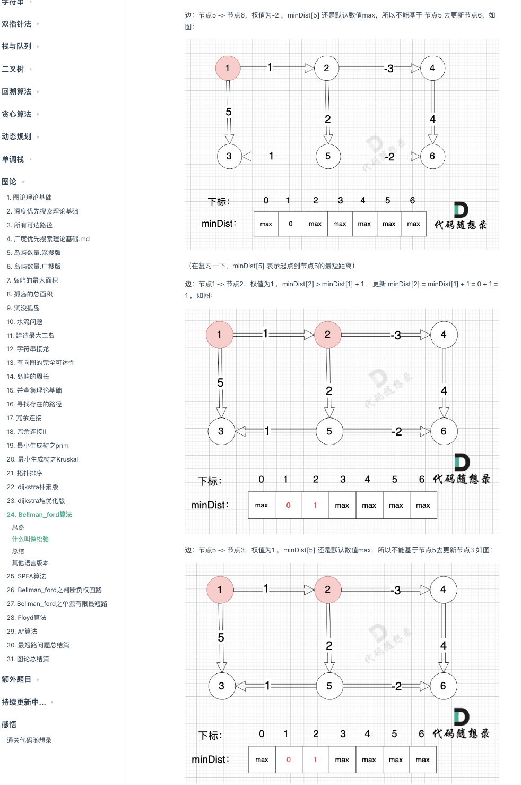

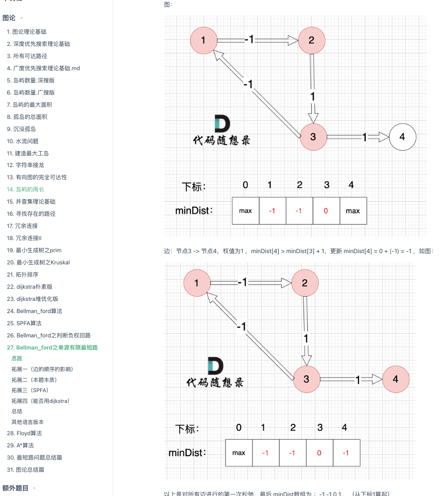

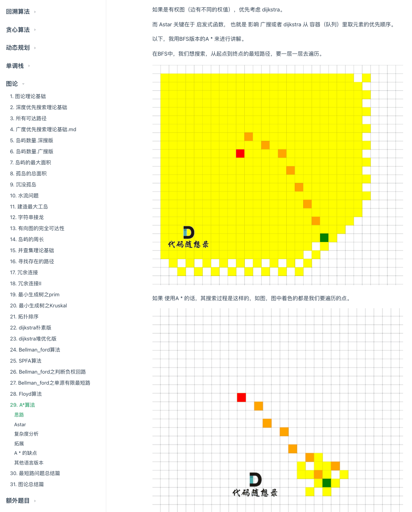

具體內容，大家可以去程式碼隨想錄網站（programmercarl.com）去看看，非常精彩！

期間有很多錄友在催：**卡哥怎麼不更新圖論呢？卡哥是不是不打算更新圖論了**？等等

每次我都要去解釋一番。

如果我想快速出圖論章節，可以很快！

**但我不想做降低程式碼隨想錄整體品質和口碑的事情**。

所以關於現在發佈的「程式碼隨想錄圖論」，我可以很自信地說，**這是市面上大家能看到的，最全、最細緻的圖論演算法教學**。

**我在寫作的時候沒有避開任何地雷區，完全遇雷排雷，然後讓大家舒舒服服地走過去**。

什麼是地雷區？

很多知識點，大家去看資料的時候會發現是沒有講解的或者一筆帶過，因為這種地雷區知識點很難講清楚或者需要花費大量的時間去講明白。

一些知識點是這樣的：**自己一旦懂了就知道是那麼回事，但要寫出來、要給別人講清楚，是很難的一件事**。

這些知識點同樣是地雷區，就是大家在看教學或者演算法講解的時候，作者避而不談的部分。

例如：深搜為什麼有兩種寫法，同樣的廣搜為什麼有一種寫法逾時了，bellman_ford 為什麼要鬆弛 n - 1 次，negative cycle 對最短路徑求解的影響等等。

這一點大家在閱讀程式碼隨想錄圖論的時候，**可以感受到我對細節講解的掌握程度**。

## 為什麼要出圖論

圖論是很重要的章節，也是大家求職筆試面試，無論是社會招聘還是校園招聘，都會考察的知識內容。

而且圖論應用廣泛，在大家做專案開發的時候，或多或少都會用到圖論相關知識。

例如：通訊網路（拓蹼排序、最短路徑演算法）、社群網路（深搜、廣搜）、路徑最佳化（最短路徑演算法）、任務排程（拓蹼排序）、生物資訊學（基因為節點（node），基因關係為邊（edge））、遊戲開發（A* 演算法（A* algorithm）等）等等

為了保質保量更新圖論，**市面上所有的演算法書籍，我都看過**！

**反覆確認思路正確性的同時，不禁感嘆市面上演算法書籍在圖論方面的「缺斤少兩」**。

大名鼎鼎的《演算法 4》以圖論內容詳細且圖解多而被大家好評，

以最短路徑演算法為例，《演算法 4》只講解了 Dijkstra 演算法（Dijkstra algorithm）（堆積（heap）最佳化）、SPFA（貝爾曼－福特演算法（Bellman-Ford algorithm）基於佇列（queue））和拓蹼排序，

而 Dijkstra 樸素版、Bellman_ford 樸素版、bellman_ford 之單源有限最短路徑、福洛伊德－瓦沙耳最短路徑演算法（Floyd-Warshall algorithm）、A* 演算法以及各個最短路徑演算法的優劣，並沒有講解。

其他演算法書籍更是對圖論的很多知識點一筆帶過。

而在程式碼隨想錄圖論章節，**僅僅是最短路徑演算法方面，我就詳細講解了如下內容**：

* dijkstra 樸素版
* dijkstra 堆積最佳化版
* Bellman_ford
* Bellman_ford 佇列最佳化演算法（又名 SPFA）
* bellman_ford 演算法判斷 negative cycle
* bellman_ford 之單源有限最短路徑
* Floyd-Warshall 演算法精講
* 啟發式搜尋：A* 演算法

**常見最短路徑演算法，我都沒有落下**。

而且大家在看很多演算法書籍時，是沒有程式設計題目配合練習的，這樣學習效果大打折扣；一些書籍有程式設計題目配合練習，但知識點嚴重不全。

## 出題

我在講解圖論的時候，最頭疼的就是找題，在 LeetCode 上找題總是找不到符合思路且能完整表達演算法精髓的題目。

特別是最短路徑演算法相關的題目，例如 Bellman_ford 系列、Floyd、A* 等等總是找不到符合思路的題目。

所以我乾脆就自己出題吧，**這也是 KamaCoder（kamacoder.com）誕生的一個原因之一**。

**為了給大家帶來極致的學習體驗，我在很多細節上都下了功夫**。

KamaCoder 專門給大家準備了 ACM 輸入輸出模式，**圖論在筆試還有面試中，通常都是以 ACM 模式來考察大家**，而大家習慣在 LeetCode 刷題（核心程式碼模式），核心程式碼模式把圖（graph）的儲存和輸出都隱藏了。

**圖論題目的輸入輸出相對於其他章節的題目來說是最難處理的**。

### 輸入的細節

圖論的輸入難在圖的儲存結構，**如果沒有練習過相鄰串列（adjacency list）和相鄰矩陣（adjacency matrix），很多錄友是寫不出來的**。

而 LeetCode 上是直接給好現成的資料結構，可以直接用，所以練習不到圖的輸入，也練習不到相鄰串列和相鄰矩陣。

ACM 輸入輸出模式是最考察候選人對程式碼細節掌握程度的。

如果熟練 ACM 模式，那麼核心程式碼模式基本沒問題，但反過來就不一定了。

### 輸出的細節

同樣，圖論的輸出也有細節，例如求節點 1 到節點 5 的所有路徑（path），輸出可能是：

```
1 2 4 5
1 3 5
```

表示有兩條路可以到節點 5，那儲存這個結果需要二維（2D）陣列（array），最後再一起輸出，LeetCode 是直接 return 陣列就好了，但 ACM 模式要求我們自己輸出，這裡就有細節了。

就拿只輸出一行資料，輸出 `1 2 4 5` 來說，

很多錄友程式碼可能直接就這麼寫了：

```CPP
for (int i = 0 ; i < result.size(); i++) {
    cout << result[i] << " ";
}
```

這麼寫輸出的結果是 `1 2 4 5 `，發現結果是對的，一提交，發現 OJ 回傳格式錯誤或者結果錯誤。

如果沒練習過這種輸出方式的錄友，就開始懷疑了，這結果一模一樣的，怎麼就不對，我在 LeetCode 上提交都是對的！

**大家要注意，5 後面要不要有空白**！

上面這段程式碼輸出，5 後面是加上了空白的，如果評測機判斷結果的長度，標準答案 `1 2 4 5` 長度是 7，而上面程式碼輸出的長度是 8，很明顯就是不對的。

所以正確的寫法應該是：

```CPP
for (int i = 0 ; i < result.size() - 1; i++) {
    cout << result[i] << " ";
}
cout << result[result.size() - 1];
```

這麼寫，最後一個元素（element）後面就沒有空白了。

這是很多錄友經常疏忽的，也是大家刷習慣了 LeetCode（核心程式碼模式）根本不會注意到的細節。

**同樣在工程開發中，這些細節都是影響系統穩定運行的因素之一**。

**ACM 模式除了考驗演算法思路，也考驗大家對程式碼的掌握力度**，而核心程式碼模式只注重演算法的解題思路，所以輸入輸出這些就省略掉了。

## 情懷

大家可以發現，**現在用心給大家更新硬核且免費資料的部落客已經不多了**。

這一年的空閒時間，如果我用來打磨付費課程或者付費專案，或者乾脆把圖論做成付費專欄，加上現在的影響力，一定可以「狠狠賺一筆」。

對我來說，有些錢可以賺，有些錢不賺。

如果持續關注程式碼隨想錄的錄友可以發現：程式碼隨想錄不僅僅優質題解和影片免費，還有 [ACM 模板（template）配套 25 題](https://mp.weixin.qq.com/s/ai_Br_jSayeV2ELIYvnMYQ)、[設計模式精講配套 23 題](https://mp.weixin.qq.com/s/Wmu8jW4ezCi4CQ0uT9v9iA)、[每週舉辦大型企業筆試真題（製作真題是十分費時的）](https://mp.weixin.qq.com/s/ULTehoK4GbdbQIdauKYt1Q)，這些都是免費優質資源。

**在付費與免費之間，我一直都在努力尋找平衡**。

很多錄友之所以付費加入[知識星球](https://mp.weixin.qq.com/s/65Vrq6avJkuTqofnz361Rw)或者[演算法訓練營](https://mp.weixin.qq.com/s/vkbcihvdNvBu1W4-bExoXA)，也是因為看了這些免費資源想支持我一下。

「不忘初心」，說出來很容易，**但真正能隨著歲月的流淌堅持初心，是非常非常難的事情**。

**誘惑太多！有惰性的誘惑，有利益的誘惑**。

正如我之前說的：「程式碼隨想錄」這五個字，我是會用一生去經營。

**免費硬核的演算法內容是程式碼隨想錄的立身之本**，也是大家為什麼學演算法、學程式設計首選程式碼隨想錄的根本所在。

當大家透過程式碼隨想錄提升了程式設計與演算法能力，考上研究所或者找到好工作的時候，對我來說已經是很幸福的事情：

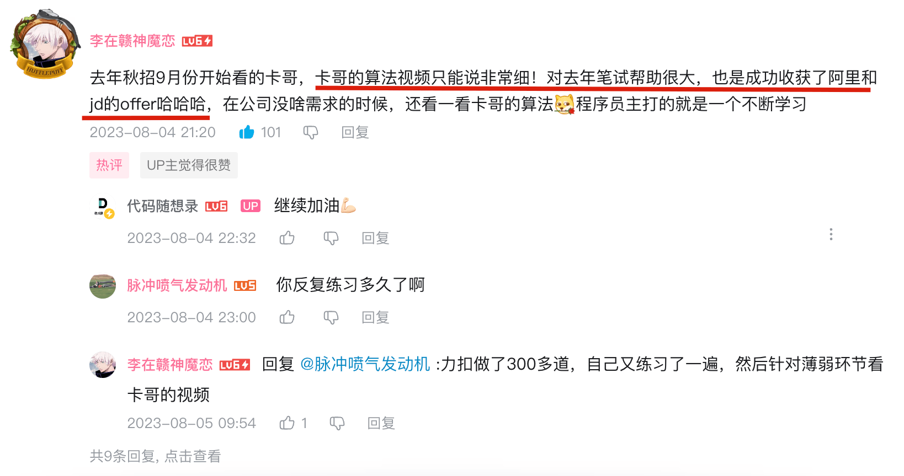


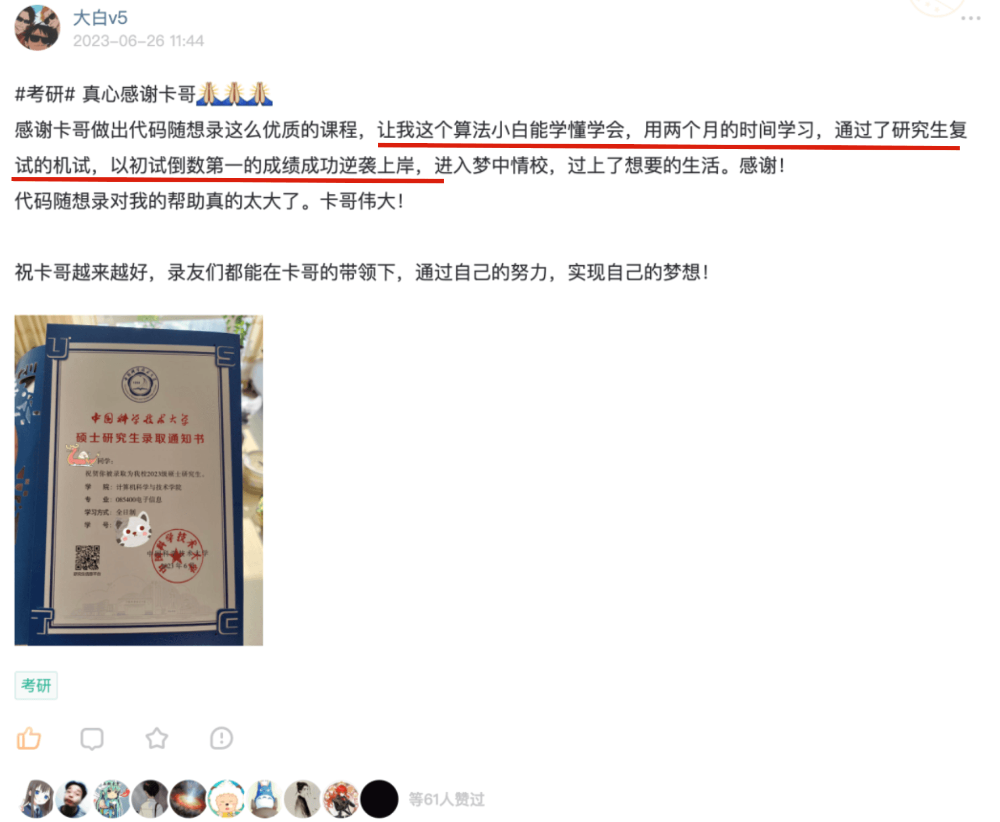

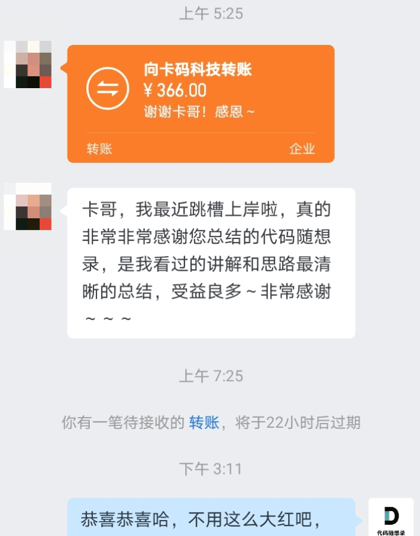

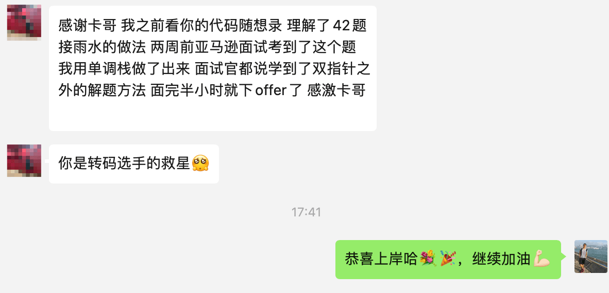

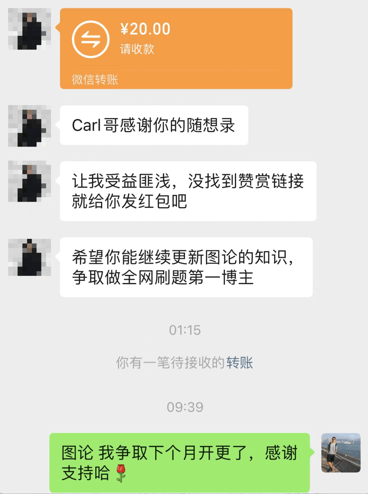

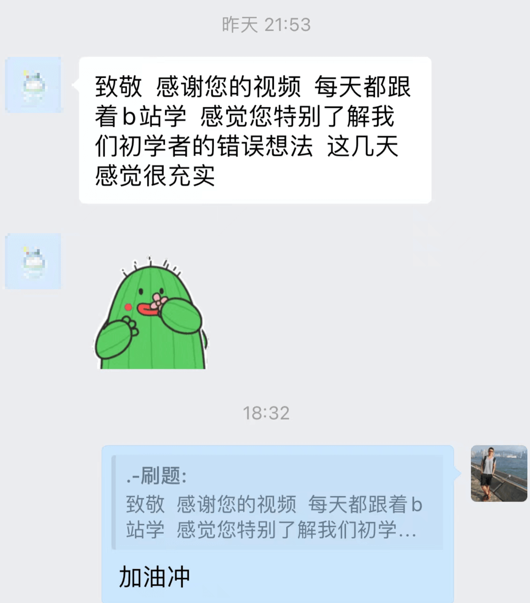

至此**圖論內容已完全免費開放在程式碼隨想錄網站（programmercarl.com），造福廣大學習程式設計的錄友們**！

GitHub 也已經同步：https://github.com/youngyangyang04/leetcode-master ，關於其他語言版本，歡迎錄友們去儲存庫提交 PR

## 後續

關於圖論 PDF 版本，我後面會整理出來，免費發放給大家。

關於圖論影片版本，不出意外，應該在年底開始在 B 站更新，同樣免費開放。

總之，程式碼隨想錄會持續更新下去，無論是文字版還是影片版。

希望大家不用非要到找工作的時候或者要考研究所的時候才想到程式碼隨想錄。

**程式碼是作品，演算法更是藝術**，時不時來欣賞一段解決關鍵問題的優雅程式碼，也是一種享受。

最後，**願錄友們學有所成，歸來仍看程式碼隨想錄**！


