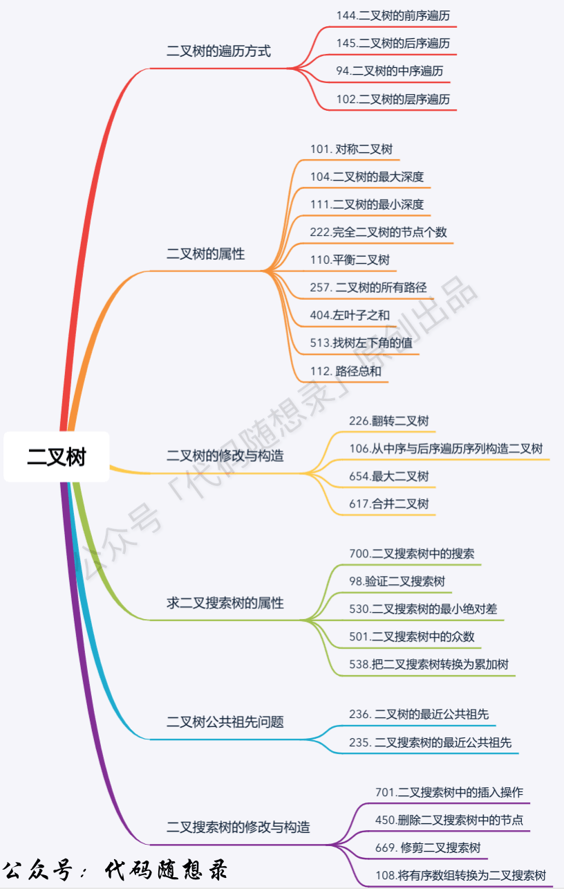
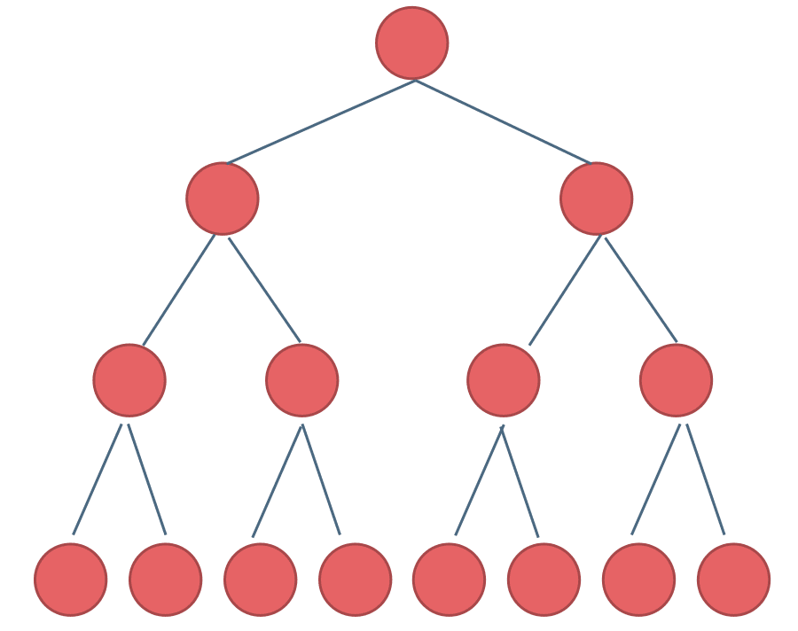
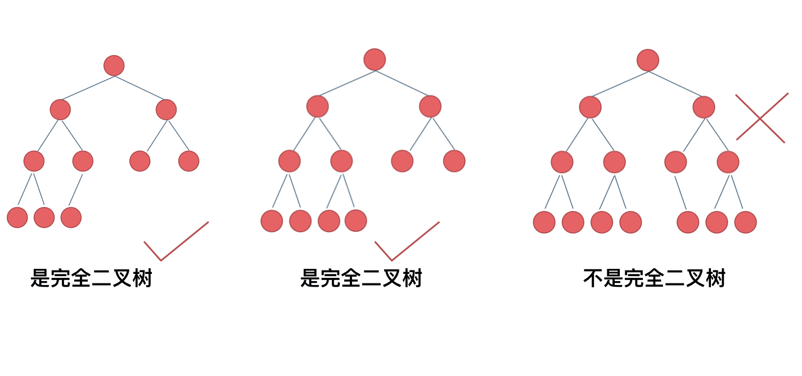
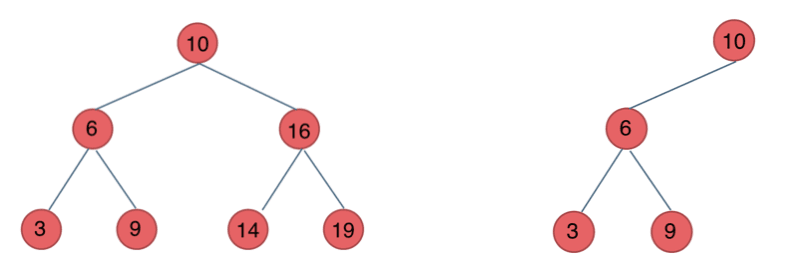
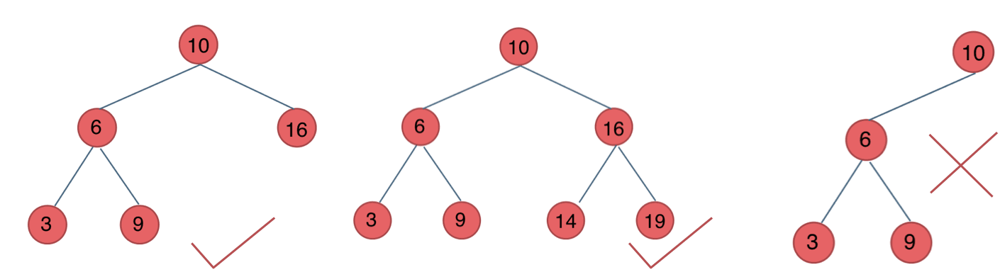
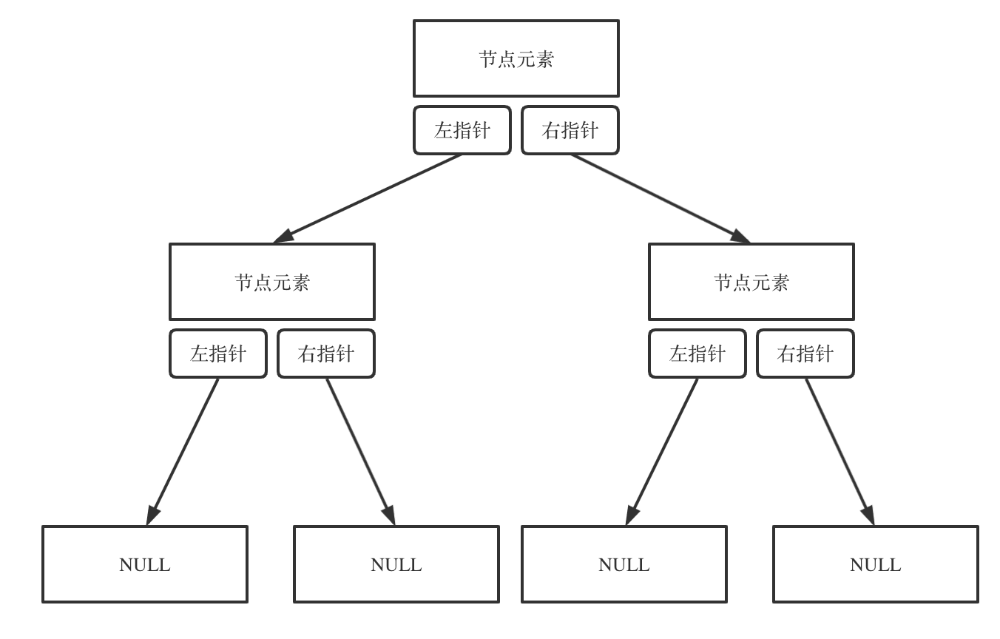
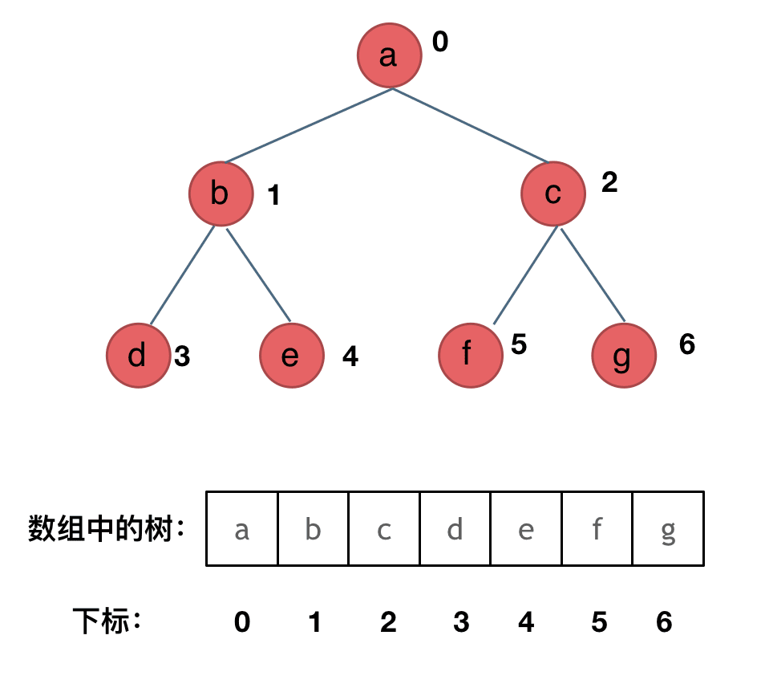
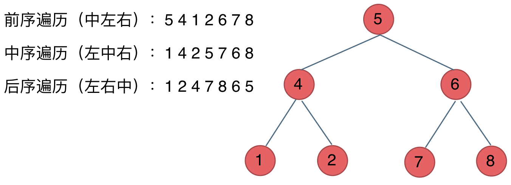

* [做專案（多個 C++、Java、Go、測試開發、前端專案）](https://www.programmercarl.com/other/kstar.html)
* [刷演算法（兩個月高強度學演算法）](https://www.programmercarl.com/xunlian/xunlianying.html)
* [背面試必考題（八股文）（40 天挑戰高頻面試題）](https://www.programmercarl.com/xunlian/bagu.html)


# 二元樹（binary tree）理論基礎篇

## 演算法公開課

**[《程式碼隨想錄》演算法影片公開課](https://programmercarl.com/other/gongkaike.html)：[關於二元樹，你該了解這些！](https://www.bilibili.com/video/BV1Hy4y1t7ij)，相信結合影片再看本篇題解，更有助於大家對本題的理解**。

## 題目分類


題目分類大綱如下：

 </img></div>

說到二元樹，大家對於二元樹其實都很熟悉了，本文呢我也不想教科書式地把二元樹的基礎內容再囉嗦一遍，所以以下我講的都是一些比較重點的內容。

相信只要耐心看完，都會有所收穫。

## 二元樹的種類

在我們解題過程中，二元樹有兩種主要的形式：滿二元樹（full binary tree）和完全二元樹（complete binary tree）。

### 滿二元樹

滿二元樹：如果一棵二元樹只有度（degree）為 0 的節點（node）和度為 2 的節點，並且度為 0 的節點在同一層上，則這棵二元樹為滿二元樹。

如圖所示：

 </img></div>

這棵二元樹為滿二元樹，也可以說深度（depth）為 k，有 2^k-1 個節點的二元樹。


### 完全二元樹

什麼是完全二元樹？

完全二元樹的定義如下：在完全二元樹中，除了最底層節點可能沒填滿外，其餘每層節點數都達到最大值，並且最下面一層的節點都集中在該層最左邊的若干位置。若最底層為第 h 層（h 從 1 開始），則該層包含 1~ 2^(h-1) 個節點。

**大家要自己看完全二元樹的定義，很多同學對完全二元樹其實不是真正地懂了。**

我來舉一個典型的例子如題：

 </img></div>

相信不少同學最後一個二元樹是不是完全二元樹都中招了。

**之前我們剛剛講過優先佇列（priority queue）其實是一個堆積（heap），堆積就是一棵完全二元樹，同時保證父子節點的順序關係。**

### 二元搜尋樹（binary search tree, BST）

前面介紹的樹（tree），都沒有數值的，而二元搜尋樹（binary search tree, BST）是有數值的了，**BST是一個有序（ordered）樹**。


* 若它的左子樹（left subtree）不空，則左子樹上所有節點的值（value）均小於它的根節點（root node）的值；
* 若它的右子樹（right subtree）不空，則右子樹上所有節點的值均大於它的根節點的值；
* 它的左、右子樹也分別為 二元排序樹（binary sort tree）

下面這兩棵樹都是搜尋樹

 </img></div>


### 平衡二元搜尋樹

平衡BST：又被稱為 AVL（Adelson-Velsky and Landis）樹（AVL tree），且具有以下性質：它是一棵空樹或它的左右兩個子樹（subtree）的高度（height）差的絕對值（absolute value）不超過 1，並且左右兩個子樹都是一棵平衡二元樹（balanced binary tree）。

如圖：

 </img></div>

最後一棵不是平衡二元樹，因為它的左右兩個子樹的高度差的絕對值超過了 1。

**C++ 中 map、set、multimap、多（重）集（multiset） 的底層實作都是平衡BST**，所以 map、set 的增刪操作時間複雜度（time complexity）是 logn，注意我這裡沒有說 unordered_map、unordered_set，unordered_map、unordered_set 底層實作是雜湊表（hash table）。

**所以大家使用自己熟悉的程式設計語言（programming language）寫演算法，一定要知道常用的容器（container）底層都是如何實作的，最基本的就是 map、set 等等，否則自己寫的程式碼，自己對其效能分析都分析不清楚！**


## 二元樹的儲存方式

**二元樹可以採用 鏈式儲存（linked storage），也可以採用 順序儲存器（sequential storage）。**

那麼 鏈式儲存 方式就用指標（pointer），順序儲存器 的方式就是用陣列（array）。

顧名思義就是 順序儲存器 的元素（element）在記憶體（memory）是連續分布的，而 鏈式儲存 則是透過指標把分布在各個位址（address）的節點串聯在一起。

鏈式儲存 如圖：

 </img></div>

鏈式儲存 是大家很熟悉的一種方式，那麼我們來看看如何進行 順序儲存器 呢？

其實就是用陣列來儲存二元樹，順序儲存器 的方式如圖：

 </img></div>

用陣列來儲存二元樹如何遍歷（traversal）呢？

**如果父節點（father node）的陣列下標（subscript）是 i，那麼它的左孩子就是 i * 2 + 1，右孩子就是 i * 2 + 2。**

但是用鏈式表示的二元樹，更有利於我們理解，所以一般我們都是用 鏈式儲存 儲存二元樹。

**所以大家要了解，用陣列依然可以表示二元樹。**

## 二元樹的遍歷方式

關於二元樹的遍歷方式，要知道二元樹遍歷的基本方式都有哪些。

一些同學已經做了很多二元樹的題目了，可能知道前中後序遍歷，可能知道層次序走訪（level order traversal），但是卻沒有框架（framework）。

我這裡把二元樹的幾種遍歷方式列出來，大家就可以一一串起來了。

二元樹主要有兩種遍歷方式：

1. 深度優先遍歷（depth-first traversal）：先往深走，遇到葉節點（leaf node）再往回走。
2. 廣度優先遍歷（breadth-first traversal）：一層一層地去遍歷。

**這兩種遍歷是圖論（graph theory）中最基本的兩種遍歷方式**，後面在介紹圖論的時候還會介紹到。

那麼從 深度優先遍歷 和 廣度優先遍歷 進一步拓展，才有如下遍歷方式：

* 深度優先遍歷
  * 前序遍歷（preorder traversal）（遞迴（recursion）法，疊代（iteration）法）
  * 中序橫過（inorder traversal）（遞迴法，疊代法）
  * 後序遍歷（post-order traversal）（遞迴法，疊代法）
* 廣度優先遍歷
  * 層次序走訪（疊代法）


在 深度優先遍歷 中：有三個順序，前中後序遍歷，有同學總分不清這三個順序，經常搞混，我這裡教大家一個技巧。

**這裡前中後，其實指的就是中間節點的遍歷順序**，只要大家記住前中後序指的就是中間節點的位置就可以了。

看如下中間節點的順序，就可以發現，中間節點的順序就是所謂的遍歷方式

* 前序遍歷：中左右
* 中序橫過：左中右
* 後序遍歷：左右中

大家可以對照如下圖，看看自己理解的前後中序有沒有問題。

 </img></div>

最後再說一說二元樹中 深度優先遍歷 和 廣度優先遍歷 實作方式，我們做二元樹相關題目，經常會使用遞迴的方式來實作 深度優先遍歷，也就是實作前中後序遍歷，使用遞迴是比較方便的。

**之前我們講堆疊（stack）與佇列（queue）的時候，就說過堆疊其實就是遞迴的一種實作結構**，也就是說前中後序遍歷的邏輯其實都是可以借助堆疊使用遞迴的方式來實作的。

而 廣度優先遍歷 的實作一般使用佇列來實作，這也是佇列先進先出（first in first out, FIFO）的特點所決定的，因為需要FIFO的結構，才能一層一層地來遍歷二元樹。

**這裡其實我們又了解了堆疊與佇列的一個應用場景了。**

具體的實作我們後面都會講的，這裡大家先要清楚這些理論基礎。

## 二元樹的定義

剛剛我們說過了二元樹有兩種儲存方式：順序儲存器 和 鏈式儲存，順序儲存器 就是用陣列來存，這個定義沒什麼可說的，我們來看看 鏈式儲存 的二元樹節點的定義方式。


C++ 程式碼如下：

```cpp
struct TreeNode {
    int val;
    TreeNode *left;
    TreeNode *right;
    TreeNode(int x) : val(x), left(NULL), right(NULL) {}
};
```

大家會發現二元樹的定義和鏈接串列（linked list）是差不多的，相對於鏈接串列，二元樹的節點裡多了一個指標，有兩個指標，指向左右孩子。

這裡要提醒大家要注意二元樹節點定義的書寫方式。

**在現場面試的時候，面試官可能要求手寫程式碼，所以資料結構的定義以及簡單邏輯的程式碼一定要鍛鍊在白紙上寫出來。**

因為我們在刷 LeetCode 的時候，節點的定義預設（default）都定義好了，真到面試的時候，需要自己寫節點定義的時候，有時候會一臉茫然！

## 總結

二元樹是一種基礎資料結構，在演算法面試中都是常客，也是眾多資料結構的基石。

本篇我們介紹了二元樹的種類、儲存方式、遍歷方式以及定義，比較全面地介紹了二元樹各個方面的重點，幫助大家掃一遍基礎。

**說到二元樹，就不得不說遞迴，很多同學對遞迴都是又熟悉又陌生，遞迴的程式碼一般很簡短，但每次都是一看就會，一寫就廢。**

## 其他語言版本

### Java：

```java
public class TreeNode {
    int val;
    TreeNode left;
    TreeNode right;

    TreeNode() {}
    TreeNode(int val) { this.val = val; }
    TreeNode(int val, TreeNode left, TreeNode right) {
        this.val = val;
        this.left = left;
        this.right = right;
    }
}
```

### Python：

```python
class TreeNode:
    def __init__(self, val, left = None, right = None):
        self.val = val
        self.left = left
        self.right = right
```

### Go：

```go
type TreeNode struct {
    Val int
    Left *TreeNode
    Right *TreeNode
}
```

### JavaScript：

```javascript
function TreeNode(val, left, right) {
    this.val = (val===undefined ? 0 : val)
    this.left = (left===undefined ? null : left)
    this.right = (right===undefined ? null : right)
}
```

### TypeScript：

```typescript
class TreeNode {
    public val: number;
    public left: TreeNode | null;
    public right: TreeNode | null;
    constructor(val?: number, left?: TreeNode, right?: TreeNode) {
        this.val = val === undefined ? 0 : val;
        this.left = left === undefined ? null : left;
        this.right = right === undefined ? null : right;
    }
}
```

### Swift:

```Swift
class TreeNode<T> {
    var value: T
    var left: TreeNode?
    var right: TreeNode?
    init(_ value: T,
         left: TreeNode? = nil,
         right: TreeNode? = nil) {
        self.value = value
        self.left = left
        self.right = right
    }
}
```

### Scala:

```scala
class TreeNode(_value: Int = 0, _left: TreeNode = null, _right: TreeNode = null) {
  var value: Int = _value
  var left: TreeNode = _left
  var right: TreeNode = _right
}
```

### Rust:

```rust
#[derive(Debug, PartialEq, Eq)]
pub struct TreeNode<T> {
    pub val: T,
    pub left: Option<Rc<RefCell<TreeNode<T>>>>,
    pub right: Option<Rc<RefCell<TreeNode<T>>>>,
}

impl<T> TreeNode<T> {
    #[inline]
    pub fn new(val: T) -> Self {
        TreeNode {
            val,
            left: None,
            right: None,
        }
    }
}

```
```c#
public class TreeNode
{
    public int val;
    public TreeNode left;
    public TreeNode right;
    public TreeNode(int x) { val = x; }
}
```

