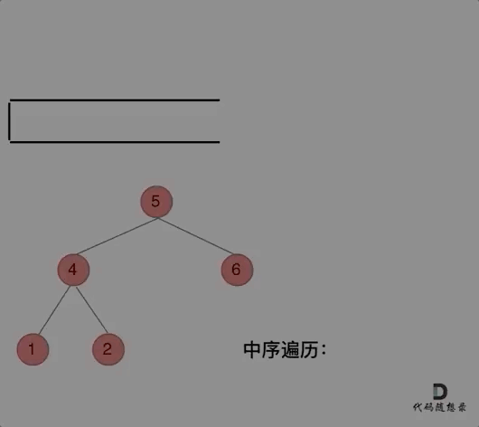
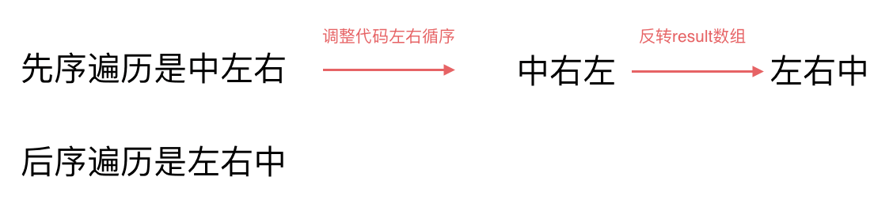

* [做專案（多個 C++、Java、Go、測試開發、前端專案）](https://www.programmercarl.com/other/kstar.html)
* [刷演算法（兩個月高強度學演算法（algorithm））](https://www.programmercarl.com/xunlian/xunlianying.html)
* [背面試必考題（八股文）（40 天挑戰高頻面試題）](https://www.programmercarl.com/xunlian/bagu.html)

> 聽說還可以用非遞迴的方式

# 二元樹（binary tree）的疊代（iteration）遍歷（traversal）

## 演算法公開課

[《程式碼隨想錄》演算法影片公開課](https://programmercarl.com/other/gongkaike.html)：

* **[寫出二元樹的非遞迴（recursion）遍歷很難嗎？（前序和後序）](https://www.bilibili.com/video/BV15f4y1W7i2)** 
* **[寫出二元樹的非遞迴遍歷很難嗎？（中序）)](https://www.bilibili.com/video/BV1Zf4y1a77g)**
**相信結合影片再看本篇題解，更有助於大家對本題的理解。**

看完本篇大家可以使用疊代法，再重新解決如下三道 LeetCode 上的題目：

* [144.二元樹的前序遍歷](https://leetcode.cn/problems/binary-tree-preorder-traversal/)
* [94.二元樹的中序橫過](https://leetcode.cn/problems/binary-tree-inorder-traversal/)
* [145.二元樹的後序遍歷](https://leetcode.cn/problems/binary-tree-postorder-traversal/)

## 想法

為什麼可以用疊代法（非遞迴的方式）來實作二元樹的前後中序遍歷呢？

我們在[堆疊與佇列：匹配問題都是堆疊的強項](https://programmercarl.com/1047.删除字符串中的所有相邻重复项.html)中提到了，**遞迴的實作就是：每一次遞迴呼叫（recursive call）都會把函式（function）的局部變數（local variable）、參數（parameter）值和返回位址（address）等壓入呼叫堆疊（call stack）中**，然後遞迴返回的時候，從堆疊頂（top of stack）彈出上一次遞迴的各項參數，所以這就是遞迴為什麼可以返回上一層位置的原因。

此時大家應該知道我們用堆疊（stack）也可以實作二元樹的前後中序遍歷了。

### 前序遍歷（preorder traversal）（疊代法）

我們先看一下前序遍歷。

前序遍歷是中左右，每次先處理的是中間節點（node），那麼先將根節點（root node）放入堆疊中，然後將右孩子加入堆疊，再加入左孩子。

為什麼要先加入右孩子，再加入左孩子呢？因為這樣出堆疊的時候才是中左右的順序。

動畫如下：


不難寫出如下程式碼: （**注意程式碼中 null node 不入堆疊**）

```CPP
class Solution {
public:
    vector<int> preorderTraversal(TreeNode* root) {
        stack<TreeNode*> st;
        vector<int> result;
        if (root == NULL) return result;
        st.push(root);
        while (!st.empty()) {
            TreeNode* node = st.top();                       // 中
            st.pop();
            result.push_back(node->val);
            if (node->right) st.push(node->right);           // 右（空節點不入堆疊）
            if (node->left) st.push(node->left);             // 左（空節點不入堆疊）
        }
        return result;
    }
};
```

此時會發現貌似使用疊代法寫出前序遍歷並不難，確實不難。

**此時是不是想改一點前序遍歷程式碼順序就把中序橫過（inorder traversal）搞出來了？**

其實還真不行！

但接下來，**再用疊代法寫中序橫過的時候，會發現固定做法又不一樣了，目前的前序遍歷的邏輯無法直接應用到中序橫過上。**

### 中序橫過（疊代法）

為了解釋清楚，我說明一下剛剛在疊代的過程中，其實我們有兩個操作：

1. **處理：將元素（element）放進 result 陣列（array）中**
2. **存取：遍歷節點**

分析一下為什麼剛剛寫的前序遍歷的程式碼，不能和中序橫過通用呢，因為前序遍歷的順序是中左右，先存取的元素是中間節點，要處理的元素也是中間節點，所以剛剛才能寫出相對簡潔的程式碼，**因為要存取的元素和要處理的元素順序是一致的，都是中間節點。**

那麼再看看中序橫過，中序橫過是左中右，先存取的是二元樹頂部的節點，然後一層一層向下存取，直到到達樹（tree）左面的最底部，再開始處理節點（也就是把節點的數值放進 result 陣列中），這就造成了**處理順序和存取順序是不一致的。**

那麼**在使用疊代法寫中序橫過時，就需要借用指標（pointer）的遍歷來幫助存取節點，堆疊則用來處理節點上的元素。**

動畫如下：



**中序橫過，可以寫出如下程式碼：**

```CPP
class Solution {
public:
    vector<int> inorderTraversal(TreeNode* root) {
        vector<int> result;
        stack<TreeNode*> st;
        TreeNode* cur = root;
        while (cur != NULL || !st.empty()) {
            if (cur != NULL) { // 指標來存取節點，存取到最底層
                st.push(cur); // 將存取的節點放進堆疊
                cur = cur->left;                // 左
            } else {
                cur = st.top(); // 從堆疊裡彈出的資料，就是要處理的資料（放進 result 陣列裡的資料）
                st.pop();
                result.push_back(cur->val);     // 中
                cur = cur->right;               // 右
            }
        }
        return result;
    }
};

```

### 後序遍歷（post-order traversal）（疊代法）

再來看後序遍歷，先序遍歷是中左右，後序遍歷是左右中，那麼我們只需要調整一下先序遍歷的程式碼順序，就變成中右左的遍歷順序，然後再反轉（reverse）result 陣列，輸出的結果順序就是左右中了，如下圖：



**所以後序遍歷只需要前序遍歷的程式碼稍作修改就可以了，程式碼如下：**

```CPP
class Solution {
public:
    vector<int> postorderTraversal(TreeNode* root) {
        stack<TreeNode*> st;
        vector<int> result;
        if (root == NULL) return result;
        st.push(root);
        while (!st.empty()) {
            TreeNode* node = st.top();
            st.pop();
            result.push_back(node->val);
            if (node->left) st.push(node->left); // 相對於前序遍歷，這裡更改一下入堆疊順序（空節點不入堆疊）
            if (node->right) st.push(node->right); // 空節點不入堆疊
        }
        reverse(result.begin(), result.end()); // 將結果反轉之後就是左右中的順序了
        return result;
    }
};

```

## 總結

此時我們用疊代法寫出了二元樹的前後中序遍歷，大家可以看出前序和中序是完全兩種程式碼風格，並不像遞迴寫法那樣程式碼稍作調整，就可以實作前後中序。

**這是因為前序遍歷中存取節點（遍歷節點）和處理節點（將元素放進 result 陣列中）可以同步處理，但是中序就無法做到同步！**

上面這句話，可能一些同學不太理解，建議自己親手用疊代法，先寫出來前序，再試試能不能寫出中序，就能理解了。

**那麼問題又來了，難道二元樹前後中序遍歷的疊代法實作，就不能風格統一嗎（即前序遍歷改變程式碼順序就可以實作中序和後序）？**

當然可以，這種寫法還不是很好理解，我們將在下一篇文章裡重點講解，敬請期待！


## 其他語言版本

### Java：

```java
// 前序遍歷順序：中-左-右，入堆疊順序：中-右-左
class Solution {
    public List<Integer> preorderTraversal(TreeNode root) {
        List<Integer> result = new ArrayList<>();
        if (root == null){
            return result;
        }
        Stack<TreeNode> stack = new Stack<>();
        stack.push(root);
        while (!stack.isEmpty()){
            TreeNode node = stack.pop();
            result.add(node.val);
            if (node.right != null){
                stack.push(node.right);
            }
            if (node.left != null){
                stack.push(node.left);
            }
        }
        return result;
    }
}

// 中序橫過順序: 左-中-右 入堆疊順序： 左-右
class Solution {
    public List<Integer> inorderTraversal(TreeNode root) {
        List<Integer> result = new ArrayList<>();
        if (root == null){
            return result;
        }
        Stack<TreeNode> stack = new Stack<>();
        TreeNode cur = root;
        while (cur != null || !stack.isEmpty()){
           if (cur != null){
               stack.push(cur);
               cur = cur.left;
           }else{
               cur = stack.pop();
               result.add(cur.val);
               cur = cur.right;
           }
        }
        return result;
    }
}

// 後序遍歷順序 左-右-中 入堆疊順序：中-左-右 出堆疊順序：中-右-左， 最後反轉結果
class Solution {
    public List<Integer> postorderTraversal(TreeNode root) {
        List<Integer> result = new ArrayList<>();
        if (root == null){
            return result;
        }
        Stack<TreeNode> stack = new Stack<>();
        stack.push(root);
        while (!stack.isEmpty()){
            TreeNode node = stack.pop();
            result.add(node.val);
            if (node.left != null){
                stack.push(node.left);
            }
            if (node.right != null){
                stack.push(node.right);
            }
        }
        Collections.reverse(result);
        return result;
    }
}
```

### Python：

```python
# 前序遍歷-疊代-LC144_二元樹的前序遍歷
class Solution:
    def preorderTraversal(self, root: TreeNode) -> List[int]:
        # 根節點為空則回傳空串列
        if not root:
            return []
        stack = [root]
        result = []
        while stack:
            node = stack.pop()
            # 中節點先處理
            result.append(node.val)
            # 右孩子先入堆疊
            if node.right:
                stack.append(node.right)
            # 左孩子後入堆疊
            if node.left:
                stack.append(node.left)
        return result
```
```python

# 中序橫過-疊代-LC94_二元樹的中序橫過
class Solution:
    def inorderTraversal(self, root: TreeNode) -> List[int]:

        if not root:
            return []
        stack = []  # 不能提前將 root 節點加入 stack 中

        result = []
        cur = root
        while cur or stack:
            # 先疊代存取最底層的左子樹節點
            if cur:     
                stack.append(cur)
                cur = cur.left		
            # 到達最左節點後處理堆疊頂節點    
            else:		
                cur = stack.pop()
                result.append(cur.val)
                # 取堆疊頂元素右節點
                cur = cur.right	
        return result
```
```python

# 後序遍歷-疊代-LC145_二元樹的後序遍歷
class Solution:
    def postorderTraversal(self, root: TreeNode) -> List[int]:
        if not root:
            return []
        stack = [root]
        result = []
        while stack:
            node = stack.pop()
            # 中節點先處理
            result.append(node.val)
            # 左孩子先入堆疊
            if node.left:
                stack.append(node.left)
            # 右孩子後入堆疊
            if node.right:
                stack.append(node.right)
        # 將最終的陣列反轉
        return result[::-1]
 ```

#### Python 後序遍歷的疊代新解法：
* 本解法不同於前文介紹的`逆轉前序遍歷調整後的結果`，而是採用了對每個節點直接處理。這個實作方法在面試中不容易寫出來，在下一節，我將改造本程式碼，奉上程式碼更簡潔、更固定做法化、更容易實作的統一方法。

```python
class Solution:
    def postorderTraversal(self, root: Optional[TreeNode]) -> List[int]:
        values = []
        stack = []
        popped_nodes = set() # 記錄值已經被收割了的 nodes，這是關鍵，已經被收割的節點還在樹中，還會被存取到，但邏輯上已經等同於 null 節點。
        current = root

        while current or stack:
            if current: # 一次處理完一個節點和他的左右兒子節點，不處理孫子節點，孫子節點由左右兒子等會兒分別處理。
                stack.append(current) # 入堆疊自己

                if current.right:
                    stack.append(current.right) # 入堆疊右兒子
                
                if current.left: # 因為堆疊是後進先出，後序是「左右中」，所以後加左兒子
                    stack.append(current.left) # 入堆疊左兒子

                current = None # 會導致後面 A 處出堆疊
                continue

            node = stack.pop() # A 處，出的是左兒子，如果無左兒子，出的就是右兒子，如果連右兒子也沒有，出的就是自己了。

            # 如果 node 是葉子節點，就可以收割了；如果左右兒子都已經被收割了，也可以收割
            if (node.left is None or node.left in popped_nodes) and \
                (node.right is None or node.right in popped_nodes):
                popped_nodes.add(node)
                values.append(node.val)
                continue
            
            current = node # 不符合收割條件，說明 node 下還有未入堆疊的兒子，就去入堆疊
        
        return values
```

### Go：

> 疊代法前序遍歷

```go
func preorderTraversal(root *TreeNode) []int {
    ans := []int{}

	if root == nil {
		return ans
	}

	st := list.New()
    st.PushBack(root)

    for st.Len() > 0 {
        node := st.Remove(st.Back()).(*TreeNode)

        ans = append(ans, node.Val)
        if node.Right != nil {
            st.PushBack(node.Right)
        }
        if node.Left != nil {
            st.PushBack(node.Left)
        }
    }
    return ans
}
```

> 疊代法後序遍歷

```go
func postorderTraversal(root *TreeNode) []int {
    ans := []int{}

	if root == nil {
		return ans
	}

	st := list.New()
    st.PushBack(root)

    for st.Len() > 0 {
        node := st.Remove(st.Back()).(*TreeNode)

        ans = append(ans, node.Val)
        if node.Left != nil {
            st.PushBack(node.Left)
        }
        if node.Right != nil {
            st.PushBack(node.Right)
        }
    }
    reverse(ans)
    return ans
}

func reverse(a []int) {
    l, r := 0, len(a) - 1
    for l < r {
        a[l], a[r] = a[r], a[l]
        l, r = l+1, r-1
    }
}
```

> 疊代法中序橫過

```go
func inorderTraversal(root *TreeNode) []int {
    ans := []int{}
    if root == nil {
        return ans
    }

    st := list.New()
    cur := root

    for cur != nil || st.Len() > 0 {
        if cur != nil {
            st.PushBack(cur)
            cur = cur.Left
        } else {
            cur = st.Remove(st.Back()).(*TreeNode)
            ans = append(ans, cur.Val)
            cur = cur.Right
        }
    }

    return ans
}
```

### JavaScript：

```js

前序遍歷:

// 入堆疊 右 -> 左
// 出堆疊 中 -> 左 -> 右
var preorderTraversal = function(root, res = []) {
    if(!root) return res;
    const stack = [root];
    let cur = null;
    while(stack.length) {
        cur = stack.pop();
        res.push(cur.val);
        cur.right && stack.push(cur.right);
        cur.left && stack.push(cur.left);
    }
    return res;
};

中序橫過:

// 入堆疊 左 -> 右
// 出堆疊 左 -> 中 -> 右

var inorderTraversal = function(root, res = []) {
    const stack = [];
    let cur = root;
    while(stack.length || cur) {
        if(cur) {
            stack.push(cur);
            // 左
            cur = cur.left;
        } else {
            // --> 彈出 中
            cur = stack.pop();
            res.push(cur.val); 
            // 右
            cur = cur.right;
        }
    };
    return res;
};

後序遍歷:

// 入堆疊 左 -> 右
// 出堆疊 中 -> 右 -> 左 結果反轉

var postorderTraversal = function(root, res = []) {
    if (!root) return res;
    const stack = [root];
    let cur = null;
    do {
        cur = stack.pop();
        res.push(cur.val);
        cur.left && stack.push(cur.left);
        cur.right && stack.push(cur.right);
    } while(stack.length);
    return res.reverse();
};
```

### TypeScript：

```typescript
// 前序遍歷（疊代法）
function preorderTraversal(root: TreeNode | null): number[] {
    if (root === null) return [];
    let res: number[] = [];
    let helperStack: TreeNode[] = [];
    let curNode: TreeNode = root;
    helperStack.push(curNode);
    while (helperStack.length > 0) {
        curNode = helperStack.pop()!;
        res.push(curNode.val);
        if (curNode.right !== null) helperStack.push(curNode.right);
        if (curNode.left !== null) helperStack.push(curNode.left);
    }
    return res;
};

// 中序橫過（疊代法）
function inorderTraversal(root: TreeNode | null): number[] {
    let helperStack: TreeNode[] = [];
    let res: number[] = [];
    if (root === null) return res;
    let curNode: TreeNode | null = root;
    while (curNode !== null || helperStack.length > 0) {
        if (curNode !== null) {
            helperStack.push(curNode);
            curNode = curNode.left;
        } else {
            curNode = helperStack.pop()!;
            res.push(curNode.val);
            curNode = curNode.right;
        }
    }
    return res;
};

// 後序遍歷（疊代法）
function postorderTraversal(root: TreeNode | null): number[] {
    let helperStack: TreeNode[] = [];
    let res: number[] = [];
    let curNode: TreeNode;
    if (root === null) return res;
    helperStack.push(root);
    while (helperStack.length > 0) {
        curNode = helperStack.pop()!;
        res.push(curNode.val);
        if (curNode.left !== null) helperStack.push(curNode.left);
        if (curNode.right !== null) helperStack.push(curNode.right);
    }
    return res.reverse();
};
```

### Swift：

```swift
// 前序遍歷疊代法
func preorderTraversal(_ root: TreeNode?) -> [Int] {
    var result = [Int]()
    guard let root = root else { return result }
    var stack = [root]
    while !stack.isEmpty {
        let current = stack.removeLast()
        // 先右後左，這樣出堆疊的時候才是左右順序
        if let node = current.right { // 右
            stack.append(node)
        }
        if let node = current.left { // 左
            stack.append(node)
        }
        result.append(current.val) // 中
    }
    return result
}

// 後序遍歷疊代法
func postorderTraversal(_ root: TreeNode?) -> [Int] {
    var result = [Int]()
    guard let root = root else { return result }
    var stack = [root]
    while !stack.isEmpty {
        let current = stack.removeLast()
        // 與前序相反，即中右左，最後結果還需反轉才是後序
        if let node = current.left { // 左
            stack.append(node)
        }
        if let node = current.right { // 右
            stack.append(node)
        }
        result.append(current.val) // 中
    }
    return result.reversed()
}

// 中序橫過疊代法
func inorderTraversal(_ root: TreeNode?) -> [Int] {
    var result = [Int]()
    var stack = [TreeNode]()
    var current: TreeNode! = root
    while current != nil || !stack.isEmpty {
        if current != nil { // 先存取到最左葉子
            stack.append(current)
            current = current.left // 左
        } else {
            current = stack.removeLast()
            result.append(current.val) // 中
            current = current.right // 右
        }
    }
    return result
}
```
### Scala:

```scala
// 前序遍歷（疊代法）
object Solution {
  import scala.collection.mutable
  def preorderTraversal(root: TreeNode): List[Int] = {
    val res = mutable.ListBuffer[Int]()
    if (root == null) return res.toList
    // 宣告一個堆疊，泛型為 TreeNode
    val stack = mutable.Stack[TreeNode]()
    stack.push(root) // 先把根節點壓入堆疊
    while (!stack.isEmpty) {
      var curNode = stack.pop()
      res.append(curNode.value) // 先把這個值壓入堆疊
      // 如果目前節點的左右節點不為空，則入堆疊，先放右節點，再放左節點
      if (curNode.right != null) stack.push(curNode.right)
      if (curNode.left != null) stack.push(curNode.left)
    }
    res.toList
  }
}

// 中序橫過（疊代法）
object Solution {
  import scala.collection.mutable
  def inorderTraversal(root: TreeNode): List[Int] = {
    val res = mutable.ArrayBuffer[Int]()
    if (root == null) return res.toList
    val stack = mutable.Stack[TreeNode]()
    var curNode = root
    // 將左節點都入堆疊，當遍歷到最左（到空）的時候，再彈出堆疊頂元素，加入 res
    // 再把堆疊頂元素的右節點加進來，繼續下一輪遍歷
    while (curNode != null || !stack.isEmpty) {
      if (curNode != null) {
        stack.push(curNode)
        curNode = curNode.left
      } else {
        curNode = stack.pop()
        res.append(curNode.value)
        curNode = curNode.right
      }
    }
    res.toList
  }
}

// 後序遍歷（疊代法）
object Solution {
  import scala.collection.mutable
  def postorderTraversal(root: TreeNode): List[Int] = {
    val res = mutable.ListBuffer[Int]()
    if (root == null) return res.toList
    val stack = mutable.Stack[TreeNode]()
    stack.push(root)
    while (!stack.isEmpty) {
      val curNode = stack.pop()
      res.append(curNode.value)
      // 這次左節點先入堆疊，右節點再入堆疊
      if(curNode.left != null) stack.push(curNode.left)
      if(curNode.right != null) stack.push(curNode.right)
    }
    // 最後需要反轉 List
    res.reverse.toList
  }
}
```

### Rust:

```rust
use std::cell::RefCell;
use std::rc::Rc;
impl Solution {
    //前序
    pub fn preorder_traversal(root: Option<Rc<RefCell<TreeNode>>>) -> Vec<i32> {
        let mut res = vec![];
        let mut stack = vec![root];
        while !stack.is_empty() {
            if let Some(node) = stack.pop().unwrap() {
                res.push(node.borrow().val);
                stack.push(node.borrow().right.clone());
                stack.push(node.borrow().left.clone());
            }
        }
        res
    }
    //中序
    pub fn inorder_traversal(root: Option<Rc<RefCell<TreeNode>>>) -> Vec<i32> {
        let mut res = vec![];
        let mut stack = vec![];
        let mut node = root;

        while !stack.is_empty() || node.is_some() {
            while let Some(n) = node {
                node = n.borrow().left.clone();
                stack.push(n);
            }
            if let Some(n) = stack.pop() {
                res.push(n.borrow().val);
                node = n.borrow().right.clone();
            }
        }
        res
    }
    //後序
    pub fn postorder_traversal(root: Option<Rc<RefCell<TreeNode>>>) -> Vec<i32> {
        let mut res = vec![];
        let mut stack = vec![root];
        while !stack.is_empty() {
            if let Some(node) = stack.pop().unwrap() {
                res.push(node.borrow().val);
                stack.push(node.borrow().left.clone());
                stack.push(node.borrow().right.clone());
            }
        }
        res.into_iter().rev().collect()
    }
}
```
### C#
```csharp
// 前序遍歷
public IList<int> PreorderTraversal(TreeNode root)
{
    var st = new Stack<TreeNode>();
    var res = new List<int>();
    if (root == null) return res;
    st.Push(root);
    while (st.Count != 0)
    {
        var node = st.Pop();
        res.Add(node.val);
        if (node.right != null)
            st.Push(node.right);
        if (node.left != null)
            st.Push(node.left);
    }
    return res;
}  

// 中序橫過
public IList<int> InorderTraversal(TreeNode root)
{
    var st = new Stack<TreeNode>();
    var res = new List<int>();
    var cur = root;
    while (st.Count != 0 || cur != null)
    {
        if (cur != null)
        {
            st.Push(cur);
            cur = cur.left;
        }
        else
        {
            cur = st.Pop();
            res.Add(cur.val);
            cur = cur.right;
        }
    }
    return res;
}
// 後序遍歷
public IList<int> PostorderTraversal(TreeNode root)
{
    var res = new List<int>();
    var st = new Stack<TreeNode>();
    if (root == null) return res;
    st.Push(root);
    while (st.Count != 0)
    {
        var cur = st.Pop();
        res.Add(cur.val);
        if (cur.left != null) st.Push(cur.left);
        if (cur.right != null) st.Push(cur.right);
    }
    res.Reverse(0, res.Count());
    return res;
}
```

