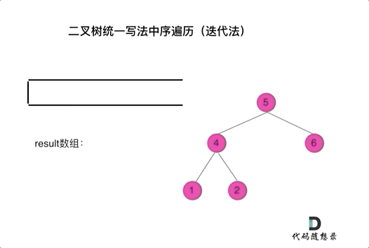

* [做專案（多個 C++、Java、Go、測試開發、前端專案）](https://www.programmercarl.com/other/kstar.html)
* [刷演算法（兩個月高強度學演算法）](https://www.programmercarl.com/xunlian/xunlianying.html)
* [背面試必考題（八股文）（40 天挑戰高頻面試題）](https://www.programmercarl.com/xunlian/bagu.html)


> 統一寫法是一種什麼感覺

# 二元樹（binary tree）的統一疊代（iteration）法

## 想法

此時我們在[二元樹：一入遞迴深似海，從此 offer 是路人](./二叉樹的遞迴遍歷.md)中用遞迴（recursion）的方式，實作了二元樹前中後序的遍歷（traversal）。

在[二元樹：聽說遞迴能做的，堆疊也能做！](./二叉樹的疊代遍歷.md)中用堆疊（stack）實作了二元樹前後中序的疊代遍歷（非遞迴）。

之後我們發現**疊代法實作的先中後序，其實風格也不是那麼統一，除了先序和後序有關聯，中序完全就是另一個風格了，一會兒用堆疊遍歷，一會兒又用指標（pointer）來遍歷。**

實踐過的同學，也會發現使用疊代法實作先中後序遍歷，很難寫出統一的程式碼，不像是遞迴法，實作了其中的一種遍歷方式，其他兩種只要稍稍改一下節點（node）順序就可以了。

其實**針對三種遍歷方式，使用疊代法是可以寫出統一風格的程式碼！**

**重頭戲來了，接下來介紹一下統一寫法。**

我們以中序橫過（inorder traversal）為例，在[二元樹：聽說遞迴能做的，堆疊也能做！](./二叉樹的疊代遍歷.md)中提到說使用堆疊的話，**無法同時解決存取節點（遍歷節點）和處理節點（將元素（element）放進結果集（result set））不一致的情況**。

**那我們就將存取的節點放入堆疊中，把要處理的節點也放入堆疊中但是要做標記。**

如何標記呢？

* 方法一：**就是要處理的節點放入堆疊之後，緊接著放入一個空指標（null pointer）作為標記。** 這種方法可以叫做`空指標標記法`。

* 方法二：**加一個 `boolean` 值（value）跟隨每個節點，`false` (預設（default）值) 表示需要為該節點和它的左右兒子安排在堆疊中的位次，`true` 表示該節點的位次之前已經安排過了，可以收割節點了。** 
這種方法可以叫做`boolean 標記法`，範例程式碼見下文`C++ 和 Python 的 boolean 標記法`。 這種方法更容易理解，在面試中更容易寫出來。

### 疊代法中序橫過

> 中序橫過（空指標標記法）程式碼如下：（詳細註解）

```CPP
class Solution {
public:
    vector<int> inorderTraversal(TreeNode* root) {
        vector<int> result;
        stack<TreeNode*> st;
        if (root != NULL) st.push(root);
        while (!st.empty()) {
            TreeNode* node = st.top();
            if (node != NULL) {
                st.pop(); // 將該節點彈出，避免重複操作，下面再將右中左節點加到堆疊中
                if (node->right) st.push(node->right);  // 加入右節點（空節點不入堆疊）

                st.push(node);                          // 加入中節點
                st.push(NULL); // 中節點存取過，但是還沒有處理，加入空節點作為標記。

                if (node->left) st.push(node->left);    // 加入左節點（空節點不入堆疊）
            } else { // 只有遇到空節點的時候，才將下一個節點放進結果集
                st.pop();           // 將空節點彈出
                node = st.top();    // 重新取出堆疊中元素
                st.pop();
                result.push_back(node->val); // 加到結果集
            }
        }
        return result;
    }
};
```

看程式碼有點抽象我們來看一下動畫(中序橫過)：



動畫中，result 陣列（array）就是最終結果集。

可以看出我們將存取的節點直接加入到堆疊中，但如果是處理的節點則後面放入一個空節點（null node），這樣只有空節點彈出的時候，才將下一個節點放進結果集。

> 中序橫過（boolean 標記法）：
```c++
class Solution {
public:
    vector<int> inorderTraversal(TreeNode* root) {
        vector<int> result;
        stack<pair<TreeNode*, bool>> st;
        if (root != nullptr)
            st.push(make_pair(root, false)); // 多加一個參數，false 為預設值，含義見下文註解

        while (!st.empty()) {
            auto node = st.top().first;
            auto visited = st.top().second; //多加一個 visited 參數，使「疊代統一寫法」成為一件簡單的事
            st.pop();

            if (visited) { // visited 為 True，表示該節點和兩個兒子位次之前已經安排過了，現在可以收割節點了
                result.push_back(node->val);
                continue;
            }

            // visited 目前為 false, 表示初次存取本節點，此次存取的目的是「把自己和兩個兒子在堆疊中安排好位次」。
            
            // 中序橫過是「左中右」，右兒子最先入堆疊，最後出堆疊。
            if (node->right)
                st.push(make_pair(node->right, false));
            
            // 把自己加回到堆疊中，位置居中。
            // 同時，設定 visited 為 true，表示下次再存取本節點時，允許收割。
            st.push(make_pair(node, true));

            if (node->left)
                st.push(make_pair(node->left, false)); // 左兒子最後入堆疊，最先出堆疊
        }
        
        return result;
    }
};
```

此時我們再來看前序遍歷（preorder traversal）程式碼。

### 疊代法前序遍歷

疊代法前序遍歷程式碼如下： (**注意此時我們和中序橫過相比僅僅改變了兩行程式碼的順序**)

```CPP
class Solution {
public:
    vector<int> preorderTraversal(TreeNode* root) {
        vector<int> result;
        stack<TreeNode*> st;
        if (root != NULL) st.push(root);
        while (!st.empty()) {
            TreeNode* node = st.top();
            if (node != NULL) {
                st.pop();
                if (node->right) st.push(node->right);  // 右
                if (node->left) st.push(node->left);    // 左
                st.push(node);                          // 中
                st.push(NULL);
            } else {
                st.pop();
                node = st.top();
                st.pop();
                result.push_back(node->val);
            }
        }
        return result;
    }
};
```

### 疊代法後序遍歷（post-order traversal）

> 後序遍歷程式碼如下： (**注意此時我們和中序橫過相比僅僅改變了兩行程式碼的順序**)

```CPP
class Solution {
public:
    vector<int> postorderTraversal(TreeNode* root) {
        vector<int> result;
        stack<TreeNode*> st;
        if (root != NULL) st.push(root);
        while (!st.empty()) {
            TreeNode* node = st.top();
            if (node != NULL) {
                st.pop();
                st.push(node);                          // 中
                st.push(NULL);

                if (node->right) st.push(node->right);  // 右
                if (node->left) st.push(node->left);    // 左

            } else {
                st.pop();
                node = st.top();
                st.pop();
                result.push_back(node->val);
            }
        }
        return result;
    }
};
```

> 疊代法後序遍歷（boolean 標記法）：
```c++
class Solution {
public:
    vector<int> postorderTraversal(TreeNode* root) {
        vector<int> result;
        stack<pair<TreeNode*, bool>> st;
        if (root != nullptr)
            st.push(make_pair(root, false)); // 多加一個參數，false 為預設值，含義見下文

        while (!st.empty()) {
            auto node = st.top().first;
            auto visited = st.top().second; //多加一個 visited 參數，使「疊代統一寫法」成為一件簡單的事
            st.pop();

            if (visited) { // visited 為 True，表示該節點和兩個兒子位次之前已經安排過了，現在可以收割節點了
                result.push_back(node->val);
                continue;
            }

            // visited 目前為 false, 表示初次存取本節點，此次存取的目的是「把自己和兩個兒子在堆疊中安排好位次」。
            // 後序遍歷是「左右中」，節點自己最先入堆疊，最後出堆疊。
            // 同時，設定 visited 為 true，表示下次再存取本節點時，允許收割。
            st.push(make_pair(node, true));

            if (node->right)
                st.push(make_pair(node->right, false)); // 右兒子位置居中

            if (node->left)
                st.push(make_pair(node->left, false)); // 左兒子最後入堆疊，最先出堆疊
        }
        
        return result;
    }
};
```
## 總結

此時我們寫出了統一風格的疊代法，不用再糾結於前序寫出來了，中序寫不出來的情況了。

但是統一風格的疊代法並不好理解，而且想在面試直接寫出來還有難度的。

所以大家根據自己的個人喜好，對於二元樹的前中後序遍歷，選擇一種自己容易理解的遞迴和疊代法。

## 其他語言版本

### Java：

疊代法前序遍歷（空指標標記法）程式碼如下：

```java
class Solution {
    public List<Integer> preorderTraversal(TreeNode root) {
        List<Integer> result = new LinkedList<>();
        Stack<TreeNode> st = new Stack<>();
        if (root != null) st.push(root);
        while (!st.empty()) {
            TreeNode node = st.peek();
            if (node != null) {
                st.pop(); // 將該節點彈出，避免重複操作，下面再將右左中節點加到堆疊中（前序遍歷-中左右，入堆疊順序右左中）
                if (node.right != null) st.push(node.right);  // 加入右節點（空節點不入堆疊）
                if (node.left != null) st.push(node.left);    // 加入左節點（空節點不入堆疊）
                st.push(node); // 加入中節點
                st.push(null); // 中節點存取過，但是還沒有處理，加入空節點作為標記。
            } else { // 只有遇到空節點的時候，才將下一個節點放進結果集
                st.pop();           // 將空節點彈出
                node = st.peek();    // 重新取出堆疊中元素
                st.pop();
                result.add(node.val); // 加到結果集
            }
        }
        return result;
    }
}
```

疊代法中序橫過（空指標標記法）程式碼如下：
```java
class Solution {
    public List<Integer> inorderTraversal(TreeNode root) {
        List<Integer> result = new LinkedList<>();
        Stack<TreeNode> st = new Stack<>();
        if (root != null) st.push(root);
        while (!st.empty()) {
            TreeNode node = st.peek();
            if (node != null) {
                st.pop(); // 將該節點彈出，避免重複操作，下面再將右中左節點加到堆疊中（中序橫過-左中右，入堆疊順序右中左）
                if (node.right != null) st.push(node.right);  // 加入右節點（空節點不入堆疊）
                st.push(node); // 加入中節點
                st.push(null); // 中節點存取過，但是還沒有處理，加入空節點作為標記。
                if (node.left != null) st.push(node.left);    // 加入左節點（空節點不入堆疊）
            } else { // 只有遇到空節點的時候，才將下一個節點放進結果集
                st.pop();           // 將空節點彈出
                node = st.peek();    // 重新取出堆疊中元素
                st.pop();
                result.add(node.val); // 加到結果集
            }
        }
        return result;
    }
}
```

疊代法後序遍歷（空指標標記法）程式碼如下：
```java
class Solution {
   public List<Integer> postorderTraversal(TreeNode root) {
        List<Integer> result = new LinkedList<>();
        Stack<TreeNode> st = new Stack<>();
        if (root != null) st.push(root);
        while (!st.empty()) {
            TreeNode node = st.peek();
            if (node != null) {
                st.pop(); // 將該節點彈出，避免重複操作，下面再將中右左節點加到堆疊中（後序遍歷-左右中，入堆疊順序中右左）
                st.push(node); // 加入中節點
                st.push(null); // 中節點存取過，但是還沒有處理，加入空節點作為標記。
                if (node.right!=null) st.push(node.right);  // 加入右節點（空節點不入堆疊）
                if (node.left!=null) st.push(node.left);    // 加入左節點（空節點不入堆疊）
            } else { // 只有遇到空節點的時候，才將下一個節點放進結果集
                st.pop();           // 將空節點彈出
                node = st.peek();    // 重新取出堆疊中元素
                st.pop();
                result.add(node.val); // 加到結果集
            }
        }
        return result;
   }
}
```

疊代法前序遍歷（boolean 標記法）程式碼如下：

```java
// LeetCode 提交時注意加入匯入套件語句
import java.util.AbstractMap.SimpleEntry;

class Solution {
    public List<Integer> preorderTraversal(TreeNode root) {
        List<Integer> result = new ArrayList<>();
        if (root == null)
            return result;
        Stack<SimpleEntry<TreeNode, Boolean>> stack = new Stack<>();
        stack.push(new SimpleEntry<>(root, false));

        while (!stack.isEmpty()) {
            TreeNode node = stack.peek().getKey();
            // 多加一個 visited 參數，使「疊代統一寫法」成為一件簡單的事
            boolean visited = stack.peek().getValue();
            stack.pop();

            // visited 為 True，表示該節點和兩個兒子位次之前已經安排過了，現在可以收割節點了
            if (visited) {
                result.add(node.val);
                continue;
            }

            // visited 目前為 false, 表示初次存取本節點，此次存取的目的是「把自己和兩個兒子在堆疊中安排好位次」
			
            // 前序遍歷是「中左右」，右兒子最先入堆疊，最後出堆疊
            if (node.right != null) {
                stack.push(new SimpleEntry<>(node.right, false));
            }

            // 左兒子位置居中
            if (node.left != null) {
                stack.push(new SimpleEntry<>(node.left, false));
            }

            // 節點自己最後入堆疊，最先出堆疊
            // 同時，設定 visited 為 true，表示下次再存取本節點時，允許收割
            stack.push(new SimpleEntry<>(node, true));
        }

        return result;
    }
}
```

疊代法中序橫過（boolean 標記法）程式碼如下：

```java
// LeetCode 提交時注意加入匯入套件語句
import java.util.AbstractMap.SimpleEntry;

class Solution {
    public List<Integer> inorderTraversal(TreeNode root) {
        List<Integer> result = new ArrayList<>();
        if (root == null)
            return result;
        Stack<SimpleEntry<TreeNode, Boolean>> stack = new Stack<>();
        stack.push(new SimpleEntry<>(root, false));

        while (!stack.isEmpty()) {
            TreeNode node = stack.peek().getKey();
            // 多加一個 visited 參數，使「疊代統一寫法」成為一件簡單的事
            boolean visited = stack.peek().getValue();
            stack.pop();

            // visited 為 True，表示該節點和兩個兒子位次之前已經安排過了，現在可以收割節點了
            if (visited) {
                result.add(node.val);
                continue;
            }

            // visited 目前為 false, 表示初次存取本節點，此次存取的目的是「把自己和兩個兒子在堆疊中安排好位次」
			
            // 中序橫過是「左中右」，右兒子最先入堆疊，最後出堆疊
            if (node.right != null) {
                stack.push(new SimpleEntry<>(node.right, false));
            }
            
            // 把自己加回到堆疊中，位置居中
            // 同時，設定 visited 為 true，表示下次再存取本節點時，允許收割
            stack.push(new SimpleEntry<>(node, true));

            // 左兒子最後入堆疊，最先出堆疊
            if (node.left != null) {
                stack.push(new SimpleEntry<>(node.left, false));
            }
        }

        return result;
    }
}
```

疊代法後序遍歷（boolean 標記法）程式碼如下：

```java
// LeetCode 提交時注意加入匯入套件語句
import java.util.AbstractMap.SimpleEntry;

class Solution {
    public List<Integer> postorderTraversal(TreeNode root) {
        List<Integer> result = new ArrayList<>();
        if (root == null)
            return result;
        Stack<SimpleEntry<TreeNode, Boolean>> stack = new Stack<>();
        stack.push(new SimpleEntry<>(root, false));

        while (!stack.isEmpty()) {
            TreeNode node = stack.peek().getKey();
            // 多加一個 visited 參數，使「疊代統一寫法」成為一件簡單的事
            boolean visited = stack.peek().getValue();
            stack.pop();

            // visited 為 True，表示該節點和兩個兒子位次之前已經安排過了，現在可以收割節點了
            if (visited) {
                result.add(node.val);
                continue;
            }

            // visited 目前為 false, 表示初次存取本節點，此次存取的目的是「把自己和兩個兒子在堆疊中安排好位次」
			
            // 後序遍歷是「左右中」，節點自己最先入堆疊，最後出堆疊
            // 同時，設定 visited 為 true，表示下次再存取本節點時，允許收割
            stack.push(new SimpleEntry<>(node, true));
            
            // 右兒子位置居中
            if (node.right != null) {
                stack.push(new SimpleEntry<>(node.right, false));
            }
            
            // 左兒子最後入堆疊，最先出堆疊
            if (node.left != null) {
                stack.push(new SimpleEntry<>(node.left, false));
            }
        }

        return result;
    }
}
```

### Python：

> 疊代法前序遍歷（空指標標記法）：
```python
class Solution:
    def preorderTraversal(self, root: TreeNode) -> List[int]:
        result = []
        st= []
        if root:
            st.append(root)
        while st:
            node = st.pop()
            if node != None:
                if node.right: #右
                    st.append(node.right)
                if node.left: #左
                    st.append(node.left)
                st.append(node) #中
                st.append(None)
            else:
                node = st.pop()
                result.append(node.val)
        return result
```

> 疊代法中序橫過（空指標標記法）：
```python
class Solution:
    def inorderTraversal(self, root: TreeNode) -> List[int]:
        result = []
        st = []
        if root:
            st.append(root)
        while st:
            node = st.pop()
            if node != None:
                if node.right: #加入右節點（空節點不入堆疊）
                    st.append(node.right)
                
                st.append(node) #加入中節點
                st.append(None) #中節點存取過，但是還沒有處理，加入空節點作為標記。
                
                if node.left: #加入左節點（空節點不入堆疊）
                    st.append(node.left)
            else: #只有遇到空節點的時候，才將下一個節點放進結果集
                node = st.pop() #重新取出堆疊中元素
                result.append(node.val) #加到結果集
        return result
```

> 疊代法後序遍歷（空指標標記法）：
```python
class Solution:
    def postorderTraversal(self, root: TreeNode) -> List[int]:
        result = []
        st = []
        if root:
            st.append(root)
        while st:
            node = st.pop()
            if node != None:
                st.append(node) #中
                st.append(None)
                
                if node.right: #右
                    st.append(node.right)
                if node.left: #左
                    st.append(node.left)
            else:
                node = st.pop()
                result.append(node.val)
        return result
```

> 中序橫過，統一疊代（boolean 標記法）：
```python
class Solution:
    def inorderTraversal(self, root: Optional[TreeNode]) -> List[int]:
        values = []
        stack = [(root, False)] if root else [] # 多加一個參數，False 為預設值，含義見下文

        while stack:
            node, visited = stack.pop() # 多加一個 visited 參數，使「疊代統一寫法」成為一件簡單的事
            
            if visited: # visited 為 True，表示該節點和兩個兒子的位次之前已經安排過了，現在可以收割節點了
                values.append(node.val)
                continue

            # visited 目前為 False, 表示初次存取本節點，此次存取的目的是「把自己和兩個兒子在堆疊中安排好位次」。
            # 中序橫過是「左中右」，右兒子最先入堆疊，最後出堆疊。
            if node.right:
                stack.append((node.right, False))

            stack.append((node, True)) # 把自己加回到堆疊中，位置居中。同時，設定 visited 為 True，表示下次再存取本節點時，允許收割

            if node.left:
                stack.append((node.left, False)) # 左兒子最後入堆疊，最先出堆疊

        return values
```

> 後序遍歷，統一疊代（boolean 標記法）：
```python
class Solution:
    def postorderTraversal(self, root: Optional[TreeNode]) -> List[int]:
        values = []
        stack = [(root, False)] if root else [] # 多加一個參數，False 為預設值，含義見下文

        while stack:
            node, visited = stack.pop() # 多加一個 visited 參數，使「疊代統一寫法」成為一件簡單的事

            if visited: # visited 為 True，表示該節點和兩個兒子位次之前已經安排過了，現在可以收割節點了
                values.append(node.val)
                continue

            # visited 目前為 False, 表示初次存取本節點，此次存取的目的是「把自己和兩個兒子在堆疊中安排好位次」
            # 後序遍歷是「左右中」，節點自己最先入堆疊，最後出堆疊。
            # 同時，設定 visited 為 True，表示下次再存取本節點時，允許收割。
            stack.append((node, True))

            if node.right:
                stack.append((node.right, False)) # 右兒子位置居中

            if node.left:
                stack.append((node.left, False)) # 左兒子最後入堆疊，最先出堆疊
        
        return values
```

### Go：

> 前序遍歷統一疊代法

```GO
 /**
 type Element struct {
    // 元素保管的值
    Value interface{}
    // 內含隱藏或非匯出欄位
}

func (l *List) Back() *Element 
前序遍歷：中左右
入堆疊順序：右左中
 **/
func preorderTraversal(root *TreeNode) []int {
	if root == nil {
		return nil
	}
	var stack = list.New()//堆疊
    res:=[]int{}//結果集
    stack.PushBack(root)
    var node *TreeNode
    for stack.Len()>0{
        e := stack.Back()
        stack.Remove(e)//彈出元素
        if e.Value==nil{// 如果為空，則表明是需要處理中間節點
            e=stack.Back()//彈出元素（即中間節點）
            stack.Remove(e)//刪除中間節點
            node=e.Value.(*TreeNode)
            res=append(res,node.Val)//將中間節點加到結果集中
            continue//繼續彈出堆疊中下一個節點
        }
        node = e.Value.(*TreeNode)
        //入堆疊順序：右左中
        if node.Right!=nil{
            stack.PushBack(node.Right)
        }
        if node.Left!=nil{
            stack.PushBack(node.Left)
        }
        stack.PushBack(node)//中間節點入堆疊後再壓入 nil 作為中間節點的標誌符
        stack.PushBack(nil)
    }
    return res

}
```

> 中序橫過統一疊代法

```go
/**
 * Definition for a binary tree node.
 * type TreeNode struct {
 *     Val int
 *     Left *TreeNode
 *     Right *TreeNode
 * }
 */
 //中序橫過：左中右
 //入堆疊順序：右中左
func inorderTraversal(root *TreeNode) []int {
    if root==nil{
       return nil
    }
    stack:=list.New()//堆疊
    res:=[]int{}//結果集
    stack.PushBack(root)
    var node *TreeNode
    for stack.Len()>0{
        e := stack.Back()
        stack.Remove(e)
        if e.Value==nil{// 如果為空，則表明是需要處理中間節點
            e=stack.Back()//彈出元素（即中間節點）
            stack.Remove(e)//刪除中間節點
            node=e.Value.(*TreeNode)
            res=append(res,node.Val)//將中間節點加到結果集中
            continue//繼續彈出堆疊中下一個節點
        }
        node = e.Value.(*TreeNode)
        //入堆疊順序：右中左
        if node.Right!=nil{
            stack.PushBack(node.Right)
        }
        stack.PushBack(node)//中間節點入堆疊後再壓入 nil 作為中間節點的標誌符
        stack.PushBack(nil)
        if node.Left!=nil{
            stack.PushBack(node.Left)
        }
    }
    return res
}
```

> 後序遍歷統一疊代法

```go
//後序遍歷：左右中
//入堆疊順序：中右左
func postorderTraversal(root *TreeNode) []int {
	if root == nil {
		return nil
	}
	var stack = list.New()//堆疊
    res:=[]int{}//結果集
    stack.PushBack(root)
    var node *TreeNode
    for stack.Len()>0{
        e := stack.Back()
        stack.Remove(e)
        if e.Value==nil{// 如果為空，則表明是需要處理中間節點
            e=stack.Back()//彈出元素（即中間節點）
            stack.Remove(e)//刪除中間節點
            node=e.Value.(*TreeNode)
            res=append(res,node.Val)//將中間節點加到結果集中
            continue//繼續彈出堆疊中下一個節點
        }
        node = e.Value.(*TreeNode)
        //入堆疊順序：中右左
        stack.PushBack(node)//中間節點入堆疊後再壓入 nil 作為中間節點的標誌符
        stack.PushBack(nil)
        if node.Right!=nil{
            stack.PushBack(node.Right)
        }
        if node.Left!=nil{
            stack.PushBack(node.Left)
        }
    }
    return res
}
```

### JavaScript:

> 前序遍歷統一疊代法

```js

// 前序遍歷：中左右
// 入堆疊順序：右左中

var preorderTraversal = function(root, res = []) {
    const stack = [];
    if (root) stack.push(root);
    while(stack.length) {
        const node = stack.pop();
        if(!node) {
            res.push(stack.pop().val);
            continue;
        }
        if (node.right) stack.push(node.right); // 右
        if (node.left) stack.push(node.left); // 左
        stack.push(node); // 中
        stack.push(null);
    };
    return res;
};

```

> 中序橫過統一疊代法

```js

//  中序橫過：左中右
//  入堆疊順序：右中左
 
var inorderTraversal = function(root, res = []) {
    const stack = [];
    if (root) stack.push(root);
    while(stack.length) {
        const node = stack.pop();
        if(!node) {
            res.push(stack.pop().val);
            continue;
        }
        if (node.right) stack.push(node.right); // 右
        stack.push(node); // 中
        stack.push(null);
        if (node.left) stack.push(node.left); // 左
    };
    return res;
};

```

> 後序遍歷統一疊代法

```js

// 後序遍歷：左右中
// 入堆疊順序：中右左
 
var postorderTraversal = function(root, res = []) {
    const stack = [];
    if (root) stack.push(root);
    while(stack.length) {
        const node = stack.pop();
        if(!node) {
            res.push(stack.pop().val);
            continue;
        }
        stack.push(node); // 中
        stack.push(null);
        if (node.right) stack.push(node.right); // 右
        if (node.left) stack.push(node.left); // 左
    };
    return res;
};

```

### TypeScript：

```typescript
// 前序遍歷（疊代法）
function preorderTraversal(root: TreeNode | null): number[] {
    let helperStack: (TreeNode | null)[] = [];
    let res: number[] = [];
    let curNode: TreeNode | null;
    if (root === null) return res;
    helperStack.push(root);
    while (helperStack.length > 0) {
        curNode = helperStack.pop()!;
        if (curNode !== null) {
            if (curNode.right !== null) helperStack.push(curNode.right);
	    if (curNode.left !== null) helperStack.push(curNode.left);
            helperStack.push(curNode);
            helperStack.push(null);
        } else {
            curNode = helperStack.pop()!;
            res.push(curNode.val);
        }
    }
    return res;
};

// 中序橫過（疊代法）
function inorderTraversal(root: TreeNode | null): number[] {
    let helperStack: (TreeNode | null)[] = [];
    let res: number[] = [];
    let curNode: TreeNode | null;
    if (root === null) return res;
    helperStack.push(root);
    while (helperStack.length > 0) {
        curNode = helperStack.pop()!;
        if (curNode !== null) {
            if (curNode.right !== null) helperStack.push(curNode.right);
            helperStack.push(curNode);
            helperStack.push(null);
            if (curNode.left !== null) helperStack.push(curNode.left);
        } else {
            curNode = helperStack.pop()!;
            res.push(curNode.val);
        }
    }
    return res;
};

// 後序遍歷（疊代法）
function postorderTraversal(root: TreeNode | null): number[] {
    let helperStack: (TreeNode | null)[] = [];
    let res: number[] = [];
    let curNode: TreeNode | null;
    if (root === null) return res;
    helperStack.push(root);
    while (helperStack.length > 0) {
        curNode = helperStack.pop()!;
        if (curNode !== null) {
	    helperStack.push(curNode);
            helperStack.push(null);
            if (curNode.right !== null) helperStack.push(curNode.right);
            if (curNode.left !== null) helperStack.push(curNode.left);
        } else {
            curNode = helperStack.pop()!;
            res.push(curNode.val);
        }
    }
    return res;
};
```
### Scala:

```scala
// 前序遍歷
object Solution {
  import scala.collection.mutable
  def preorderTraversal(root: TreeNode): List[Int] = {
    val res = mutable.ListBuffer[Int]()
    val stack = mutable.Stack[TreeNode]()
    if (root != null) stack.push(root)
    while (!stack.isEmpty) {
      var curNode = stack.top
      if (curNode != null) {
        stack.pop()
        if (curNode.right != null) stack.push(curNode.right)
        if (curNode.left != null) stack.push(curNode.left)
        stack.push(curNode)
        stack.push(null)
      } else {
        stack.pop()
        res.append(stack.pop().value)
      }
    }
    res.toList
  }
}

// 中序橫過
object Solution {  
  import scala.collection.mutable
  def inorderTraversal(root: TreeNode): List[Int] = {
    val res = mutable.ListBuffer[Int]()
    val stack = mutable.Stack[TreeNode]()
    if (root != null) stack.push(root)
    while (!stack.isEmpty) {
      var curNode = stack.top
      if (curNode != null) {
        stack.pop()
        if (curNode.right != null) stack.push(curNode.right)
        stack.push(curNode)
        stack.push(null)
        if (curNode.left != null) stack.push(curNode.left)
      } else {
        // 等於空的時候好辦，彈出這個元素
        stack.pop()
        res.append(stack.pop().value)
      }
    }
    res.toList
  }
}

// 後序遍歷
object Solution {
  import scala.collection.mutable
  def postorderTraversal(root: TreeNode): List[Int] = {
    val res = mutable.ListBuffer[Int]()
    val stack = mutable.Stack[TreeNode]()
    if (root != null) stack.push(root)
    while (!stack.isEmpty) {
      var curNode = stack.top
      if (curNode != null) {
        stack.pop()
        stack.push(curNode)
        stack.push(null)
        if (curNode.right != null) stack.push(curNode.right)
        if (curNode.left != null) stack.push(curNode.left)
      } else {
        stack.pop()
        res.append(stack.pop().value)
      }
    }
    res.toList
  }
}
```

### Rust:

```rust
impl Solution{
    // 前序
    pub fn preorder_traversal(root: Option<Rc<RefCell<TreeNode>>>) -> Vec<i32> {
        let mut res = vec![];
        let mut stack = vec![];
        if root.is_some(){
            stack.push(root);
        }
        while !stack.is_empty(){
            if let Some(node) = stack.pop().unwrap(){
                if node.borrow().right.is_some(){
                    stack.push(node.borrow().right.clone());
                }
                if node.borrow().left.is_some(){
                    stack.push(node.borrow().left.clone());
                }
                stack.push(Some(node));
                stack.push(None);
            }else{
                res.push(stack.pop().unwrap().unwrap().borrow().val);
            }
        }
        res
    }
    // 中序
    pub fn inorder_traversal(root: Option<Rc<RefCell<TreeNode>>>) -> Vec<i32> {
        let mut res = vec![];
        let mut stack = vec![];
        if root.is_some() {
            stack.push(root);
        }
        while !stack.is_empty() {
            if let Some(node) = stack.pop().unwrap() {
                if node.borrow().right.is_some() {
                    stack.push(node.borrow().right.clone());
                }
                stack.push(Some(node.clone()));
                stack.push(None);
                if node.borrow().left.is_some() {
                    stack.push(node.borrow().left.clone());
                }
            } else {
                res.push(stack.pop().unwrap().unwrap().borrow().val);
            }
        }
        res
    }
    // 後序
    pub fn postorder_traversal(root: Option<Rc<RefCell<TreeNode>>>) -> Vec<i32> {
        let mut res = vec![];
        let mut stack = vec![];
        if root.is_some() {
            stack.push(root);
        }
        while !stack.is_empty() {
            if let Some(node) = stack.pop().unwrap() {
                stack.push(Some(node.clone()));
                stack.push(None);
                if node.borrow().right.is_some() {
                    stack.push(node.borrow().right.clone());
                }
                if node.borrow().left.is_some() {
                    stack.push(node.borrow().left.clone());
                }
            } else {
                res.push(stack.pop().unwrap().unwrap().borrow().val);
            }
        }
        res
    }
}
```
### C#
```csharp
// 前序遍歷
public IList<int> PreorderTraversal(TreeNode root)
{
    var res = new List<int>();
    var st = new Stack<TreeNode>();
    if (root == null) return res;
    st.Push(root);
    while (st.Count != 0)
    {
        var node = st.Peek();
        if (node == null)
        {
            st.Pop();
            node = st.Peek();
            st.Pop();
            res.Add(node.val);
        }
        else
        {
            st.Pop();
            if (node.right != null) st.Push(node.right);
            if (node.left != null) st.Push(node.left);
            st.Push(node);
            st.Push(null);
        }
    }
    return res;
}
```
```csharp
// 中序橫過
public IList<int> InorderTraversal(TreeNode root)
{
    var res = new List<int>();
    var st = new Stack<TreeNode>();
    if (root == null) return res;
    st.Push(root);
    while (st.Count != 0)
    {
        var node = st.Peek();
        if (node == null)
        {
            st.Pop();
            node = st.Peek();
            st.Pop();
            res.Add(node.val);
        }
        else
        {
            st.Pop();
            if (node.right != null) st.Push(node.right);
            st.Push(node);
            st.Push(null);
            if (node.left != null) st.Push(node.left);
        }
    }
    return res;
}
```

```csharp
// 後序遍歷
public IList<int> PostorderTraversal(TreeNode root)
{
    var res = new List<int>();
    var st = new Stack<TreeNode>();
    if (root == null) return res;
    st.Push(root);
    while (st.Count != 0)
    {
        var node = st.Peek();
        if (node == null)
        {
            st.Pop();
            node = st.Peek();
            st.Pop();
            res.Add(node.val);
        }
        else
        {
            st.Pop();
            if (node.left != null) st.Push(node.left);
            if (node.right != null) st.Push(node.right);
            st.Push(node);
            st.Push(null);
        }
    }
    res.Reverse(0, res.Count);
    return res;
}
```


