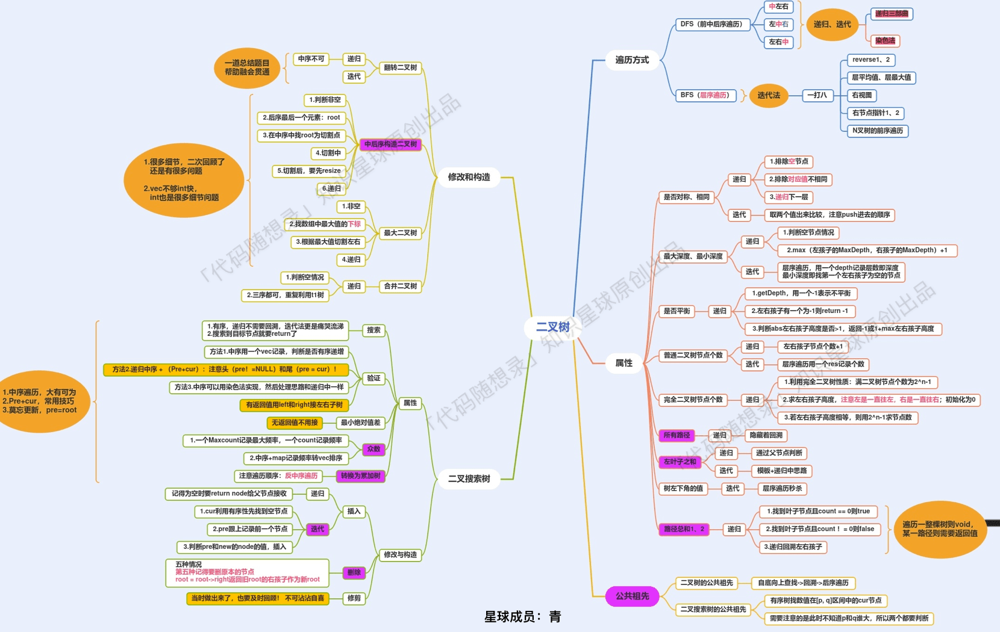

* [做專案（多個 C++、Java、Go、測開、前端專案）](https://www.programmercarl.com/other/kstar.html)
* [刷演算法（兩個月高強度學演算法）](https://www.programmercarl.com/xunlian/xunlianying.html)
* [背八股（40 天挑戰高頻面試題）](https://www.programmercarl.com/xunlian/bagu.html)

# 二元樹：總結篇！（需要掌握的二元樹技能都在這裡了）

> LeetCode 二元樹大總結！

不知不覺二元樹（binary tree）已經和我們度過了**三十三天**，[「程式碼隨想錄」](https://img-blog.csdnimg.cn/20200815195519696.png)裡已經發了**三十三篇二元樹的文章**，詳細講解了**30+ 二元樹經典題目**，一直堅持下來的讀者們一定會對二元樹有深刻理解了。

在每一道二元樹的題目中，我都使用了**遞迴三部曲**來分析題目，相信大家以後看到二元樹，看到遞迴（recursion），都會想：回傳值（return value）、參數（parameter）是什麼？終止條件（termination condition）是什麼？單層邏輯是什麼？

而且**幾乎每一道題目我都給出對應的疊代（iteration）法**，可以用來進一步提高自己。

下面 Carl 把分析過的題目分門別類，可以幫助新讀者循序漸進學習二元樹，也方便老讀者面試前快速複習，看到一個標題，就回想一下對應的解題思路，這樣很快就可以系統性地複習一遍二元樹了。

公眾號（WeChat Official Account）的發文順序，就是循序漸進的，所以如下分類基本就是按照文章發文順序來的，我再做一個系統性的分類。

## 二元樹的理論基礎

* [關於二元樹，你該了解這些！](./二叉樹理論基礎.md)：二元樹的種類、儲存方式、遍歷（traversal）方式、定義方式

## 二元樹的遍歷方式

*  深度優先遍歷（depth-first traversal）
    * [二元樹：前中後序遞迴法](./二叉樹的遞迴遍歷.md)：遞迴三部曲初次亮相
    * [二元樹：前中後序疊代法（一）](./二叉樹的疊代遍歷.md)：透過堆疊（stack）模擬（simulation）遞迴
    * [二元樹：前中後序疊代法（二）統一風格](./二叉樹的統一疊代法.md)
* 廣度優先遍歷（breadth-first traversal）
    * [二元樹的層次序走訪](./0102.二元樹的層次序走訪.md)：透過佇列（queue）模擬

## 求二元樹的屬性

* [二元樹：是否對稱](./0101.對稱二叉樹.md)
    * 遞迴：後序，比較的是根節點（root node）的左子樹（left subtree）與右子樹（right subtree）是不是相互反轉（reverse）
    * 疊代：使用佇列/堆疊將兩個節點（node）順序放入容器（container）中進行比較
* [二元樹：求最大深度](./0104.二叉樹的最大深度.md)
    * 遞迴：後序，求根節點最大高度（height）就是最大深度（depth），透過遞迴函數（recursive function）的回傳值做計算樹的高度
    * 疊代：層次序走訪（level order traversal）
* [二元樹：求最小深度](./0111.二叉樹的最小深度.md)
    * 遞迴：後序，求根節點最小高度就是最小深度，注意最小深度的定義
    * 疊代：層次序走訪
* [二元樹：求有多少個節點](./0222.完全二叉樹的節點個數.md)
    * 遞迴：後序，透過遞迴函數的回傳值計算節點數量
    * 疊代：層次序走訪
* [二元樹：是否平衡](./0110.平衡二叉樹.md)
    * 遞迴：後序，注意後序求高度和前序求深度，遞迴過程判斷高度差
    * 疊代：效率很低，不推薦
* [二元樹：找所有路徑](./0257.二叉樹的所有路徑.md)
    * 遞迴：前序，方便讓父節點（father node）指向子節點（child node），涉及回溯（backtracking）處理根節點到葉子的所有路徑（path）
    * 疊代：一個堆疊模擬遞迴，一個堆疊來存放對應的遍歷路徑
* [二元樹：遞迴中如何隱藏著回溯](./二叉樹中遞迴帶著回溯.md)
    * 詳解[二元樹：找所有路徑](./0257.二叉樹的所有路徑.md)中遞迴如何隱藏著回溯
* [二元樹：求左葉子之和](./0404.左葉子之和.md)
    * 遞迴：後序，必須三層約束條件，才能判斷是否是左葉子。
    * 疊代：直接模擬後序遍歷（post-order traversal）
* [二元樹：求左下角的值](./0513.找樹左下角的值.md)
    * 遞迴：順序無所謂，優先左孩子搜尋，同時找深度最大的葉節點（leaf node）。
    * 疊代：層次序走訪找最後一行最左邊
* [二元樹：求路徑總和](./0112.路徑總和.md)
    * 遞迴：順序無所謂，遞迴函數回傳值為 bool 類型是為了搜尋一條邊（edge），沒有回傳值是搜尋整棵樹。
    * 疊代：堆疊裡元素（element）不僅要記錄節點指標（pointer），還要記錄從頭節點（head node）到該節點的路徑數值總和

## 二元樹的修改與建構

* [反轉二元樹](./0226.反轉二叉樹.md)
    * 遞迴：前序，交換左右孩子
    * 疊代：直接模擬前序遍歷（preorder traversal）
* [建構二元樹](./0106.從中序與後序遍歷序列構造二叉樹.md)
    * 遞迴：前序，重點在於找分割點，分左右區間（interval）建構
    * 疊代：比較複雜，意義不大
* [建構最大的二元樹](./0654.最大二叉樹.md)
    * 遞迴：前序，分割點為陣列（array）最大值，分左右區間建構
    * 疊代：比較複雜，意義不大
* [合併兩個二元樹](./0617.合併二叉樹.md)
    * 遞迴：前序，同時操作兩個樹的節點，注意合併的規則
    * 疊代：使用佇列，類似層次序走訪

## 求二元搜尋樹的屬性

* [二元搜尋樹中的搜尋](./0700.二叉搜索樹中的搜索.md)
    * 遞迴：二元搜尋樹（binary search tree, BST）的遞迴是有方向的
    * 疊代：因為有方向，所以疊代法很簡單
* [是不是二元搜尋樹](./0098.驗證二叉搜索樹.md)
    * 遞迴：中序，相當於變成了判斷一個序列（sequence）是不是遞增的
    * 疊代：模擬中序，邏輯相同
* [求二元搜尋樹的最小絕對差](./0530.二叉搜索樹的最小絕對差.md)
    * 遞迴：中序，雙指標（two pointers）操作
    * 疊代：模擬中序，邏輯相同
* [求二元搜尋樹的 mode](./0501.二叉搜索樹中的眾數.md)

    * 遞迴：中序，清空結果集（result set）的技巧，遍歷一遍便可求 mode 集合（set）
* [二元搜尋樹轉成累加樹](./0538.把二叉搜索樹轉換為累加樹.md)
    * 遞迴：中序，雙指標操作累加
    * 疊代：模擬中序，邏輯相同

## 二元樹公共祖先問題

* [二元樹的公共祖先問題](./0236.二叉樹的最近公共祖先.md)
    * 遞迴：後序，回溯，找到左子樹出現目標值，右子樹節點目標值的節點。
    * 疊代：不適合模擬回溯
* [二元搜尋樹的公共祖先問題](./0235.二叉搜索樹的最近公共祖先.md)
    * 遞迴：順序無所謂，如果節點的數值在目標區間就是最低共用源始（lowest common ancestor, LCA）
    * 疊代：按序遍歷

## 二元搜尋樹的修改與建構

* [二元搜尋樹中的插入操作](./0701.二叉搜索樹中的插入操作.md)
    * 遞迴：順序無所謂，透過遞迴函數回傳值新增節點
    * 疊代：按序遍歷，需要記錄插入父節點，這樣才能做插入操作
* [二元搜尋樹中的刪除操作](./0450.刪除二叉搜索樹中的節點.md)
    * 遞迴：前序，想清楚刪除非葉節點的情況
    * 疊代：有序（ordered）遍歷，較複雜
* [修剪二元搜尋樹](./0669.修剪二叉搜索樹.md)
    * 遞迴：前序，透過遞迴函數回傳值刪除節點
    * 疊代：有序遍歷，較複雜
* [建構二元搜尋樹](./0108.將有序陣列轉換為二叉搜索樹.md)
    * 遞迴：前序，陣列中間節點分割
    * 疊代：較複雜，透過三個佇列來模擬

## 階段總結

大家以上題目都做過了，也一定要看如下階段小結。

**每週小結都會對大家的疑問做統一解答，並且對每週的內容進行拓展和補充，所以一定要看，將細碎知識點一網打盡！**

* [本週小結！（二元樹系列一）](./週總結/20200927二叉樹週末總結.md)
* [本週小結！（二元樹系列二）](./週總結/20201003二叉樹週末總結.md)
* [本週小結！（二元樹系列三）](./週總結/20201010二叉樹週末總結.md)
* [本週小結！（二元樹系列四）](./週總結/20201017二叉樹週末總結.md)

## 最後總結

**在二元樹題目選擇什麼遍歷順序是不少同學頭疼的事情，我們做了這麼多二元樹的題目了，Carl 給大家大體分分類**。

* 涉及到二元樹的建構，無論普通二元樹還是BST一定前序，都是先建構中節點。

* 求普通二元樹的屬性，一般是後序，一般要透過遞迴函數的回傳值做計算。

* 求BST的屬性，一定是中序了，要不然浪費了有序性了。

注意在普通二元樹的屬性中，我用的是一般為後序，例如單純求深度就用前序，[二元樹：找所有路徑](./0257.二叉樹的所有路徑.md)也用了前序，這是為了方便讓父節點指向子節點。

所以求普通二元樹的屬性還是要具體問題具體分析。

二元樹專題匯聚為一張圖： 

這個圖是 [程式碼隨想錄知識星球](https://programmercarl.com/other/kstar.html) 成員：[青](https://wx.zsxq.com/dweb2/index/footprint/185251215558842)，所畫，總結得非常好，分享給大家。

**最後，二元樹系列就這麼完美結束了，估計這應該是最長的系列了，感謝大家 33 天的堅持與陪伴，接下來我們又要開始新的系列了「回溯演算法（backtracking algorithm）」！**

