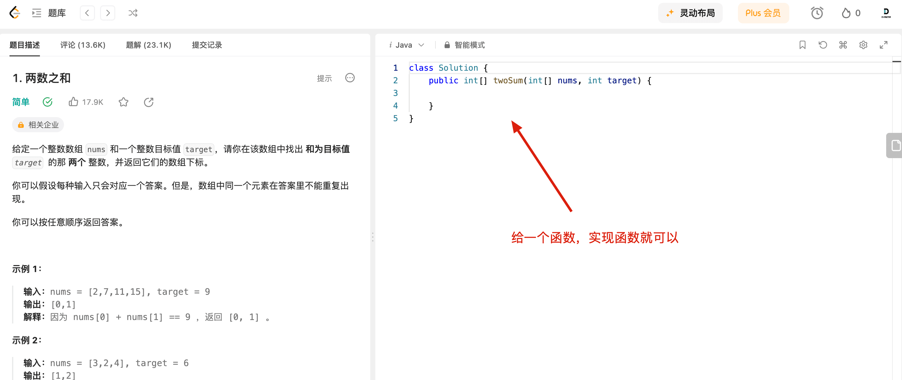
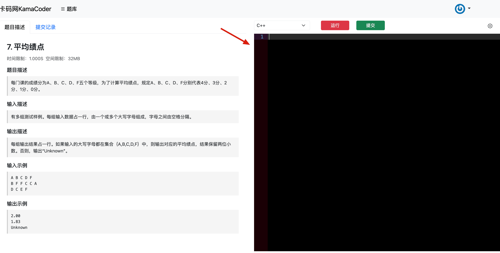
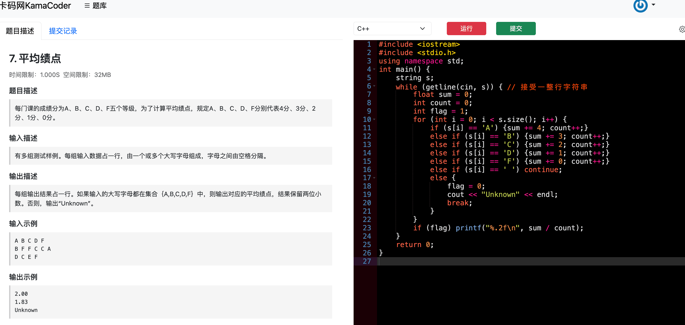
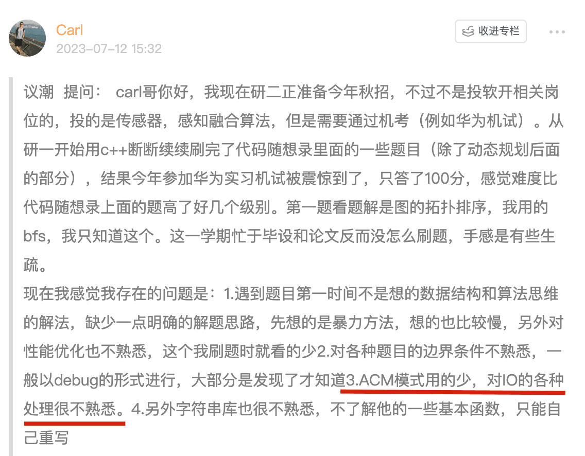
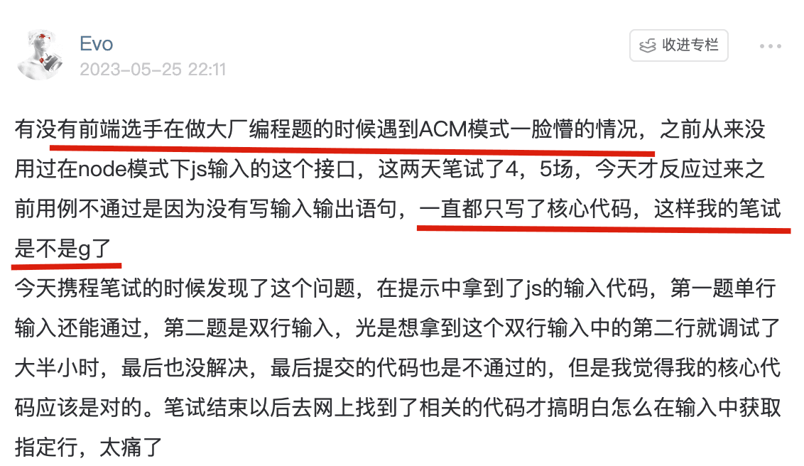
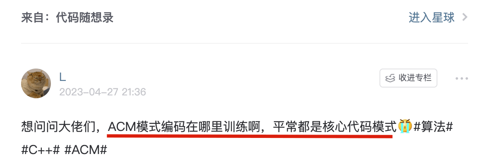
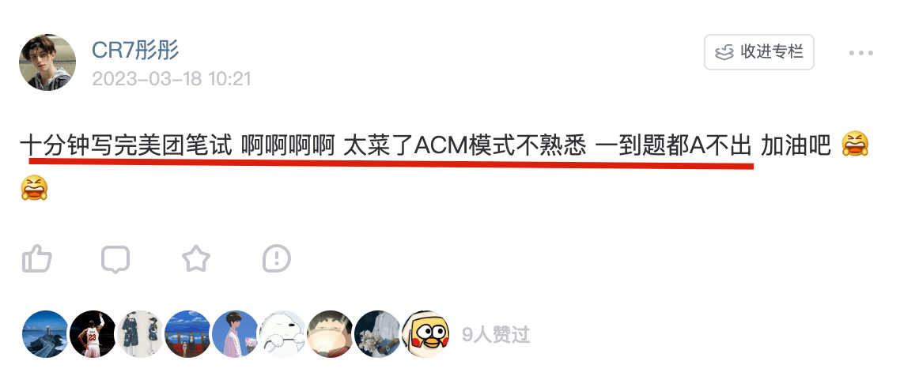
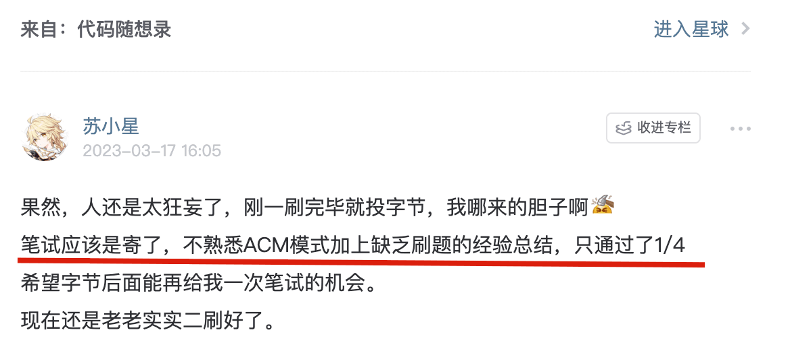
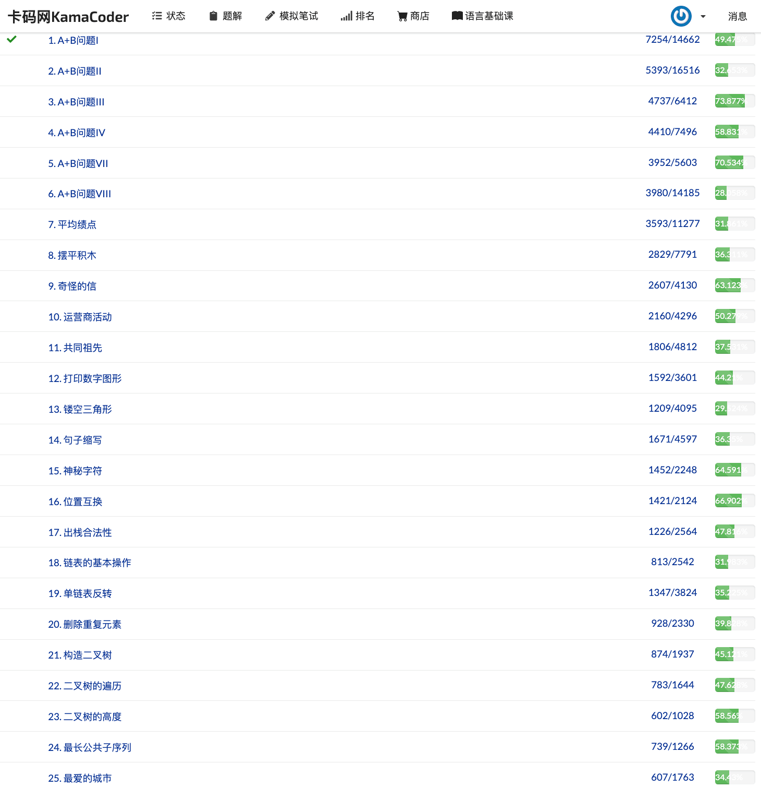

# 什麼是核心程式碼模式，什麼又是 ACM 模式？

很多錄友刷了不少題了，到現在也沒有搞清楚什麼是 ACM 模式，什麼是核心程式碼模式。

平時大家在 LeetCode 上刷題，就是核心程式碼模式，即給你一個函式（function），直接寫函式實作，例如這樣：

而 ACM 模式，是程式的 header file、`main` 函式、資料的輸入輸出都要自己處理，例如這樣：

大家可以發現右邊程式碼框什麼都沒有，程式從頭到尾都需要自己實作，本題如果寫完程式碼是這樣的：（細心的錄友可以發現和 LeetCode 上刷題是不一樣的）

**如果大家從一開始學習演算法就一直在 LeetCode 上的話，突然切換到 ACM 模式會非常不適應**。

知識星球裡也有很多錄友，因為不熟悉 ACM 模式在面試的過程中吃了不少虧。

</img>

</img>

</img>

</img>

</img>

## 面試究竟怎麼考？

筆試的話，基本都是 ACM 模式。

面試的話，看情況，有的面試官會讓你寫一個函式實作就可以，此時就是核心程式碼模式。

有的面試官會給你一個編輯器，讓你寫完程式碼執行一下看看輸出結果，此時就是 ACM 模式。

有的錄友想，那我平時在 LeetCode 刷題，寫的是核心程式碼模式，我也可以執行，為什麼一定要用 ACM 模式。

**大家在 LeetCode 刷題刷多了，已經忘了程式是如何執行的了**，LeetCode 上寫的程式碼，脫離 LeetCode 環境，那個函式，你怎麼執行呢？

想讓程式在本機執行起來，是不是需要補充程式館函數（library function），是不是要補充 `main` 函式，是不是要補充資料的輸入和輸出。那不就是 ACM 模式了。

綜合來看，**ACM 模式更考驗綜合程式碼能力，核心程式碼模式是更聚焦演算法的實作邏輯**。

## 去哪練習 ACM 模式？

這裡給大家推薦 KamaCoder：[kamacoder.com](https://kamacoder.com/)

你只要能把 KamaCoder 首頁的 25 道題目都刷完，就把所有的 ACM 輸入輸出方式都練習到位了，不會有任何盲區。

而且你不用擔心題目難度太大，直接把自己勸退，**KamaCoder 的前 25 道題目都是我精心製作的，難度也是循序漸進的**，大家去刷一下就知道了。

