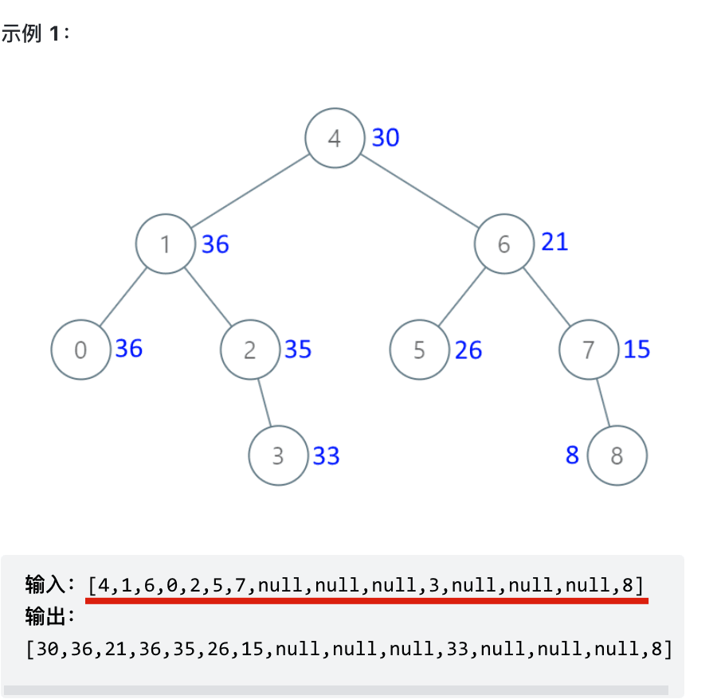
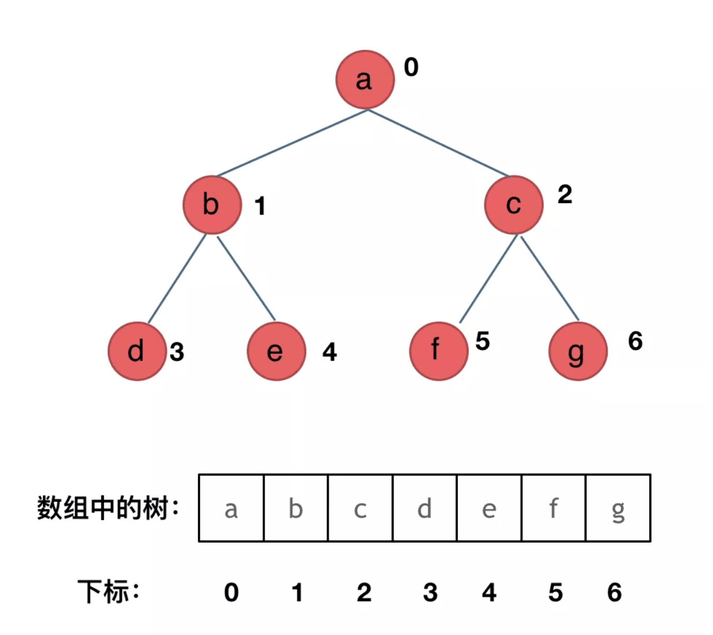
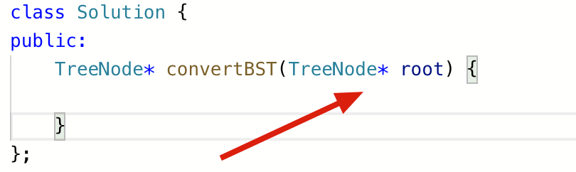
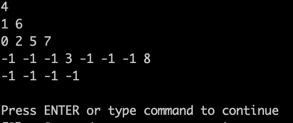
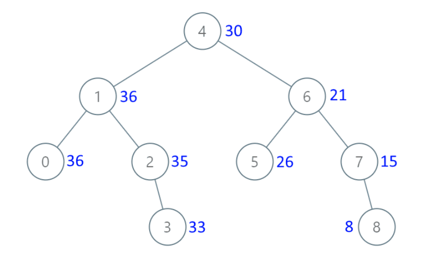
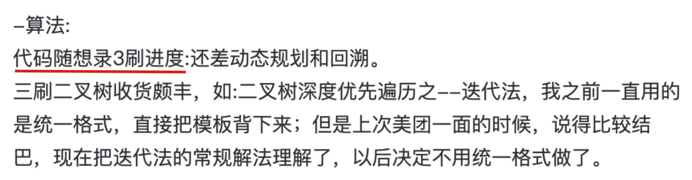

# LeetCode 上如何自己建構二元樹輸入測試案例？

**這裡給大家推薦 ACM 模式練習網站**：[kamacoder.com](https://kamacoder.com)，把上面的題目刷完，ACM 模式就沒問題了。

經常有錄友問，二元樹（binary tree）的題目中輸入測試案例（test case）在 ACM 模式下應該怎麼建構呢？

LeetCode 上的題目，輸入測試案例就給了一個陣列（array），怎麼就能建構成二元樹呢？

這次就給大家好好講一講！

就拿最近公眾號（WeChat Official Account）上二元樹的打卡題目來說：

[538.把二元搜尋樹轉換為累加樹](https://mp.weixin.qq.com/s/rlJUFGCnXsIMX0Lg-fRpIw)

其輸入測試案例，就是用一個陣列來表述二元樹，如下：



一直跟著公眾號學演算法的錄友應該知道，我在[二元樹：建構二元樹登場！](https://mp.weixin.qq.com/s/Dza-fqjTyGrsRw4PWNKdxA)，已經講過，**只有中序與後序和中序與前序可以確定一棵唯一的二元樹。前序和後序是不能確定唯一的二元樹的**。

那麼[538.把二元搜尋樹轉換為累加樹](https://mp.weixin.qq.com/s/rlJUFGCnXsIMX0Lg-fRpIw)的範例中，為什麼一個序列（sequence）（陣列或者是字串（string））就可以確定二元樹了呢？

很明顯，是系統後台直接明確了建構規則。

再看一下這個輸入序列和對應的二元樹。


從二元樹推導到序列，大家可以發現這就是層次序走訪（level order traversal）。

但從序列推導到二元樹，很多同學就看不懂了，這得怎麼轉換呢。

我在 [關於二元樹，你該了解這些！](https://mp.weixin.qq.com/s/q_eKfL8vmSbSFcptZ3aeRA)已經詳細講過，二元樹可以有兩種儲存方式，一種是 linked storage，另一種是順序儲存器（sequential storage）。

linked storage 就是大家熟悉的二元樹，用指標（pointer）指向左右子節點（child node）。

順序儲存器就是用一個陣列來存二元樹，其方式如圖所示：



那麼此時大家是不是應該知道了，陣列如何轉化成二元樹了。**如果父節點（father node）的陣列索引（index）是 i，那麼它的左子節點索引就是 i * 2 + 1，右子節點索引就是 i * 2 + 2**。

那麼這裡又有同學疑惑了，這些我都懂了，但我還是不知道應該怎麼建構。

來，咱們上程式碼。昨天晚上快速敲了一遍實作程式碼。

具體過程看註解：

```CPP
// 根據陣列建構二元樹
TreeNode* construct_binary_tree(const vector<int>& vec) {
    vector<TreeNode*> vecTree (vec.size(), NULL);
    TreeNode* root = NULL;
    // 把輸入數值陣列，先轉化為二元樹節點陣列
    for (int i = 0; i < vec.size(); i++) {
        TreeNode* node = NULL;
        if (vec[i] != -1) node = new TreeNode(vec[i]); // 用 -1 表示 null
        vecTree[i] = node;
        if (i == 0) root = node;
    }
    // 遍歷一遍，根據規則左右孩子賦值就可以了
    // 注意這裡 結束規則是 i * 2 + 1 < vec.size()，避免空指標
    // 為什麼結束規則不能是 i * 2 + 2 < arr.length 呢?
    // 如果 i * 2 + 2 < arr.length 是終止條件
    // 那麼 i * 2 + 1 這個符合條件的節點就被忽略掉了
    // 例如 [2,7,9,-1,1,9,6,-1,-1,10] 這樣的一個二元樹，最後的 10 就會被忽略掉
    // 遍歷一遍，根據規則左右孩子賦值就可以了
           
    for (int i = 0; i * 2 + 1 < vec.size(); i++) {
        if (vecTree[i] != NULL) {
            // 順序儲存轉 linked storage 關鍵邏輯
            vecTree[i]->left = vecTree[i * 2 + 1];
            if(i * 2 + 2 < vec.size())
            vecTree[i]->right = vecTree[i * 2 + 2];
        }
    }
    return root;
}
```

這個函式（function）最後回傳的指標就是根節點（root node）的指標，這就是傳入二元樹的格式了，也就是 LeetCode 上的測試案例輸入格式，如圖：



也有不少同學在做 ACM 模式的題目，就經常疑惑：

* 讓我傳入數值，我會！
* 讓我傳入陣列，我會！
* 讓我傳入鏈接串列（linked list），我也會！
* **讓我傳入二元樹，我懵了，啥？傳入二元樹？二元樹怎麼傳？**

其實傳入二元樹，就是傳入二元樹的根節點的指標，和傳入鏈接串列都是一個邏輯。

這種現象主要就是大家對 ACM 模式過於陌生，說實話，ACM 模式才真正地考驗程式碼能力（注意不是演算法能力），而 LeetCode 的核心程式碼模式總有一種不夠徹底的感覺。

所以，如果大家對 ACM 模式不夠了解，一定要多去練習！

那麼以上的程式碼，我們根據陣列建構二元樹，接下來我們再把這個二元樹印出來，看看是不是我們輸入的二元樹結構，這裡就用到了層次序走訪，我們在[二元樹：層次序走訪登場！](https://mp.weixin.qq.com/s/4-bDKi7SdwfBGRm9FYduiA)中講過。


完整測試程式碼如下：

```CPP
#include <iostream>
#include <vector>
#include <queue>
using namespace std;

struct TreeNode {
    int val;
    TreeNode *left;
    TreeNode *right;
    TreeNode(int x) : val(x), left(NULL), right(NULL) {}
};

// 根據陣列建構二元樹
TreeNode* construct_binary_tree(const vector<int>& vec) {
    vector<TreeNode*> vecTree (vec.size(), NULL);
    TreeNode* root = NULL;
    for (int i = 0; i < vec.size(); i++) {
        TreeNode* node = NULL;
        if (vec[i] != -1) node = new TreeNode(vec[i]);
        vecTree[i] = node;
        if (i == 0) root = node;
    }
    for (int i = 0; i * 2 + 1 < vec.size(); i++) {
        if (vecTree[i] != NULL) {
            vecTree[i]->left = vecTree[i * 2 + 1];
            if(i * 2 + 2 < vec.size())
            vecTree[i]->right = vecTree[i * 2 + 2];
        }
    }
    return root;
}

// 層次序印出二元樹
void print_binary_tree(TreeNode* root) {
    queue<TreeNode*> que;
    if (root != NULL) que.push(root);
    vector<vector<int>> result;
    while (!que.empty()) {
        int size = que.size();
        vector<int> vec;
        for (int i = 0; i < size; i++) {
            TreeNode* node = que.front();
            que.pop();
            if (node != NULL) {
                vec.push_back(node->val);
                que.push(node->left);
                que.push(node->right);
            }
            // 這裡的處理邏輯是為了把 null 節點印出來，用 -1 表示 null
            else vec.push_back(-1);
        }
        result.push_back(vec);
    }
    for (int i = 0; i < result.size(); i++) {
        for (int j = 0; j < result[i].size(); j++) {
            cout << result[i][j] << " ";
        }
        cout << endl;
    }
}

int main() {
    // 注意本程式碼沒有考慮輸入異常資料的情況
    // 用 -1 來表示 null
    vector<int> vec = {4,1,6,0,2,5,7,-1,-1,-1,3,-1,-1,-1,8};
    TreeNode* root = construct_binary_tree(vec);
    print_binary_tree(root);
}

```

可以看出我們傳入的陣列是：`{4,1,6,0,2,5,7,-1,-1,-1,3,-1,-1,-1,8}`，這裡是用 -1 來表示 `null`，

和 [538.把二元搜尋樹轉換為累加樹](https://mp.weixin.qq.com/s/rlJUFGCnXsIMX0Lg-fRpIw) 中的輸入是一樣的


這裡可能又有同學疑惑，你這不一樣啊，題目是 `null`，你為什麼用 -1。

用 -1 表示 `null` 為了方便舉例，如果非要和 LeetCode 輸入一模一樣的，就是簡單的字串處理，把 `null` 替換為 -1 就行了。

再來看測試程式碼輸出的效果：



可以看出和題目中輸入測試案例這個圖是一模一樣的。只不過題目中圖沒有把 null node 畫出來而已。



大家可以拿我的程式碼去測試一下，跑一跑。

**注意：我的測試程式碼，並沒有處理輸入異常（exception）的情況（例如輸入空陣列之類的），處理各種輸入異常，大家可以自己去練練**。


# 總結

大家可以發現，這個問題其實涉及很多知識點，而這些知識點其實我在文章裡都講過，而且是詳細地講過，如果大家能把這些知識點串起來，很容易解決心中的疑惑了。

但為什麼很多錄友都沒有想到這個程度呢。

這也是我反覆強調，**《程式碼隨想錄》上的題目和理論基礎，至少要詳細刷兩遍**。

**[知識星球](https://mp.weixin.qq.com/s/QVF6upVMSbgvZy8lHZS3CQ)**裡有的錄友已經開始刷第三遍：



只做過一遍，真的就是懂了一點皮毛，第二遍刷才真的對各個題目有較為深入的理解，也會明白我為什麼要這樣安排刷題的順序了。

**都是卡哥的良苦用心呀！**


# 其他語言版本


## Java 

```Java
public class Solution {
    // 節點類別
    static class TreeNode {
        // 節點值
        int val;
        
        // 左節點
        TreeNode left;

        // 右節點
        TreeNode right;

        // 節點的建構子（預設左右節點都為 null）
        public TreeNode(int x) {
            this.val = x;
            this.left = null;
            this.right = null;
        }
    }
    
    /**
     * 根據陣列建構二元樹
     * @param arr 樹的陣列表示
     * @return 建構成功後樹的根節點
     */
    public TreeNode constructBinaryTree(final int[] arr) {
        // 建構和原陣列相同的樹節點串列
        List<TreeNode> treeNodeList = arr.length > 0 ? new ArrayList<>(arr.length) : null;
        TreeNode root = null;
        // 把輸入數值陣列，先轉化為二元樹節點串列
        for (int i = 0; i < arr.length; i++) {
            TreeNode node = null;
            if (arr[i] != -1) { // 用 -1 表示 null
                node = new TreeNode(arr[i]);
            }
            treeNodeList.add(node);
            if (i == 0) {
                root = node;
            }
        }
        // 遍歷一遍，根據規則左右孩子賦值就可以了
        // 注意這裡 結束規則是 i * 2 + 1 < arr.length，避免空指標
        // 為什麼結束規則不能是 i * 2 + 2 < arr.length 呢?
        // 如果 i * 2 + 2 < arr.length 是終止條件
        // 那麼 i * 2 + 1 這個符合條件的節點就被忽略掉了
        // 例如 [2,7,9,-1,1,9,6,-1,-1,10] 這樣的一個二元樹，最後的 10 就會被忽略掉
        for (int i = 0; i * 2 + 1 < arr.length; i++) {
            TreeNode node = treeNodeList.get(i);
            if (node != null) {
                // 順序儲存轉 linked storage 關鍵邏輯
                node.left = treeNodeList.get(2 * i + 1);
                // 再次判斷一下 不忽略任何一個節點
                if(i * 2 + 2 < arr.length)
                node.right = treeNodeList.get(2 * i + 2);
            }
        }
        return root;
    }
}
```


## Python 

```Python
class TreeNode:
    def __init__(self, val = 0, left = None, right = None):
        self.val = val
        self.left = left
        self.right = right


# 根據陣列建構二元樹

def construct_binary_tree(nums: []) -> TreeNode:
    if not nums: 
        return None
    # 用於存放建構好的節點
    root = TreeNode(-1)
    Tree = []
    # 將陣列元素全部轉化為樹節點
    for i in range(len(nums)):
        if nums[i]!= -1:
            node = TreeNode(nums[i])
        else:
            node = None
        Tree.append(node)
        if i == 0:
            root = node
    # 直接判斷 2*i+2<len(Tree) 會漏掉 2*i+1=len(Tree)-1 的情況
    for i in range(len(Tree)):
        if Tree[i] and 2 * i + 1 < len(Tree):
            Tree[i].left = Tree[2 * i + 1]
            if 2 * i + 2 < len(Tree):
                Tree[i].right = Tree[2 * i + 2]
    return root


# 演算法：中序橫過二元樹

class Solution:
    def __init__(self):
        self.T = []
    def inorder(self, root: TreeNode) -> []:
        if not root:
            return 
        self.inorder(root.left)
        self.T.append(root.val)
        self.inorder(root.right)
        return self.T


# 驗證建立二元樹的有效性，二元排序樹的中序橫過應為順序排列

test_tree = [3, 1, 5, -1, 2, 4 ,6]
root = construct_binary_tree(test_tree)
A = Solution()
print(A.inorder(root))
```


## Go 

```Go
package main

import "fmt"

type TreeNode struct {
    Val   int
    Left  *TreeNode
    Right *TreeNode
}

func constructBinaryTree(array []int) *TreeNode {
    var root *TreeNode
    nodes := make([]*TreeNode, len(array))

    // 初始化二元樹節點
    for i := 0; i < len(nodes); i++ {
	var node *TreeNode
	if array[i] != -1 {
	    node = &TreeNode{Val: array[i]}
	}
	nodes[i] = node
	if i == 0 {
	    root = node
	}
    }
    // 串聯節點
    for i := 0; i*2+2 < len(array); i++ {
        if nodes[i] != nil {
	    nodes[i].Left = nodes[i*2+1]
	    nodes[i].Right = nodes[i*2+2]
	}
    }
    return root
}

func printBinaryTree(root *TreeNode, n int) {
    var queue []*TreeNode
    if root != nil {
	queue = append(queue, root)
    }

    result := []int{}
    for len(queue) > 0 {
	for j := 0; j < len(queue); j++ {
	    node := queue[j]
	    if node != nil {
		result = append(result, node.Val)
		queue = append(queue, node.Left)
		queue = append(queue, node.Right)
	    } else {
	        result = append(result, -1)
	    }
        }
	// 清除佇列中的本層節點，進入下一層遍歷
	queue = queue[len(queue):]
    }
    
    // 參數 n 控制輸出值數量，否則二元樹最後一層葉節點的孩子節點也會被印出（但是這些孩子節點是不存在的）.
    fmt.Println(result[:n])
}

func main() {
    array := []int{4, 1, 6, 0, 2, 5, 7, -1, -1, -1, 3, -1, -1, -1, 8}
    root := constructBinaryTree(array)
    printBinaryTree(root, len(array))
}

```

## JavaScript

```JavaScript
```

-----------------------
<div align="center"> </img></div>
