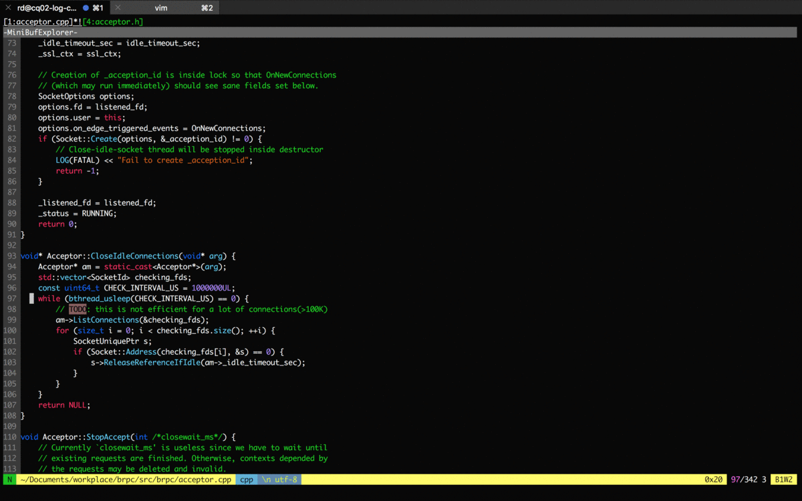
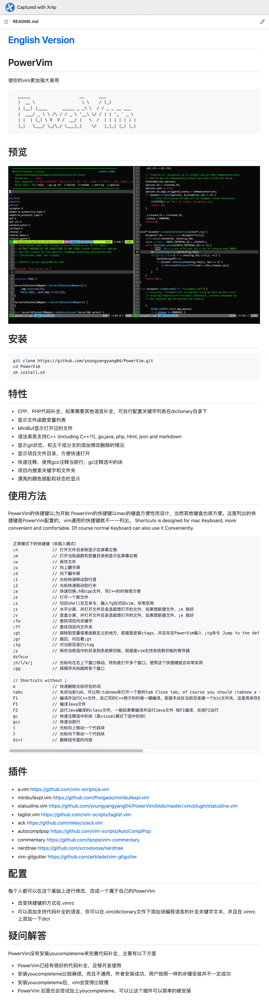

# 人生苦短，我用 VIM！| 最強 Vim 組態

> GitHub 網址：[https://github.com/youngyangyang04/PowerVim](https://github.com/youngyangyang04/PowerVim)
> Gitee 網址：[https://gitee.com/programmercarl/power-vim](https://gitee.com/programmercarl/power-vim)

熟悉我的錄友，應該都知道我是 Vim 流，無論是寫程式碼還是寫文件（Markdown），都是 Vim，都沒用 IDE。

但這裡我並不是說 IDE 不好用，IDE 在程式碼追蹤、參考（reference）跳轉等等其實是很給力的，效率比 Vim 高。

我用 Vim 的話，如果需要追蹤程式碼的話，就用 ctags 去跳轉，雖然很不智慧（是基於規則匹配，不是語意匹配），但加上我自己的智慧就也能用（這裡真的要看對程式碼的掌握程度了）

所以連追蹤程式碼都不用 IDE 的話，其他方面那我就更用不上 IDE 了。

## 為什麼用 VIM

**至於寫程式碼的效率，VIM 大勝 IDE**，其他不說，就使用 IDE 每次還要去碰滑鼠，就很讓人煩心！（真凸顯了工程師的執著）

這裡說一說 Vim 的方便之處吧，做後端（back end）開發的同學，都得玩 Linux 吧，在 Linux 下寫程式碼，如果不會 Vim 的話，會非常難受。

日常我們的開發機、線上伺服器（server）、預發布伺服器，都是遠端 Linux，需要跳板機連上去進行操作，如果不會 Vim，每次都把程式碼複製到本機，修改編譯，再傳到遠端伺服器，還真的麻煩。

使用 VIM 的話，本機、伺服器、開發機，一刀流，無縫切換，爽不。

IDE 那麼吃記憶體（memory），打開個 IDE 卡半天，用 VIM 就很輕便了，秒開！

而且在我們日常開發中，工作年頭多了，都會發現沒有純粹的 C++、Java 開發之類的，就是 C++ 也得寫，Java 也得寫，有時候寫 Go 起個 HTTP 服務，寫 Python 處理一下資料，寫 shell 搞個自動部署、編譯什麼的。**總之就是什麼語言都得寫，一切以專案需求為導向！**

寫語言還要切換不同的 IDE，熟悉不同的操作規則，想想是不是很麻煩。

聽說好像現在有的 IDE 可以支援很多語言了，這個我還不太了解，但能確定的是，IDE 支援的語言再多，也不會有 Vim 多。

**因為 Vim 是編輯器！**什麼都可以寫，不同的語言做一下相應的組態（configuration）就好，寫起來都是一樣的順暢。

應該不少錄友感覺 Vim 上捷徑鍵（shortcut key）太多了，根本記不過來，其實這和我看 IDE 是一樣的想法，我看 IDE 上那些按鈕一排一排的也太多了，我都記不過來，所以索性一套 Vim 流掃遍所有程式碼，它不香嗎。

而且 IDE 整合編譯、除錯（debugging）、智慧自動完成（autocomplete）、語法高亮度顯示（syntax highlighting）、專案管理等等，隱藏了太多細節，使用 Vim 就都自己組態，想支援什麼語言就自己組態，想怎麼樣就怎麼樣，需要什麼就補什麼，這不是很酷嗎？

可能有的同學感覺什麼都要自己組態，有點恐懼。但一旦組態好了就非常舒服了。

**其實工程師就要逢山開路遇水搭橋，這也是最基本的素質！**

從頭打造一個自己的開發利器，再舒服不過了。

## PowerVim

這裡給大家介紹一下我的 Vim 組態吧，**這套 Vim 組態我已經打磨了將近四年**，不斷調整最佳化，已經可以完全滿足工業級開發的需求了。

所以我給它起名為 PowerVim。一個真正強大的 Vim。

```
  _____                    __      ___
  |  __ \                   \ \    / (_)
  | |__) |____      _____ _ _\ \  / / _ _ __ ___
  |  ___/ _ \ \ /\ / / _ \ '__\ \/ / | | '_ ` _ \
  | |  | (_) \ V  V /  __/ |   \  /  | | | | | | |
  |_|   \___/ \_/\_/ \___|_|    \/   |_|_| |_| |_|
```

這個組態我開放原始碼（open source）在 GitHub 上，網址：[https://github.com/youngyangyang04/PowerVim](https://github.com/youngyangyang04/PowerVim)


來感受一下 PowerVim 的使用體驗，看起來很酷吧！注意這些操作都不用滑鼠的，一波鍵盤控制流！所以我平時寫程式碼是不碰滑鼠的！



## 安裝

PowerVim 的安裝非常簡單，我已經寫好了安裝腳本（script），只要執行一下就可以安裝，而且不會影響你之前的 Vim 組態，之前的組態都做了備份，大家看一下腳本就知道備份在哪裡了。

安裝過程非常簡單：
```bash
git clone https://github.com/youngyangyang04/PowerVim.git
cd PowerVim
sh install.sh
```

## 特性

目前 PowerVim 支援如下功能，這些都是自己組態的：

* CPP、PHP、Java 程式碼補全，如果需要其他語言補全，可自行組態關鍵字（keyword）串列在 `PowerVim/.vim/dictionary` 目錄（directory）下
* 顯示檔案函數（function）變數（variable）串列
* MiniBuf 顯示打開過的檔案
* 語法高亮度顯示支援 C++ (including C++11)、Go、Java、PHP、HTML、JSON 和 Markdown
* 顯示 Git 狀態，和主幹或分支（branch）的添加修改刪除的情況
* 顯示專案檔案目錄，方便快速打開
* 快速註解，使用 `gcc` 註解當前行，`gc` 註解選中的區塊
* 專案內搜尋關鍵字和資料夾
* 漂亮的顏色搭配和狀態列顯示

## 最後

當然還有很多，我還詳細寫了 PowerVim 的捷徑鍵、使用方法、外掛、組態等等，都在 GitHub 主頁的 README 上。當時我的 GitHub 上寫的都是英文 README，這次為了方便大家閱讀，我又翻譯成中文 README。



GitHub 網址：[https://github.com/youngyangyang04/PowerVim](https://github.com/youngyangyang04/PowerVim)

Gitee 網址：[https://gitee.com/programmercarl/power-vim](https://gitee.com/programmercarl/power-vim)

最後，因為這個 Vim 組態我一直沒有宣傳，所以 star 數量很少，錄友們去給個 star 吧，真正的開發利器，值得頂起來！

