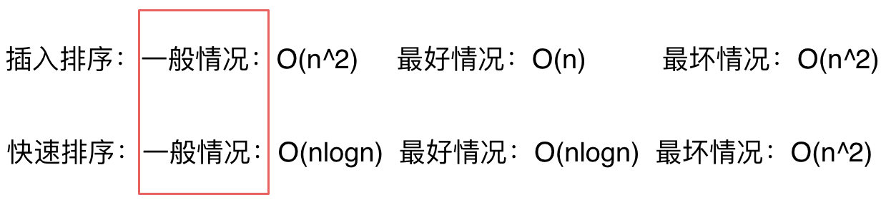
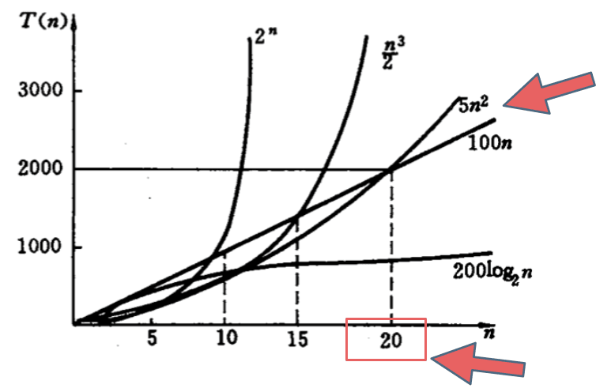
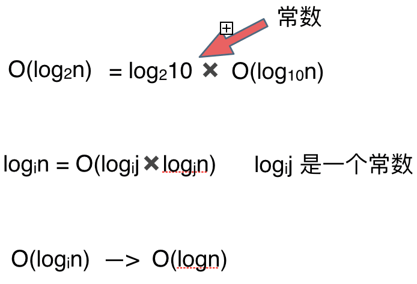

# 關於時間複雜度，你不知道的都在這裡！

相信每一位錄友都接觸過時間複雜度（time complexity），但又對時間複雜度的認識處於一種朦朧的狀態，所以是時候對時間複雜度來一個深度的剖析了。

本篇從如下六點進行分析：

* 究竟什麼是時間複雜度
* 什麼是大 O
* 不同資料規模的差異
* 複雜表式的化簡
* $O(\log n)$ 中的 log 是以什麼為底？
* 舉一個例子


這可能是你見過對時間複雜度分析最通透的一篇文章。

## 究竟什麼是時間複雜度

**時間複雜度是一個函數（function），它定性描述該演算法的執行時間**。

我們在軟體開發中，時間複雜度就是用來方便開發者估算出程式執行的大體時間。

那麼該如何估計程式執行時間呢，通常會估算演算法的操作單元數量來代表程式消耗的時間，這裡預設 CPU 的每個單元執行消耗的時間都是相同的。

假設演算法的問題規模為 $n$，那麼操作單元數量便用函數 $f(n)$ 來表示，隨著資料規模 $n$ 的增大，演算法執行時間的增長率和 $f(n)$ 的增長率相同，這稱作為演算法的漸近時間複雜度（asymptotic time complexity），簡稱時間複雜度，記為 $O(f(n))$。

## 什麼是大 O

這裡的大 O 記法（big O notation）是指什麼呢，說到時間複雜度，**大家都知道 $O(n)$ 、 $O(n^2)$ ，卻說不清什麼是大 O**。

演算法導論給出的解釋：**大 O 用來表示上界（upper bound）的**，當用它作為演算法的最壞情況（worst case）執行時間的上界，就是對任意資料輸入的執行時間的上界。

同樣演算法導論給出了例子：拿插入分類（insertion sort）來說，插入分類的時間複雜度我們都說是 $O(n^2)$。

輸入資料的形式對程式運算時間是有很大影響的，在資料本來有序（ordered）的情況下時間複雜度是 $O(n)$，但如果資料是逆序（reverse order）的話，插入分類的時間複雜度就是 $O(n^2)$，也就對於所有輸入情況來說，最壞是 $O(n^2)$ 的時間複雜度，所以稱插入分類的時間複雜度為 $O(n^2)$。

同樣的道理再看一下快速排序（quick sort），都知道快速排序是 $O(n\log n)$，但是當資料已經有序的情況下，快速排序的時間複雜度是 $O(n^2)$ 的，**所以嚴格從大 O 的定義來講，快速排序的時間複雜度應該是 $O(n^2)$ **。

**但是我們依然說快速排序是 $O(n\log n)$ 的時間複雜度，這個就是業內的一個預設規定，這裡說的 O 代表的就是一般情況，而不是嚴格的上界**。如圖所示：


我們主要關心的還是一般情況下的資料形式。

**面試中說的演算法的時間複雜度是多少指的都是一般情況**。但是如果面試官和我們深入探討一個演算法的實作以及效能的時候，就要時刻想著資料測試案例的不一樣，時間複雜度也是不同的，這一點是一定要注意的。


## 不同資料規模的差異

如下圖中可以看出不同演算法的時間複雜度在不同資料輸入規模下的差異。



在決定使用哪些演算法的時候，不是時間複雜度越低越好（因為簡化後的時間複雜度忽略了常數（constant）項等等），要考慮資料規模，如果資料規模很小甚至用 $O(n^2)$ 的演算法比 $O(n)$ 更合適（在有常數項的時候）。

就像上圖中 $O(5n^2)$ 和 $O(100n)$ 在 $n$ 為 20 之前，很明顯 $O(5n^2)$ 是更優的，所花費的時間也是最少的。

那為什麼在計算時間複雜度的時候要忽略常數項係數呢，也就是說 $O(100n)$ 就是 $O(n)$ 的時間複雜度，$O(5n^2)$ 就是 $O(n^2)$ 的時間複雜度，而且要預設 $O(n)$ 優於 $O(n^2)$ 呢？

這裡就又涉及到大 O 的定義，**因為大 O 就是資料量級突破一個點且資料量級非常大的情況下所表現出的時間複雜度，這個資料量也就是常數項係數已經不起決定性作用的資料量**。

例如上圖中 20 就是那個點，$n$ 只要大於 20 常數項係數已經不起決定性作用了。

**所以我們說的時間複雜度都是省略常數項係數的，是因為一般情況下都是預設資料規模足夠大，基於這樣的事實，給出的演算法時間複雜度的一個排行如下所示**：

$O(1)$ 常數階 < $O(\log n)$ 對數（log）階 < $O(n)$ 線性階 < $O(n\log n)$ 線性對數階 < $O(n^2)$ 平方階 < $O(n^3)$ 立方階 < $O(2^n)$ 指數（exponential）階

但是也要注意大常數，如果這個常數非常大，例如 $10^7$ 、 $10^9$ ，那麼常數就是不得不考慮的因素了。

## 複雜表式（expression）的化簡

有時候我們去計算時間複雜度的時候發現不是一個簡單的 $O(n)$ 或者 $O(n^2)$，而是一個複雜的表式，例如：

```
O(2*n^2 + 10*n + 1000)
```

那這裡如何描述這個演算法的時間複雜度呢，一種方法就是簡化法。

去掉執行時間中的加法常數項（因為常數項並不會因為 $n$ 的增大而增加電腦的操作次數）。

```
O(2*n^2 + 10*n)
```

去掉常數係數（上文中已經詳細講過為什麼可以去掉常數項的原因）。

```
O(n^2 + n)
```

只保留最高項，去掉數量級小一級的 $n$（因為 $n^2$ 的資料規模遠大於 $n$），最終簡化為：

```
O(n^2)
```

如果這一步理解有困難，那也可以做提出 $n$ 的操作，變成 $O(n(n+1))$，省略加法常數項後也就變成了：

```
O(n^2)
```

所以最後我們說：這個演算法的時間複雜度是 $O(n^2)$。


也可以用另一種簡化的思路，其實當 $n$ 大於 40 的時候，這個複雜度會恆小於 $O(3 \times n^2)$，
$O(2 \times n^2 + 10 \times n + 1000) < O(3 \times n^2)$，所以說最後省略掉常數項係數最終時間複雜度也是 $O(n^2)$。

## $O(\log n)$ 中的 log 是以什麼為底？

平時說這個演算法的時間複雜度是 $\log n$ 的，那麼一定是 $\log$ 以 2 為底 $n$ 的對數嗎？

其實不然，也可以是以 10 為底 $n$ 的對數，也可以是以 20 為底 $n$ 的對數，**但我們統一說 $\log n$，也就是忽略底數的描述**。

為什麼可以這麼做呢？如下圖所示：




假如有兩個演算法的時間複雜度，分別是 $\log$ 以 2 為底 $n$ 的對數和 $\log$ 以 10 為底 $n$ 的對數，那麼這裡如果還記得高中數學的話，應該不難理解`以 2 為底 n 的對數 = 以 2 為底 10 的對數 * 以 10 為底 n 的對數`。

而以 2 為底 10 的對數是一個常數，在上文已經講述了我們計算時間複雜度是忽略常數項係數的。

抽象一下就是在時間複雜度的計算過程中，$\log$ 以 $i$ 為底 $n$ 的對數等於 $\log$ 以 $j$ 為底 $n$ 的對數，所以忽略了 $i$，直接說是 $\log n$。

這樣就應該不難理解為什麼忽略底數了。

## 舉一個例子

透過這道面試題目，來分析一下時間複雜度。題目描述：找出 $n$ 個字串（string）中相同的兩個字串（假設這裡只有兩個相同的字串）。

如果是蠻力（brute force）列舉（enumeration）的話，時間複雜度是多少呢，是 $O(n^2)$ 嗎？

這裡一些同學會忽略了字串比較（comparison）的時間消耗，這裡並不像 `int` 型數字做比較那麼簡單，除了 $n^2$ 次的遍歷（traversal）次數外，字串比較依然要消耗 $m$ 次操作（$m$ 也就是字串的長度），所以時間複雜度是 $O(m \times n \times n)$。

接下來再想一下其他解題思路。

先對 $n$ 個字串按詞典編纂次序（lexicographical order）來排序（sorting），排序後 $n$ 個字串就是有序的，意味著兩個相同的字串就是挨在一起，然後再遍歷一遍 $n$ 個字串，這樣就找到兩個相同的字串了。

那看看這種演算法的時間複雜度，快速排序時間複雜度為 $O(n\log n)$，依然要考慮字串的長度是 $m$，那麼快速排序每次的比較都要有 $m$ 次的字元（character）比較的操作，就是 $O(m \times n \times \log n)$。

之後還要遍歷一遍這 $n$ 個字串找出兩個相同的字串，別忘了遍歷的時候依然要比較字串，所以總共的時間複雜度是 $O(m \times n \times \log n + n \times m)$。

我們對 $O(m \times n \times \log n + n \times m)$ 進行簡化操作，把 $m \times n$ 提出來變成 $O(m \times n \times (\log n + 1))$，再省略常數項最後的時間複雜度是 $O(m \times n \times \log n)$。

最後很明顯 $O(m \times n \times \log n)$ 要優於 $O(m \times n \times n)$！

所以先把字串集合（set）排序再遍歷一遍找到兩個相同字串的方法要比直接蠻力列舉的方式更快。

這就是我們透過分析兩種演算法的時間複雜度得來的。

**當然這不是這道題目的最佳解，我僅僅是用這道題目來講解一下時間複雜度**。

## 總結

本篇講解了什麼是時間複雜度，複雜度是用來做什麼，以及資料規模對時間複雜度的影響。

還講解了被大多數同學忽略的大 O 的定義以及 $\log$ 究竟是以誰為底的問題。

再分析了如何簡化複雜的時間複雜度，最後舉一個具體的例子，把本篇的內容串起來。

相信看完本篇，大家對時間複雜度的認識會深刻很多！


-----------------------
<div align="center"> </img></div>
