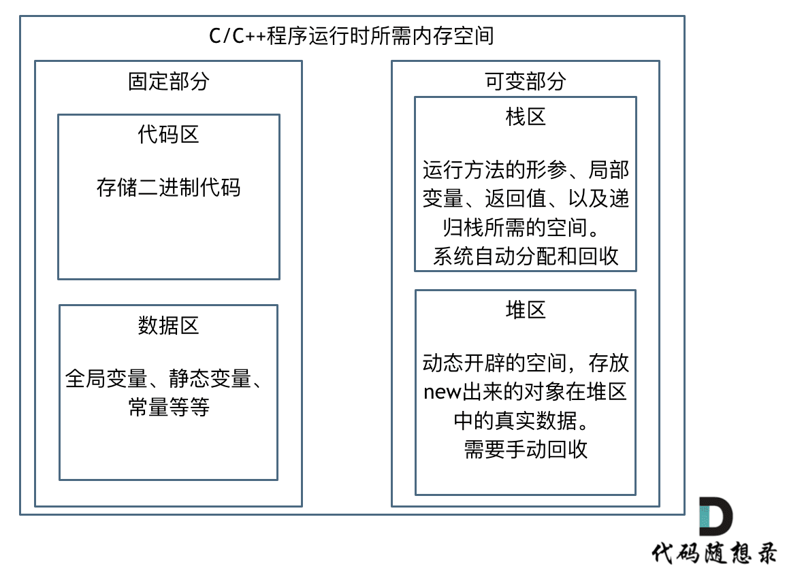
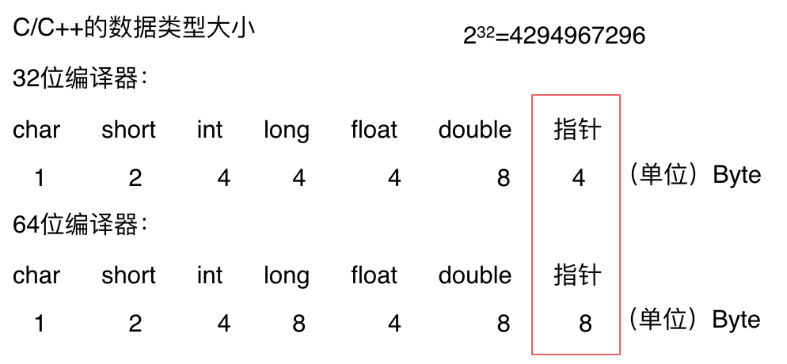
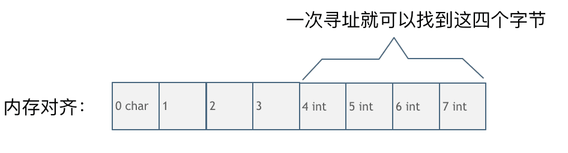
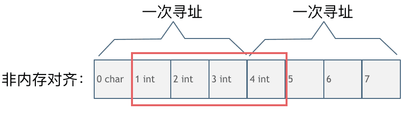

# 刷了這麼多題，你了解自己程式碼的記憶體消耗嗎？

理解程式碼的記憶體（memory）消耗，最關鍵是要知道自己所用程式設計語言（programming language）的記憶體管理。

## 不同語言的記憶體管理

不同的程式設計語言有各自的記憶體管理方式。

* C/C++ 這種記憶體堆積（heap）空間的申請和釋放完全靠自己管理
* Java 依賴 JVM 來做記憶體管理，不了解 JVM 記憶體管理的機制，很可能會因一些錯誤的程式碼寫法而導致記憶體洩漏（memory leak）或記憶體溢位（memory overflow）
* Python 記憶體管理是由私有堆積空間管理的，所有的 Python 物件（object）和資料結構都儲存在私有堆積空間中。程式設計師（programmer）沒有存取堆積的權限，只有解譯器（interpreter）才能操作。

例如 Python 萬物皆物件，並且將記憶體操作封裝得很好，**所以 Python 的基本資料類型（primitive data type）所用的記憶體會遠大於存放純資料類型（data type）所佔的記憶體**，例如，我們都知道儲存 `int` 型資料需要四個位元組（byte），但是使用 Python 申請一個物件來存放資料的話，所用空間要遠大於四個位元組。

## C++ 的記憶體管理

以 C++ 為例來介紹一下程式設計語言的記憶體管理。

如果我們寫 C++ 的程式，就要知道堆疊（stack）和堆積的概念，程式執行時所需的記憶體空間分為固定部分，和可變部分，如下：



固定部分的記憶體消耗是不會隨著程式碼執行產生變化的，可變部分則是會產生變化的。

更具體一些，一個由 C/C++ 編譯的程式佔用的記憶體分為以下幾個部分：

* 堆疊區（Stack）：由編譯器（compiler）自動分配釋放，存放函式（function）的參數（parameter）值，局部變數（local variable）的值等，其操作方式類似於資料結構中的堆疊。
* 堆積區（Heap）：一般由程式設計師分配釋放，若程式設計師不釋放，程式結束時可能由 OS 收回
* 未初始化（initialization）資料區（Uninitialized Data）：存放未初始化的總體變數（global variable）和靜態變數（static variable）
* 初始化資料區（Initialized Data）：存放已經初始化的總體變數和靜態變數
* 程式碼區（Text）：存放函式體的二進制（binary）程式碼

程式碼區和資料區所佔空間都是固定的，而且佔用的空間非常小，那麼看執行時消耗的記憶體主要看可變部分。

在可變部分中，堆疊區間的資料在程式碼區塊執行結束之後，系統會自動回收，而堆積區間資料是需要程式設計師自己回收，所以也就是造成記憶體洩漏的發源地。

**而 Java、Python 的話則不需要程式設計師去考慮記憶體洩漏的問題，虛擬機器（virtual machine）都做了這些事情**。

## 如何計算程式佔用多大記憶體

想要算出自己程式會佔用多少記憶體就一定要了解自己定義的資料類型的大小，如下：



注意圖中有兩個不一樣的地方，為什麼 64 位的指標（pointer）就佔用了 8 個位元組，而 32 位的指標佔用 4 個位元組呢？

1 個位元組佔 8 個位元（bit），那麼 4 個位元組就是 32 個位元，可存放資料的大小為 $2^{32}$，也就是 4G 空間的大小，即：可以尋找 4G 空間大小的記憶體位址（address）。

大家現在使用的電腦一般都是 64 位元了，所以編譯器也都是 64 位元的。

安裝 64 位元的作業系統（operating system）的電腦記憶體都已經超過了 4G，也就是指標大小如果還是 4 個位元組的話，就已經不能定址（addressing）全部的記憶體位址，所以 64 位元編譯器使用 8 個位元組的指標才能尋找所有的記憶體位址。

注意 $2^{64}$ 是一個非常巨大的數，對於尋找位址來說已經足夠用了。

## 記憶體對齊（memory alignment）

再介紹一下記憶體管理中另一個重要的知識點：**記憶體對齊**。

**不要以為只有 C/C++ 才會有記憶體對齊，只要可以跨平台的程式設計語言都需要做記憶體對齊，Java、Python 都是一樣的**。

而且這是面試中面試官非常喜歡問到的問題，就是：**為什麼會有記憶體對齊？**

主要是兩個原因：

1. 平台原因：不是所有的硬體平台都能存取任意記憶體位址上的任意資料，某些硬體平台只能在某些位址處取某些特定類型的資料，否則拋出硬體異常（exception）。為了同一個程式可以在多平台執行，需要記憶體對齊。

2. 硬體原因：經過記憶體對齊後，CPU 存取記憶體的速度大大提升。

可以看一下這段 C++ 程式碼輸出的各個資料類型大小是多少？

```CPP
struct node{
   int num;
   char cha;
}st;
int main() {
    int a[100];
    char b[100];
    cout << sizeof(int) << endl;
    cout << sizeof(char) << endl;
    cout << sizeof(a) << endl;
    cout << sizeof(b) << endl;
    cout << sizeof(st) << endl;
}
```

看一下和自己想的結果一樣嗎，我們來逐一分析一下。

其輸出的結果依次為：

```
4
1
400
100
8
```

此時會發現，和單純計算位元組數的話是有一些誤差的。

這就是因為記憶體對齊的原因。

來看一下記憶體對齊和非記憶體對齊產生的效果區別。

CPU 讀取記憶體不是一次讀取單個位元組，而是一塊一塊地來讀取記憶體，塊的大小可以是 2、4、8、16 個位元組，具體取多少個位元組取決於硬體。

假設 CPU 把記憶體劃分為 4 位元組大小的塊，要讀取一個 4 位元組大小的 `int` 型資料，來看一下這兩種情況下 CPU 的工作量：

第一種就是記憶體對齊的情況，如圖：



一位元組的 `char` 佔用了四個位元組，空了三個位元組的記憶體位址，`int` 資料從位址 4 開始。

此時，直接將位址 4、5、6、7 處的四個位元組資料讀取到即可。

第二種是沒有記憶體對齊的情況如圖：



`char` 型的資料和 `int` 型的資料挨在一起，該 `int` 資料從位址 1 開始，那麼 CPU 想要讀這個資料的話來看看需要幾步操作：

1. 因為 CPU 是四個位元組四個位元組來定址，首先 CPU 讀取 0、1、2、3 處的四個位元組資料
2. CPU 讀取 4、5、6、7 處的四個位元組資料
3. 合併位址 1、2、3、4 處四個位元組的資料才是本次操作需要的 `int` 資料

此時一共需要兩次定址，一次合併的操作。

**大家可能會發現記憶體對齊豈不是浪費了記憶體資源嗎？**

是這樣的，但事實上，相對來說電腦記憶體資源一般都是充足的，我們更希望的是提高執行速度。

**編譯器一般都會做記憶體對齊的最佳化操作，也就是說當考慮程式真正佔用的記憶體大小的時候，也需要認識到記憶體對齊的影響**。


## 總結

不少同學對這方面的知識很欠缺，基本處於盲區，透過這一篇大家可以初步補齊一下這塊。

之後也可以有意識地去學習自己所用的程式設計語言是如何管理記憶體的，這些也是程式設計師的內功。


-----------------------

<div align="center"> </img></div>
