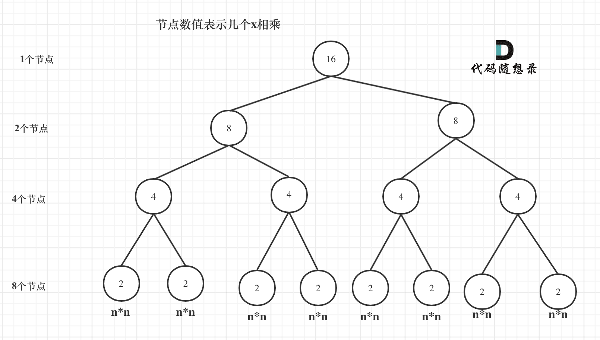
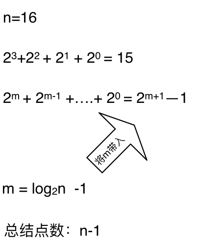

# 透過一道面試題目，講一講遞迴（recursion）演算法的時間複雜度（time complexity）！

> 本篇透過一道面試題，一個面試場景，來好好分析一下如何求遞迴演算法的時間複雜度。

相信很多同學對遞迴演算法的時間複雜度都很模糊，那麼這篇來給大家通透地講一講。

**同一道題目，同樣使用遞迴演算法，有的同學寫出了 O(n) 的程式碼，有的同學就寫出了 O(logn) 的程式碼**。

這是為什麼呢？

如果對遞迴的時間複雜度理解得不夠深入的話，就會這樣！

那麼我透過一道簡單的面試題，模擬（simulation）面試的場景，來帶大家逐步分析遞迴演算法的時間複雜度，最後找出最優解，來看看同樣是遞迴，怎麼就寫成了 O(n) 的程式碼。

面試題：求 x 的 n 次方

想一下這麼簡單的一道題目，程式碼應該如何寫呢。最直觀的方式應該就是，一個 for 迴圈（for-loop）求出結果，程式碼如下：

```CPP
int function1(int x, int n) {
    int result = 1;  // 注意 任何數的 0 次方等於 1
    for (int i = 0; i < n; i++) {
        result = result * x;
    }
    return result;
}
```
時間複雜度為 O(n)，此時面試官會說，有沒有效率更好的演算法呢。

**如果此時沒有思路，不要說：我不會，我不知道了等等**。

可以和面試官探討一下，詢問：「可不可以給點提示」。面試官提示：「考慮一下遞迴演算法」。

那麼就可以寫出了如下這樣的一個遞迴的演算法，使用遞迴解決了這個問題。

```CPP
int function2(int x, int n) {
    if (n == 0) {
        return 1; // return 1 同樣是因為 0 次方是等於 1 的
    }
    return function2(x, n - 1) * x;
}
```
面試官問：「那麼這個程式碼的時間複雜度是多少？」。

一些同學可能一看到遞迴就想到了 O(log n)，其實並不是這樣，遞迴演算法的時間複雜度本質上是要看：**遞迴的次數 * 每次遞迴中的操作次數**。

那再來看程式碼，這裡遞迴了幾次呢？

每次 n-1，遞迴了 n 次時間複雜度是 O(n)，每次進行了一個乘法操作，乘法操作的時間複雜度是一個常數（constant）項 O(1)，所以這份程式碼的時間複雜度是 n × 1 = O(n)。

這個時間複雜度就沒有達到面試官的預期。於是又寫出了如下的遞迴演算法的程式碼：

```CPP
int function3(int x, int n) {
    if (n == 0) return 1;
    if (n == 1) return x;

    if (n % 2 == 1) {
        return function3(x, n / 2) * function3(x, n / 2)*x;
    }
    return function3(x, n / 2) * function3(x, n / 2);
}

```

面試官看到後微微一笑，問：「這份程式碼的時間複雜度又是多少呢？」此刻有些同學可能要陷入了沉思了。

我們來分析一下，首先看遞迴了多少次呢，可以把遞迴抽象出一棵滿二元樹（full binary tree）。剛剛同學寫的這個演算法，可以用一棵滿二元樹來表示（為了方便表示，選擇 n 為偶數 16），如圖：



當前這棵二元樹（binary tree）就是求 x 的 n 次方，n 為 16 的情況，n 為 16 的時候，進行了多少次乘法運算呢？

這棵樹（tree）上每一個節點（node）就代表著一次遞迴並進行了一次相乘操作，所以進行了多少次遞迴的話，就是看這棵樹上有多少個節點。

熟悉二元樹的話應該知道如何求滿二元樹節點數量，這棵滿二元樹的節點數量就是 `2^3 + 2^2 + 2^1 + 2^0 = 15`，可以發現：**這其實是等比數列的求和公式，這個結論在二元樹相關的面試題裡也經常出現**。

那麼如果是求 x 的 n 次方，這個遞迴樹有多少個節點呢，如下圖所示：（m 為深度（depth），從 0 開始）



**時間複雜度忽略掉常數項 `-1` 之後，這個遞迴演算法的時間複雜度依然是 O(n)**。對，你沒看錯，依然是 O(n) 的時間複雜度！

此時面試官就會說：「這個遞迴的演算法依然還是 O(n) 啊」，很明顯沒有達到面試官的預期。

那麼 O(logn) 的遞迴演算法應該怎麼寫呢？

想一想剛剛給出的那份遞迴演算法的程式碼，是不是有哪裡比較冗餘（redundant）呢，其實有重複計算的部分。

於是又寫出如下遞迴演算法的程式碼：

```CPP
int function4(int x, int n) {
    if (n == 0) return 1;
    if (n == 1) return x;
    int t = function4(x, n / 2);// 這裡相對於 function3，是把這個遞迴操作抽取出來
    if (n % 2 == 1) {
        return t * t * x;
    }
    return t * t;
}
```

再來看一下現在這份程式碼時間複雜度是多少呢？

依然還是看它遞迴了多少次，可以看到這裡僅僅有一個遞迴呼叫（recursive call），且每次都是 n/2，所以這裡我們一共呼叫了 log 以 2 為底 n 的對數（log）次。

**每次遞迴所做的都是一次乘法操作，這也是一個常數項的操作，那麼這個遞迴演算法的時間複雜度才是真正的 O(logn)**。

此時大家最後寫出了這樣的程式碼並且將時間複雜度分析得非常清晰，相信面試官是比較滿意的。

# 總結

對於遞迴的時間複雜度，畢竟初學者有時候會迷糊，刷過很多題的老手依然迷糊。

**本篇我用一道非常簡單的面試題目：求 x 的 n 次方，來逐步分析遞迴演算法的時間複雜度，注意不要一看到遞迴就想到了 O(logn)！**

同樣使用遞迴，有的同學可以寫出 O(logn) 的程式碼，有的同學還可以寫出 O(n) 的程式碼。

對於 function3 這樣的遞迴實作，很容易讓人感覺這是 O(log n) 的時間複雜度，其實這是 O(n) 的演算法！

```CPP
int function3(int x, int n) {
    if (n == 0) return 1;
    if (n == 1) return x;
    if (n % 2 == 1) {
        return function3(x, n / 2) * function3(x, n / 2)*x;
    }
    return function3(x, n / 2) * function3(x, n / 2);
}
```
可以看出這道題目非常簡單，但是又很考究演算法的功底，特別是對遞迴的理解，這也是我面試別人的時候用過的一道題，所以整個情景我才寫得如此逼真。

大廠面試的時候最喜歡用「簡單題」來考察候選人的演算法功底，注意這裡的「簡單題」可並不一定真的簡單喔！

如果認真讀完本篇，相信大家對遞迴演算法有了一個新的認識，同一道題目，同樣是遞迴，效率可是不一樣的！


-----------------------
<div align="center"> </img></div>
