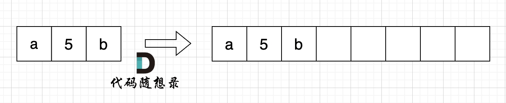
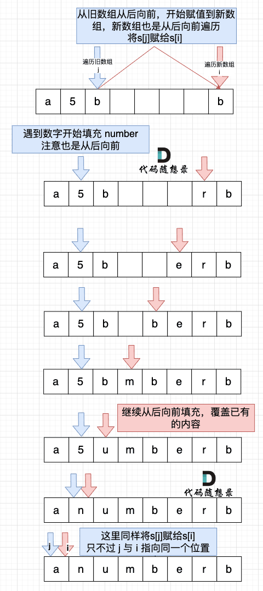

* [做專案（多個 C++、Java、Go、測試開發、前端專案）](https://www.programmercarl.com/other/kstar.html)
* [刷演算法（兩個月高強度學演算法）](https://www.programmercarl.com/xunlian/xunlianying.html)
* [背面試必考題（八股文）（40 天挑戰高頻面試題）](https://www.programmercarl.com/xunlian/bagu.html)


# 替換數字 

LeetCode 已經將劍指 Offer 題目下架，所以我在 KamaCoder 上給大家提供類似的題目來練習 

[KamaCoder 題目連結](https://kamacoder.com/problempage.php?pid=1064)

給定一個字串（string）s，它包含小寫字母和數字字元（character），請編寫一個函數（function），將字串中的字母字元保持不變，而將每個數字字元替換為 number。 

例如，對於輸入字串 "a1b2c3"，函數應該將其轉換為 "anumberbnumbercnumber"。  

對於輸入字串 "a5b"，函數應該將其轉換為 "anumberb"

輸入：一個字串 s,s 僅包含小寫字母和數字字元。

輸出：印出一個新的字串，其中每個數字字元都被替換為了 number 

範例輸入：a1b2c3  

範例輸出：anumberbnumbercnumber 

資料範圍：1 <= s.length < 10000。

## 想法

如果想把這道題目做到極致，就不要只用額外的 auxiliary space 了！ （不過使用 Java 刷題的錄友，一定要使用 auxiliary space，因為 Java 裡的 string 不能修改）

首先擴充陣列（array）到每個數字字元替換成 "number" 之後的大小。

例如 字串 "a5b" 的長度為 3，那麼將數字字元變成字串 "number" 之後的字串為 "anumberb" 長度為 8。 

如圖：  

 

然後從後向前替換數字字元，也就是 two pointers 法，過程如下：i 指向新長度的末尾，j 指向舊長度的末尾。



有同學問了，為什麼要從後向前填充，從前向後填充不行嗎？

從前向後填充就是 O(n^2) 的演算法了，因為每次添加元素（element）都要將添加元素之後的所有元素整體向後移動。

**其實很多陣列填充類的問題，其做法都是先預先給陣列擴容到填充後的大小，然後再從後向前進行操作。**

這麼做有兩個好處：

1. 不用申請新陣列。
2. 從後向前填充元素，避免了從前向後填充元素時，每次添加元素都要將添加元素之後的所有元素向後移動的問題。

C++ 程式碼如下：

```CPP
#include<iostream>
using namespace std;
int main() {
    string s;
    while (cin >> s) {
        int count = 0; // 統計數字的個數
        int sOldSize = s.size();
        for (int i = 0; i < s.size(); i++) {
            if (s[i] >= '0' && s[i] <= '9') {
                count++;
            }
        }
        // 擴充字串 s 的大小，也就是每個空格替換成 "number" 之後的大小
        s.resize(s.size() + count * 5);
        int sNewSize = s.size();
        // 從後向前將空格替換為 "number"
        for (int i = sNewSize - 1, j = sOldSize - 1; j < i; i--, j--) {
            if (s[j] > '9' || s[j] < '0') {
                s[i] = s[j];
            } else {
                s[i] = 'r';
                s[i - 1] = 'e';
                s[i - 2] = 'b';
                s[i - 3] = 'm';
                s[i - 4] = 'u';
                s[i - 5] = 'n';
                i -= 5;
            }
        }
        cout << s << endl;
    }
}


```

* 時間複雜度（time complexity）：O(n)
* 空間複雜度（space complexity）：O(1)

此時算上本題，我們已經做了七道 two pointers 相關的題目了，分別是：

* [27.移除元素](https://programmercarl.com/0027.移除元素.html)
* [15.三數之和](https://programmercarl.com/0015.三数之和.html)
* [18.四數之和](https://programmercarl.com/0018.四数之和.html)
* [206.翻轉鏈接串列（linked list）](https://programmercarl.com/0206.翻转链表.html)
* [142.環形鏈接串列 II](https://programmercarl.com/0142.环形链表II.html)
* [344.反轉（reverse）字串](https://programmercarl.com/0344.反转字符串.html)

## 拓展

這裡也給大家拓展一下字串和陣列有什麼差別，

字串是若干字元組成的有限序列（sequence），也可以理解為是一個字元陣列（character array），但是很多語言對字串做了特殊的規定，接下來我來說一說 C/C++ 中的字串。

在 C 語言中，把一個字串存入一個陣列時，也把結束字元 '\0' 存入陣列，並以此作為該字串是否結束的標誌。

例如這段程式碼：

```
char a[5] = "asd";
for (int i = 0; a[i] != '\0'; i++) {
}
```

在 C++ 中，提供一個 string 類別（class），string 類別會提供 size 介面（interface），可以用來判斷 string 類別字串是否結束，就不用 '\0' 來判斷是否結束。

例如這段程式碼:

```
string a = "asd";
for (int i = 0; i < a.size(); i++) {
}
```

那麼 vector< char > 和 string 又有什麼區別呢？

其實在基本操作上沒有區別，但是 string 提供更多的字串處理的相關介面，例如 string 多載了 +，而 vector 卻沒有。

所以想處理字串，我們還是會定義一個 string 類型。


## 其他語言版本

### C：

### Java：


### Go：


### python：

### JavaScript:


### TypeScript：


### Swift:


### Scala:


### PHP：


### Rust:


