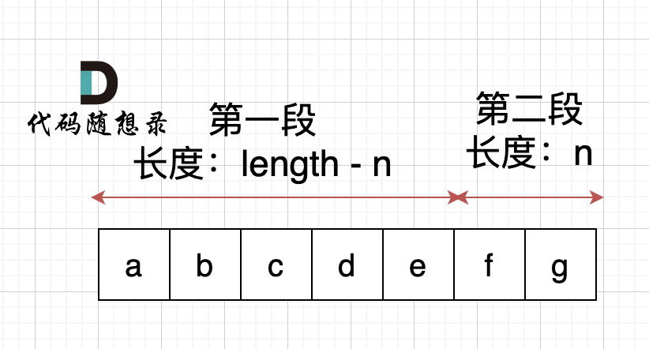
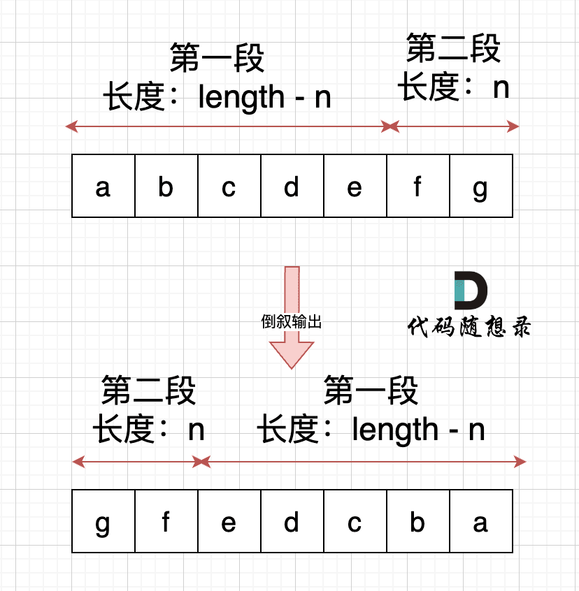
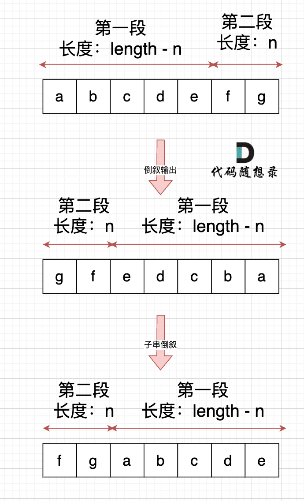
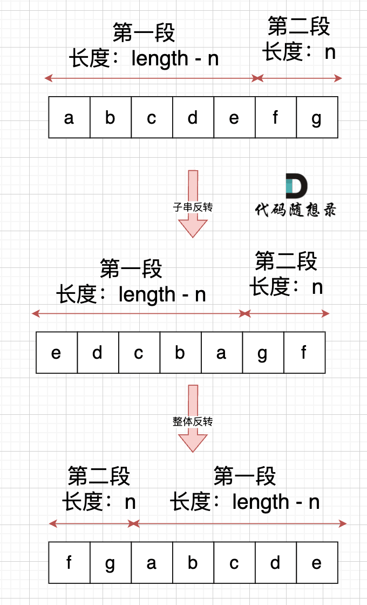

* [做專案（多個 C++、Java、Go、測試開發、前端（front end）專案）](https://www.programmercarl.com/other/kstar.html)
* [刷演算法（兩個月高強度學演算法）](https://www.programmercarl.com/xunlian/xunlianying.html)
* [背面試必考題（八股文）（40 天挑戰高頻面試題）](https://www.programmercarl.com/xunlian/bagu.html)


# 右旋字串（string）

LeetCode 已經將劍指 Offer 題目下架，所以在 KamaCoder 上給大家提供類似的題目來練習

[KamaCoder 題目連結](https://kamacoder.com/problempage.php?pid=1065)

字串的右旋轉操作是把字串尾部的若干個字元（character）轉移到字串的前面。給定一個字串 s 和一個正整數（positive integer） k，請編寫一個函數（function），將字串中的後面 k 個字元移到字串的前面，實作字串的右旋轉操作。

例如，對於輸入字串 "abcdefg" 和整數（integer） 2，函數應該將其轉換為 "fgabcde"。

輸入：輸入共包含兩行，第一行為一個正整數 k，代表右旋轉的位數。第二行為字串 s，代表需要旋轉的字串。

輸出：輸出共一行，為進行了右旋轉操作後的字串。

範例輸入：

```
2
abcdefg 
``` 

範例輸出：

```
fgabcde
```

資料範圍：1 <= k < 10000, 1 <= s.length < 10000;


## 解題思路

為了讓本題更有意義，提升一下本題難度：**不能申請額外空間，只能在本字串上操作**。（Java 不能在字串上修改，所以使用 Java 一定要開闢新空間）

不能使用額外空間的話，模擬（simulation）在本字串操作要實作右旋轉字串的功能還是有點困難的。

那麼我們可以想一下上一題目[字串：花式反轉（reverse）還不夠！](https://programmercarl.com/0151.翻转字符串里的单词.html)中講過，使用整體反轉 + 局部反轉就可以實作反轉單字順序的目的。


本題中，我們需要將字串右移 n 位，字串相當於分成了兩個部分，如果 n 為 2，字串相當於分成了兩個部分，如圖：（length 為字串長度）




右移 n 位，就是將第二段放在前面，第一段放在後面，先不考慮裡面字元的順序，是不是整體倒序就行了。如圖：



此時第一段和第二段的順序是我們想要的，但裡面的字元位置被我們倒序了，那麼此時我們再把第一段和第二段裡面的字元再倒序一次，這樣字元順序不就正確了。如圖：



其實，思路就是透過整體倒序，把兩段子字串（substring）順序顛倒，兩段子字串裡的字元再倒序一次，**負負得正**，這樣就不影響子字串裡面字元的順序了。

整體程式碼如下：

```CPP 
// 版本一
#include<iostream>
#include<algorithm>
using namespace std;
int main() {
    int n;
    string s;
    cin >> n;
    cin >> s;
    int len = s.size(); //獲取長度

    reverse(s.begin(), s.end()); // 整體反轉
    reverse(s.begin(), s.begin() + n); // 先反轉前一段，長度 n
    reverse(s.begin() + n, s.end()); // 再反轉後一段

    cout << s << endl;

} 
```

那麼整體反轉的操作放在下面，先局部反轉行不行？

可以的，不過，要記得控制好局部反轉的長度，如果先局部反轉，那麼先反轉的子字串長度就是 len - n，如圖：



程式碼如下：

```CPP
// 版本二 
#include<iostream>
#include<algorithm>
using namespace std;
int main() {
    int n;
    string s;
    cin >> n;
    cin >> s;
    int len = s.size(); //獲取長度
    reverse(s.begin(), s.begin() + len - n); // 先反轉前一段，長度 len-n，注意這裡是和版本一的差別
    reverse(s.begin() + len - n, s.end()); // 再反轉後一段
    reverse(s.begin(), s.end()); // 整體反轉
    cout << s << endl;

}
```


## 延伸

大家在做劍指 Offer 的時候，會發現劍指 Offer 的題目是左反轉，那麼左反轉和右反轉有什麼差別呢？

其實思路是一模一樣的，就是反轉的區間（interval）不同而已。如果本題是左旋轉 n，那麼實作程式碼如下：

```CPP
#include<iostream>
#include<algorithm>
using namespace std;
int main() {
    int n;
    string s;
    cin >> n;
    cin >> s;
    int len = s.size(); //獲取長度
    reverse(s.begin(), s.begin() + n); //  反轉第一段長度為 n 
    reverse(s.begin() + n, s.end()); // 反轉第二段長度為 len-n 
    reverse(s.begin(), s.end());  // 整體反轉
    cout << s << endl;

}
```

大家可以感受一下這份程式碼和版本二的差別，其實就是反轉的區間不同而已。

那麼左旋轉的話，可不可以先整體反轉，例如像版本一那樣呢？

當然可以。


## 其他程式語言版本

### Java：


### Python: 


### Go：


### JavaScript：


### TypeScript：


### Swift:


### PHP：


### Scala:


### Rust:


