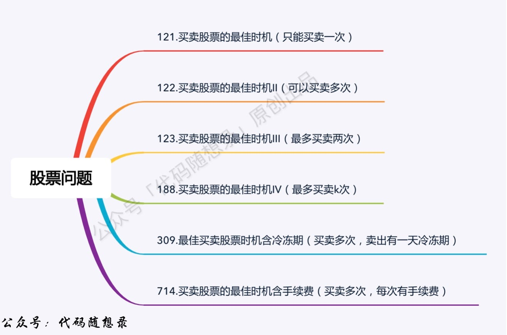

* [做專案（多個 C++、Java、Go、測試開發、前端（front end）專案）](https://www.programmercarl.com/other/kstar.html)
* [刷演算法（兩個月高強度學演算法）](https://www.programmercarl.com/xunlian/xunlianying.html)
* [背面試必考題（八股文）（40 天挑戰高頻面試題）](https://www.programmercarl.com/xunlian/bagu.html)

# LeetCode 股票問題總結篇！

之前我們已經把 LeetCode 上股票系列的題目都講過了，但還沒有來一篇股票總結，來幫大家高屋建瓴，所以總結篇這就來了！



* [動態規劃（dynamic programming, DP）：121. 買賣股票的最佳時機](https://programmercarl.com/0121.买卖股票的最佳时机.html)
* [動態規劃：122. 買賣股票的最佳時機 II](https://programmercarl.com/0122.买卖股票的最佳时机II（动态规划）.html)
* [動態規劃：123. 買賣股票的最佳時機 III](https://programmercarl.com/0123.买卖股票的最佳时机III.html)
* [動態規劃：188. 買賣股票的最佳時機 IV](https://programmercarl.com/0188.买卖股票的最佳时机IV.html)
* [動態規劃：309. 最佳買賣股票時機含冷凍期](https://programmercarl.com/0309.最佳买卖股票时机含冷冻期.html)
* [動態規劃：714. 買賣股票的最佳時機含手續費](https://programmercarl.com/0714.买卖股票的最佳时机含手续费（动态规划）.html)

## 賣股票的最佳時機

[動態規劃：121. 買賣股票的最佳時機](https://programmercarl.com/0121.买卖股票的最佳时机.html)，**股票只能買賣一次，問最大利潤**。

【貪心法（greedy）解法】

取最左最小值，取最右最大值，那麼得到的差值就是最大利潤，程式碼如下：
```CPP
class Solution {
public:
    int maxProfit(vector<int>& prices) {
        int low = INT_MAX;
        int result = 0;
        for (int i = 0; i < prices.size(); i++) {
            low = min(low, prices[i]);  // 取最左最小價格
            result = max(result, prices[i] - low); // 直接取最大區間利潤
        }
        return result;
    }
};
```

【動態規劃】

* dp[i][0] 表示第 i 天持有股票所得現金。
* dp[i][1] 表示第 i 天不持有股票所得現金。

如果第 i 天持有股票即 dp[i][0]，那麼可以由兩個狀態（state）推出來
* 第 i-1 天就持有股票，那麼就保持現狀，所得現金就是昨天持有股票的所得現金，即：dp[i - 1][0]
* 第 i 天買入股票，所得現金就是買入今天的股票後所得現金，即：-prices[i]
所以 dp[i][0] = max(dp[i - 1][0], -prices[i]);

如果第 i 天不持有股票即 dp[i][1]，也可以由兩個狀態推出來
* 第 i-1 天就不持有股票，那麼就保持現狀，所得現金就是昨天不持有股票的所得現金，即：dp[i - 1][1]
* 第 i 天賣出股票，所得現金就是按照今天股票價格賣出後所得現金，即：prices[i] + dp[i - 1][0]
所以 dp[i][1] = max(dp[i - 1][1], prices[i] + dp[i - 1][0]);

程式碼如下：

```CPP
// 版本一
class Solution {
public:
    int maxProfit(vector<int>& prices) {
        int len = prices.size();
        if (len == 0) return 0;
        vector<vector<int>> dp(len, vector<int>(2));
        dp[0][0] -= prices[0];
        dp[0][1] = 0;
        for (int i = 1; i < len; i++) {
            dp[i][0] = max(dp[i - 1][0], -prices[i]);
            dp[i][1] = max(dp[i - 1][1], prices[i] + dp[i - 1][0]);
        }
        return dp[len - 1][1];
    }
};
```
* 時間複雜性（time complexity）：O(n)
* 空間複雜度（space complexity）：O(n)

使用 rolling array，程式碼如下：

```CPP
// 版本二
class Solution {
public:
    int maxProfit(vector<int>& prices) {
        int len = prices.size();
        vector<vector<int>> dp(2, vector<int>(2)); // 注意這裡只開闢了一個 2 * 2 大小的二維陣列
        dp[0][0] -= prices[0];
        dp[0][1] = 0;
        for (int i = 1; i < len; i++) {
            dp[i % 2][0] = max(dp[(i - 1) % 2][0], -prices[i]);
            dp[i % 2][1] = max(dp[(i - 1) % 2][1], prices[i] + dp[(i - 1) % 2][0]);
        }
        return dp[(len - 1) % 2][1];
    }
};
```

* 時間複雜性：O(n)
* 空間複雜度：O(1)


## 買賣股票的最佳時機 II

[動態規劃：122. 買賣股票的最佳時機 II](https://programmercarl.com/0122.买卖股票的最佳时机II（动态规划）.html)可以多次買賣股票，問最大收益。


【貪心法解法】

收集每天的正利潤便可，程式碼如下：

```CPP
class Solution {
public:
    int maxProfit(vector<int>& prices) {
        int result = 0;
        for (int i = 1; i < prices.size(); i++) {
            result += max(prices[i] - prices[i - 1], 0);
        }
        return result;
    }
};
```

* 時間複雜性：O(n)
* 空間複雜度：O(1)


【動態規劃】

dp 陣列（array）定義：

* dp[i][0] 表示第 i 天持有股票所得現金
* dp[i][1] 表示第 i 天不持有股票所得最多現金


如果第 i 天持有股票即 dp[i][0]，那麼可以由兩個狀態推出來
* 第 i-1 天就持有股票，那麼就保持現狀，所得現金就是昨天持有股票的所得現金，即：dp[i - 1][0]
* 第 i 天買入股票，所得現金就是昨天不持有股票的所得現金減去今天的股票價格，即：dp[i - 1][1] - prices[i]

**注意這裡和[121. 買賣股票的最佳時機](https://programmercarl.com/0121.买卖股票的最佳时机.html)唯一不同的地方，就是推導 dp[i][0] 的時候，第 i 天買入股票的情況**。

在[121. 買賣股票的最佳時機](https://programmercarl.com/0121.买卖股票的最佳时机.html)中，因為股票全程只能買賣一次，所以如果買入股票，那麼第 i 天持有股票即 dp[i][0] 一定就是 -prices[i]。

而本題，因為一隻股票可以買賣多次，所以當第 i 天買入股票的時候，所持有的現金可能有之前買賣過的利潤。

程式碼如下：（注意程式碼中的註解，標記了和 121. 買賣股票的最佳時機唯一不同的地方）

```CPP
class Solution {
public:
    int maxProfit(vector<int>& prices) {
        int len = prices.size();
        vector<vector<int>> dp(len, vector<int>(2, 0));
        dp[0][0] -= prices[0];
        dp[0][1] = 0;
        for (int i = 1; i < len; i++) {
            dp[i][0] = max(dp[i - 1][0], dp[i - 1][1] - prices[i]); // 注意這裡是和 121. 買賣股票的最佳時機唯一不同的地方。
            dp[i][1] = max(dp[i - 1][1], dp[i - 1][0] + prices[i]);
        }
        return dp[len - 1][1];
    }
};
```

* 時間複雜性：O(n)
* 空間複雜度：O(n)


## 買賣股票的最佳時機 III

[動態規劃：123. 買賣股票的最佳時機 III](https://programmercarl.com/0123.买卖股票的最佳时机III.html)最多買賣兩次，問最大收益。

【動態規劃】

一天一共就有五個狀態，

0. 沒有操作
1. 第一次買入
2. 第一次賣出
3. 第二次買入
4. 第二次賣出

dp[i][j] 中 i 表示第 i 天，j 為 [0 - 4] 五個狀態，dp[i][j] 表示第 i 天狀態 j 所剩最大現金。


達到 dp[i][1] 狀態，有兩個具體操作：

* 操作一：第 i 天買入股票了，那麼 dp[i][1] = dp[i-1][0] - prices[i]
* 操作二：第 i 天沒有操作，而是沿用前一天買入的狀態，即：dp[i][1] = dp[i - 1][1]

dp[i][1] = max(dp[i-1][0] - prices[i], dp[i - 1][1]);

同理 dp[i][2] 也有兩個操作：

* 操作一：第 i 天賣出股票了，那麼 dp[i][2] = dp[i - 1][1] + prices[i]
* 操作二：第 i 天沒有操作，沿用前一天賣出股票的狀態，即：dp[i][2] = dp[i - 1][2]

所以 dp[i][2] = max(dp[i - 1][1] + prices[i], dp[i - 1][2])

同理可推出剩下狀態部分：

dp[i][3] = max(dp[i - 1][3], dp[i - 1][2] - prices[i]);

dp[i][4] = max(dp[i - 1][4], dp[i - 1][3] + prices[i]);

程式碼如下：

```CPP
// 版本一
class Solution {
public:
    int maxProfit(vector<int>& prices) {
        if (prices.size() == 0) return 0;
        vector<vector<int>> dp(prices.size(), vector<int>(5, 0));
        dp[0][1] = -prices[0];
        dp[0][3] = -prices[0];
        for (int i = 1; i < prices.size(); i++) {
            dp[i][0] = dp[i - 1][0];
            dp[i][1] = max(dp[i - 1][1], dp[i - 1][0] - prices[i]);
            dp[i][2] = max(dp[i - 1][2], dp[i - 1][1] + prices[i]);
            dp[i][3] = max(dp[i - 1][3], dp[i - 1][2] - prices[i]);
            dp[i][4] = max(dp[i - 1][4], dp[i - 1][3] + prices[i]);
        }
        return dp[prices.size() - 1][4];
    }
};
```

* 時間複雜性：O(n)
* 空間複雜度：O(n × 5)

當然，大家可以看到 LeetCode 官方題解裡的一種最佳化空間寫法，我這裡給出對應的 C++ 版本：

```CPP
// 版本二
class Solution {
public:
    int maxProfit(vector<int>& prices) {
        if (prices.size() == 0) return 0;
        vector<int> dp(5, 0);
        dp[1] = -prices[0];
        dp[3] = -prices[0];
        for (int i = 1; i < prices.size(); i++) {
            dp[1] = max(dp[1], dp[0] - prices[i]);
            dp[2] = max(dp[2], dp[1] + prices[i]);
            dp[3] = max(dp[3], dp[2] - prices[i]);
            dp[4] = max(dp[4], dp[3] + prices[i]);
        }
        return dp[4];
    }
};
```

* 時間複雜性：O(n)
* 空間複雜度：O(1)

**這種寫法看上去簡單，其實思路很繞，不建議大家這麼寫，這麼思考，很容易把自己繞進去！** 對於本題，把版本一的寫法研究明白，足以！

## 買賣股票的最佳時機 IV

[動態規劃：188. 買賣股票的最佳時機 IV](https://programmercarl.com/0188.买卖股票的最佳时机IV.html) 最多買賣 k 筆交易，問最大收益。

使用二維（2D）陣列 dp[i][j]：第 i 天的狀態為 j，所剩下的最大現金是 dp[i][j]

j 的狀態表示為：

* 0 表示不操作
* 1 第一次買入
* 2 第一次賣出
* 3 第二次買入
* 4 第二次賣出
* .....

**除了 0 以外，偶數就是賣出，奇數就是買入**。


2. 確定遞迴公式（recurrence formula）

達到 dp[i][1] 狀態，有兩個具體操作：

* 操作一：第 i 天買入股票了，那麼 dp[i][1] = dp[i - 1][0] - prices[i]
* 操作二：第 i 天沒有操作，而是沿用前一天買入的狀態，即：dp[i][1] = dp[i - 1][1]

dp[i][1] = max(dp[i - 1][0] - prices[i], dp[i - 1][1]);

同理 dp[i][2] 也有兩個操作：

* 操作一：第 i 天賣出股票了，那麼 dp[i][2] = dp[i - 1][1] + prices[i]
* 操作二：第 i 天沒有操作，沿用前一天賣出股票的狀態，即：dp[i][2] = dp[i - 1][2]

dp[i][2] = max(dp[i - 1][1] + prices[i], dp[i - 1][2])

同理可以類比剩下的狀態，程式碼如下：

```CPP
for (int j = 0; j < 2 * k - 1; j += 2) {
    dp[i][j + 1] = max(dp[i - 1][j + 1], dp[i - 1][j] - prices[i]);
    dp[i][j + 2] = max(dp[i - 1][j + 2], dp[i - 1][j + 1] + prices[i]);
}
```

整體程式碼如下：

```CPP
class Solution {
public:
    int maxProfit(int k, vector<int>& prices) {

        if (prices.size() == 0) return 0;
        vector<vector<int>> dp(prices.size(), vector<int>(2 * k + 1, 0));
        for (int j = 1; j < 2 * k; j += 2) {
            dp[0][j] = -prices[0];
        }
        for (int i = 1;i < prices.size(); i++) {
            for (int j = 0; j < 2 * k - 1; j += 2) {
                dp[i][j + 1] = max(dp[i - 1][j + 1], dp[i - 1][j] - prices[i]);
                dp[i][j + 2] = max(dp[i - 1][j + 2], dp[i - 1][j + 1] + prices[i]);
            }
        }
        return dp[prices.size() - 1][2 * k];
    }
};
```

當然有的解法是定義一個三維陣列 dp[i][j][k]，第 i 天，第 j 次買賣，k 表示買還是賣的狀態，從定義上來講是比較直觀。但感覺三維陣列操作起來有些麻煩，直接用二維陣列來模擬（simulation）三維陣列的情況，程式碼看起來也清爽一些。

## 最佳買賣股票時機含冷凍期

[動態規劃：309. 最佳買賣股票時機含冷凍期](https://programmercarl.com/0309.最佳买卖股票时机含冷冻期.html)可以多次買賣但每次賣出有冷凍期 1 天。

相對於[動態規劃：122. 買賣股票的最佳時機 II](https://programmercarl.com/0122.买卖股票的最佳时机II（动态规划）.html)，本題加上了一個冷凍期。


在[動態規劃：122. 買賣股票的最佳時機 II](https://programmercarl.com/0122.买卖股票的最佳时机II（动态规划）.html) 中有兩個狀態，持有股票後的最多現金，和不持有股票的最多現金。本題則可以劃分為四個狀態

dp[i][j]：第 i 天狀態為 j，所剩的最多現金為 dp[i][j]。

具體可以區分出如下四個狀態：

* 狀態一：買入股票狀態（今天買入股票，或者是之前就買入了股票然後沒有操作）
* 賣出股票狀態，這裡就有兩種賣出股票狀態
    * 狀態二：兩天前就賣出了股票，度過了冷凍期，一直沒操作，今天保持賣出股票狀態
    * 狀態三：今天賣出了股票
* 狀態四：今天為冷凍期狀態，但冷凍期狀態不可持續，只有一天！


達到買入股票狀態（狀態一）即：dp[i][0]，有兩個具體操作：

* 操作一：前一天就是持有股票狀態（狀態一），dp[i][0] = dp[i - 1][0]
* 操作二：今天買入了，有兩種情況
    * 前一天是冷凍期（狀態四），dp[i - 1][3] - prices[i]
    * 前一天是保持賣出股票狀態（狀態二），dp[i - 1][1] - prices[i]

所以操作二取最大值，即：max(dp[i - 1][3], dp[i - 1][1]) - prices[i]

那麼 dp[i][0] = max(dp[i - 1][0], max(dp[i - 1][3], dp[i - 1][1]) - prices[i]);

達到保持賣出股票狀態（狀態二）即：dp[i][1]，有兩個具體操作：

* 操作一：前一天就是狀態二
* 操作二：前一天是冷凍期（狀態四）

dp[i][1] = max(dp[i - 1][1], dp[i - 1][3]);

達到今天就賣出股票狀態（狀態三），即：dp[i][2]，只有一個操作：

* 操作一：昨天一定是買入股票狀態（狀態一），今天賣出

即：dp[i][2] = dp[i - 1][0] + prices[i];

達到冷凍期狀態（狀態四），即：dp[i][3]，只有一個操作：

* 操作一：昨天賣出了股票（狀態三）

dp[i][3] = dp[i - 1][2];

綜上分析，遞推程式碼如下：

```CPP
dp[i][0] = max(dp[i - 1][0], max(dp[i - 1][3]- prices[i], dp[i - 1][1]) - prices[i];
dp[i][1] = max(dp[i - 1][1], dp[i - 1][3]);
dp[i][2] = dp[i - 1][0] + prices[i];
dp[i][3] = dp[i - 1][2];
```

整體程式碼如下：

```CPP
class Solution {
public:
    int maxProfit(vector<int>& prices) {
        int n = prices.size();
        if (n == 0) return 0;
        vector<vector<int>> dp(n, vector<int>(4, 0));
        dp[0][0] -= prices[0]; // 持股票
        for (int i = 1; i < n; i++) {
            dp[i][0] = max(dp[i - 1][0], max(dp[i - 1][3], dp[i - 1][1]) - prices[i]);
            dp[i][1] = max(dp[i - 1][1], dp[i - 1][3]);
            dp[i][2] = dp[i - 1][0] + prices[i];
            dp[i][3] = dp[i - 1][2];
        }
        return max(dp[n - 1][3],max(dp[n - 1][1], dp[n - 1][2]));
    }
};
```

* 時間複雜性：O(n)
* 空間複雜度：O(n)

## 買賣股票的最佳時機含手續費

[動態規劃：714. 買賣股票的最佳時機含手續費](https://programmercarl.com/0714.买卖股票的最佳时机含手续费（动态规划）.html) 可以多次買賣，但每次有手續費。


相對於[動態規劃：122. 買賣股票的最佳時機 II](https://programmercarl.com/0122.买卖股票的最佳时机II（动态规划）.html)，本題只需要在計算賣出操作的時候減去手續費就可以了，程式碼幾乎是一樣的。

唯一差別在於遞迴公式部分，所以本篇也就不按照動規五部曲詳細講解了，主要講解一下遞迴公式部分。

這裡重申一下 dp 陣列的含義：

dp[i][0] 表示第 i 天持有股票所剩最多現金。
dp[i][1] 表示第 i 天不持有股票所得最多現金


如果第 i 天持有股票即 dp[i][0]，那麼可以由兩個狀態推出來
* 第 i-1 天就持有股票，那麼就保持現狀，所得現金就是昨天持有股票的所得現金，即：dp[i - 1][0]
* 第 i 天買入股票，所得現金就是昨天不持有股票的所得現金減去今天的股票價格，即：dp[i - 1][1] - prices[i]


所以：dp[i][0] = max(dp[i - 1][0], dp[i - 1][1] - prices[i]);


再來看看如果第 i 天不持有股票即 dp[i][1] 的情況，依然可以由兩個狀態推出來
* 第 i-1 天就不持有股票，那麼就保持現狀，所得現金就是昨天不持有股票的所得現金，即：dp[i - 1][1]
* 第 i 天賣出股票，所得現金就是按照今天股票價格賣出後所得現金，**注意這裡需要有手續費了**，即：dp[i - 1][0] + prices[i] - fee

所以：dp[i][1] = max(dp[i - 1][1], dp[i - 1][0] + prices[i] - fee);

**本題和[動態規劃：122. 買賣股票的最佳時機 II](https://programmercarl.com/0122.买卖股票的最佳时机II（动态规划）.html)的差別就是這裡需要多一個減去手續費的操作**。

以上分析完畢，程式碼如下：

```CPP
class Solution {
public:
    int maxProfit(vector<int>& prices, int fee) {
        int n = prices.size();
        vector<vector<int>> dp(n, vector<int>(2, 0));
        dp[0][0] -= prices[0]; // 持股票
        for (int i = 1; i < n; i++) {
            dp[i][0] = max(dp[i - 1][0], dp[i - 1][1] - prices[i]);
            dp[i][1] = max(dp[i - 1][1], dp[i - 1][0] + prices[i] - fee);
        }
        return max(dp[n - 1][0], dp[n - 1][1]);
    }
};
```

* 時間複雜性：O(n)
* 空間複雜度：O(n)


## 總結

至此，股票系列正式劇終，全部講解完畢！

從買賣一次到買賣多次，從最多買賣兩次到最多買賣 k 次，從冷凍期再到手續費，最後再來一個股票大總結，可以說對股票系列完美收官了。

「程式碼隨想錄」值得推薦給身邊每一位學習演算法的朋友同學們，關注後都會發現相見恨晚！


