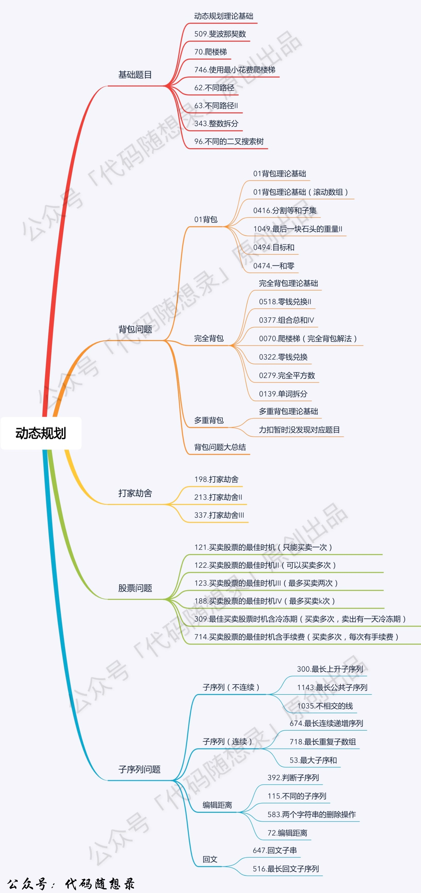

* [做專案（多個 C++、Java、Go、測試開發、前端（front end）專案）](https://www.programmercarl.com/other/kstar.html)
* [刷演算法（兩個月高強度學演算法）](https://www.programmercarl.com/xunlian/xunlianying.html)
* [背面試必考題（八股文）（40 天挑戰高頻面試題）](https://www.programmercarl.com/xunlian/bagu.html)

# 動態規劃（dynamic programming, DP）理論基礎

動態規劃刷題大綱

 </img>

## 演算法公開課

**[《程式碼隨想錄》演算法影片公開課](https://programmercarl.com/other/gongkaike.html)：[動態規劃理論基礎](https://www.bilibili.com/video/BV13Q4y197Wg)，相信結合影片再看本篇題解，更有助於大家對本題的理解**。

## 什麼是動態規劃

動態規劃，英文：Dynamic Programming，簡稱 DP，如果某一問題有很多重疊次問題（overlapping subproblems），使用動態規劃是最有效的。

所以動態規劃中每一個狀態（state）一定是由上一個狀態推導出來的，**這一點就區分於貪心法（greedy）**，貪心法沒有狀態推導，而是從局部直接選最優的，

在[關於貪心演算法（greedy algorithm），你該了解這些！](https://programmercarl.com/%E8%B4%AA%E5%BF%83%E7%AE%97%E6%B3%95%E7%90%86%E8%AE%BA%E5%9F%BA%E7%A1%80.html)中我舉了一個背包問題（knapsack problem）的例子。

例如：有 N 件物品和一個最多能背重量為 W 的背包。第 i 件物品的重量是 weight[i]，得到的價值是 value[i]。**每件物品只能用一次**，求解將哪些物品裝入背包裡物品價值總和最大。

動態規劃中 dp[j] 是由 dp[j-weight[i]] 推導出來的，然後取 max(dp[j], dp[j - weight[i]] + value[i])。

但如果是貪心法呢，每次拿物品選一個最大的或者最小的就完事了，和上一個狀態沒有關係。

所以貪心法解決不了動態規劃的問題。

**其實大家也不用死扣動規和貪心法的理論差別，後面做做題目自然就知道了**。

而且很多講解動態規劃的文章都會講 optimal substructure 啊和重疊次問題啊這些，這些東西都是教科書上的定義，晦澀難懂而且不實用。

大家知道動規是由前一個狀態推導出來的，而貪心法是局部直接選最優的，對於刷題來說就夠用了。

上述提到的背包問題，後續會詳細講解。

## 動態規劃的解題步驟

做動規題目的時候，很多同學會陷入一個誤區，就是以為把狀態變遷方程式（state transition equation）背下來，照著套用改一改，就開始寫程式碼，甚至把題目 AC 之後，都不太清楚 dp[i] 表示的是什麼。

**這就是一種朦朧的狀態，然後就把題給過了，遇到稍稍難一點的，可能直接就不會了，然後看題解，然後繼續照著套用，陷入這種惡性循環中**。

狀態變遷方程式（遞迴公式（recurrence formula））是很重要，但動規不僅僅只有遞迴公式。

**對於動態規劃問題，我將拆解為如下五部曲，這五步都搞清楚了，才能說把動態規劃真的掌握了！**

1. 確定 dp 陣列（array）（dp table）以及下標（subscript）的含義
2. 確定遞迴公式
3. dp 陣列如何初始化（initialization）
4. 確定遍歷（traversal）順序
5. 舉例推導 dp 陣列

一些同學可能想為什麼要先確定遞迴公式，然後再考慮初始化呢？

**因為一些情況是遞迴公式決定了 dp 陣列要如何初始化！**

後面的講解中我都是圍繞著這五點來進行講解。

可能刷過動態規劃題目的同學都知道遞迴公式的重要性，感覺確定了遞迴公式這道題目就解出來了。

其實確定遞迴公式僅僅是解題裡的一步而已！

一些同學知道遞迴公式，但搞不清楚 dp 陣列應該如何初始化，或者正確的遍歷順序，以至於記下來公式，但寫的程式怎麼改都通過不了。

後續的講解大家就會慢慢感受到這五步的重要性了。

## 動態規劃應該如何除錯（debugging）

相信動規的題目，很大部分同學都是這樣做的。

看一下題解，感覺看懂了，然後照著套用，如果能正好套對了，萬事大吉，一旦要是沒通過，就怎麼改都通過不了，對 dp 陣列的初始化、遞迴公式、遍歷順序，處於一種黑箱的理解狀態。

寫動規題目，程式碼出問題很正常！

**找問題的最好方式就是把 dp 陣列印出來，看看究竟是不是按照自己解題思路推導的！**

一些同學對於 dp 的學習是黑箱的狀態，就是不清楚 dp 陣列的含義，不懂為什麼這麼初始化，遞迴公式背下來了，遍歷順序靠習慣就是這麼寫的，然後一鼓作氣寫出程式碼，如果程式碼能通過萬事大吉，通過不了的話就憑感覺改一改。

這是一個很不好的習慣！

**做動規的題目，寫程式碼之前一定要把狀態轉移在 dp 陣列上的具體情況模擬（simulation）一遍，心中有數，確定最後推出的是想要的結果**。

然後再寫程式碼，如果程式碼沒通過就印出 dp 陣列，看看是不是和自己預先推導的哪裡不一樣。

如果印出來和自己預先模擬推導是一樣的，那麼就是自己的遞迴公式、初始化或者遍歷順序有問題了。

如果和自己預先模擬推導的不一樣，那麼就是程式碼實作細節有問題。

**這樣才是一個完整的思考過程，而不是一旦程式碼出問題，就毫無頭緒地東改改西改改，最後過不了，或者說是稀里糊塗地過了**。

這也是我為什麼在動規五部曲裡強調推導 dp 陣列的重要性。

舉個例子哈：在「程式碼隨想錄」刷題小分隊微信群裡，一些錄友可能程式碼通過不了，會把程式碼丟到討論群裡問：我這裡程式碼都已經和題解一模一樣了，為什麼通過不了呢？

發出這樣的問題之前，其實可以自己先思考這三個問題：

* 這道題目我舉例推導狀態變遷方程式了嗎？
* 我印出 dp 陣列的日誌（log）了嗎？
* 印出來的 dp 陣列和我想的一樣嗎？

**如果這靈魂三問自己都做到了，基本上這道題目也就解決了**，或者更清晰地知道自己究竟是哪一點不明白，是狀態轉移不明白，還是實作程式碼不知道該怎麼寫，還是不理解遍歷 dp 陣列的順序。

然後再問問題，目的性就很強了，群裡的夥伴也可以快速知道提問者的疑惑了。

**注意這裡不是說不讓大家問問題哈，而是說問問題之前要有自己的思考，問題要問到點子上！**

**大家工作之後就會發現，特別是大型科技公司，問問題是一個專業活，是的，問問題也要體現出專業！**

如果問同事很不專業的問題，同事們會懶得回答，主管也會認為你缺乏思考能力，這對職場發展是很不利的。

所以大家在刷題的時候，就鍛鍊自己養成專業提問的好習慣。

## 總結

這一篇是動態規劃的整體概述，講解了什麼是動態規劃，動態規劃的解題步驟，以及如何除錯。

動態規劃是一個很大的領域，今天這一篇講解的內容是整個動態規劃系列中都會使用到的一些理論基礎。

在後續講解中針對某一具體問題，還會講解其對應的理論基礎，例如背包問題中的 0/1 背包問題（0/1 knapsack problem），LeetCode 上的題目都是 0/1 背包的應用，而沒有純 0/1 背包的問題，那麼就需要在把對應的理論知識講解一下。

大家會發現，我講解的理論基礎並不是教科書上各種動態規劃的定義、錯綜複雜的公式。

這裡理論基礎篇已經是非常偏實用的了，每個知識點都是在解題實戰中非常有用的內容，大家要重視起來哈。

今天我們開始新的征程了，你準備好了嗎？

