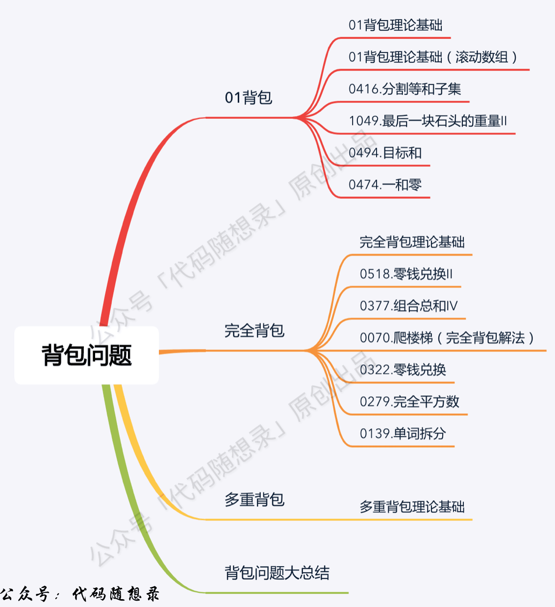
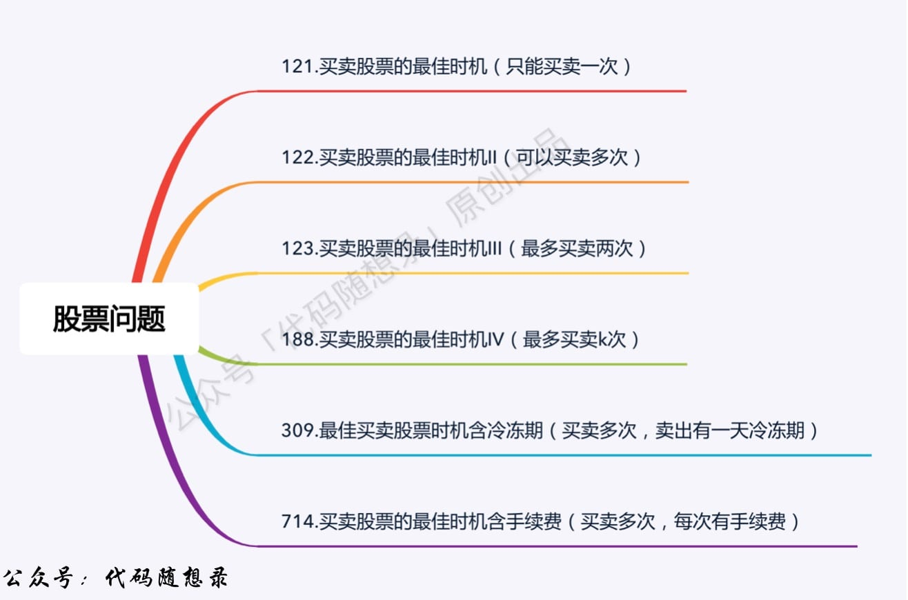
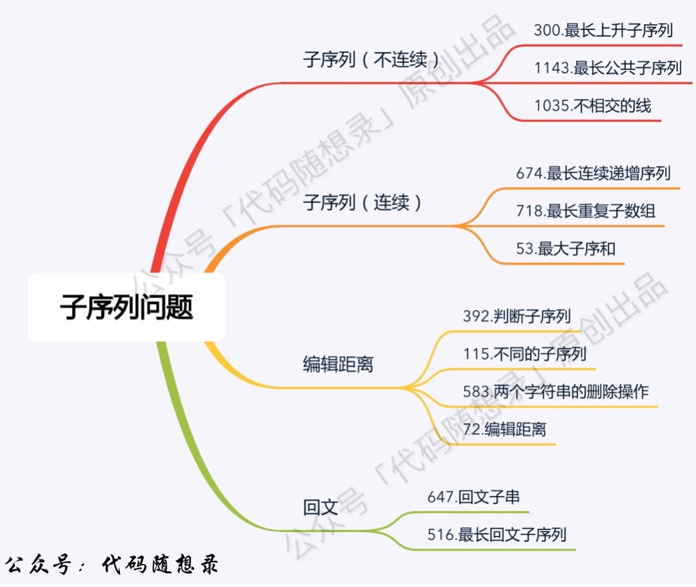
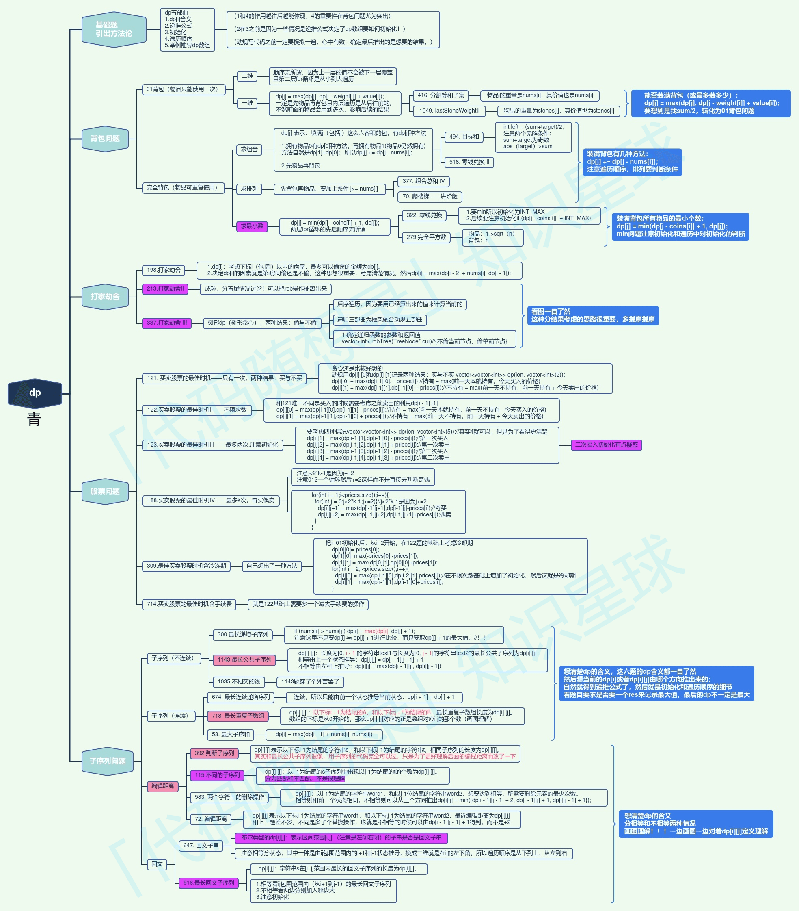

* [做專案（多個 C++、Java、Go、測試開發、前端（front end）專案）](https://www.programmercarl.com/other/kstar.html)
* [刷演算法（兩個月高強度學演算法）](https://www.programmercarl.com/xunlian/xunlianying.html)
* [背面試必考題（八股文）（40 天挑戰高頻面試題）](https://www.programmercarl.com/xunlian/bagu.html)

# 動態規劃（dynamic programming, DP）最強總結篇！

如今動態規劃（dynamic programming, DP）已經講解了 42 道經典題目，共 50 篇文章，是時候做一篇總結了。

關於DP，在專題第一篇[關於動態規劃，你該了解這些！](./動態規劃理論基礎.md)就說了動規五部曲，**而且強調了五步對解動規題目至關重要！**

這是 Carl 做過一百多道動規題目總結出來的經驗結晶啊，如果大家跟著「程式碼隨想錄」刷過動規專題，一定會對這動規五部曲的作用感受極其深刻。

動規五部曲分別為：

1. 確定 dp 陣列（array）（dp table）以及下標（subscript）的含義
2. 確定遞迴公式（recurrence formula）
3. dp 陣列如何初始化（initialization）
4. 確定遍歷（traversal）順序
5. 舉例推導 dp 陣列

動規專題剛開始的時候，講的題目比較簡單，不少錄友和我反應：這麼簡單的題目講得太複雜了，不用那麼多步驟分析，想出遞迴公式直接就 AC 這道題目了。

**Carl 的觀點一直都是，簡單題是用來鞏固方法論的**。簡單題目是可以靠感覺，但後面稍稍難一點的題目，估計感覺就不管用了。

在動規專題講解中，也充分體現出這動規五部曲的重要性。

還有不少錄友對動規的理解是：遞迴公式才是最難最重要的，只要想出遞迴公式，其他都好辦。

**其實這麼想的同學基本對動規理解得不到位**。

動規五部曲裡，哪一步沒想清楚，這道題目基本就做不出來，即使做出來了也沒有想清楚，而是朦朦朧朧地就把題目過了。

* 如果想不清楚 dp 陣列的具體含義，遞迴公式從何談起，甚至初始化的時候就寫錯了。
* 例如[動態規劃：不同路徑還不夠，要有障礙！](./0063.不同路徑II.md) 在這道題目中，初始化才是重頭戲
* 如果看過背包問題（knapsack problem）系列，特別是無界背包問題（unbounded knapsack problem），那麼兩層 for 迴圈（for-loop）先後順序絕對可以搞懵很多人，反而遞迴公式是簡單的。
* 至於推導 dp 陣列的重要性，動規專題裡幾乎每篇 Carl 都反覆強調，當程式結果不對的時候，一定要自己推導公式，看看和程式印出的日誌（log）是否一樣。

好啦，我們再一起回顧一下，DP專題中我們都講了哪些內容。

## 動態規劃基礎

* [關於動態規劃，你該了解這些！](./動態規劃理論基礎.md)
* [動態規劃：斐波那契數（Fibonacci number）](./0509.斐波那契數.md)
* [動態規劃：爬樓梯](./0070.爬楼梯.md)
* [動態規劃：使用最小花費爬樓梯](./0746.使用最小花費爬楼梯.md)
* [動態規劃：不同路徑（path）](./0062.不同路徑.md)
* [動態規劃：不同路徑還不夠，要有障礙！](./0063.不同路徑II.md)
* [動態規劃：整數（integer）拆分，你要怎麼拆？](./0343.整數拆分.md)
* [動態規劃：不同的二元搜尋樹（binary search tree, BST）](./0096.不同的二叉搜索樹.md)

## 背包問題系列

 </img>

* [動態規劃：關於 0/1 背包問題（0/1 knapsack problem），你該了解這些！](./背包理論基礎01背包-1.md)
* [動態規劃：關於 0/1 背包問題，你該了解這些！（rolling array）](./背包理論基礎01背包-2.md)
* [動態規劃：分割等和子集（subset）可以用 0/1 背包！](./0416.分割等和子集.md)
* [動態規劃：最後一塊石頭的重量 II](./1049.最後一塊石頭的重量II.md)
* [動態規劃：目標和！](./0494.目標和.md)
* [動態規劃：一和零！](./0474.一和零.md)
* [動態規劃：關於無界背包問題，你該了解這些！](./背包問題理論基礎完全背包.md)
* [動態規劃：給你一些零錢，你要怎麼湊？](./0518.零錢兌換II.md)
* [動態規劃：Carl 稱它為排列（permutation）總和！](./0377.組合總和Ⅳ.md)
* [動態規劃：以前我沒得選，現在我選擇再爬一次！](./0070.爬楼梯完全背包版本.md)
* [動態規劃：給我個機會，我再兌換一次零錢](./0322.零錢兌換.md)
* [動態規劃：一樣的解法模式，再求一次完全平方（perfect square）](./0279.完全平方數.md)
* [動態規劃：單字拆分](./0139.單詞拆分.md)
* [動態規劃：關於 bounded knapsack，你該了解這些！](./背包問題理論基礎多重背包.md)
* [聽說背包問題很難？這篇總結篇來拯救你了](./背包總結篇.md)

## 打家劫舍系列

* [動態規劃：開始打家劫舍！](./0198.打家劫捨.md)
* [動態規劃：繼續打家劫舍！](./0213.打家劫捨II.md)
* [動態規劃：還要打家劫舍！](./0337.打家劫捨III.md)

## 股票系列

 </img>

* [動態規劃：買賣股票的最佳時機](./0121.買賣股票的最佳時機.md)
* [動態規劃：本週我們都講了這些（系列六）](./週總結/20210225動規週末總結.md)
* [動態規劃：買賣股票的最佳時機 II](./0122.買賣股票的最佳時機II（動態規劃）.md)
* [動態規劃：買賣股票的最佳時機 III](./0123.買賣股票的最佳時機III.md)
* [動態規劃：買賣股票的最佳時機 IV](./0188.買賣股票的最佳時機IV.md)
* [動態規劃：最佳買賣股票時機含冷凍期](./0309.最佳買賣股票時機含冷凍期.md)
* [動態規劃：本週我們都講了這些（系列七）](./週總結/20210304動規週末總結.md)
* [動態規劃：買賣股票的最佳時機含手續費](./0714.買賣股票的最佳時機含手續費（動態規劃）.md)
* [動態規劃：股票系列總結篇](./動態規劃-股票問題總結篇.md)

## 次序列（subsequence）系列

 </img>

* [動態規劃：longest increasing subsequence](./0300.最長上升次序列.md)
* [動態規劃：最長連續遞增序列（sequence）](./0674.最長連續遞增序列.md)
* [動態規劃：最長重複（duplicate）子陣列（subarray）](./0718.最長重複子陣列.md)
* [動態規劃：最長公用次序列（longest common subsequence）](./1143.最長公共次序列.md)
* [動態規劃：不相交的線](./1035.不相交的线.md)
* [動態規劃：最大子序和](./0053.最大子序和（動態規劃）.md)
* [動態規劃：判斷次序列](./0392.判斷次序列.md)
* [動態規劃：不同的次序列](./0115.不同的次序列.md)
* [動態規劃：兩個字串（string）的刪除操作](./0583.兩個字串的刪除操作.md)
* [動態規劃：edit distance](./0072.編輯距離.md)
* [為了絕殺 edit distance，我做了三步鋪墊，你都知道嗎？](./為了絕殺編輯距離，卡爾做了三步鋪墊.md)
* [動態規劃：回文（palindrome）子字串（substring）](./0647.回文子字串.md)
* [動態規劃：最長回文次序列](./0516.最長回文次序列.md)

## 動規結束語

關於動規，還有樹狀 DP（打家劫舍系列裡有一道）、數位 DP、區間（interval）DP、機率型 DP、賽局型 DP、狀態壓縮（state compression） dp 等等，這些我就不去做講解了，面試中出現的機率非常低。

能把本篇中列舉的題目都研究通透的話，你的動規水平就已經非常高了。應付面試已經足夠！

這個圖是 [程式碼隨想錄知識星球](https://programmercarl.com/other/kstar.html) 成員：[青](https://wx.zsxq.com/dweb2/index/footprint/185251215558842) 所畫，總結得非常好，分享給大家。

這應該是全網對動規最深刻的講解系列了。

**其實大家去網上搜一搜也可以發現，能把DP講清楚的資料挺少的，因為動規確實很難！要給別人講清楚更難！**

《劍指 Offer》上動規的題目很少，經典的演算法書籍《演算法（第 4 版）》沒有講動規，而《演算法導論》講的動規基本屬於勸退級別的。

講清楚一道題容易，講清楚兩道題也容易，但把整個DP的各個分支（branch）講清楚，每道題目講通透，並用一套方法論把整個動規貫徹始終就非常難了。

所以 Carl 花費了這麼大精力，把自己對動規演算法理解一五一十地全部分享給了錄友們，幫助大家少走彎路，加油！

