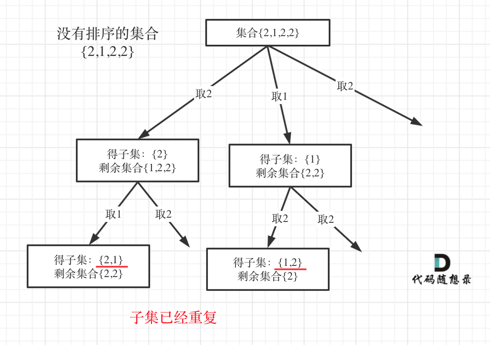
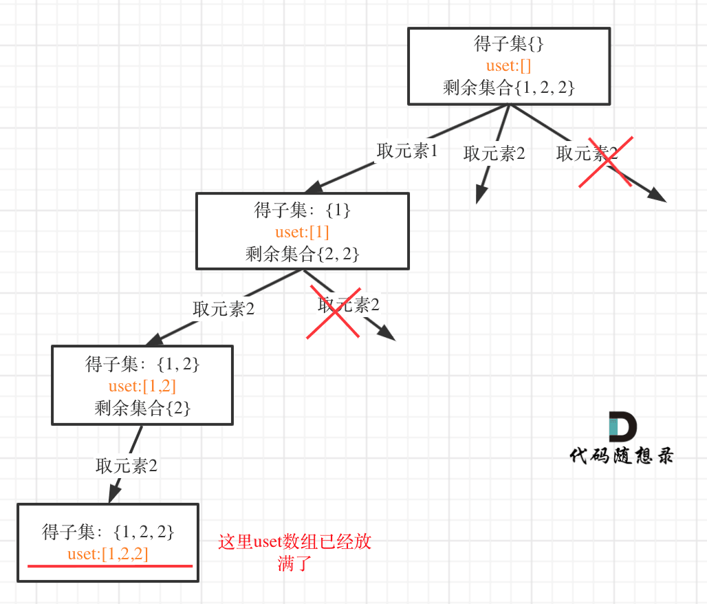

* [做專案（多個 C++、Java、Go、測試開發、前端（front end）專案）](https://www.programmercarl.com/other/kstar.html)
* [刷演算法（兩個月高強度學演算法）](https://www.programmercarl.com/xunlian/xunlianying.html)
* [背八股文（40 天挑戰高頻面試題）](https://www.programmercarl.com/xunlian/bagu.html)

# 回溯演算法（backtracking algorithm）去重（deduplication）問題的另一種寫法

> 在 [本週小結！（回溯演算法系列三）](https://programmercarl.com/周总结/20201112回溯周末总结.html) 中一位讀者／錄友對 整棵樹（tree）的本層和同一節點（node）的本層有疑問，也讓我重新思考了一下，發現這裡確實有問題，所以專門寫一篇來糾正，感謝大家的積極交流哈！

接下來我再把這塊再講一下。

在[回溯演算法：求子集問題（二）](https://programmercarl.com/0090.子集II.html)中的去重和 [回溯演算法：遞增次序列（subsequence）](https://programmercarl.com/0491.递增子序列.html)中的去重都是 同一父節點（father node）下本層的去重。

[回溯演算法：求子集問題（二）](https://programmercarl.com/0090.子集II.html)也可以使用 set 針對同一父節點本層去重，但子集（subset）問題一定要排序（sorting），為什麼呢？

我用沒有排序的集合（set） {2,1,2,2} 來舉例子畫一個圖，如圖：




圖中，大家就很明顯的看到，子集重複（duplicate）了。

那麼下面我針對[回溯演算法：求子集問題（二）](https://programmercarl.com/0090.子集II.html) 給出使用 set 來對本層去重的程式碼實作。

## 90.子集 II

used 陣列（array）去重版本： [回溯演算法：求子集問題（二）](https://programmercarl.com/0090.子集II.html)

使用集合去重（set 去重）的版本如下：

```CPP
class Solution {
private:
    vector<vector<int>> result;
    vector<int> path;
    void backtracking(vector<int>& nums, int startIndex, vector<bool>& used) {
        result.push_back(path);
        unordered_set<int> uset; // 定義 set 對同一節點下的本層 deduplication
        for (int i = startIndex; i < nums.size(); i++) {
            if (uset.find(nums[i]) != uset.end()) { // 如果發現出現過就 pass
                continue;
            }
            uset.insert(nums[i]); // set 更新元素
            path.push_back(nums[i]);
            backtracking(nums, i + 1, used);
            path.pop_back();
        }
    }

public:
    vector<vector<int>> subsetsWithDup(vector<int>& nums) {
        result.clear();
        path.clear();
        vector<bool> used(nums.size(), false);
        sort(nums.begin(), nums.end()); // deduplication 需要排序
        backtracking(nums, 0, used);
        return result;
    }
};

```

針對留言區讀者／錄友們的疑問，我再補充一些常見的錯誤寫法，


### 錯誤寫法一

把 uset 定義放到類別（class）成員位置，然後模擬（simulation）回溯（backtracking）的樣子 insert 一次，erase 一次。

例如：

```CPP
class Solution {
private:
    vector<vector<int>> result;
    vector<int> path;
    unordered_set<int> uset; // 把 uset 定義放到類別成員位置
    void backtracking(vector<int>& nums, int startIndex, vector<bool>& used) {
        result.push_back(path);

        for (int i = startIndex; i < nums.size(); i++) {
            if (uset.find(nums[i]) != uset.end()) {
                continue;
            }
            uset.insert(nums[i]);   // 遞迴之前 insert
            path.push_back(nums[i]);
            backtracking(nums, i + 1, used);
            path.pop_back();
            uset.erase(nums[i]);    // 回溯再 erase
        }
    }

```

在樹狀結構（tree structure）中，**如果把 unordered_set<int> uset 放在類別成員的位置（相當於全域變數（global variable）），就把樹枝的情況都記錄了，不是單純的控制某一節點下的同一層了**。

如圖：



可以看出一旦把 unordered_set<int> uset 放在類別成員位置，它控制的就是整棵樹，包括樹枝。

**所以這麼寫不行！**

### 錯誤寫法二

有同學把 unordered_set<int> uset; 放到類別成員位置，然後每次進入單層的時候用 uset.clear()。

程式碼如下：

```CPP
class Solution {
private:
    vector<vector<int>> result;
    vector<int> path;
    unordered_set<int> uset; // 把 uset 定義放到類別成員位置
    void backtracking(vector<int>& nums, int startIndex, vector<bool>& used) {
        result.push_back(path);
        uset.clear(); // 到每一層的時候，清空 uset
        for (int i = startIndex; i < nums.size(); i++) {
            if (uset.find(nums[i]) != uset.end()) {
                continue;
            }
            uset.insert(nums[i]); // set 記錄元素
            path.push_back(nums[i]);
            backtracking(nums, i + 1, used);
            path.pop_back();
        }
    }
```
uset 已經是全域變數，本層的 uset 記錄了一個元素（element），然後進入下一層之後這個 uset（和上一層是同一個 uset）就被清空了，也就是說，層與層之間的 uset 是同一個，那麼就會相互影響。

**所以這麼寫依然不行！**

**組合（combination）問題和排列（permutation）問題，其實也可以使用 set 來對同一節點下本層去重，下面我都分別給出實作程式碼**。

## 40. 組合總和 II

使用 used 陣列去重版本：[回溯演算法：求組合總和（三）](https://programmercarl.com/0040.组合总和II.html)

使用集合去重的版本如下：

```CPP
class Solution {
private:
    vector<vector<int>> result;
    vector<int> path;
    void backtracking(vector<int>& candidates, int target, int sum, int startIndex) {
        if (sum == target) {
            result.push_back(path);
            return;
        }
        unordered_set<int> uset; // 控制某一節點下的同一層元素不能重複
        for (int i = startIndex; i < candidates.size() && sum + candidates[i] <= target; i++) {
            if (uset.find(candidates[i]) != uset.end()) {
                continue;
            }
            uset.insert(candidates[i]); // 記錄元素
            sum += candidates[i];
            path.push_back(candidates[i]);
            backtracking(candidates, target, sum, i + 1);
            sum -= candidates[i];
            path.pop_back();
        }
    }

public:
    vector<vector<int>> combinationSum2(vector<int>& candidates, int target) {
        path.clear();
        result.clear();
        sort(candidates.begin(), candidates.end());
        backtracking(candidates, target, 0, 0);
        return result;
    }
};
```

## 47. 全排列 II

使用 used 陣列去重版本：[回溯演算法：排列問題（二）](https://programmercarl.com/0047.全排列II.html)

使用集合去重的版本如下：

```CPP
class Solution {
private:
    vector<vector<int>> result;
    vector<int> path;
    void backtracking (vector<int>& nums, vector<bool>& used) {
        if (path.size() == nums.size()) {
            result.push_back(path);
            return;
        }
        unordered_set<int> uset; // 控制某一節點下的同一層元素不能重複
        for (int i = 0; i < nums.size(); i++) {
            if (uset.find(nums[i]) != uset.end()) {
                continue;
            }
            if (used[i] == false) {
                uset.insert(nums[i]); // 記錄元素
                used[i] = true;
                path.push_back(nums[i]);
                backtracking(nums, used);
                path.pop_back();
                used[i] = false;
            }
        }
    }
public:
    vector<vector<int>> permuteUnique(vector<int>& nums) {
        result.clear();
        path.clear();
        sort(nums.begin(), nums.end()); // 排序
        vector<bool> used(nums.size(), false);
        backtracking(nums, used);
        return result;
    }
};
```

## 兩種寫法的效能分析

需要注意的是：**使用集合去重的版本相對於 used 陣列的版本效率都要低很多**，大家在 LeetCode 上提交，能明顯發現。

原因在[回溯演算法：遞增次序列](https://programmercarl.com/0491.递增子序列.html)中也分析過，主要是因為程式執行的時候對 unordered_set 頻繁的 insert，unordered_set 需要做雜湊（hash）映射（map / mapping）（也就是把 key 透過 hash function 映射為唯一的雜湊值）相對費時間，而且 insert 的時候其底層的符號表（symbol table）也要做相應的擴充，也是費時的。

**而使用 used 陣列在時間複雜度（time complexity）上幾乎沒有額外負擔！**

**使用集合去重，不僅時間複雜度高了，空間複雜度（space complexity）也高了**，在[本週小結！（回溯演算法系列三）](https://programmercarl.com/周总结/20201112回溯周末总结.html)中分析過，組合，子集，排列問題的空間複雜度都是 O(n)，但如果使用集合去重，空間複雜度就變成了 O(n^2)，因為每一層遞迴（recursion）都有一個 set 集合，系統堆疊空間（stack space）是 n，每一個空間都有 set 集合。

那有同學可能疑惑 用 used 陣列也是佔用 O(n) 的空間啊？

used 陣列可是全域變數，每層與每層之間共用一個 used 陣列，所以空間複雜度是 O(n + n)，最終空間複雜度還是 O(n)。

## 總結

本篇本打算是對[本週小結！（回溯演算法系列三）](https://programmercarl.com/周总结/20201112回溯周末总结.html)的一個點做一下糾正，沒想到又寫出來這麼多！

**這個點都源於一位讀者／錄友的疑問，然後我思考總結了一下，就寫了這一篇，所以還是得多交流啊！**

如果大家對「程式碼隨想錄」文章有什麼疑問，儘管打卡留言的時候提出來哈，或者在交流群裡提問。

**其實這就是相互學習的過程，交流一波之後都對題目理解得更深刻了，我如果發現文中有問題，都會在評論區或者下一篇文章中即時修正，保證不會給大家帶跑偏！**


## 其他語言版本

### Java
**47.全排列 II**


```java
class Solution {
    private List<List<Integer>> res = new ArrayList<>();
    private List<Integer> path = new ArrayList<>();
    private boolean[] used = null;

    public List<List<Integer>> permuteUnique(int[] nums) {
        used = new boolean[nums.length];
        Arrays.sort(nums);
        backtracking(nums);
        return res;
    }

    public void backtracking(int[] nums) {
        if (path.size() == nums.length) {
            res.add(new ArrayList<>(path));
            return;
        }
        HashSet<Integer> hashSet = new HashSet<>();//層 deduplication
        for (int i = 0; i < nums.length; i++) {
            if (hashSet.contains(nums[i]))
                continue;
            if (used[i] == true)//枝 deduplication
                continue;
            hashSet.add(nums[i]);//記錄元素
            used[i] = true;
            path.add(nums[i]);
            backtracking(nums);
            path.remove(path.size() - 1);
            used[i] = false;
        }
    }
}

```
**90.子集 II**
```java
class Solution {
    List<List<Integer>> reslut = new ArrayList<>();
    LinkedList<Integer> path = new LinkedList<>();
    
    public List<List<Integer>> subsetsWithDup(int[] nums) {
        if(nums.length == 0){
            reslut.add(path);
            return reslut;
        }
        Arrays.sort(nums);
        backtracking(nums,0);
        return reslut;
    }

    public void backtracking(int[] nums,int startIndex){
        reslut.add(new ArrayList<>(path));
        if(startIndex >= nums.length)return;
        HashSet<Integer> hashSet = new HashSet<>();
        for(int i = startIndex; i < nums.length; i++){
            if(hashSet.contains(nums[i])){
                continue;
            }
            hashSet.add(nums[i]);
            path.add(nums[i]);
            backtracking(nums,i+1);
            path.removeLast();
        }
    }
}
```
**40.組合總和 II**
```java
class Solution {
    List<List<Integer>> result = new ArrayList<>();
    LinkedList<Integer> path = new LinkedList<>();
    public List<List<Integer>> combinationSum2(int[] candidates, int target) {
        Arrays.sort( candidates );
        if( candidates[0] > target ) return result;
        backtracking(candidates,target,0,0);
        return result;
    }

    public void backtracking(int[] candidates,int target,int sum,int startIndex){
        if( sum > target )return;
        if( sum == target ){
            result.add( new ArrayList<>(path) );
        }
        HashSet<Integer> hashSet = new HashSet<>();
        for( int i = startIndex; i < candidates.length; i++){
            if( hashSet.contains(candidates[i]) ){
                continue;
            }
            hashSet.add(candidates[i]);
            path.add(candidates[i]);
            sum += candidates[i];
            backtracking(candidates,target,sum,i+1);
            path.removeLast();
            sum -= candidates[i];
        }
    }
}
```
### Python

**90.子集 II**

```python
class Solution:
    def subsetsWithDup(self, nums):
        nums.sort()  # deduplication 需要排序
        result = []
        self.backtracking(nums, 0, [], result)
        return result

    def backtracking(self, nums, startIndex, path, result):
        result.append(path[:])
        used = set()
        for i in range(startIndex, len(nums)):
            if nums[i] in used:
                continue
            used.add(nums[i])
            path.append(nums[i])
            self.backtracking(nums, i + 1, path, result)
            path.pop()

```

**40. 組合總和 II**

```python
class Solution:
    def combinationSum2(self, candidates, target):
        candidates.sort()
        result = []
        self.backtracking(candidates, target, 0, 0, [], result)
        return result

    def backtracking(self, candidates, target, sum, startIndex, path, result):
        if sum == target:
            result.append(path[:])
            return
        used = set()
        for i in range(startIndex, len(candidates)):
            if sum + candidates[i] > target:
                break
            if candidates[i] in used:
                continue
            used.add(candidates[i])
            sum += candidates[i]
            path.append(candidates[i])
            self.backtracking(candidates, target, sum, i + 1, path, result)
            sum -= candidates[i]
            path.pop()

```

**47. 全排列 II**

```python
class Solution:
    def permuteUnique(self, nums):
        nums.sort()  # 排序
        result = []
        self.backtracking(nums, [False] * len(nums), [], result)
        return result

    def backtracking(self, nums, used, path, result):
        if len(path) == len(nums):
            result.append(path[:])
            return
        used_set = set()
        for i in range(len(nums)):
            if nums[i] in used_set:
                continue
            if not used[i]:
                used_set.add(nums[i])
                used[i] = True
                path.append(nums[i])
                self.backtracking(nums, used, path, result)
                path.pop()
                used[i] = False

```

### JavaScript

**90.子集 II**

```javascript
function subsetsWithDup(nums) {
    nums.sort((a, b) => a - b);
    const resArr = [];
    backTraking(nums, 0, []);
    return resArr;
    function backTraking(nums, startIndex, route) {
        resArr.push([...route]);
        const helperSet = new Set();
        for (let i = startIndex, length = nums.length; i < length; i++) {
            if (helperSet.has(nums[i])) continue;
            helperSet.add(nums[i]);
            route.push(nums[i]);
            backTraking(nums, i + 1, route);
            route.pop();
        }
    }
};
```

**40. 組合總和 II**

```javascript
function combinationSum2(candidates, target) {
    candidates.sort((a, b) => a - b);
    const resArr = [];
    backTracking(candidates, target, 0, 0, []);
    return resArr;
    function backTracking( candidates, target, curSum, startIndex, route ) {
        if (curSum > target) return;
        if (curSum === target) {
            resArr.push([...route]);
            return;
        }
        const helperSet = new Set();
        for (let i = startIndex, length = candidates.length; i < length; i++) {
            let tempVal = candidates[i];
            if (helperSet.has(tempVal)) continue;
            helperSet.add(tempVal);
            route.push(tempVal);
            backTracking(candidates, target, curSum + tempVal, i + 1, route);
            route.pop();
        }
    }
};
```

**47. 全排列 II**

```javascript
function permuteUnique(nums) {
    const resArr = [];
    const usedArr = [];
    backTracking(nums, []);
    return resArr;
    function backTracking(nums, route) {
        if (nums.length === route.length) {
            resArr.push([...route]);
            return;
        }
        const usedSet = new Set();
        for (let i = 0, length = nums.length; i < length; i++) {
            if (usedArr[i] === true || usedSet.has(nums[i])) continue;
            usedSet.add(nums[i]);
            route.push(nums[i]);
            usedArr[i] = true;
            backTracking(nums, route);
            usedArr[i] = false;
            route.pop();
        }
    }
};
```

### TypeScript

**90.子集 II**

```typescript
function subsetsWithDup(nums: number[]): number[][] {
    nums.sort((a, b) => a - b);
    const resArr: number[][] = [];
    backTraking(nums, 0, []);
    return resArr;
    function backTraking(nums: number[], startIndex: number, route: number[]): void {
        resArr.push([...route]);
        const helperSet: Set<number> = new Set();
        for (let i = startIndex, length = nums.length; i < length; i++) {
            if (helperSet.has(nums[i])) continue;
            helperSet.add(nums[i]);
            route.push(nums[i]);
            backTraking(nums, i + 1, route);
            route.pop();
        }
    }
};
```

**40. 組合總和 II**

```typescript
function combinationSum2(candidates: number[], target: number): number[][] {
    candidates.sort((a, b) => a - b);
    const resArr: number[][] = [];
    backTracking(candidates, target, 0, 0, []);
    return resArr;
    function backTracking(
        candidates: number[], target: number,
        curSum: number, startIndex: number, route: number[]
    ) {
        if (curSum > target) return;
        if (curSum === target) {
            resArr.push([...route]);
            return;
        }
        const helperSet: Set<number> = new Set();
        for (let i = startIndex, length = candidates.length; i < length; i++) {
            let tempVal: number = candidates[i];
            if (helperSet.has(tempVal)) continue;
            helperSet.add(tempVal);
            route.push(tempVal);
            backTracking(candidates, target, curSum + tempVal, i + 1, route);
            route.pop();

        }
    }
};
```

**47. 全排列 II**

```typescript
function permuteUnique(nums: number[]): number[][] {
    const resArr: number[][] = [];
    const usedArr: boolean[] = [];
    backTracking(nums, []);
    return resArr;
    function backTracking(nums: number[], route: number[]): void {
        if (nums.length === route.length) {
            resArr.push([...route]);
            return;
        }
        const usedSet: Set<number> = new Set();
        for (let i = 0, length = nums.length; i < length; i++) {
            if (usedArr[i] === true || usedSet.has(nums[i])) continue;
            usedSet.add(nums[i]);
            route.push(nums[i]);
            usedArr[i] = true;
            backTracking(nums, route);
            usedArr[i] = false;
            route.pop();
        }
    }
};
```

### Rust

**90.子集 II**：

```rust
use std::collections::HashSet;
impl Solution {
    pub fn subsets_with_dup(mut nums: Vec<i32>) -> Vec<Vec<i32>> {
        let mut res = vec![];
        let mut path = vec![];
        nums.sort();
        Self::backtracking(&nums, &mut path, &mut res, 0);
        res
    }

    pub fn backtracking(
        nums: &Vec<i32>,
        path: &mut Vec<i32>,
        res: &mut Vec<Vec<i32>>,
        start_index: usize,
    ) {
        res.push(path.clone());
        let mut helper_set = HashSet::new();
        for i in start_index..nums.len() {
            if helper_set.contains(&nums[i]) {
                continue;
            }
            helper_set.insert(nums[i]);
            path.push(nums[i]);
            Self::backtracking(nums, path, res, i + 1);
            path.pop();
        }
    }
}
```

**40. 組合總和 II**

```rust
use std::collections::HashSet;
impl Solution {
    pub fn backtracking(
        candidates: &Vec<i32>,
        target: i32,
        sum: i32,
        path: &mut Vec<i32>,
        res: &mut Vec<Vec<i32>>,
        start_index: usize,
    ) {
        if sum > target {
            return;
        }
        if sum == target {
            res.push(path.clone());
        }
        let mut helper_set = HashSet::new();
        for i in start_index..candidates.len() {
            if sum + candidates[i] <= target {
                if helper_set.contains(&candidates[i]) {
                    continue;
                }
                helper_set.insert(candidates[i]);
                path.push(candidates[i]);
                Self::backtracking(candidates, target, sum + candidates[i], path, res, i + 1);
                path.pop();
            }
        }
    }

    pub fn combination_sum2(mut candidates: Vec<i32>, target: i32) -> Vec<Vec<i32>> {
        let mut res = vec![];
        let mut path = vec![];
        candidates.sort();
        Self::backtracking(&candidates, target, 0, &mut path, &mut res, 0);
        res
    }
}
```

**47. 全排列 II**

```rust
use std::collections::HashSet;
impl Solution {
    pub fn permute_unique(mut nums: Vec<i32>) -> Vec<Vec<i32>> {
        let mut res = vec![];
        let mut path = vec![];
        let mut used = vec![false; nums.len()];
        Self::backtracking(&mut res, &mut path, &nums, &mut used);
        res
    }
    pub fn backtracking(
        res: &mut Vec<Vec<i32>>,
        path: &mut Vec<i32>,
        nums: &Vec<i32>,
        used: &mut Vec<bool>,
    ) {
        if path.len() == nums.len() {
            res.push(path.clone());
            return;
        }
        let mut helper_set = HashSet::new();
        for i in 0..nums.len() {
            if used[i] || helper_set.contains(&nums[i]) {
                continue;
            }
            helper_set.insert(nums[i]);
            path.push(nums[i]);
            used[i] = true;
            Self::backtracking(res, path, nums, used);
            used[i] = false;
            path.pop();
        }
    }
}
```


