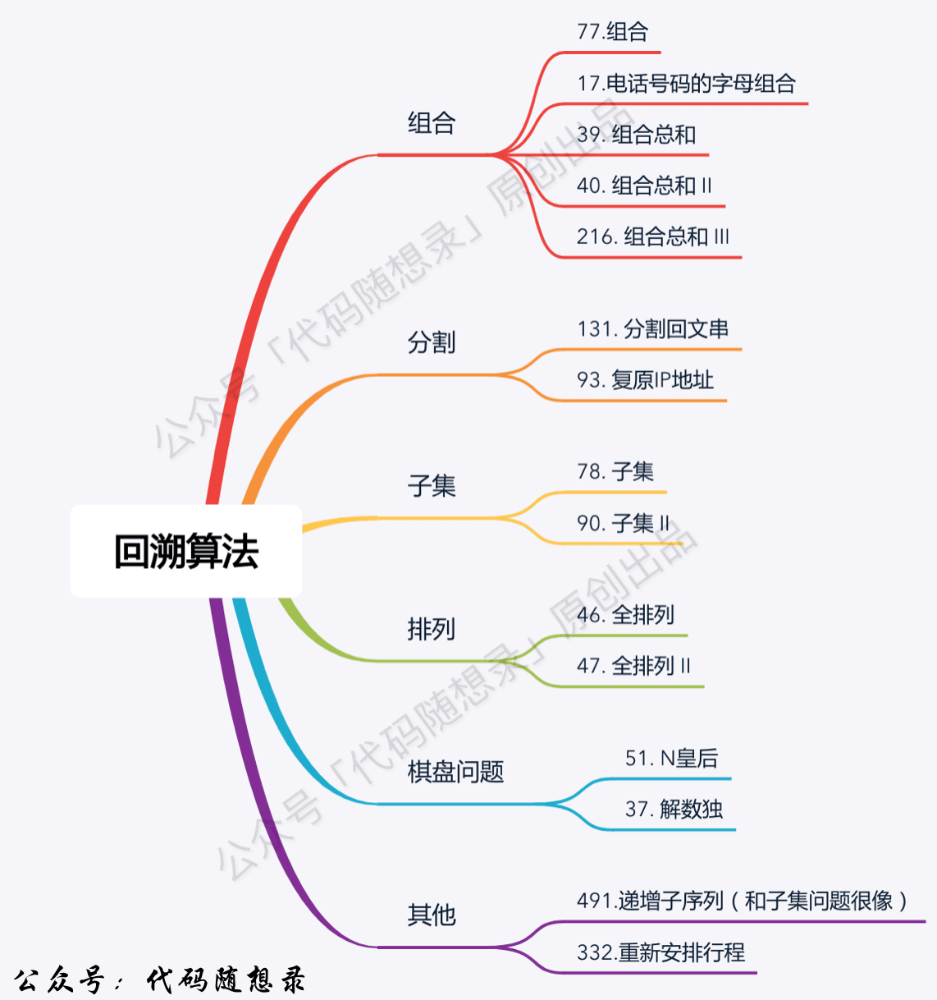
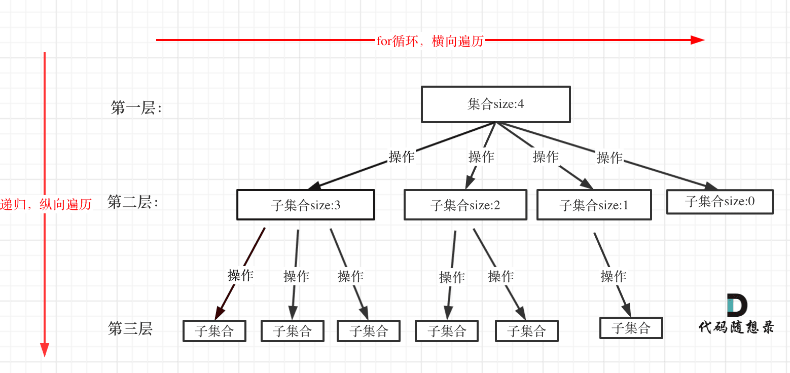

* [做專案（多個 C++、Java、Go、測試開發、前端（front end）專案）](https://www.programmercarl.com/other/kstar.html)
* [刷演算法（algorithm）（兩個月高強度學演算法）](https://www.programmercarl.com/xunlian/xunlianying.html)
* [背八股文（40 天挑戰高頻面試題）](https://www.programmercarl.com/xunlian/bagu.html)

# 回溯（backtracking）演算法（algorithm）理論基礎 

## 題目分類

 </img>

## 演算法公開課


**[《程式碼隨想錄》演算法影片公開課](https://programmercarl.com/other/gongkaike.html)：[帶你學透回溯演算法（理論篇）](https://www.bilibili.com/video/BV1cy4y167mM/)，相信結合影片再看本篇題解，更有助於大家對本題的理解。**

## 理論基礎

### 什麼是回溯法

回溯法也可以叫做回溯搜尋法，它是一種搜尋的方式。

在二元樹（binary tree）系列中，我們已經不止一次提到了回溯，例如[二元樹：以為使用了遞迴（recursion），其實還隱藏著回溯](https://programmercarl.com/二叉树中递归带着回溯.html)。

回溯是遞迴的副產品，只要有遞迴就會有回溯。

**所以以下講解中，回溯函式（function）也就是遞迴函數（recursive function），指的都是一個函式**。

### 回溯法的效率

回溯法的效能如何呢？這裡要和大家說清楚了，**雖然回溯法很難，很不好理解，但是回溯法並不是什麼高效的演算法**。

**因為回溯的本質是竭盡式搜尋（exhaustive search），窮舉所有可能，然後選出我們想要的答案**，如果想讓回溯法高效一些，可以加一些修剪法（pruning）的操作，但也改不了回溯法就是竭盡式搜尋的本質。

那麼既然回溯法並不高效，為什麼還要用它呢？

因為沒得選，一些問題能蠻力（brute force）搜出來就不錯了，撐死了再做一下修剪法，還沒有更高效的解法。

此時大家應該好奇了，都什麼問題，這麼厲害，只能暴力搜尋。

### 回溯法解決的問題

回溯法，一般可以解決如下幾種問題：

* 組合（combination）問題：N 個數裡面按一定規則找出 k 個數的集合（set）
* 切割問題：一個字串（string）按一定規則有幾種切割方式
* 子集（subset）問題：一個 N 個數的集合裡有多少符合條件（condition）的子集
* 排列（permutation）問題：N 個數按一定規則全排列，有幾種排列方式
* 棋盤問題：n 皇后（n queens），解 Sudoku 等等

**相信大家看著這些之後會發現，每個問題都不簡單！**


另外，會有一些同學可能分不清什麼是組合，什麼是排列？

**組合是不強調元素（element）順序的，排列是強調元素順序**。

例如：{1, 2} 和 {2, 1} 在組合上，就是一個集合，因為不強調順序，而要是排列的話，{1, 2} 和 {2, 1} 就是兩個集合了。

記住組合無序，排列有序（ordered），就可以了。

### 如何理解回溯法

**回溯法解決的問題都可以抽象為樹狀結構（tree structure）**，是的，我指的是所有回溯法的問題都可以抽象為樹狀結構！

因為回溯法解決的都是在集合中遞迴尋找子集，**集合的大小就構成了樹（tree）的寬度，遞迴的深度（depth）就構成了樹的深度**。

遞迴就要有終止條件（termination condition），所以必然是一棵高度（height）有限的樹（n 元樹（n-ary tree））。

這塊可能初學者還不太理解，後面的回溯演算法解決的所有題目中，我都會強調這一點並畫圖舉相應的例子，現在有一個印象就行。


### 回溯法模板

這裡給出 Carl 總結的回溯演算法模板（template）。

在講[二元樹的遞迴](https://programmercarl.com/二叉树的递归遍历.html)中我們說了遞迴三部曲，這裡我再給大家列出回溯三部曲。

* 回溯函式模板轉回值（return value）以及參數（parameter）

在回溯演算法中，我的習慣是函式起名字為 backtracking，這個起名大家隨意。

回溯演算法中函式轉回值一般為 void。

再來看一下參數，因為回溯演算法需要的參數可不像二元樹遞迴的時候那麼容易一次性確定下來，所以一般是先寫邏輯，然後需要什麼參數，就填什麼參數。

但後面的回溯題目的講解中，為了方便大家理解，我在一開始就幫大家把參數確定下來。

回溯函式 pseudocode 如下：

```
void backtracking(參數)
```

* 回溯函式終止條件

既然是樹狀結構，那麼我們在講解[二元樹的遞迴](https://programmercarl.com/二叉树的递归遍历.html)的時候，就知道遍歷（traversal）樹狀結構一定要有終止條件。

所以回溯也要有終止條件。

什麼時候達到了終止條件，樹中就可以看出，一般來說搜到葉節點（leaf node）了，也就找到了滿足條件的一條答案，把這個答案存放起來，並結束本層遞迴。

所以回溯函式終止條件 pseudocode 如下：
```
if (終止條件) {
    存放結果;
    return;
}
```

* 回溯搜尋的遍歷過程

在上面我們提到了，回溯法一般是在集合中遞迴搜尋，集合的大小構成了樹的寬度，遞迴的深度構成了樹的深度。

如圖：



注意圖中，我特意舉例集合大小和孩子的數量是相等的！

回溯函式遍歷過程 pseudocode 如下：
```
for (選擇：本層集合中元素（樹中節點孩子的數量就是集合的大小）) {
    處理節點;
    backtracking(路徑，選擇列表); // 遞迴
    回溯，撤銷處理結果
}
```


for 迴圈（for-loop）就是遍歷集合區間（interval），可以理解一個節點（node）有多少個孩子，這個 for 迴圈就執行多少次。

backtracking 這裡自己呼叫自己，實作遞迴。

大家可以從圖中看出**for 迴圈可以理解是橫向遍歷，backtracking（遞迴）就是縱向遍歷**，這樣就把這棵樹全遍歷完了，一般來說，搜尋葉節點就是找的其中一個結果了。

分析完過程，回溯演算法模板框架（framework）如下：

```
void backtracking(參數) {
    if (終止條件) {
        存放結果;
        return;
    }

    for (選擇：本層集合中元素（樹中節點孩子的數量就是集合的大小）) {
        處理節點;
        backtracking(路徑，選擇列表); // 遞迴
        回溯，撤銷處理結果
    }
}

```

**這份模板很重要，後面做回溯法的題目都靠它了！**

如果從來沒有學過回溯演算法的讀者／錄友們，看到這裡會有點懵，後面開始講解具體題目的時候就會好一些了，已經做過回溯法題目的讀者／錄友，看到這裡應該會感同身受了。

## 總結

本篇我們講解了，什麼是回溯演算法，知道了回溯和遞迴是相輔相成的。

接著提到了回溯法的效率，回溯法其實就是暴力搜尋，並不是什麼高效的演算法。

然後列出了回溯法可以解決幾類問題，可以看出每一類問題都不簡單。

最後我們講到回溯法解決的問題都可以抽象為樹狀結構（n 元樹），並給出了回溯法的模板。

今天是回溯演算法的第一天，按照慣例 Carl 都是先概述一波，然後再開始講解具體題目，沒有接觸過回溯法的同學剛學起來有點看不懂很正常，後面和具體題目結合起來會好一些。


