* [做專案（多個 C++、Java、Go、測試開發、前端（front end）專案）](https://www.programmercarl.com/other/kstar.html)
* [刷演算法（兩個月高強度學演算法）](https://www.programmercarl.com/xunlian/xunlianying.html)
* [背八股文（40 天挑戰高頻面試題）](https://www.programmercarl.com/xunlian/bagu.html)


> 20 張樹狀結構（tree structure）圖、14 道精選回溯（backtracking）題目，21 篇回溯法精講文章，由淺入深，一氣呵成，這是全網最強回溯演算法（backtracking algorithm）總結！

# 回溯總結篇

## 回溯法理論基礎

轉眼間[「程式碼隨想錄」](https://img-blog.csdnimg.cn/20200815195519696.png)裡已經分享連續講解了 21 天的回溯演算法，是時候做一個大總結了，本篇高能，需要花費很大的精力來看！

關於回溯演算法理論基礎，我錄了一期 B 站影片[帶你學透回溯演算法（理論篇）](https://www.bilibili.com/video/BV1cy4y167mM)如果對回溯演算法還不了解的話，可以看一下。

在[關於回溯演算法，你該了解這些！](https://programmercarl.com/回溯算法理论基础.html)中我們詳細的介紹了回溯演算法的理論知識，不同於教科書般的講解，這裡介紹的回溯法的效率，解決的問題以及模板（template）都是在刷題的過程中非常實用！

**回溯是遞迴（recursion）的副產品，只要有遞迴就會有回溯**，所以回溯法也經常和二元樹（binary tree）遍歷（traversal），深度優先搜尋（depth-first search, DFS）混在一起，因為這兩種方式都是用了遞迴。

回溯法就是暴力搜尋，並不是什麼高效的演算法，最多再做一下修剪法（pruning）。

回溯演算法能解決如下問題：

* 組合（combination）問題：N 個數裡面按一定規則找出 k 個數的集合（set）
* 排列（permutation）問題：N 個數按一定規則全排列，有幾種排列方式
* 切割問題：一個字串（string）按一定規則有幾種切割方式
* 子集（subset）問題：一個 N 個數的集合裡有多少符合條件（condition）的子集
* 棋盤問題：n 皇后（n queens），解 數獨（Sudoku） 等等

**我在回溯演算法系列講解中就按照這個順序給大家講解，可以說深入淺出，步步到位**。

回溯法確實不好理解，所以需要把回溯法抽象為一個圖形來理解就容易多了，**在後面的每一道回溯法的題目我都將遍歷過程抽象為樹狀結構方便大家的理解**。

在[關於回溯演算法，你該了解這些！](https://programmercarl.com/回溯算法理论基础.html)還用了回溯三部曲來分析回溯演算法，並給出了回溯法的模板：

```
void backtracking(參數) {
    if (終止條件) {
        存放結果;
        return;
    }

    for (選擇：本層集合中元素（樹中節點孩子的數量就是集合的大小）) {
        處理節點;
        backtracking(路徑，選擇列表); // 遞迴
        回溯，撤銷處理結果
    }
}
```

**事實證明這個模板會伴隨整個回溯法系列！**

## 組合問題

### 組合問題

在[回溯演算法：求組合問題！](https://programmercarl.com/0077.组合.html)中，我們開始用回溯法解決第一道題目：組合問題。

我在文中開始的時候給大家列舉（enumeration）k 層 for 迴圈（for-loop）例子，進而得出同樣是蠻力（brute force）解法，為什麼要用回溯法！

**此時大家應該深有體會回溯法的魅力，用遞迴控制 for 迴圈嵌套的數量！**

本題我把回溯問題抽象為樹狀結構，如題：

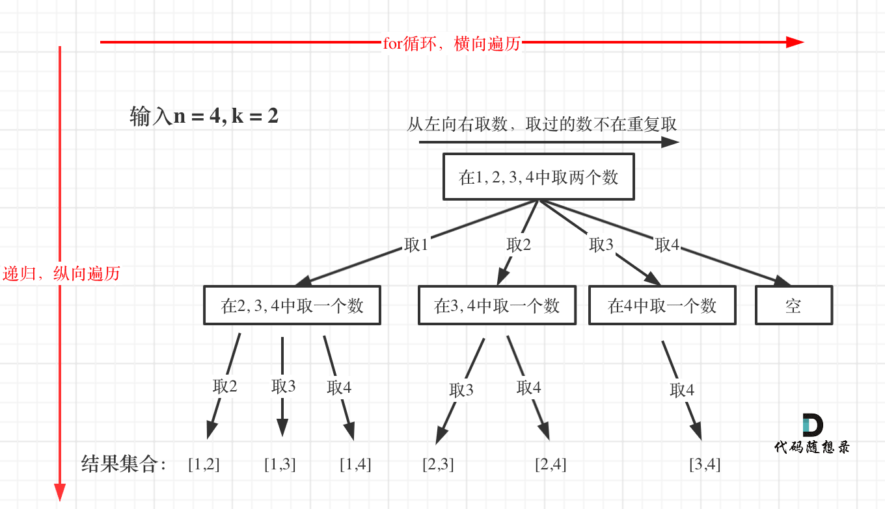

可以直觀的看出其搜尋的過程：**for 迴圈橫向遍歷，遞迴縱向遍歷，回溯不斷調整結果集（result set）**，這個理念貫穿整個回溯法系列，也是我做了很多回溯的題目，不斷摸索其規律才總結出來的。

對於回溯法的整體框架，網上搜的文章這塊都說不清楚，按照天上掉下來的程式碼對著講解，不知道究竟是怎麼來的，也不知道為什麼要這麼寫。

**所以，錄友們剛開始學回溯法，起跑姿勢就很標準了！**

最佳化回溯演算法只有修剪法一種方法，在[回溯演算法：組合問題再剪剪枝](https://programmercarl.com/0077.组合优化.html)中把回溯法程式碼做了修剪法最佳化，樹狀結構如圖：

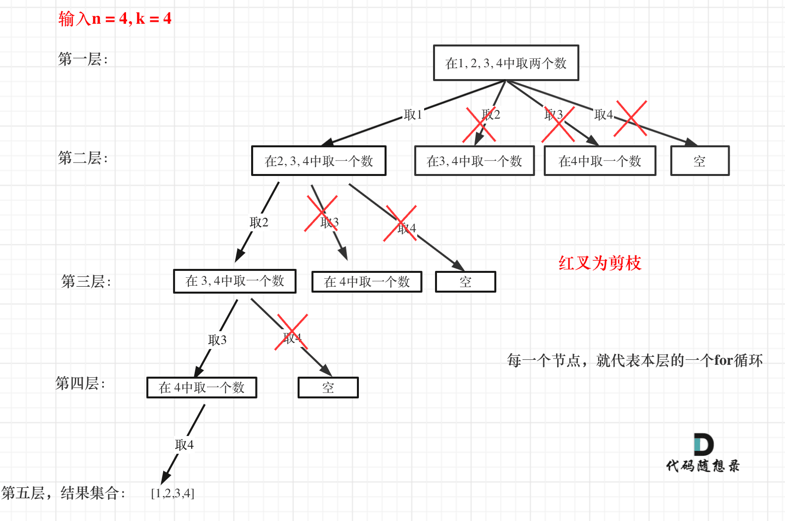

大家可以一目了然剪的究竟是哪裡。

**[回溯演算法：求組合問題！](https://programmercarl.com/0077.组合.html)修剪法精髓是：for 迴圈在尋找起點的時候要有一個範圍，如果這個起點到集合終止之間的元素（element）已經不夠題目要求的 k 個元素了，就沒有必要搜尋了**。

**在 for 迴圈上做修剪法操作是回溯法修剪法的常見固定做法！** 後面的題目還會經常用到。


### 組合總和

#### 組合總和（一）

在[回溯演算法：求組合總和！](https://programmercarl.com/0216.组合总和III.html)中，相當於 [回溯演算法：求組合問題！](https://programmercarl.com/0077.组合.html)加了一個元素總和的限制。

樹狀結構如圖：
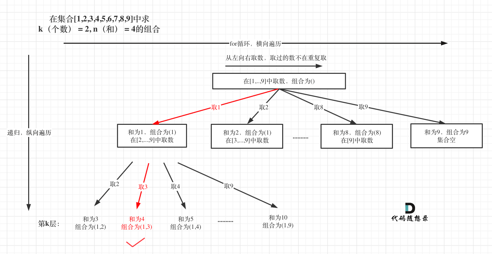

整體解題思路還是一樣的，本題的修剪法會好想一些，即：**已選元素總和如果已經大於 n（題中要求的和）了，那麼往後遍歷就沒有意義了，直接剪掉**，如圖：

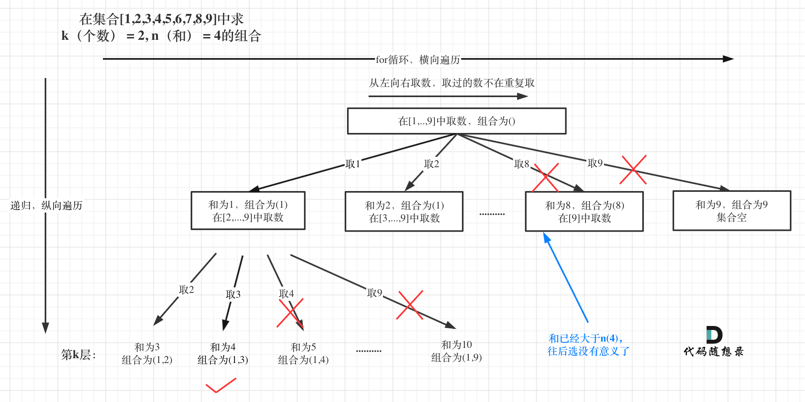

在本題中，依然還可以有一個修剪法，就是[回溯演算法：組合問題再剪剪枝](https://programmercarl.com/0077.组合优化.html)中提到的，對 for 迴圈選擇的起始範圍的修剪法。

所以修剪法的程式碼可以在 for 迴圈加上 `i <= 9 - (k - path.size()) + 1` 的限制！

#### 組合總和（二）

在[回溯演算法：求組合總和（二）](https://programmercarl.com/0039.组合总和.html)中講解的組合總和問題，和[回溯演算法：求組合問題！](https://programmercarl.com/0077.组合.html)，[回溯演算法：求組合總和！](https://programmercarl.com/0216.组合总和III.html)的區別是：本題沒有數量要求，可以無限重複（duplicate），但是有總和的限制，所以間接的也是有個數的限制。

不少同學都是看到可以重複選擇，就義無反顧的把 startIndex 去掉了。

**本題還需要 startIndex 來控制 for 迴圈的起始位置，對於組合問題，什麼時候需要 startIndex 呢？**

我舉過例子，如果是一個集合來求組合的話，就需要 startIndex，例如：[回溯演算法：求組合問題！](https://programmercarl.com/0077.组合.html)，[回溯演算法：求組合總和！](https://programmercarl.com/0216.组合总和III.html)。

如果是多個集合取組合，各個集合之間相互不影響，那麼就不用 startIndex，例如：[回溯演算法：電話號碼的字母組合](https://programmercarl.com/0017.电话号码的字母组合.html)

**注意以上我只是說求組合的情況，如果是排列問題，又是另一套分析的固定做法**。

樹狀結構如下：
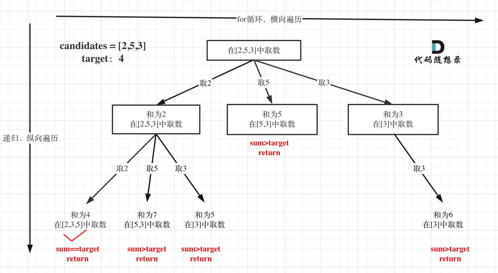


最後還給出了本題的修剪法最佳化，如下：

```cpp
for (int i = startIndex; i < candidates.size() && sum + candidates[i] <= target; i++)
```

最佳化後樹狀結構如下：

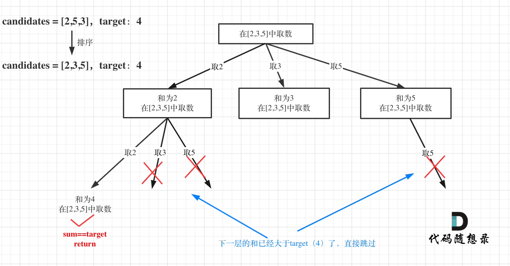


#### 組合總和（三）

在[回溯演算法：求組合總和（三）](https://programmercarl.com/0040.组合总和II.html)中集合元素會有重複，但要求解集不能包含重複的組合。

**所以難就難在 去重（deduplication） 問題上了**。

這個 去重 問題，相信做過的錄友都知道有多麼的晦澀難懂。網上的題解一般就說「去掉重複」，但說不清怎麼個 去重，程式碼一甩就完事了。

為了解說這個 去重 問題，**Carl 自創了兩個詞彙，「樹枝 去重」和「樹層 去重」**。

都知道組合問題可以抽象為樹狀結構，那麼「使用過」在這個樹狀結構上是有兩個維度的，一個維度是同一樹枝上「使用過」，一個維度是同一樹層上「使用過」。**沒有理解這兩個層面上的「使用過」 是造成大家沒有徹底理解 去重 的根本原因**。

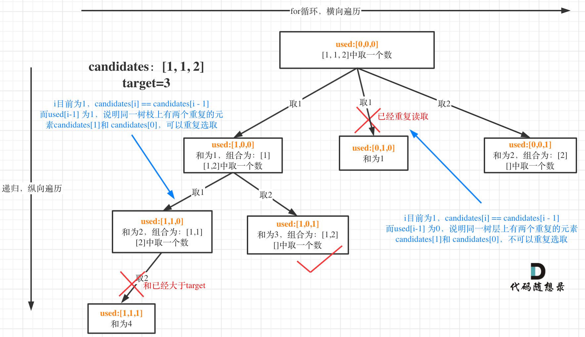

我在圖中將 used 的變化用橘黃色標註上，**可以看出在 candidates[i] == candidates[i - 1] 相同的情況下：**

* used[i - 1] == true，說明同一樹枝 candidates[i - 1] 使用過
* used[i - 1] == false，說明同一樹層 candidates[i - 1] 使用過

**這塊 去重 的邏輯很抽象，網上搜的題解基本沒有能講清楚的，如果大家之前思考過這個問題或者刷過這道題目，看到這裡一定會感覺通透了很多！**

對於 去重，其實排列和子集問題也是一樣的道理。

### 多個集合求組合

在[回溯演算法：電話號碼的字母組合](https://programmercarl.com/0017.电话号码的字母组合.html)中，開始用多個集合來求組合，還是熟悉的模板題目，但是有一些細節。

例如這裡 for 迴圈，可不像是在 [回溯演算法：求組合問題！](https://programmercarl.com/0077.组合.html)和[回溯演算法：求組合總和！](https://programmercarl.com/0216.组合总和III.html)中從 startIndex 開始遍歷的。

**因為本題每一個數字代表的是不同集合，也就是求不同集合之間的組合，而[回溯演算法：求組合問題！](https://programmercarl.com/0077.组合.html)和[回溯演算法：求組合總和！](https://programmercarl.com/0216.组合总和III.html)都是求同一個集合中的組合！**

樹狀結構如下：

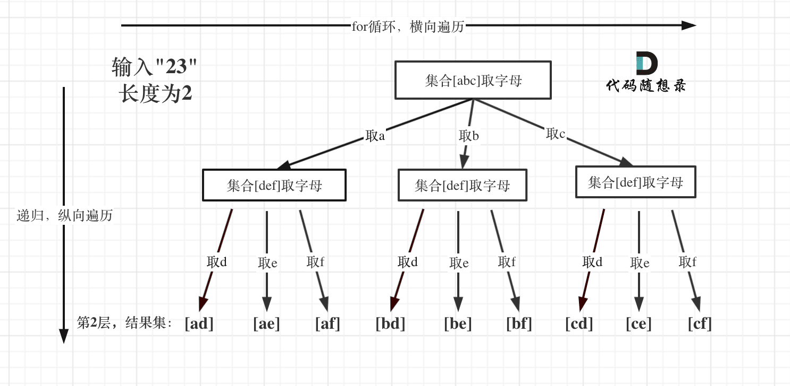

如果大家在現場面試的時候，一定要注意各種輸入異常（exception）的情況，例如本題輸入 1 * # 按鍵。

其實本題不算難，但也處處是細節，還是要反覆琢磨。

## 切割問題

在[回溯演算法：分割回文串](https://programmercarl.com/0131.分割回文串.html)中，我們開始講解切割問題，雖然最後程式碼看起來好像是一道模板題，但是從分析到學會套用這個模板，是比較難的。

我列出如下幾個難點：

* 切割問題其實類似組合問題
* 如何模擬（simulation）那些切割線
* 切割問題中遞迴如何終止
* 在遞迴迴圈中如何截取子字串（substring）
* 如何判斷回文（palindrome）

如果想到**用求解組合問題的解題思路來解決切割問題，本題就成功一大半了**，接下來就可以對著模板照葫蘆畫瓢。

**但後續如何模擬切割線，如何終止，如何截取子字串，其實都不好想，最後判斷回文算是最簡單的了**。

所以本題應該是一道 hard 題目了。

除了這些難點，**本題還有細節，例如：切割過的地方不能重複切割所以遞迴函數（recursive function）需要傳入 i + 1**。

樹狀結構如下：

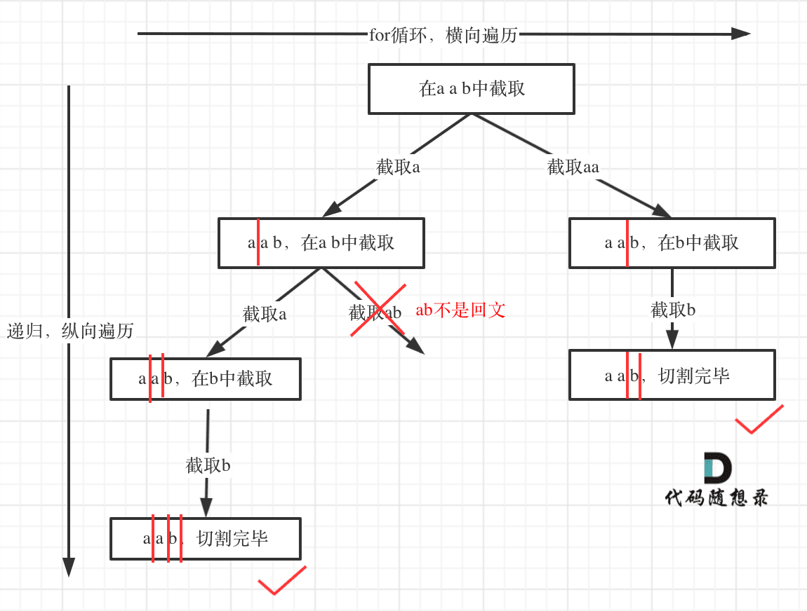


## 子集問題

### 子集問題（一）

在[回溯演算法：求子集問題！](https://programmercarl.com/0078.子集.html)中講解了子集問題，**在樹狀結構中子集問題是要收集所有節點（node）的結果，而組合問題是收集葉節點（leaf node）的結果**。

如圖：

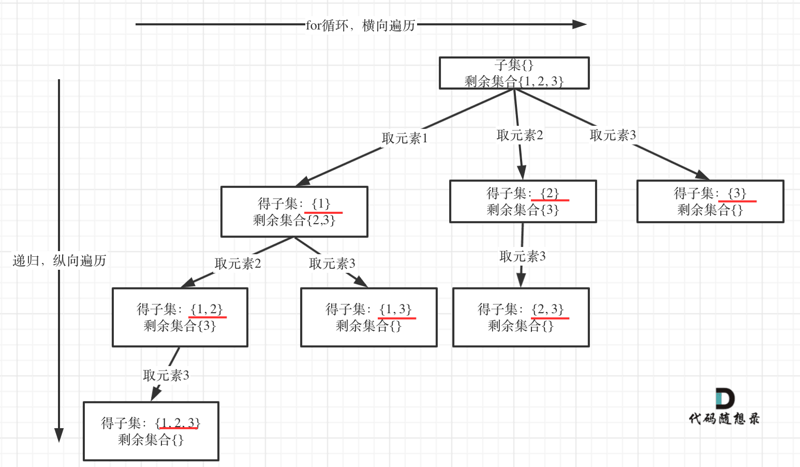

認清這個本質之後，今天的題目就是一道模板題了。

**本題其實可以不需要加終止條件（termination condition）**，因為 startIndex >= nums.size()，本層 for 迴圈本來也結束了，本來我們就要遍歷整棵樹（tree）。

有的同學可能擔心不寫終止條件會不會無限遞迴（infinite recursion）？

並不會，因為每次遞迴的下一層就是從 i+1 開始的。

如果要寫終止條件，注意：`result.push_back(path);` 要放在終止條件的上面，如下：

```
result.push_back(path); // 收集子集，要放在終止條件的上面，否則會漏掉結果
if (startIndex >= nums.size()) { // 終止條件可以不加
    return;
}
```

### 子集問題（二）

在[回溯演算法：求子集問題（二）](https://programmercarl.com/0090.子集II.html)中，開始針對子集問題進行 去重。

本題就是[回溯演算法：求子集問題！](https://programmercarl.com/0078.子集.html)的基礎上加上了 去重，去重 我們在[回溯演算法：求組合總和（三）](https://programmercarl.com/0040.组合总和II.html)也講過了，一樣的固定做法。

樹狀結構如下：

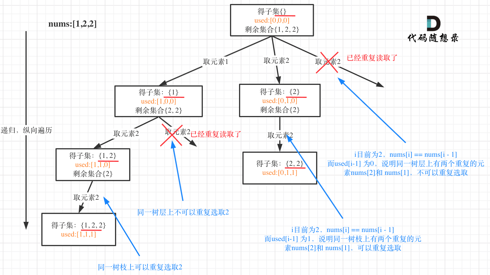

### 遞增次序列（subsequence）

在[回溯演算法：遞增次序列](https://programmercarl.com/0491.递增子序列.html)中，處處都能看到子集的身影，但處處是陷阱，值得好好琢磨琢磨！

樹狀結構如下：
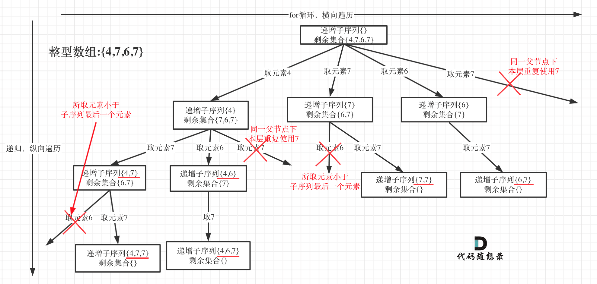


很多同學都會把這道題目和[回溯演算法：求子集問題（二）](https://programmercarl.com/0090.子集II.html)混在一起。

**[回溯演算法：求子集問題（二）](https://programmercarl.com/0090.子集II.html)也可以使用 set 針對同一父節點（father node）本層 去重，但子集問題一定要排序（sorting），為什麼呢？**

我用沒有排序的集合 {2,1,2,2} 來舉個例子畫一個圖，如下：

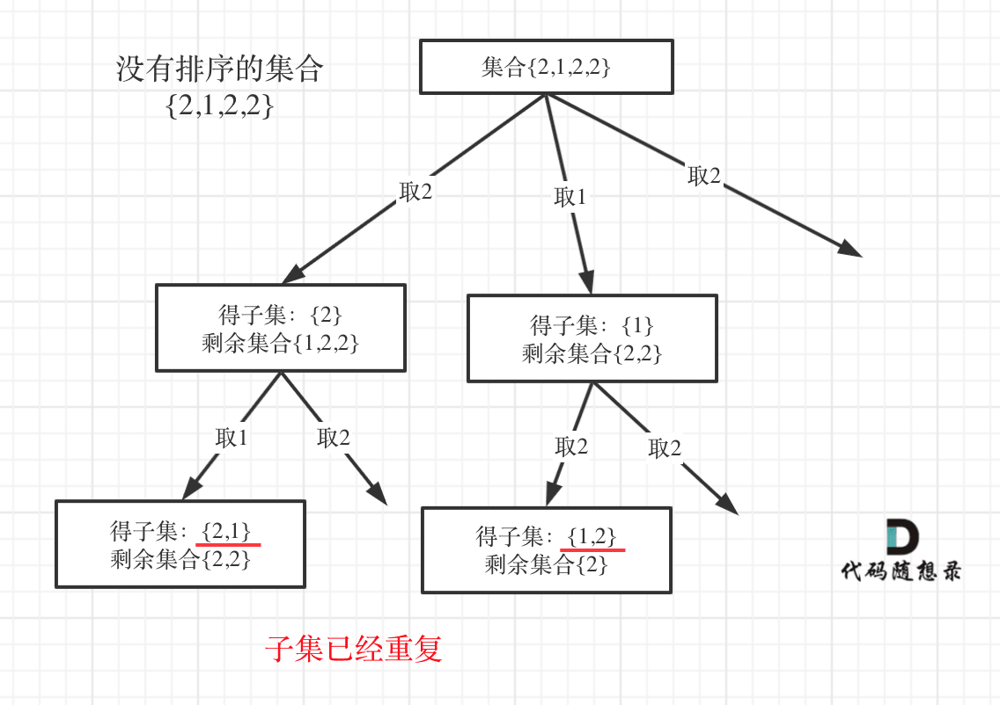

**相信這個圖勝過千言萬語的解釋了**。

## 排列問題

### 排列問題（一）

[回溯演算法：排列問題！](https://programmercarl.com/0046.全排列.html) 又不一樣了。

排列是有序（ordered）的，也就是說 [1,2] 和 [2,1] 是兩個集合，這和之前分析的子集以及組合所不同的地方。

可以看出元素 1 在 [1,2] 中已經使用過了，但是在 [2,1] 中還要再使用一次 1，所以處理排列問題就不用使用 startIndex 了。

如圖：

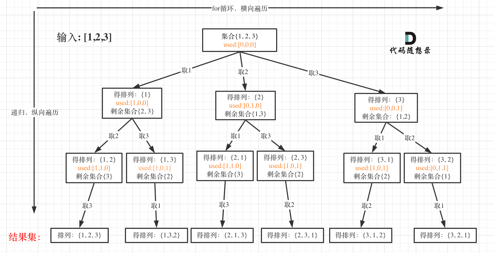

**大家此時可以感受出排列問題的不同：**

* 每層都是從 0 開始搜尋而不是 startIndex
* 需要 used 陣列（array）記錄 path 裡都放了哪些元素了

### 排列問題（二）

排列問題也要 去重 了，在[回溯演算法：排列問題（二）](https://programmercarl.com/0047.全排列II.html)中又一次強調了「樹層 去重」和「樹枝 去重」。

樹狀結構如下：

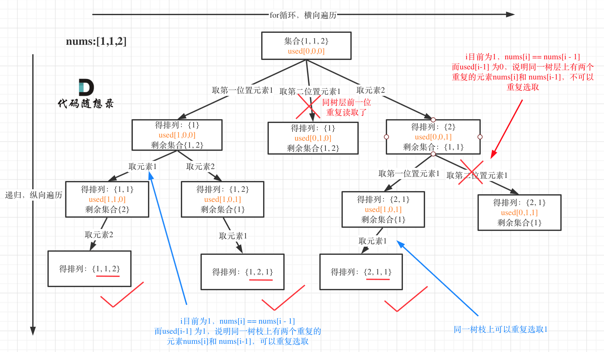

**這道題目神奇的地方就是 used[i - 1] == false 也可以，used[i - 1] == true 也可以！**

我就用輸入: [1,1,1] 來舉一個例子。

樹層上 去重（used[i - 1] == false）的樹狀結構如下：

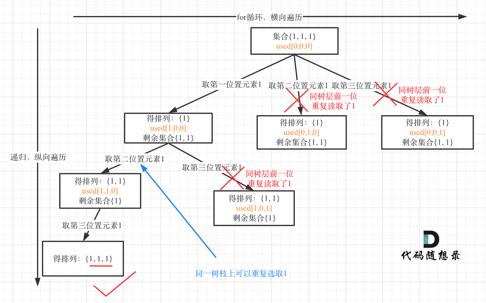

樹枝上 去重（used[i - 1] == true）的樹狀結構如下：

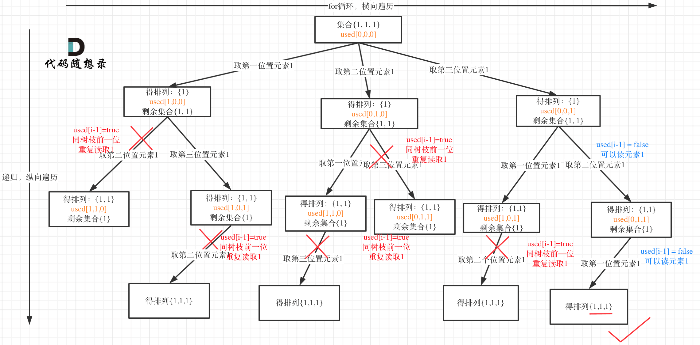

**可以清晰的看到使用 (used[i - 1] == false)，即樹層 去重，效率更高！**

本題 used 陣列既是記錄 path 裡都放了哪些元素，同時也用來 去重，一舉兩得。

## 去重 問題

以上我都是統一使用 used 陣列來 去重 的，其實使用 set 也可以用來 去重！

在[本週小結！（回溯演算法系列三）續集](https://programmercarl.com/回溯算法去重问题的另一种写法.html)中給出了子集、組合、排列問題使用 set 來 去重 的解法以及具體程式碼，並糾正一些同學的常見錯誤寫法。

同時詳細分析了使用 used 陣列 去重 和使用 集合去重（set 去重） 兩種寫法的效能差異：

**使用 集合去重 的版本相對於 used 陣列的版本效率都要低很多**，大家在 LeetCode 上提交，能明顯發現。

原因在[回溯演算法：遞增次序列](https://programmercarl.com/0491.递增子序列.html)中也分析過，主要是因為程式執行的時候對 unordered_set 頻繁的 insert，unordered_set 需要做雜湊（hash）映射（map / mapping）（也就是把 key 透過 hash function 映射為唯一的雜湊值）相對費時間，而且 insert 的時候其底層的符號表（symbol table）也要做相應的擴充，也是費時的。

**而使用 used 陣列在時間複雜度（time complexity）上幾乎沒有額外負擔！**

**使用 集合去重，不僅時間複雜度高了，空間複雜度（space complexity）也高了**，在[本週小結！（回溯演算法系列三）](https://programmercarl.com/周总结/20201112回溯周末总结.html)中分析過，組合，子集，排列問題的空間複雜度都是 O(n)，但如果使用 集合去重，空間複雜度就變成了 O(n^2)，因為每一層遞迴都有一個 set 集合，系統堆疊空間（stack space）是 n，每一個空間都有 set 集合。

那有同學可能疑惑 用 used 陣列也是佔用 O(n) 的空間啊？

used 陣列可是全域變數（global variable），每層與每層之間共用一個 used 陣列，所以空間複雜度是 O(n + n)，最終空間複雜度還是 O(n)。

## 重新安排行程（圖論（graph theory）額外拓展）

之前說過，有遞迴的地方就有回溯，DFS也是用遞迴來實作的，所以往往伴隨著回溯。

在[回溯演算法：重新安排行程](https://programmercarl.com/0332.重新安排行程.html)其實也算是圖論裡深搜的題目，但是我用回溯法的固定做法來講解這道題目，算是給大家拓展一下想法，原來回溯法還可以這麼玩！

以輸入：[["JFK", "KUL"], ["JFK", "NRT"], ["NRT", "JFK"]為例，抽象為樹狀結構如下：

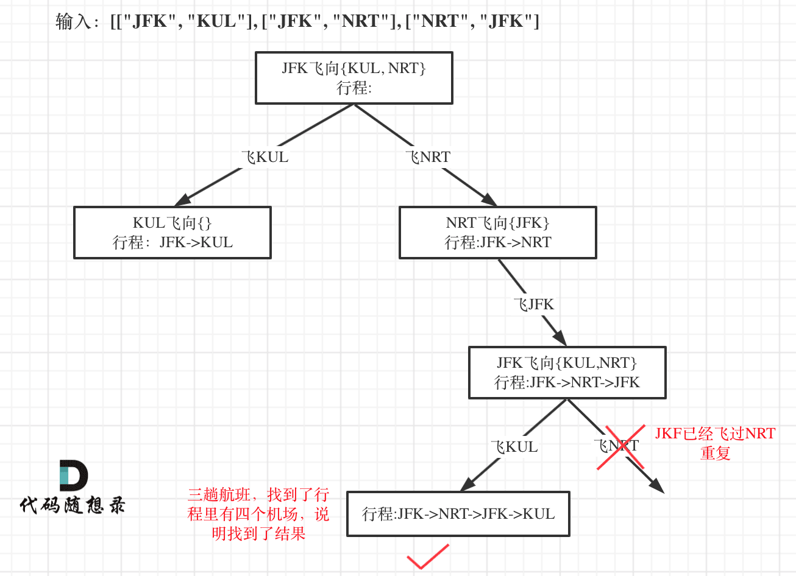

本題可以算是一道 hard 的題目了，關於本題的難點我在文中已經詳細列出。

**如果單純的回溯搜尋（深搜）並不難，難還難在容器（container）的選擇和使用上！**

本題其實是一道DFS的題目，但是我完全使用回溯法的想法來講解這道題目，**算是給大家拓展一下思維方式，其實深搜和回溯也是分不開的，畢竟最終都是用遞迴**。


## 棋盤問題

### n 皇后問題

在[回溯演算法：N 皇后問題](https://programmercarl.com/0051.N皇后.html)中終於迎來了傳說中的 n 皇后。

下面我用一個 3 * 3 的棋盤，將搜尋過程抽象為一棵樹，如圖：

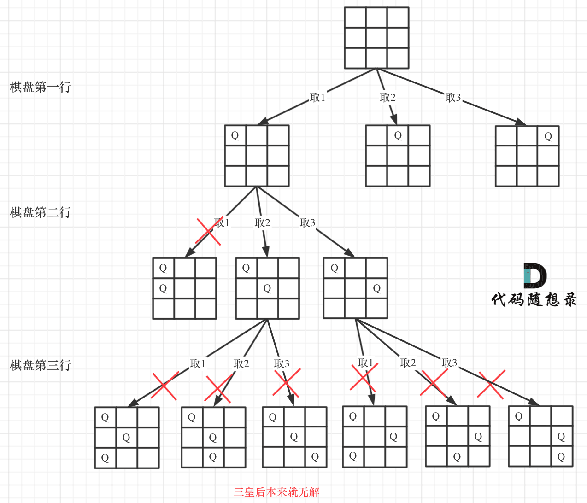

從圖中可以看出，二維（two-dimensional）矩陣（matrix）中矩陣的高度（height）就是這棵樹的高度，矩陣的寬度就是樹狀結構中每一個節點的寬度。

那麼我們用皇后們的約束條件，來回溯搜尋這棵樹，**只要搜尋到了樹的葉節點，說明就找到了皇后們的合理位置了**。

如果從來沒有接觸過 n 皇后問題的同學看著這樣的題會感覺無從下手，可能知道要用回溯法，但也不知道該怎麼去搜。

**這裡我明確給出了棋盤的寬度就是 for 迴圈的長度，遞迴的深度（depth）就是棋盤的高度，這樣就可以套進回溯法的模板裡了**。

相信看完本篇[回溯演算法：N 皇后問題](https://programmercarl.com/0051.N皇后.html)也沒那麼難了，傳說已經不是傳說了。


### 解 數獨 問題

在[回溯演算法：解數獨](https://programmercarl.com/0037.解数独.html)中要征服回溯法的最後一道山峰。

解 數獨 應該是棋盤很難的題目了，比 n 皇后還要複雜一些，但只要理解「二維遞迴」這個過程，其實發現就沒那麼難了。

大家已經跟著「程式碼隨想錄」刷過了如下回溯法題目，例如：[77.組合（組合問題）](https://programmercarl.com/0077.组合.html)，[131.分割回文串（分割問題）](https://programmercarl.com/0131.分割回文串.html)，[78.子集（子集問題）](https://programmercarl.com/0078.子集.html)，[46.全排列（排列問題）](https://programmercarl.com/0046.全排列.html)，以及[51.N 皇后（n 皇后問題）](https://programmercarl.com/0051.N皇后.html)，其實這些題目都是一維遞迴。

其中[n 皇后問題](https://programmercarl.com/0051.N皇后.html)是因為每一列（row）每一行（column）只放一個皇后，只需要一層 for 迴圈遍歷一列，遞迴來遍歷行，然後一列一行確定皇后的唯一位置。

本題就不一樣了，**本題中棋盤的每一個位置都要放一個數字，並檢查數字是否合法，解 數獨 的樹狀結構要比 n 皇后更寬更深**。

因為這個樹狀結構太大了，我抽取一部分，如圖所示：

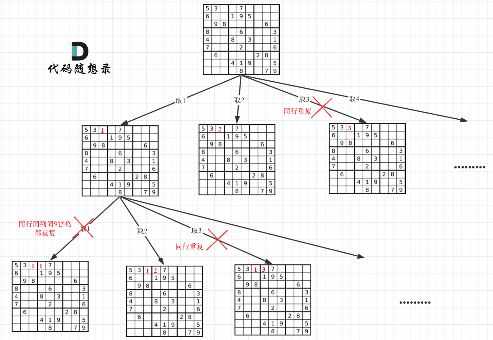

解 數獨 可以說是非常難的題目了，如果還一直停留在一維遞迴的邏輯中，這道題目可以讓大家瞬間崩潰。

**所以我在[回溯演算法：解數獨](https://programmercarl.com/0037.解数独.html)中開篇就提到了二維遞迴，這也是我自創詞彙**，希望可以幫助大家理解解 數獨 的搜尋過程。

一波分析之後，再看程式碼會發現其實也不難，唯一難點就是理解**二維遞迴**的思維邏輯。

**這樣，解 數獨 這麼難的問題也被我們攻克了**。

## 效能分析

**關於回溯演算法的複雜度分析在網上的資料魚龍混雜，一些所謂的經典面試書籍不講回溯演算法，演算法書籍對這塊也避而不談，感覺就像是演算法裡模糊的邊界（boundary）**。

**所以這塊就說一說我個人理解，對內容持開放態度，集思廣益，歡迎大家來討論！**

以下在計算空間複雜度的時候我都把系統堆疊（stack）（不是資料結構裡的堆疊）所佔空間算進去。

子集問題分析：

* 時間複雜度：O(2^n)，因為每一個元素的狀態（state）無外乎取與不取，所以時間複雜度為 O(2^n)
* 空間複雜度：O(n)，遞迴深度為 n，所以系統堆疊所用空間為 O(n)，每一層遞迴所用的空間都是常數（constant）級別，注意程式碼裡的 result 和 path 都是全域變數，就算是放在參數（parameter）裡，傳的也是參考（reference），並不會新申請記憶體（memory）空間，最終空間複雜度為 O(n)

排列問題分析：

* 時間複雜度：O(n!)，這個可以從排列的樹狀圖中很明顯發現，每一層節點為 n，第二層每一個分支（branch）都延伸了 n-1 個分支，再往下又是 n-2 個分支，所以一直到葉節點一共就是 n * n-1 * n-2 * ..... 1 = n!。
* 空間複雜度：O(n)，和子集問題同理。

組合問題分析：

* 時間複雜度：O(2^n)，組合問題其實就是一種子集的問題，所以組合問題最壞的情況，也不會超過子集問題的時間複雜度。
* 空間複雜度：O(n)，和子集問題同理。

n 皇后問題分析：

* 時間複雜度：O(n!)，其實如果看樹狀圖的話，直覺上是 O(n^n)，但皇后之間不能見面所以在搜尋的過程中是有修剪法的，最差也就是 O(n!)，n! 表示 n * (n-1) * .... * 1。
* 空間複雜度：O(n)，和子集問題同理。

解 數獨 問題分析：

* 時間複雜度：O(9^m)，m 是 '.' 的數目。
* 空間複雜度：O(n^2)，遞迴的深度是 n^2


**一般說到回溯演算法的複雜度，都說是指數（exponential）級別的時間複雜度，這也算是一個概括吧！**


## 總結

**[「程式碼隨想錄」](https://img-blog.csdnimg.cn/20200815195519696.png)歷時 21 天，14 道經典題目分析，20 張樹狀圖，21 篇回溯法精講文章，從組合到切割，從子集到排列，從棋盤問題到最後的複雜度分析**，至此收尾了。

這裡的每一種問題，講解的時候我都會和其他問題作對比，做分析，確保每一個問題都講得通透。

可以說方方面面都詳細介紹到了。

例如：

* 如何理解回溯法的搜尋過程？
* 什麼時候用 startIndex，什麼時候不用？
* 如何 去重？如何理解「樹枝 去重」與「樹層 去重」？
* 去重 的幾種方法？
* 如何理解二維遞迴？

**這裡的每一個問題，網上幾乎找不到能講清楚的文章，這也是直擊回溯演算法本質的問題**。

相信一路堅持下來的讀者／錄友們，對回溯演算法已經都有深刻的認識。

此時回溯演算法系列就要正式告一段落了。

**讀者／錄友們可以回顧一下這 21 天，每天的打卡，每天在交流群裡和大家探討程式碼，最終換來的都是不知不覺的成長**。

同樣也感謝讀者／錄友們的堅持，這也是我持續寫作的動力，**正是因為大家的積極參與，我才知道這件事情是非常有意義的**。

回溯專題匯聚為一張圖：

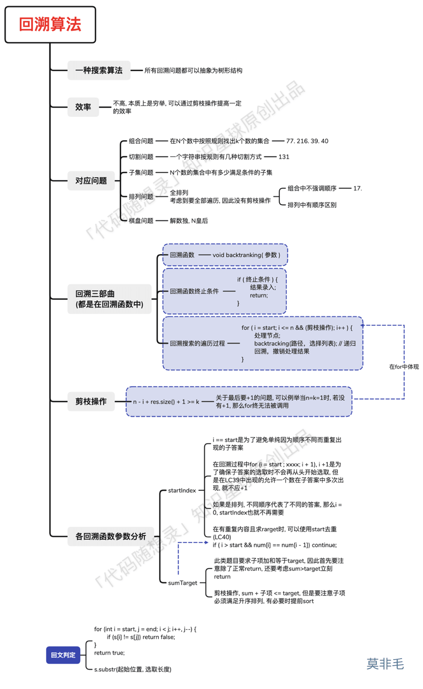

這個圖是 [程式碼隨想錄知識星球](https://programmercarl.com/other/kstar.html) 成員：[莫非毛](https://wx.zsxq.com/dweb2/index/footprint/828844212542)，所畫，總結的非常好，分享給大家。

**回溯演算法系列正式結束，新的系列終將開始，讀者／錄友們準備開啟新的征程！**


