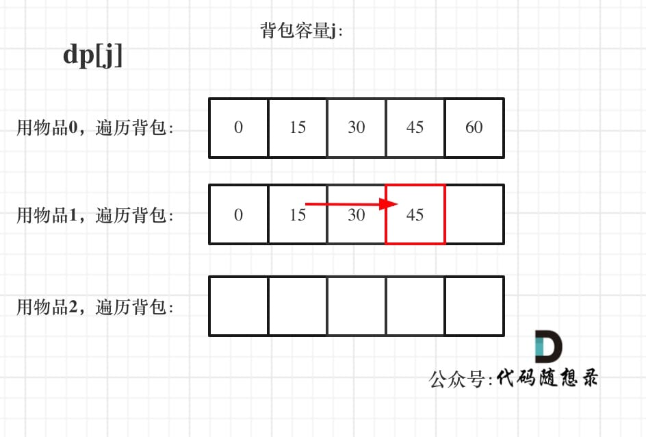
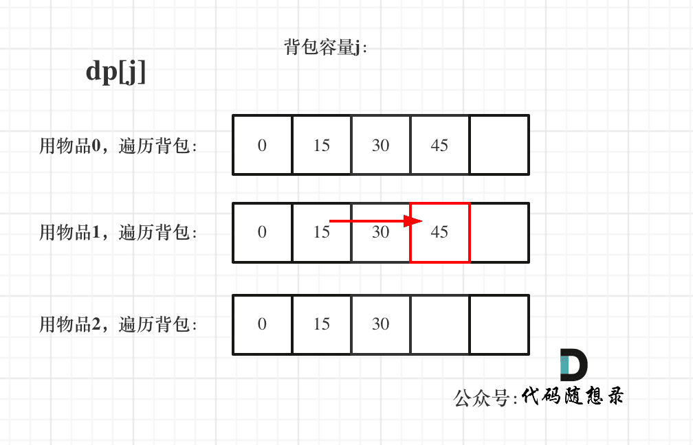

* [做專案（多個 C++、Java、Go、測試開發、前端（front end）專案）](https://www.programmercarl.com/other/kstar.html)
* [刷演算法（兩個月高強度學演算法）](https://www.programmercarl.com/xunlian/xunlianying.html)
* [背八股文（40 天挑戰高頻面試題）](https://www.programmercarl.com/xunlian/bagu.html)

# 無界背包問題（unbounded knapsack problem）- 一維陣列（one dimensional array）

本題 LeetCode 上沒有原題，大家可以去[KamaCoder 第 52 題](https://kamacoder.com/problempage.php?pid=1052)練習。

## 演算法公開課

**[《程式碼隨想錄》演算法影片公開課](https://programmercarl.com/other/gongkaike.html)：[帶你學透無界背包問題！](https://www.bilibili.com/video/BV1uK411o7c9/)，相信結合影片再看本篇題解，更有助於大家對本題的理解**。


## 解題思路

本篇我們不再做五部曲分析，核心內容在 0/1 背包問題（0/1 knapsack problem）二維（two-dimensional）、0/1 背包一維和無界背包二維的講解中都講過了。

上一篇我們剛剛講了無界背包二維 DP 陣列（array）的寫法：

```CPP 
for (int i = 1; i < n; i++) { // 遍歷物品
    for(int j = 0; j <= bagWeight; j++) { // 遍歷背包容量
        if (j < weight[i]) dp[i][j] = dp[i - 1][j];
        else dp[i][j] = max(dp[i - 1][j], dp[i][j - weight[i]] + value[i]);
    }
}
```  

壓縮成一維 DP 陣列，也就是將上一層複製到當前層。

將上一層 dp[i-1] 的那一層複製到當前層 dp[i]，那麼遞迴公式（recurrence formula）由：`dp[i][j] = max(dp[i - 1][j], dp[i][j - weight[i]] + value[i])` 變成：`dp[i][j] = max(dp[i][j], dp[i][j - weight[i]] + value[i])`

這裡有讀者／錄友想，這樣複製的話，dp[i - 1][j] 的數值會不會覆蓋了 dp[i][j] 的數值呢？

並不會，因為當前層 dp[i][j] 是空的，是沒有計算過的。

變成 `dp[i][j] = max(dp[i][j], dp[i][j - weight[i]] + value[i])` 我們壓縮成一維 dp 陣列，去掉 i 層數維度。

即：`dp[j] = max(dp[j], dp[j - weight[i]] + value[i])`


接下來我們重點講一下遍歷（traversal）順序。

看過這兩篇的話：

* [0/1 背包理論基礎（二維陣列）](https://programmercarl.com/背包理论基础01背包-1.html)
* [0/1 背包理論基礎（一維陣列）](https://programmercarl.com/背包理论基础01背包-2.html)

就知道了，0/1 背包中二維 dp 陣列的兩個 for 迴圈（for-loop）遍歷的先後順序是可以顛倒的，一維 dp 陣列的兩個 for 迴圈先後順序一定是先遍歷物品，再遍歷背包容量。

**在無界背包中，對於一維 dp 陣列來說，其實兩個 for 迴圈巢狀順序是無所謂的**！

因為 dp[j] 是根據下標（subscript）j 之前所對應的 dp[j] 計算出來的。只要保證下標 j 之前的 dp[j] 都是經過計算的就可以了。

遍歷物品在外層迴圈，遍歷背包容量在內層迴圈，狀態（state）如圖：



遍歷背包容量在外層迴圈，遍歷物品在內層迴圈，狀態如圖：



看了這兩個圖，大家就會理解，無界背包中，兩個 for 迴圈的先後順序，都不影響計算 dp[j] 所需要的值（這個值就是下標 j 之前所對應的 dp[j]）。

先遍歷背包再遍歷物品，程式碼如下：

```CPP
for(int j = 0; j <= bagWeight; j++) { // 遍歷背包容量
    for(int i = 0; i < weight.size(); i++) { // 遍歷物品
        if (j - weight[i] >= 0) dp[j] = max(dp[j], dp[j - weight[i]] + value[i]);
    }
    cout << endl;
}
```

先遍歷物品再遍歷背包：

```CPP 
for(int i = 0; i < weight.size(); i++) { // 遍歷物品
    for(int j = 0; j <= bagWeight; j++) { // 遍歷背包容量
        if (j - weight[i] >= 0) dp[j] = max(dp[j], dp[j - weight[i]] + value[i]);
    }
}
```

整體程式碼如下：

```cpp
#include <iostream>
#include <vector>
using namespace std;

int main() {
    int N, bagWeight;
    cin >> N >> bagWeight;
    vector<int> weight(N, 0);
    vector<int> value(N, 0);
    for (int i = 0; i < N; i++) {
        int w;
        int v;
        cin >> w >> v;
        weight[i] = w;
        value[i] = v;
    }

    vector<int> dp(bagWeight + 1, 0);
    for(int j = 0; j <= bagWeight; j++) { // 遍歷背包容量
        for(int i = 0; i < weight.size(); i++) { // 遍歷物品
            if (j - weight[i] >= 0) dp[j] = max(dp[j], dp[j - weight[i]] + value[i]);
        }
    }
    cout << dp[bagWeight] << endl;

    return 0;
}
```


## 總結

細心的同學可能發現，**全文我說的都是對於純無界背包問題，其 for 迴圈的先後順序是可以顛倒的！**

但如果題目稍稍有點變化，就會體現在遍歷順序上。

如果問裝滿背包有幾種方式的話？那麼兩個 for 迴圈的先後順序就有很大區別了，而 LeetCode 上的題目都是這種稍有變化的類型。

這個區別，我將在後面講解具體 LeetCode 題目中給大家介紹，因為這塊如果不結合具體題目，單純地介紹原理估計很多同學會越看越懵！

別急，下一篇就是了！

最後，**又可以出一道面試題了，就是純無界背包，要求先用二維 dp 陣列實作，然後再用一維 dp 陣列實作，最後再問，兩個 for 迴圈的先後是否可以顛倒？為什麼？**

這個簡單的無界背包問題，估計就可以難住不少候選人了。


## 其他語言版本

### Java：

```java
import java.util.Scanner;

public class Main {
    public static void main(String[] args) {
        Scanner scanner = new Scanner(System.in);
        int N = scanner.nextInt();
        int bagWeight = scanner.nextInt();

        int[] weight = new int[N];
        int[] value = new int[N];
        for (int i = 0; i < N; i++) {
            weight[i] = scanner.nextInt();
            value[i] = scanner.nextInt();
        }

        int[] dp = new int[bagWeight + 1];

        for (int j = 0; j <= bagWeight; j++) { // 遍歷背包容量
            for (int i = 0; i < weight.length; i++) { // 遍歷物品
                if (j >= weight[i]) {
                    dp[j] = Math.max(dp[j], dp[j - weight[i]] + value[i]);
                }
            }
        }

        System.out.println(dp[bagWeight]);
        scanner.close();
    }
}

```


### Python：

```python
def complete_knapsack(N, bag_weight, weight, value):
    dp = [0] * (bag_weight + 1)

    for j in range(bag_weight + 1):  # 遍歷背包容量
        for i in range(len(weight)):  # 遍歷物品
            if j >= weight[i]:
                dp[j] = max(dp[j], dp[j - weight[i]] + value[i])

    return dp[bag_weight]

# 輸入
N, bag_weight = map(int, input().split())
weight = []
value = []
for _ in range(N):
    w, v = map(int, input().split())
    weight.append(w)
    value.append(v)

# 輸出結果
print(complete_knapsack(N, bag_weight, weight, value))


```


### Go：

```go

```
### Javascript:

```Javascript
```

