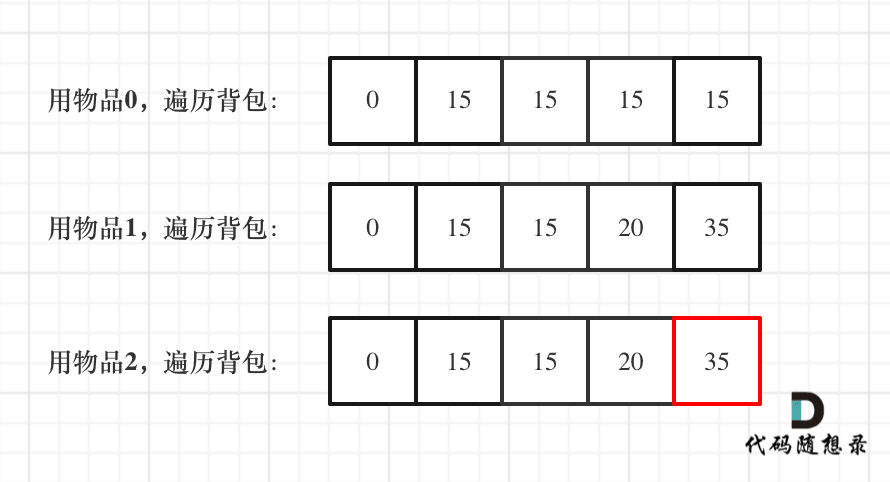

* [做專案（多個 C++、Java、Go、測試開發、前端（front end）專案）](https://www.programmercarl.com/other/kstar.html)
* [刷演算法（兩個月高強度學演算法）](https://www.programmercarl.com/xunlian/xunlianying.html)
* [背八股文（40 天挑戰高頻面試題）](https://www.programmercarl.com/xunlian/bagu.html)

# 動態規劃（dynamic programming, DP）：0/1 背包問題（0/1 knapsack problem）理論基礎（rolling array）

本題 LeetCode 上沒有原題，大家可以去[KamaCoder 第 46 題](https://kamacoder.com/problempage.php?pid=1046)練習

## 演算法公開課

**[《程式碼隨想錄》演算法影片公開課](https://programmercarl.com/other/gongkaike.html)：[帶你學透 0/1 背包問題！（rolling array）](https://www.bilibili.com/video/BV1BU4y177kY/)，相信結合影片再看本篇題解，更有助於大家對本題的理解**。

## 解題思路

昨天[動態規劃：關於 0/1 背包問題，你該了解這些！](./背包理論基礎01背包-1.md)中是用二維（two-dimensional）dp 陣列（array）來講解 0/1 背包。

今天我們就來說一說滾動陣列，其實在前面的題目中我們已經用到過滾動陣列了，就是把二維 dp 降為一維陣列（one dimensional array）dp，一些讀者／錄友當時還表示比較困惑。

那麼我們透過 0/1 背包，來徹底講一講滾動陣列！

接下來還是用如下這個例子來進行講解

背包最大重量為 4。

物品為：

|       | 重量 | 價值 |
| ---   | ---  | ---  |
| 物品0 | 1    | 15   |
| 物品1 | 3    | 20   |
| 物品2 | 4    | 30   |

問背包能背的物品最大價值是多少？

### 一維 dp 陣列（rolling array）

對於背包問題其實狀態（state）都是可以壓縮的。

在使用二維陣列的時候，遞迴公式（recurrence formula）：dp[i][j] = max(dp[i - 1][j], dp[i - 1][j - weight[i]] + value[i]);

**其實可以發現如果把 dp[i - 1] 那一層複製到 dp[i] 上，表達式完全可以是：dp[i][j] = max(dp[i][j], dp[i][j - weight[i]] + value[i]);**

**與其把 dp[i - 1] 這一層複製到 dp[i] 上，不如只用一個一維陣列了**，只用 dp[j]（一維陣列，也可以理解是一個 rolling array）。

這就是滾動陣列的由來，需要滿足的條件是上一層可以重複利用，直接複製到當前層。

讀到這裡估計大家都忘了 dp[i][j] 裡的 i 和 j 表達的是什麼了，i 是物品，j 是背包容量。

**dp[i][j] 表示從下標（subscript）為 [0-i] 的物品裡任意取，放進容量為 j 的背包，價值總和最大是多少**。

一定要時刻記住這裡 i 和 j 的含義，要不然很容易看懵了。

動規五部曲分析如下：

1. 確定 dp 陣列的定義

關於 dp 陣列的定義，我在 [0/1 背包理論基礎](./背包理論基礎01背包-1.md) 有詳細講解

在一維 dp 陣列中，dp[j] 表示：容量為 j 的背包，所背的物品價值可以最大為 dp[j]。

2. 一維 dp 陣列的遞迴公式

二維 dp 陣列的遞迴公式為：`dp[i][j] = max(dp[i - 1][j], dp[i - 1][j - weight[i]] + value[i]);`

公式是怎麼來的，在這裡 [0/1 背包理論基礎](./背包理論基礎01背包-1.md) 有詳細講解。

一維 dp 陣列，其實就是把上一層 dp[i-1] 這一層複製到 dp[i] 來。

所以在上面遞迴公式的基礎上，去掉 i 這個維度就好。

遞迴公式為：`dp[j] = max(dp[j], dp[j - weight[i]] + value[i]);`

以下為分析：

dp[j] 為容量為 j 的背包所背的最大價值。

dp[j] 可以透過 dp[j - weight[i]] 推導出來，dp[j - weight[i]] 表示容量為 j - weight[i] 的背包所背的最大價值。

`dp[j - weight[i]] + value[i]` 表示容量為 [j - 物品 i 重量] 的背包加上物品 i 的價值。（也就是容量為 j 的背包，放入物品 i 了之後的價值即：dp[j]）

此時 dp[j] 有兩個選擇，一個是取自己 dp[j]，相當於二維 dp 陣列中的 dp[i-1][j]，即不放物品 i，一個是取 `dp[j - weight[i]] + value[i]`，即放物品 i，肯定是取最大的，畢竟是求最大價值，

所以遞迴公式為：

```
dp[j] = max(dp[j], dp[j - weight[i]] + value[i]);
```

可以看出相對於二維 dp 陣列的寫法，就是把 dp[i][j] 中 i 的維度去掉了。

3. 一維 dp 陣列如何初始化（initialization）

**關於初始化，一定要和 dp 陣列的定義吻合，否則到遞迴公式的時候就會越來越亂**。

dp[j] 表示：容量為 j 的背包，所背的物品價值可以最大為 dp[j]，那麼 dp[0] 就應該是 0，因為背包容量為 0 所背的物品的最大價值就是 0。

那麼 dp 陣列除了下標 0 的位置初始為 0，其他下標應該初始化多少呢？

看一下遞迴公式：dp[j] = max(dp[j], dp[j - weight[i]] + value[i]);

dp 陣列在推導的時候一定是取價值最大的數，如果題目給的價值都是正整數（positive integer），那麼非 0 下標都初始化為 0 就可以了。

**這樣才能讓 dp 陣列在遞迴公式的過程中取到最大的價值，而不是被初始值覆蓋了**。

那麼我假設物品價值都是大於 0 的，所以 dp 陣列初始化的時候，都初始為 0 就可以了。

4. 一維 dp 陣列遍歷（traversal）順序

程式碼如下：

```
for(int i = 0; i < weight.size(); i++) { // 遍歷物品
    for(int j = bagWeight; j >= weight[i]; j--) { // 遍歷背包容量
        dp[j] = max(dp[j], dp[j - weight[i]] + value[i]);

    }
}
```

**這裡大家發現和二維 dp 的寫法中，遍歷背包的順序是不一樣的！**

二維 dp 遍歷的時候，背包容量是從小到大，而一維 dp 遍歷的時候，背包是從大到小。

為什麼呢？

**倒序遍歷是為了保證物品 i 只被放入一次！** 但如果一旦正序遍歷了，那麼物品 0 就會被重複加入多次！

舉一個例子：物品 0 的重量 weight[0] = 1，價值 value[0] = 15

如果正序遍歷

dp[1] = dp[1 - weight[0]] + value[0] = 15

dp[2] = dp[2 - weight[0]] + value[0] = 30

此時 dp[2] 就已經是 30 了，意味著物品 0 被放入了兩次，所以不能正序遍歷。

為什麼倒序遍歷，就可以保證物品只放入一次呢？

倒序就是先算 dp[2]

dp[2] = dp[2 - weight[0]] + value[0] = 15（dp 陣列已經都初始化為 0）

dp[1] = dp[1 - weight[0]] + value[0] = 15

所以從後往前迴圈（loop），每次取得的狀態不會和之前取得的狀態重合，這樣每種物品就只取一次了。

**那麼問題又來了，為什麼二維 dp 陣列遍歷的時候不用倒序呢？**

因為對於二維 dp，dp[i][j] 都是透過上一層即 dp[i - 1][j] 計算而來，本層的 dp[i][j] 並不會被覆蓋！

（如果這裡讀不懂，大家就要動手試一試了，空想還是不靠譜的，實踐出真知！）

**再來看看兩個巢狀 for 迴圈（for-loop）的順序，程式碼中是先遍歷物品再巢狀遍歷背包容量，那可不可以先遍歷背包容量再巢狀遍歷物品呢？**

不可以！

因為一維 dp 的寫法，背包容量一定是要倒序遍歷（原因上面已經講了），如果遍歷背包容量放在上一層，那麼每個 dp[j] 就只會放入一個物品，即：背包裡只放入了一個物品。

**所以一維 dp 陣列的背包在遍歷順序上和二維其實是有很大差異的！** 這一點大家一定要注意。

5. 舉例推導 dp 陣列

一維 dp，分別用物品 0、物品 1、物品 2 來遍歷背包，最終得到結果如下：




本題 LeetCode 上沒有原題，大家可以去[KamaCoder 第 46 題](https://kamacoder.com/problempage.php?pid=1046)練習，題意是一樣的，程式碼如下：

```CPP 
// 一維 dp 陣列實作
#include <iostream>
#include <vector>
using namespace std;

int main() {
    // 讀取 M 和 N
    int M, N;
    cin >> M >> N;

    vector<int> costs(M);
    vector<int> values(M);

    for (int i = 0; i < M; i++) {
        cin >> costs[i];
    }
    for (int j = 0; j < M; j++) {
        cin >> values[j];
    }

    // 建立一個動態規劃陣列 dp，初始值為 0
    vector<int> dp(N + 1, 0);

    // 外層迴圈遍歷每個類型的研究材料
    for (int i = 0; i < M; ++i) {
        // 內層迴圈從 N 空間逐漸減少到當前研究材料所佔空間
        for (int j = N; j >= costs[i]; --j) {
            // 考慮當前研究材料選擇和不選擇的情況，選擇最大值
            dp[j] = max(dp[j], dp[j - costs[i]] + values[i]);
        }
    }

    // 輸出 dp[N]，即在給定 N 行李空間可以攜帶的研究材料最大價值
    cout << dp[N] << endl;

    return 0;
}

```

可以看出，一維 dp 的 0/1 背包，要比二維簡潔得多！初始化和遍歷順序相對簡單了。

**所以我傾向於使用一維 dp 陣列的寫法，比較直觀簡潔，而且空間複雜度（space complexity）還降了一個數量級！**

**在後面背包問題的講解中，我都直接使用一維 dp 陣列來進行推導**。

## 總結

以上的講解可以發展出一道面試題目（畢竟 LeetCode 上沒原題）。

就是本文中的題目，要求先實作一個純二維的 0/1 背包，如果寫出來了，然後再問為什麼兩個 for 迴圈的巢狀順序這麼寫？反過來寫行不行？再講一講初始化的邏輯。

然後要求實作一個一維陣列的 0/1 背包，最後再問，一維陣列的 0/1 背包，兩個 for 迴圈的順序反過來寫行不行？為什麼？

注意以上問題都是在候選人把程式碼寫出來的情況下才問的。

就是純 0/1 背包的題目，都不用考 0/1 背包應用類的題目就可以看出候選人對演算法的理解程度了。

**相信大家讀完這篇文章，應該對以上問題都有了答案！**

此時 0/1 背包理論基礎就講完了，我用了兩篇文章把 0/1 背包的 dp 陣列定義、遞迴公式、初始化、遍歷順序從二維陣列到一維陣列統統深度剖析了一遍，沒有放過任何難點。

大家可以發現其實資訊量還是挺大的。

如果把[動態規劃：關於 0/1 背包問題，你該了解這些！](./背包理論基礎01背包-1.md)和本篇的內容都理解了，後面我們在做 0/1 背包的題目，就會發現非常簡單了。

不用再憑感覺或者記憶去寫背包，而是有自己的思考，了解其本質，程式碼的方方面面都在自己的掌控之中。

即使程式碼沒有通過，也會有自己的邏輯去 debug，這樣就思維清晰了。


## 其他語言版本

### Java 

```java
import java.util.Scanner;

public class Main {
    public static void main(String[] args) {
        Scanner scanner = new Scanner(System.in);

        // 讀取 M 和 N
        int M = scanner.nextInt();  // 研究材料的數量
        int N = scanner.nextInt();  // 行李空間的大小

        int[] costs = new int[M];   // 每種材料的空間佔用
        int[] values = new int[M];  // 每種材料的價值

        // 輸入每種材料的空間佔用
        for (int i = 0; i < M; i++) {
            costs[i] = scanner.nextInt();
        }

        // 輸入每種材料的價值
        for (int j = 0; j < M; j++) {
            values[j] = scanner.nextInt();
        }

        // 建立一個動態規劃陣列 dp，初始值為 0
        int[] dp = new int[N + 1];

        // 外層迴圈遍歷每個類型的研究材料
        for (int i = 0; i < M; i++) {
            // 內層迴圈從 N 空間逐漸減少到當前研究材料所佔空間
            for (int j = N; j >= costs[i]; j--) {
                // 考慮當前研究材料選擇和不選擇的情況，選擇最大值
                dp[j] = Math.max(dp[j], dp[j - costs[i]] + values[i]);
            }
        }

        // 輸出 dp[N]，即在給定 N 行李空間可以攜帶的研究材料的最大價值
        System.out.println(dp[N]);

        scanner.close();
    }
}

```


### Python

```python
n, bagweight = map(int, input().split())
weight = list(map(int, input().split()))
value = list(map(int, input().split()))

dp = [0] * (bagweight + 1)  # 建立一個動態規劃陣列 dp，初始值為 0

dp[0] = 0  # 初始化 dp[0] = 0,背包容量為 0，價值最大為 0

for i in range(n):  # 應該先遍歷物品，如果遍歷背包容量放在上一層，那麼每個 dp[j] 就只會放入一個物品
    for j in range(bagweight, weight[i]-1, -1):  # 倒序遍歷背包容量是為了保證物品 i 只被放入一次
        dp[j] = max(dp[j], dp[j - weight[i]] + value[i])

print(dp[bagweight])

```
### Go
```go
package main

import (
    "fmt"
)

func main() {
    // 讀取 M 和 N
    var M, N int
    fmt.Scan(&M, &N)

    costs := make([]int, M)
    values := make([]int, M)

    for i := 0; i < M; i++ {
        fmt.Scan(&costs[i])
    }
    for j := 0; j < M; j++ {
        fmt.Scan(&values[j])
    }

    // 建立一個動態規劃陣列 dp，初始值為 0
    dp := make([]int, N + 1)

    // 外層迴圈遍歷每個類型的研究材料
    for i := 0; i < M; i++ {
        // 內層迴圈從 N 空間逐漸減少到當前研究材料所佔空間
        for j := N; j >= costs[i]; j-- {
            // 考慮當前研究材料選擇和不選擇的情況，選擇最大值
            dp[j] = max(dp[j], dp[j-costs[i]] + values[i])
        }
    }

    // 輸出 dp[N]，即在給定 N 行李空間可以攜帶的研究材料最大價值
    fmt.Println(dp[N])
}

func max(x, y int) int {
    if x > y {
        return x
    }
    return y
}

```

### JavaScript 

```js
const readline = require('readline').createInterface({
    input: process.stdin,
    output: process.stdout
});

let input = [];

readline.on('line', (line) => {
    input.push(line);
});

readline.on('close', () => {
    let [n, bagweight] = input[0].split(' ').map(Number);
    let weight = input[1].split(' ').map(Number);
    let value = input[2].split(' ').map(Number);

    let dp = Array.from({ length: n }, () => Array(bagweight + 1).fill(0));

    for (let j = weight[0]; j <= bagweight; j++) {
        dp[0][j] = value[0];
    }

    for (let i = 1; i < n; i++) {
        for (let j = 0; j <= bagweight; j++) {
            if (j < weight[i]) {
                dp[i][j] = dp[i - 1][j];
            } else {
                dp[i][j] = Math.max(dp[i - 1][j], dp[i - 1][j - weight[i]] + value[i]);
            }
        }
    }

    console.log(dp[n - 1][bagweight]);
});


```

### C
```c
#include <stdio.h>
#include <stdlib.h>

int max(int a, int b) {
    return a > b ? a : b;
}

int main() {
    int n, bagweight;
    scanf("%d %d", &n, &bagweight);

    int *weight = (int *)malloc(n * sizeof(int));
    int *value = (int *)malloc(n * sizeof(int));

    for (int i = 0; i < n; ++i) {
        scanf("%d", &weight[i]);
    }
    for (int j = 0; j < n; ++j) {
        scanf("%d", &value[j]);
    }

    int **dp = (int **)malloc(n * sizeof(int *));
    for (int i = 0; i < n; ++i) {
        dp[i] = (int *)malloc((bagweight + 1) * sizeof(int));
        for (int j = 0; j <= bagweight; ++j) {
            dp[i][j] = 0;
        }
    }

    for (int j = weight[0]; j <= bagweight; j++) {
        dp[0][j] = value[0];
    }

    for (int i = 1; i < n; i++) {
        for (int j = 0; j <= bagweight; j++) {
            if (j < weight[i]) {
                dp[i][j] = dp[i - 1][j];
            } else {
                dp[i][j] = max(dp[i - 1][j], dp[i - 1][j - weight[i]] + value[i]);
            }
        }
    }

    printf("%d\n", dp[n - 1][bagweight]);

    for (int i = 0; i < n; ++i) {
        free(dp[i]);
    }
    free(dp);
    free(weight);
    free(value);

    return 0;
}

```


