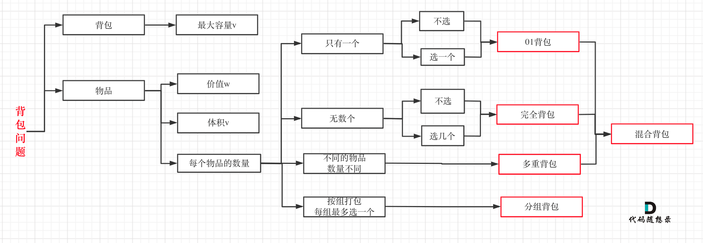
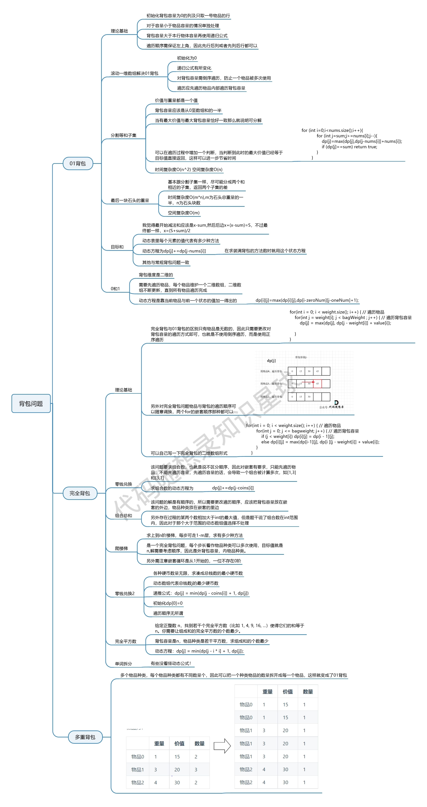

* [做專案（多個 C++、Java、Go、測開、前端專案）](https://www.programmercarl.com/other/kstar.html)
* [刷演算法（兩個月高強度學演算法）](https://www.programmercarl.com/xunlian/xunlianying.html)
* [背八股（40 天挑戰高頻面試題）](https://www.programmercarl.com/xunlian/bagu.html)

# 聽說背包問題很難？這篇總結篇來拯救你了

年前我們已經把背包問題（knapsack problem）都講完了，那麼現在我們要對背包問題進行總結一番。

背包問題是動態規劃（dynamic programming, DP）裡非常重要的一部分，所以我把背包問題單獨總結一下，等DP專題更新完之後，我們還會在整體總結一波DP。

關於這幾種常見的背包，其關係如下：

透過這個圖，可以很清晰分清這幾種常見背包之間的關係。

在講解背包問題的時候，我們都是按照如下五步來逐步分析，相信大家也體會到，把這五步都搞透了，算是對DP理解深入了。

1. 確定 dp 陣列（array）（dp table）以及下標（subscript）的含義
2. 確定遞迴公式（recurrence formula）
3. dp 陣列如何初始化（initialization）
4. 確定遍歷（traversal）順序
5. 舉例推導 dp 陣列

**其實這五步裡哪一步都很關鍵，但確定遞迴公式和確定遍歷順序都具有規律性和代表性，所以下面我從這兩點來對背包問題做一做總結**。

## 背包遞迴公式

問能否能裝滿背包（或者最多裝多少）：`dp[j] = max(dp[j], dp[j - nums[i]] + nums[i]);`，對應題目如下：
* [動態規劃：416.分割等和子集](./0416.分割等和子集.md)
* [動態規劃：1049.最後一塊石頭的重量 II](./1049.最後一塊石頭的重量II.md)

問裝滿背包有幾種方法：`dp[j] += dp[j - nums[i]]`，對應題目如下：
* [動態規劃：494.目標和](./0494.目標和.md)
* [動態規劃：518. 零錢兌換 II](./0518.零錢兌換II.md)
* [動態規劃：377.組合總和Ⅳ](./0377.組合總和Ⅳ.md)
* [動態規劃：70. 爬樓梯進階版（無界背包問題）](./0070.爬楼梯完全背包版本.md)

問背包裝滿最大價值：`dp[j] = max(dp[j], dp[j - weight[i]] + value[i]);`，對應題目如下：
* [動態規劃：474.一和零](./0474.一和零.md)

問裝滿背包所有物品的最小個數：`dp[j] = min(dp[j - coins[i]] + 1, dp[j]);`，對應題目如下：
* [動態規劃：322.零錢兌換](./0322.零錢兌換.md)
* [動態規劃：279.完全平方數](./0279.完全平方數.md)

## 遍歷順序

### 0/1 背包問題

在[動態規劃：關於 0/1 背包問題，你該了解這些！](./背包理論基礎01背包-1.md)中我們講解二維（two-dimensional）dp 陣列 0/1 背包問題（0/1 knapsack problem）先遍歷物品還是先遍歷背包都是可以的，且第二層 for 迴圈（for-loop）是從小到大遍歷。

和[動態規劃：關於 0/1 背包問題，你該了解這些！（rolling array）](./背包理論基礎01背包-2.md)中，我們講解一維 dp 陣列 0/1 背包問題只能先遍歷物品再遍歷背包容量，且第二層 for 迴圈是從大到小遍歷。

**一維 dp 陣列的背包在遍歷順序上和二維 dp 陣列實作的 0/1 背包問題其實是有很大差異的，大家需要注意！**

### 無界背包問題

說完 0/1 背包問題，再看看無界背包問題（unbounded knapsack problem）。

在[動態規劃：關於無界背包問題，你該了解這些！](./背包問題理論基礎完全背包.md)中，講解了純無界背包問題的一維 dp 陣列實作，先遍歷物品還是先遍歷背包都是可以的，且第二層 for 迴圈是從小到大遍歷。

但是僅僅是純無界背包問題的遍歷順序是這樣的，題目稍有變化，兩個 for 迴圈的先後順序就不一樣了。

**如果求組合（combination）數就是外層 for 迴圈遍歷物品，內層 for 迴圈遍歷背包**。

**如果求排列（permutation）數就是外層 for 迴圈遍歷背包，內層 for 迴圈遍歷物品**。

相關題目如下：

* 求組合數：[動態規劃：518.零錢兌換 II](./0518.零錢兌換II.md)
* 求排列數：[動態規劃：377. 組合總和 Ⅳ](https://mp.weixin.qq.com/s/Iixw0nahJWQgbqVNk8k6gA)、[動態規劃：70. 爬樓梯進階版（無界背包問題）](./0070.爬楼梯完全背包版本.md)

如果求最小數，那麼兩層 for 迴圈的先後順序就無所謂了，相關題目如下：

* 求最小數：[動態規劃：322. 零錢兌換](./0322.零錢兌換.md)、[動態規劃：279.完全平方數](./0279.完全平方數.md)

**對於背包問題，其實遞迴公式算是容易的，難是難在遍歷順序上，如果把遍歷順序搞透，才算是真正理解了**。

## 總結

**這篇背包問題總結篇是對背包問題的高度概括，講最關鍵的兩步：遞迴公式和遍歷順序，結合 LeetCode 上的題目全都抽象出來了**。

**而且每一個點，我都給出了對應的 LeetCode 題目**。

最後如果你想了解多重背包（bounded knapsack），可以看這篇[動態規劃：關於 bounded knapsack，你該了解這些！](./背包問題理論基礎多重背包.md)，LeetCode 上還沒有多重背包的題目，也不是面試考察的重點。

如果把我本篇總結出來的內容都掌握的話，可以說對背包問題理解得很深刻了，用來對付面試中的背包問題綽綽有餘！

背包問題總結：

這個圖是 [程式碼隨想錄知識星球](https://programmercarl.com/other/kstar.html) 成員：[海螺人](https://wx.zsxq.com/dweb2/index/footprint/844412858822412) 所畫，總結得非常好，分享給大家。

