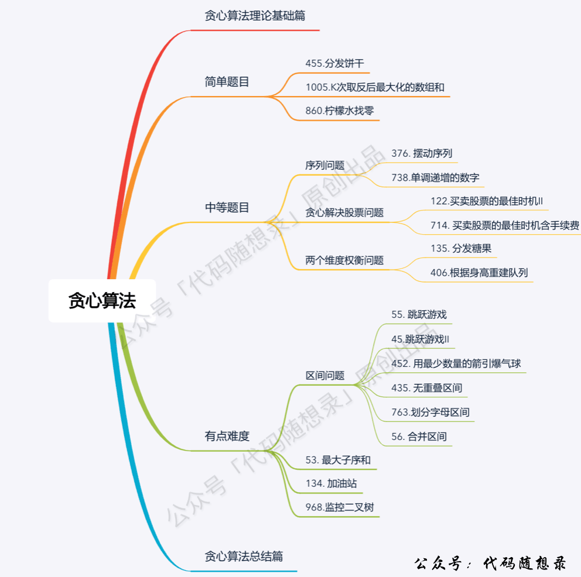

* [做專案（多個 C++、Java、Go、測試開發、前端（front end）專案）](https://www.programmercarl.com/other/kstar.html)
* [練習演算法（兩個月高強度學演算法）](https://www.programmercarl.com/xunlian/xunlianying.html)
* [背誦面試必考題（八股文）（40 天挑戰高頻面試題）](https://www.programmercarl.com/xunlian/bagu.html)

# 關於貪心演算法（greedy algorithm），你該了解這些！

題目分類大綱如下：             

 </img>

## 演算法公開課

**[《程式碼隨想錄》演算法影片公開課](https://programmercarl.com/other/gongkaike.html)：[貪心演算法理論基礎！](https://www.bilibili.com/video/BV1WK4y1R71x/)，相信結合影片再看本篇題解，更有助於大家對本題的理解**。

## 什麼是貪心

**貪心法（greedy）的本質是選擇每一階段的區域最佳（local optimum），從而達到總體最佳（global optimum）**。

這麼說有點抽象，來舉一個例子：

例如，有一堆鈔票，你可以拿走十張，如果想達到最大的金額，你要怎麼拿？

肯定每次拿最大的，最終結果就是拿走最大數額的錢。

每次拿最大的就是區域最佳，最後拿走最大數額的錢就是推出總體最佳。

再舉一個例子，如果是有一堆盒子，你有一個背包體積為 n，如何把背包盡可能裝滿，如果還每次選最大的盒子，就不行了。這時候就需要動態規劃（dynamic programming, DP）。動態規劃的問題在下一個系列會詳細講解。

## 貪心的固定做法（什麼時候用貪心）

很多同學做貪心的題目的時候，想不出來是貪心，想知道有沒有什麼固定做法可以一看就看出來是貪心。

**說實話貪心演算法並沒有固定的做法**。

所以唯一的難點就是如何透過區域最佳，推出整體最佳。

那麼如何能看出區域最佳是否能推出整體最佳呢？有沒有什麼固定策略或者解法模式呢？

**不好意思，也沒有！** 靠自己手動模擬（simulation），如果模擬可行，就可以試一試貪心策略（greedy strategy），如果不可行，可能需要動態規劃。

有同學問了如何驗證可不可以用貪心演算法呢？

**最好用的策略就是舉反例，如果想不到反例，那麼就試一試貪心吧**。

可有同學認為手動模擬、舉例子得出的結論不靠譜，想要嚴格的數學證明。

一般數學證明有如下兩種方法：

* 數學歸納法
* 反證法

看教科書上講解貪心可以是一堆公式，估計大家連看都不想看，所以數學證明就不在我要講解的範圍內了，大家感興趣可以自行查找資料。

**面試中基本不會讓面試者現場證明貪心的合理性，程式碼寫出來跑過測試案例（test case）即可，或者自己能自圓其說理由就行了**。

舉一個不太恰當的例子：我要用一下 1 + 1 = 2，但我要先證明 1 + 1 為什麼等於 2。嚴謹是嚴謹了，但沒必要。

雖然這個例子很極端，但可以表達這麼個意思：**刷題或者面試的時候，手動模擬一下感覺可以區域最佳推出整體最佳，而且想不到反例，那麼就試一試貪心**。

**例如剛剛舉的拿鈔票的例子，就是模擬一下每次拿最大的，最後就能拿到最多的錢，這還要數學證明的話，其實就不在演算法面試的範圍內了，可以看看專業的數學書籍！**

所以這也是為什麼很多同學通過（accept）了貪心的題目，但都不知道自己用了貪心演算法，**因為貪心有時候就是常識性的推導，所以會認為本應該就這麼做！**

**那麼刷題的時候什麼時候真的需要數學推導呢？**

例如這道題目：[鏈接串列（linked list）：環找到了，那入口呢？](https://programmercarl.com/0142.环形链表II.html)，這道題不用數學推導一下，就找不出環的起始位置，想試一下就不知道怎麼試，這種題目確實需要數學簡單推導一下。

## 貪心一般解題步驟

貪心演算法一般分為如下四步：

* 將問題分解為若干個子問題
* 找出適合的貪心策略
* 求解每一個子問題的最佳解
* 將區域最佳解堆疊成總體最佳解

這個四步其實過於理論化了，我們平時在做貪心類的題目時，如果按照這四步去思考，真是有點「雞肋」。  

做題的時候，只要想清楚區域最佳是什麼，如何推導出總體最佳，其實就夠了。 

## 總結

本篇給出了什麼是貪心以及大家關心的貪心演算法固定做法。

**不好意思了，貪心沒有固定做法，說白了就是常識性推導加上舉反例**。

最後給出貪心的一般解題步驟，大家可以發現這個解題步驟也是比較抽象的，不像是二元樹（binary tree）、回溯演算法（backtracking algorithm），給出了那麼具體的解題解法模式和模板（template）。

