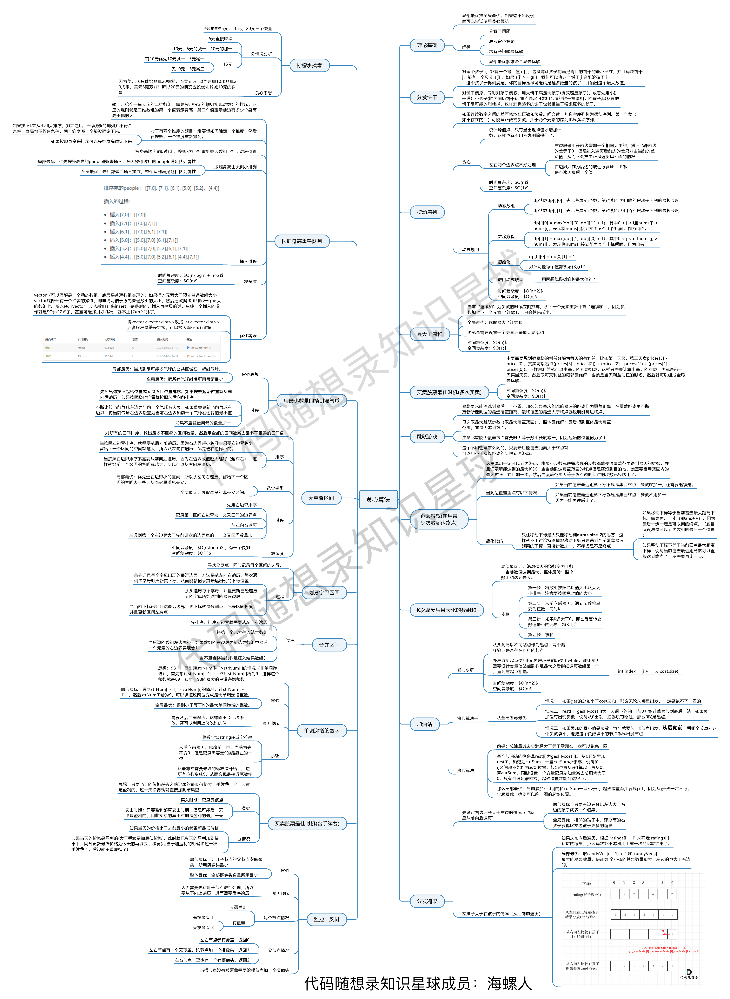

* [做專案（多個 C++、Java、Go、測試開發、前端（front end）專案）](https://www.programmercarl.com/other/kstar.html)
* [練習演算法（兩個月高強度學演算法）](https://www.programmercarl.com/xunlian/xunlianying.html)
* [背誦面試必考題（八股文）（40 天挑戰高頻面試題）](https://www.programmercarl.com/xunlian/bagu.html)

# 貪心演算法（greedy algorithm）總結篇 

我剛剛開始講解貪心法（greedy）系列的時候就說了，貪心系列並不打算嚴格地從簡單到困難這麼個順序來講解。

因為貪心的簡單題可能往往過於簡單甚至感覺不到貪心，如果我連續幾天講解簡單的貪心，估計錄友們一定會不耐煩了，會感覺貪心有啥好學的。

但貪心的難題又真的有點難，所以我是簡單困難交錯著講的，這樣大家就感覺難度適中，而且貪心也沒有什麼框架（framework）和固定做法，所以對刷題順序要求沒有那麼高。

但在貪心系列，我發的題目難度會整體呈現一個階梯狀上升，細心的錄友們應該有所體會。

在剛剛講過的回溯（backtracking）系列中，大家可以發現我是嚴格按照框架難度順序循序漸進講解的，**和貪心又不一樣，因為回溯法如果題目順序沒選好，刷題效果會非常差！**

同樣回溯系列也不允許簡單困難交替著來，因為前後題目都是有因果關係的，**相信跟著刷過回溯系列的錄友們都會明白我的良苦用心**。

**每個系列都有每個系列的特點，我都會根據特點有所調整，大家看我每天推送的題目，都不是隨便找一個就推送的，都是先有整體規劃，然後反覆斟酌具體題目的結果**。

那麼在貪心總結篇裡，我按難易程度以及題目類型大體歸個類。

貪心大總結正式開始：

## 貪心理論基礎

在貪心系列開篇詞[關於貪心演算法，你該了解這些！](https://programmercarl.com/贪心算法理论基础.html)中，我們就講解了大家對貪心的普遍疑惑。

1. 貪心很簡單，就是常識？

跟著一起刷題的錄友們就會發現，貪心想法往往很巧妙，並不簡單。

2. 貪心有沒有固定的解法模式？

貪心無固定做法，也沒有框架之類的，需要多看多練培養感覺才能想到貪心的解題思路。

3. 究竟什麼題目是貪心呢？

Carl 個人認為：如果找出區域最佳（local optimum）並可以推出總體最佳（global optimum），就是貪心，如果區域最佳都沒找出來，就不是貪心，可能是單純的模擬（simulation）。（並不是權威解讀，一家之辭哈）

但我們也不用過於強調什麼題目是貪心，什麼不是貪心，那就太學術了，畢竟學會解題就行了。

4. 如何知道區域最佳推出總體最佳，有數學證明嗎？

在做貪心題的過程中，如果再來一個數學證明，其實沒有必要，手動模擬一下，如果找不出反例，就試試貪心。面試中，程式碼寫出來跑過測試案例（test case）即可，或者自己能自圓其說理由就行了。

就像是 要用一下 1 + 1 = 2，沒有必要再證明一下 1 + 1 究竟為什麼等於 2。（例子極端了點，但是這個道理）

相信大家讀完[關於貪心演算法，你該了解這些！](https://programmercarl.com/贪心算法理论基础.html)，就對貪心有了一個基本的認識了。

## 貪心簡單題

以下三道題目就是簡單題，大家會發現貪心感覺就是常識。是的，如下三道題目，就是靠常識，但我都具體分析了區域最佳是什麼，總體最佳是什麼，貪心也要貪得有理有據！

* [貪心演算法：分發餅乾](https://programmercarl.com/0455.分发饼干.html)
* [貪心演算法：K 次取反後最大化的陣列（array）和](https://programmercarl.com/1005.K次取反后最大化的数组和.html)
* [貪心演算法：檸檬水找零](https://programmercarl.com/0860.柠檬水找零.html)

## 貪心中等題

貪心中等題，靠常識可能就有點想不出來了。開始初現貪心演算法的難度與巧妙之處。

* [貪心演算法：擺動序列](https://programmercarl.com/0376.摆动序列.html)
* [貪心演算法：單調遞增的數字](https://programmercarl.com/0738.单调递增的数字.html)

### 貪心解決股票問題

大家都知道股票系列問題是動態規劃（dynamic programming, DP）的專長，其實用貪心也可以解決，而且還不止就這兩道題目，但這兩道比較典型，我就拿來單獨說一說。

* [貪心演算法：買賣股票的最佳時機 II](https://programmercarl.com/0122.买卖股票的最佳时机II.html)
* [貪心演算法：買賣股票的最佳時機含手續費](https://programmercarl.com/0714.买卖股票的最佳时机含手续费.html) 本題使用貪心演算法比較繞，建議後面學習動態規劃章節的時候，理解動態規劃就好。

### 兩個維度權衡問題

在出現兩個維度相互影響的情況時，兩邊一起考慮一定會顧此失彼，要先確定一個維度，再確定另一個維度。

* [貪心演算法：分發糖果](https://programmercarl.com/0135.分发糖果.html)
* [貪心演算法：根據身高重建佇列（queue）](https://programmercarl.com/0406.根据身高重建队列.html)

在講解本題的過程中，還強調了程式設計語言（programming language）的重要性，模擬插隊的時候，使用 C++ 中的 list（鏈接串列（linked list））替代了 vector（動態陣列（dynamic array）），效率會高很多。

所以在[貪心演算法：根據身高重建佇列（續集）](https://programmercarl.com/根据身高重建队列（vector原理讲解）.html)詳細講解了，為什麼用 list（鏈接串列）更快！

**大家也要掌握自己所用的程式設計語言，理解其內部實作機制，這樣才能寫出高效的演算法！**

## 貪心難題

這裡的題目如果沒有接觸過，其實是很難想到的，甚至接觸過，也一時想不出來，所以題目不要做一遍，要多練！

### 貪心解決區間（interval）問題

關於區間問題，大家應該印象深刻，有一週我們專門講解了區間問題，各種覆蓋各種 deduplication。

* [貪心演算法：跳躍遊戲](https://programmercarl.com/0055.跳跃游戏.html)
* [貪心演算法：跳躍遊戲 II](https://programmercarl.com/0045.跳跃游戏II.html)
* [貪心演算法：用最少數量的箭引爆氣球](https://programmercarl.com/0452.用最少数量的箭引爆气球.html)
* [貪心演算法：無重疊區間](https://programmercarl.com/0435.无重叠区间.html)
* [貪心演算法：劃分字母區間](https://programmercarl.com/0763.划分字母区间.html)
* [貪心演算法：合併區間](https://programmercarl.com/0056.合并区间.html)

### 其他難題

[貪心演算法：最大子序和](https://programmercarl.com/0053.最大子序和.html) 其實是動態規劃的題目，但貪心效能更優，很多同學也是第一次發現貪心能比動態規劃更優的題目。

[貪心演算法：加油站](https://programmercarl.com/0134.加油站.html)可能以為是一道模擬題，但就算模擬其實也不簡單，需要把 while 用得很嫻熟。但其實是可以使用貪心給時間複雜性（time complexity）降低一個數量級。

最後貪心系列壓軸題目[貪心演算法：我要監控二元樹（binary tree）！](https://programmercarl.com/0968.监控二叉树.html)，不僅貪心的想法不好想，而且需要對二元樹的操作特別嫻熟，這就是典型的交叉類難題了。

## 貪心每週總結

週總結裡會對每週的題目中大家的疑問、相關難點或者筆誤之類的進行檢討回顧和總結。

如果大家發現文章哪裡有問題，那麼在週總結裡或者文章評論區一定進行了修正，保證不會因為我的筆誤或理解問題而誤導大家。

所以週總結一定要看！

* [本週小結！（貪心演算法系列一）](https://programmercarl.com/周总结/20201126贪心周末总结.html)
* [本週小結！（貪心演算法系列二）](https://programmercarl.com/周总结/20201203贪心周末总结.html)
* [本週小結！（貪心演算法系列三）](https://programmercarl.com/周总结/20201217贪心周末总结.html)
* [本週小結！（貪心演算法系列四）](https://programmercarl.com/周总结/20201224贪心周末总结.html)

## 總結

貪心專題匯聚為一張圖： 

這個圖是 [程式碼隨想錄知識星球](https://programmercarl.com/other/kstar.html) 成員：[海螺人](https://wx.zsxq.com/dweb2/index/footprint/844412858822412)所畫，總結得非常好，分享給大家。

很多沒有接觸過貪心的同學都會感覺貪心有啥可學的，但只要跟著「程式碼隨想錄」堅持下來之後，就會發現，貪心是一種很重要的演算法思維而且並不簡單，貪心往往妙得出其不意，措手不及！

**回想一下我們剛剛開始講解貪心的時候，大家會發現自己在堅持中進步了很多！**

這也是「程式碼隨想錄」的初衷，只要一路堅持下來，不僅基礎扎實，而且進步也是飛速的。

**在這十八道貪心經典題目中，大家可以發現在每一道題目的講解中，我都是把什麼是區域最佳，和什麼是總體最佳說清楚**。

這也是我認為判斷這是一道貪心題目的依據，如果找不出區域最佳，那可能就是一道模擬題。

不知不覺又一個系列結束了，同時也是 2020 年的結束。

**一個系列的結束，又是一個新系列的開始，我們將在明年第一個工作日正式開始動態規劃，來不及解釋了，錄友們上車別掉隊，我們又要開始新的征程！**

