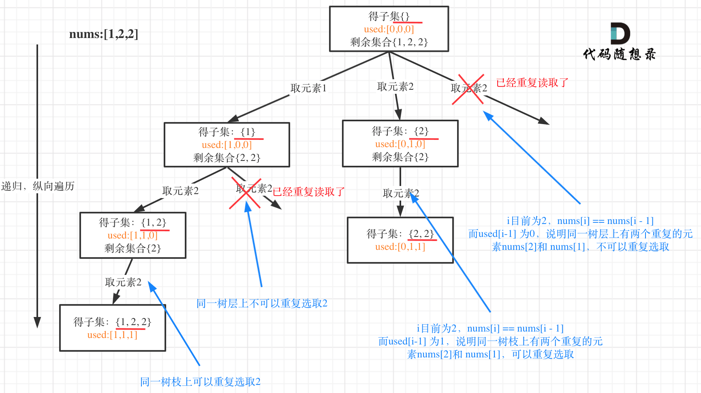
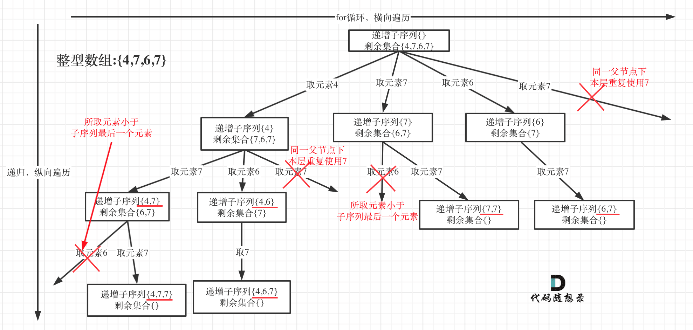
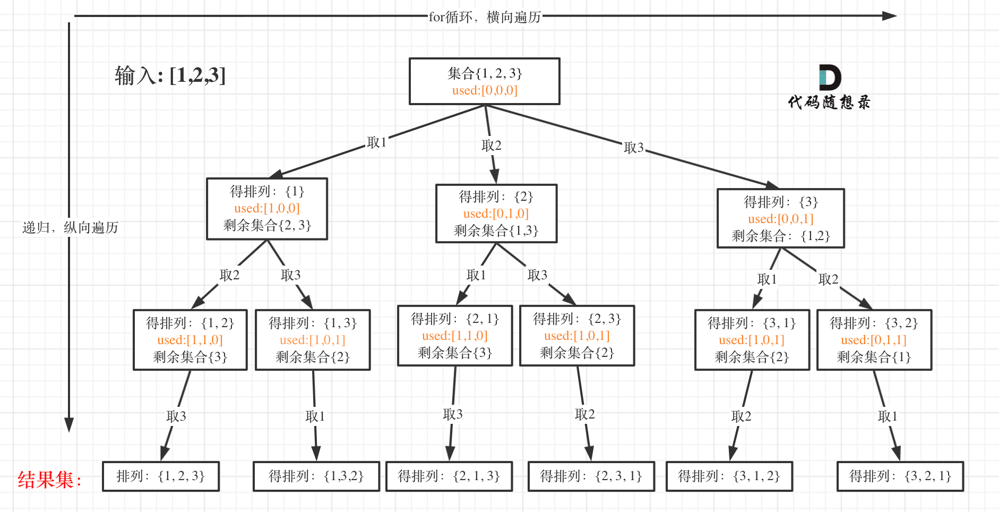
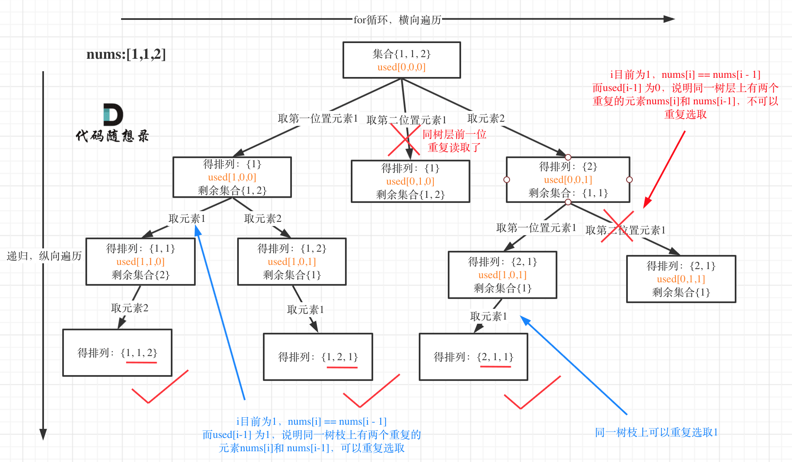
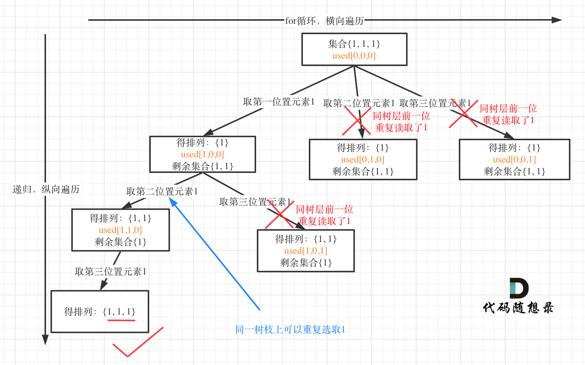
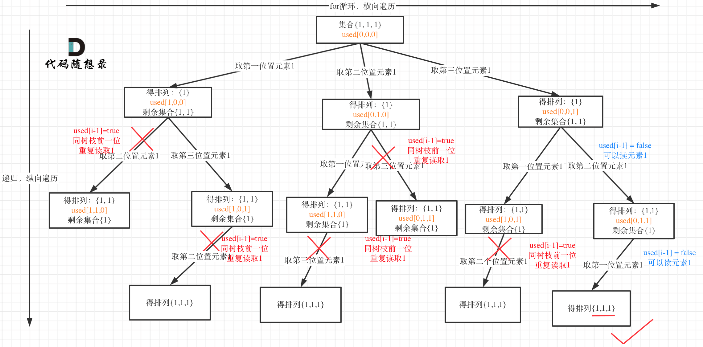

# 本週小結！（回溯演算法系列三）

## 週一

在[回溯算法：求子集問題（二）](https://programmercarl.com/0090.子集II.html)中，開始針對子集（subset）問題進行去重。

本題就是在[回溯算法：求子集問題！](https://programmercarl.com/0078.子集.html)的基礎上加上了去重，去重我們在[回溯算法：求組合總和（三）](https://programmercarl.com/0040.组合总和II.html)也講過了。

所以本題對大家應該並不難。

樹狀結構（tree structure）如下：

## 週二

在[回溯算法：遞增子序列](https://programmercarl.com/0491.递增子序列.html)中，處處都能看到子集的身影，但處處是陷阱，值得好好琢磨琢磨！

樹狀結構如下：

[回溯算法：遞增子序列](https://programmercarl.com/0491.递增子序列.html)留言區大家有很多疑問，主要還是和[回溯算法：求子集問題（二）](https://programmercarl.com/0090.子集II.html)混合在了一起。

詳細在[本周小結！（回溯算法系列三）續集](https://mp.weixin.qq.com/s/kSMGHc_YpsqL2j-jb_E_Ag)中給出了介紹！

## 週三

我們已經分析了組合（combination）問題、分割問題、子集問題，那麼[回溯算法：排列問題！](https://programmercarl.com/0046.全排列.html)又不一樣了。

排列（permutation）是有序（ordered）的，也就是說 `[1,2]` 和 `[2,1]` 是兩個集合（set），這和之前分析的子集以及組合所不同的地方。

可以看出元素（element）`1` 在 `[1,2]` 中已經使用過了，但是在 `[2,1]` 中還要再使用一次 `1`，所以處理排列問題就不用使用 `startIndex` 了。

如圖：

**大家此時可以感受出排列問題的不同：**

* 每層都是從 0 開始搜尋而不是 `startIndex`
* 需要 `used` 陣列（array）記錄 `path` 裡都放了哪些元素了

## 週四

排列問題也要去重了，在[回溯算法：排列問題（二）](https://programmercarl.com/0047.全排列II.html)中又一次強調了「樹層去重」和「樹枝去重」。

樹狀結構如下：

**這道題目神奇的地方就是 `used[i - 1] == false` 也可以，`used[i - 1] == true` 也可以！**

我就用輸入：`[1,1,1]` 來舉一個例子。

樹層上去重（`used[i - 1] == false`）的樹狀結構如下：

樹枝上去重（`used[i - 1] == true`）的樹狀結構如下：

**可以清晰地看到使用（`used[i - 1] == false`），即樹層去重，效率更高！**

## 效能分析

之前並沒有分析各個問題的時間複雜性（time complexity）和空間複雜度（space complexity），這次來說一說。

這塊網路上的資料魚龍混雜，一些所謂的經典面試書籍根本不講回溯演算法（backtracking algorithm），演算法書籍對這塊也避而不談，感覺就像是演算法裡模糊的邊界（boundary）。

**所以這塊就說一說我個人理解，對內容持開放態度，集思廣益，歡迎大家來討論！**

子集問題分析：

* 時間複雜性：$O(n × 2^n)$，因為每一個元素的狀態（state）無外乎取與不取，所以時間複雜性為 $O(2^n)$，構造每一組子集都需要填進陣列，又有需要 $O(n)$，最終時間複雜性：$O(n × 2^n)$。
* 空間複雜度：$O(n)$，遞迴（recursion）深度（depth）為 n，所以系統堆疊（stack）所用空間為 $O(n)$，每一層遞迴所用的空間都是常數（constant）級別，注意程式碼裡的 `result` 和 `path` 都是全域變數（global variable），就算是放在參數（parameter）裡，傳的也是參考（reference），並不會新申請記憶體（memory）空間，最終空間複雜度為 $O(n)$。

排列問題分析：

* 時間複雜性：$O(n!)$，這個可以從排列的樹形圖中很明顯發現，每一層節點（node）為 n，第二層每一個分支（branch）都延伸了 n-1 個分支，再往下又是 n-2 個分支，所以一直到葉節點（leaf node）一共就是 n * n-1 * n-2 * ..... 1 = n!。每個葉節點都會有一個構造全排列填進陣列的操作（對應的程式碼：`result.push_back(path)`），該操作的複雜度為 $O(n)$。所以，最終時間複雜性為：n * n!，簡化為 $O(n!)$。
* 空間複雜度：$O(n)$，和子集問題同理。

組合問題分析：

* 時間複雜性：$O(n × 2^n)$，組合問題其實就是一種子集的問題，所以組合問題最壞的情況，也不會超過子集問題的時間複雜性。
* 空間複雜度：$O(n)$，和子集問題同理。

**一般說到回溯演算法的複雜度，都說是指數（exponential）級別的時間複雜性，這也算是一個概括吧！**

## 總結

本週我們對[子集問題進行了去重](https://programmercarl.com/0090.子集II.html)，然後介紹了和子集問題非常像的[遞增子序列](https://programmercarl.com/0491.递增子序列.html)，如果還保持慣性思維，這道題就可能掉進陷阱裡。

接著介紹了[排列問題！](https://programmercarl.com/0046.全排列.html)，以及對[排列問題如何進行去重](https://programmercarl.com/0047.全排列II.html)。

最後我補充了子集問題、排列問題和組合問題的效能分析，給大家提供了回溯演算法複雜度的分析思路。

 </img>

=== END PROSE ===
