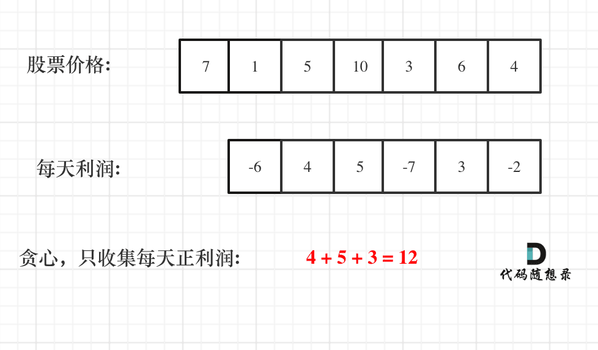
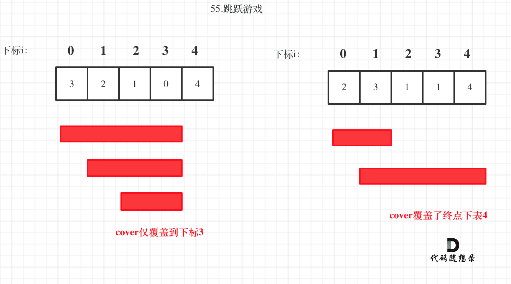
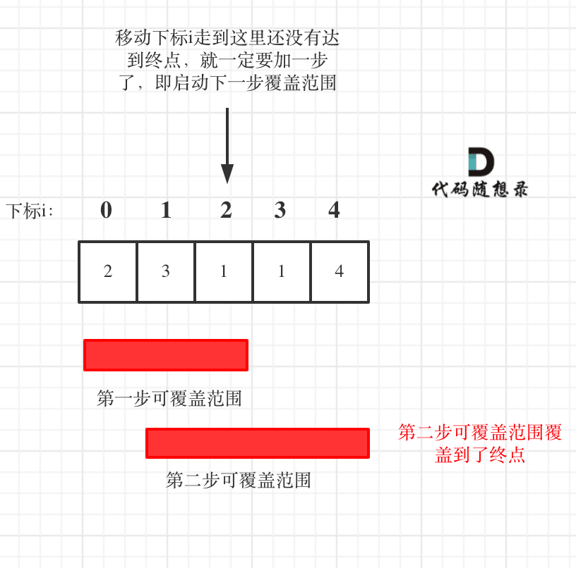
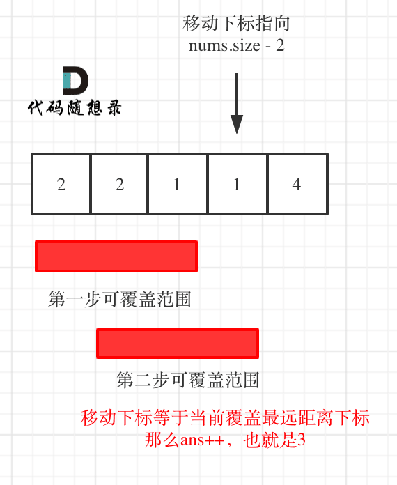
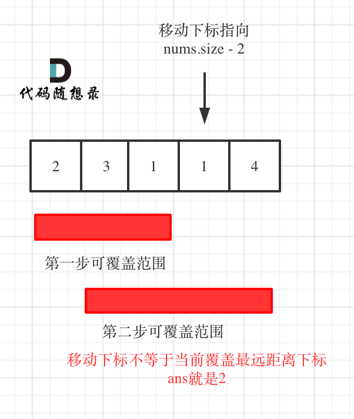

# 本週小結！（貪心演算法系列二）

## 週一

一說到股票問題，一般都會想到動態規劃（dynamic programming, DP），其實有時候貪心法（greedy）更有效！

在[貪心算法：買賣股票的最佳時機II](../0122.買賣股票的最佳時機II.md)中，講到只能多次買賣一支股票，如何獲取最大利潤。

**這道題目理解利潤拆分是關鍵點！** 不要整塊地去看，而是把整體利潤拆為每天的利潤，就很容易想到貪心了。

**區域最佳（local optimum）：只收集每天的正利潤，總體最佳（global optimum）：得到最大利潤**。

如果正利潤連續上了，相當於連續持有股票，而本題並不需要計算具體的區間（interval）。

如圖：

## 週二

在[貪心算法：跳躍遊戲](../0055.跳躍遊戲.md)中是給你一個陣列（array）看能否跳到終點。

本題貪心的關鍵是：**不用拘泥於每次究竟跳幾步，而是看覆蓋範圍，覆蓋範圍內一定是可以跳過來的，不用管是怎麼跳的**。

**那麼這個問題就轉化為跳躍覆蓋範圍究竟可不可以覆蓋到終點！**

貪心演算法（greedy algorithm）區域最佳解（solution）：移動索引（index）每次取最大跳躍步數（取最大覆蓋範圍），整體最佳解：最後得到整體最大覆蓋範圍，看是否能到終點

如果覆蓋範圍覆蓋到了終點，就表示一定可以跳過去。

如圖：

## 週三

這道題目：[貪心算法：跳躍遊戲II](../0045.跳躍遊戲II.md)可就有點難了。

本題解題關鍵在於：**以最小的步數增加最大的覆蓋範圍，直到覆蓋範圍覆蓋了終點**。

那麼區域最佳：求當前這步的最大覆蓋，那麼盡可能多走，到達覆蓋範圍的終點，只需要一步。整體最佳：達到終點，步數最少。

如圖：

注意：**圖中的移動索引是到當前這步覆蓋的最遠距離（索引 2 的位置），此時沒有到終點，只能增加第二步來擴大覆蓋範圍**。

在[貪心算法：跳躍遊戲II](../0045.跳躍遊戲II.md)中我給出了兩個版本的程式碼。

其實本質都是超過當前覆蓋範圍，步數就加一，但版本一需要考慮當前覆蓋最遠距離索引是不是陣列終點的情況。

而版本二就比較統一，超過範圍，步數就加一，但在移動索引的範圍裡做了文章。

即如果覆蓋最遠距離索引是倒數第二點：直接加一就行，預設一定可以到終點。如圖：

如果覆蓋最遠距離索引不是倒數第二點，說明本次覆蓋已經到終點了。如圖：

有的錄友認為版本一好理解，有的錄友認為版本二好理解，其實掌握一種就可以了，也不用非要比拚一下程式碼的簡潔性，簡潔程度都差不多了。

我個人傾向於版本一的寫法，思路清晰一點，版本二會有點繞。

## 週四

這道題目：[貪心算法：K次取反後最大化的數組和](../1005.K次取反後最大化的陣列和.md)就比較簡單了，用簡單題來講一講貪心的思想。

**這裡其實用了兩次貪心！**

第一次貪心：區域最佳：讓絕對值（absolute value）大的負數（negative number）變為正數，當前數值達到最大，整體最佳：整個陣列和達到最大。

處理之後，如果 K 依然大於 0，此時的題目是一個有序（ordered）正整數（positive integer）序列（sequence），如何轉變 K 次正負，讓陣列和達到最大。

第二次貪心：區域最佳：只找數值最小的正整數進行反轉（reverse），當前數值可以達到最大（例如正整數陣列 `{5, 3, 1}`，反轉 `1` 得到 `-1` 比反轉 `5` 得到的 `-5` 大多了），總體最佳：整個陣列和達到最大。

另外一位錄友留言給出一個很好的建議，因為文中是使用快速排序（quick sort），仔細看題，**題目中限定了資料範圍是正負一百，所以可以使用桶排序（bucket sort）**，這樣時間複雜度（time complexity）就可以最佳化為 $O(n)$ 了。但可能程式碼要複雜一些了。

## 總結

大家會發現本週的程式碼其實都簡單，但思路卻很巧妙，並不容易寫出來。

如果是第一次接觸的話，其實很難想出來，就是接觸過之後就會了，所以大家不用感覺自己想不出來而煩躁。

相信此時大家對貪心演算法又有一個新的認識了，加油💪

 </img>

