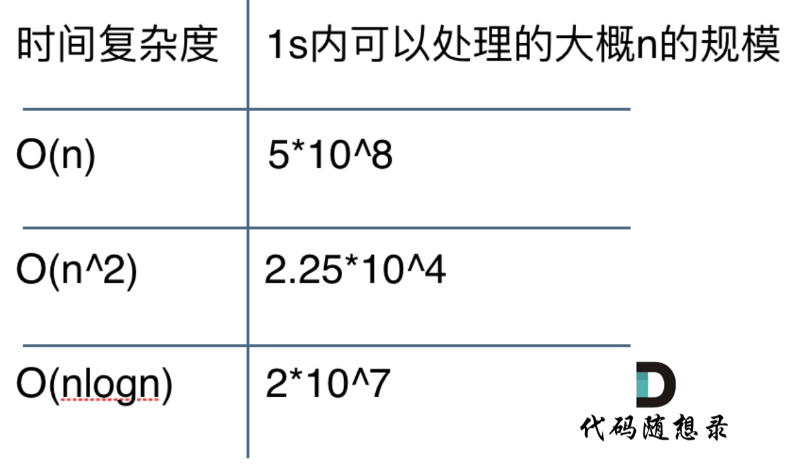

  
  
  
  

正好也給「演算法匯總」新增一個新專題——演算法效能分析，以後如果有空餘時間還會陸續更新這個模組（module），大家如果經常看「演算法匯總」的話，就會發現，「演算法匯總」裡已經更新的三個模組「程式設計素養」、「求職」、「演算法效能分析」，內容越來越豐滿了，大家現在就可以去看看哈。

後面在演算法題目之餘，我還會繼續更新這幾個模組的！

# 週一

在[程序员的簡歷應該這麼寫！！（附簡歷模板）](https://programmercarl.com/前序/程序员简历.html)中以我自己的總結經驗為例講一講大家應該如何寫履歷。

主要有如下幾點：

* 履歷篇幅不要過長
* 謹慎使用「精通」
* 拿不準的絕對不要寫在履歷上
* 專案經驗中要突出自己的貢獻
* 面試中如何變被動為主動
* 部落格的重要性

最後還給出我自己的履歷模板（template）。

每一個點我都在文章中詳細講解了應該怎麼寫，平時應該如何累積，以及面試前如何準備。

如果大家把以上幾點都注意到了，那就是一份優秀的履歷了，至少履歷上就沒啥毛病，剩下的就看自己的技術功底和臨場發揮了。

一些錄友會問我學校不好怎麼辦，沒有專案經驗怎麼辦之類的問題。

其實這就不在履歷技巧的範圍內了。

對於學校的話，某些公司可能有硬性要求，但如果能力特別出眾，機會也是很大的。不過說實話，大家都是普通人，真正技術能力出眾的選手畢竟是少數。

**而且面試其實挺看緣分的**，相信大家應該都遇到過這種情景：同一家公司面試別人的時候問題超簡單，然後人家就順利拿 offer，一到自己面試的時候難題就上來了。

至於專案經驗，沒有專案，就要自己找找專案來做。

我的 GitHub 上有一些我曾經寫過的一些小專案，大家可以去看看：https://github.com/youngyangyang04

**最後就是要端正寫履歷的心態，寫履歷是在自己真實背景和水準下，把自己各個方面包裝到極致！**

# 週二

在[關於時間複雜度，你不知道的都在這裡！](https://programmercarl.com/前序/关于时间复杂度，你不知道的都在这里！.html)中詳細講解了時間複雜性（time complexity），很多被大家忽略的內容，在文中都做了詳細的解釋。

文中涉及如下問題：

* 究竟什麼是大 O 記法（big O notation）？大 O 表示什麼意思？嚴格按照大 O 的定義來說，快速排序（quick sort）應該是 $O(n^2)$ 的演算法！
* $O(n^2)$ 的演算法為什麼有時候比 $O(n)$ 的演算法更優？
* 為什麼時間複雜性可以忽略常數（constant）項？
* 如何簡化複雜的時間複雜性表式（expression），原理是什麼？
* $O(\log n)$ 中的對數（log）究竟是以誰為底？

這些問題大家可能懵懵懂懂地了解一些，但一細問又答不上來。

相信看完本篇[關於時間複雜度，你不知道的都在這裡！](https://programmercarl.com/前序/关于时间复杂度，你不知道的都在这里！.html)，以上問題大家就理解得清晰多了。

文中最後還運用以上知識通過一道簡單的題目具體分析了一下其時間複雜性，給出兩種方法究竟誰最優。

可以說從理論到實戰將時間複雜性講得明明白白。

# 週三

在[O(n)的算法居然超時了，此時的n究竟是多大？](https://programmercarl.com/前序/On的算法居然超时了，此时的n究竟是多大？.html)中介紹了大家在 LeetCode 上提交程式碼經常遇到的一個問題——逾時！

估計很多錄友知道演算法逾時了，但沒有注意過 $O(n)$ 的演算法，如果 1s 內出結果，這個 n 究竟是多大？

文中從電腦硬體出發，分析電腦的計算效能，然後親自做實驗，整理出資料如下：

**大家有一個數量級上的概念就可以了！**

正如文中說到的，**作為一名合格的程式設計師，至少要知道我們的程式是 1s 後出結果還是一年後出結果**。

# 週四

在[通過一道面試題目，講一講遞歸算法的時間複雜度！](https://programmercarl.com/前序/通过一道面试题目，讲一讲递归算法的时间复杂度！.html)中，講一講如何計算遞迴（recursion）演算法的時間複雜性。

遞迴的時間複雜性等於**遞迴的次數 * 每次遞迴中的操作次數**。

所以了解究竟遞迴了多少次就是重點。

文中通過一道簡單的面試題：求 x 的 n 次方（**注意：這道面試題大廠面試官經常用！**），還原面試場景，來帶大家深入了解一下遞迴的時間複雜性。

文中給出了四個版本的程式碼實作，並逐一分析了其時間複雜性。

此時大家就會發現，同一道題目，同樣使用遞迴演算法，有的同學寫出了 $O(n)$ 的程式碼，有的同學就寫出了 $O(\log n)$ 的程式碼。

其本質是要對遞迴的時間複雜性有清晰的認識，才能運用遞迴來有效地解決問題！

相信看了本篇之後，對遞迴的時間複雜性分析就已經有深刻的理解了。

# 總結

本週講解的內容都是經常被大家忽略的知識點，而通常這種知識點，才最能發現一位候選人的程式設計功底。

因為之前一直都是在持續更新演算法題目的文章，這週說一說演算法效能分析，感覺也是換了換口味。

同時大家也會發現，**大廠面試官最喜歡用「簡單題」（就是看起來很簡單，其實非常考驗技術功底的題目），而不是要手寫紅-黑樹（red-black tree）之類的**。

所以基礎很重要，本週我介紹的內容其實都不難，看過的話都懂了，都是基礎內容，但很多同學都把這些內容忽略掉了。

這其實也正常，我們上學的時候教科書上基本沒有實用的重點，而一般求職演算法書也不講這些，所以這方面內容可以靠看「代碼隨想錄」的文章，當然更要靠自己多琢磨、多鑽研、多實踐！

**下週開始恢復貪心題目系列**，後續有空我還會陸續講一講類似本週的基礎內容，在「演算法匯總」的那幾個模組都會持續更新的。

就這樣，「代碼隨想錄」是技術公眾號（WeChat Official Account）裡的一抹清流，值得推薦給身邊的朋友同學們！

 </img>

=== END PROSE ===
