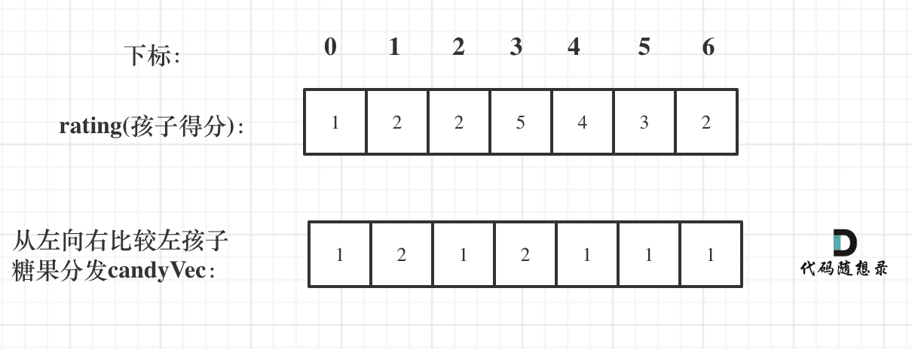
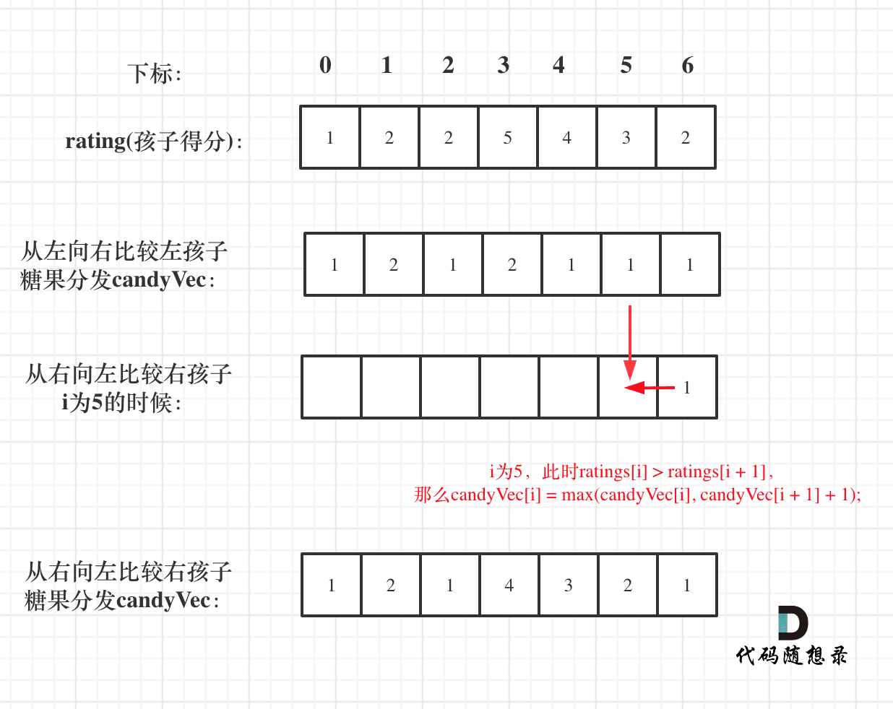

# 本週小結！（貪心演算法系列三）

對於貪心法（greedy），大多數同學都會感覺，不就是常識嘛，這算啥演算法，那麼本週的題目就可以帶大家初步領略一下貪心的巧妙，貪心演算法（greedy algorithm）往往妙得出其不意。

## 週一

在[貪心算法：加油站](../0134.加油站.md)中給出每一個加油站的汽油和開到這個加油站的消耗，問汽車能不能開一圈。

這道題目乍眼一看，感覺是一道模擬（simulation）題，模擬一下汽車從每一個節點（node）出發看看能不能開一圈，時間複雜度（time complexity）是 $O(n^2)$。

即使使用模擬這種情況，也挺考驗程式碼技巧的。

**for 迴圈（for-loop）適合模擬從頭到尾的遍歷（traversal），而 while 迴圈（while loop）適合模擬環形遍歷，對於本題的場景要善於使用 `while`！**

如果程式碼功力不到位，就模擬這種情況，可能寫的也會很費勁。

本題的貪心解法（solution），我給出兩種解法。

對於解法一，其實我並不認為這是貪心，因為沒有找出區域最佳（local optimum），而是直接從總體最佳（global optimum）的角度上思考問題，但思路很巧妙，值得學習一下。

對於解法二，貪心的區域最佳：當前累加 `rest[j]` 的和 `curSum` 一旦小於 0，起始位置至少要是 `j+1`，因為從 `j` 開始一定不行。總體最佳：找到可以跑一圈的起始位置。

這裡是可以從區域最佳推出總體最佳的，想不出反例，那就試試貪心。

**解法二就體現出貪心的精髓，同時大家也會發現，雖然貪心是常識，有些常識並不容易，甚至很難！**

## 週二

在[貪心算法：分發糖果](../0135.分發糖果.md)中我們第一次接觸了需要考慮兩個維度的情況。

例如這道題，是先考慮左邊呢，還是考慮右邊呢？

**先考慮哪一邊都可以！就別兩邊一起考慮，那樣就把自己陷進去了**。

先貪心一邊，區域最佳：只要右邊評分比左邊大，右邊的孩子就多一個糖果，總體最佳：相鄰的孩子中，評分高的右孩子獲得比左邊孩子更多的糖果

如圖：

接著再貪心另一邊，左孩子大於右孩子，左孩子的糖果就要比右孩子多。

此時 `candyVec[i]`（第 i 個小孩的糖果數量，左孩子）就有兩個選擇了，一個是 `candyVec[i + 1] + 1`（從右孩子這個加 1 得到的糖果數量），一個是 `candyVec[i]`（之前比較右孩子大於左孩子得到的糖果數量）。

那麼第二次貪心的區域最佳：取 `candyVec[i + 1] + 1` 和 `candyVec[i]` 最大的糖果數量，保證第 i 個小孩的糖果數量既大於左邊的也大於右邊的。總體最佳：相鄰的孩子中，評分高的孩子獲得更多的糖果。

區域最佳可以推出總體最佳。

如圖：

## 週三

在[貪心算法：檸檬水找零](../0860.檸檬水找零.md)中我們模擬了買檸檬水找零的過程。

這道題目剛一看，可能會有點懵，這要怎麼找零才能保證完成全部帳單的找零呢？

**但仔細一琢磨就會發現，可供我們做判斷的空間非常少！**

美元 10 只能給帳單 20 找零，而美元 5 可以給帳單 10 和帳單 20 找零，美元 5 更萬能！

區域最佳：遇到帳單 20，優先消耗美元 10，完成本次找零。總體最佳：完成全部帳單的找零。

區域最佳可以推出總體最佳。

所以把能遇到的情況分析一下，只要分析到具體情況了，一下子就豁然開朗了。

這道題目其實是一道簡單題，但如果一開始就想從整體上尋找找零方案，就會把自己陷進去，各種情況一交叉，只會越想越複雜了。

## 週四

在[貪心算法：根據身高重建隊列](../0406.根據身高重建隊列.md)中，我們再一次遇到了需要考慮兩個維度的情況。

之前我們已經做過一道類似的了，就是[貪心算法：分發糖果](../0135.分發糖果.md)，但本題比分發糖果難不少！

[貪心算法：根據身高重建隊列](../0406.根據身高重建隊列.md)中依然是要確定一邊，然後再考慮另一邊，兩邊一起考慮一定會頭昏腦脹。

那麼本題先確定 `k` 還是先確定 `h` 呢，也就是究竟先按 `h` 排序（sorting）呢，還是先按照 `k` 排序呢？

這裡其實很考驗大家的思考過程，如果按照 `k` 來從小到大排序，排完之後，會發現 `k` 的排列（permutation）並不符合條件，身高也不符合條件，兩個維度哪一個都沒確定下來。

**所以先從大到小按照 `h` 排個序，再來貪心 `k`**。

此時區域最佳：優先按身高高的 `people` 的 `k` 來插入。插入操作過後的 `people` 滿足佇列（queue）屬性。總體最佳：最後都做完插入操作，整個佇列滿足題目佇列屬性。

區域最佳可以推出總體最佳，找不出反例，那麼就來貪心。

## 總結

「代碼隨想錄」裡已經講了十一道貪心題目了，大家可以發現在每一道題目的講解中，我都是把什麼是區域最佳，和什麼是總體最佳說清楚。

雖然有時候感覺貪心就是常識，但如果真正是常識性的題目，其實是模擬題，就不是貪心演算法了！例如[貪心算法：加油站](../0134.加油站.md)中的貪心方法一，其實我就認為不是貪心演算法，而是直接從總體最佳的角度上來模擬，因為方法裡沒有體現區域最佳的過程。

而且大家也會發現，貪心並沒有想像中的那麼簡單，貪心往往妙得出其不意，措手不及！

 </img>

