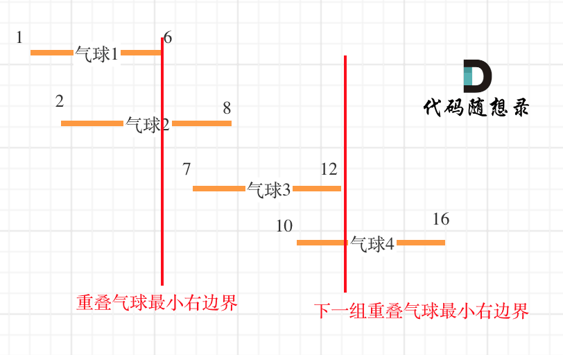
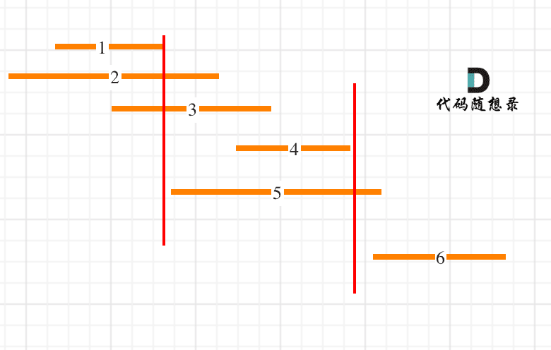
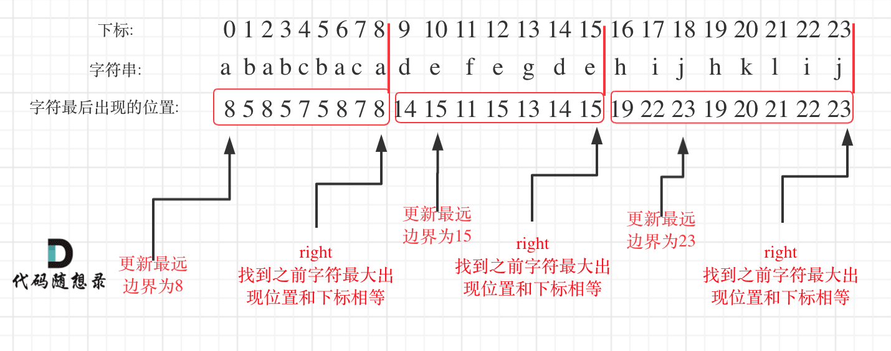
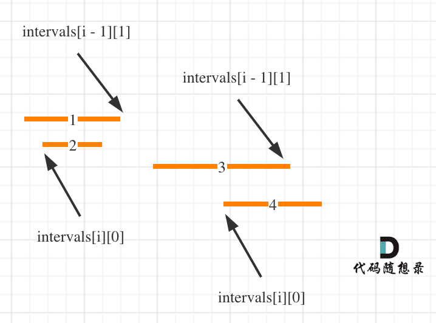

# 本週小結！（貪心演算法系列四）

## 週一

在[貪心算法：用最少數量的箭引爆氣球](https://programmercarl.com/0452.用最少数量的箭引爆气球.html)中，我們開始講解了重疊區間（interval）問題，用最少的弓箭射爆所有氣球，其本質就是找到最大的重疊區間。

按照左邊界（boundary）進行排序（sorting）後，如果氣球重疊了，重疊氣球中右邊邊界的最小值之前的區間一定需要一個弓箭

如圖：



模擬（simulation）射氣球的過程，很多同學真的要去模擬了，即時把氣球從陣列（array）中移走，這麼寫的話就複雜了，從前向後遍歷（traversal）重複的只要跳過就可以的。

## 週二

在[貪心算法：无重疊區間](https://programmercarl.com/0435.无重叠区间.html)中要去掉最少的區間，來讓所有區間沒有重疊。

我來按照右邊界排序，從左向右記錄非交叉區間的個數。最後用區間總數減去非交叉區間的個數就是需要移除的區間個數了。

如圖：



細心的同學就發現了，此題和[貪心算法：用最少數量的箭引爆氣球](https://programmercarl.com/0452.用最少数量的箭引爆气球.html)非常像。

弓箭的數量就相當於是非交叉區間的數量，只要把弓箭那道題目程式碼裡射爆氣球的判斷條件加個等號（認為 `[0, 1]` `[1, 2]` 不是相鄰區間），然後用總區間數減去弓箭數量就是要移除的區間數量了。

把[貪心算法：用最少數量的箭引爆氣球](https://programmercarl.com/0452.用最少数量的箭引爆气球.html)程式碼稍做修改，就可以 AC 本題。

修改後的 C++ 程式碼如下：

```CPP
class Solution {
public:
    // 按照區間左邊界從大到小排序
    static bool cmp (const vector<int>& a, const vector<int>& b) {
        return a[0] < b[0];
    }
    int eraseOverlapIntervals(vector<vector<int>>& intervals) {
        if (intervals.size() == 0) return 0;
        sort(intervals.begin(), intervals.end(), cmp);

        int result = 1;
        for (int i = 1; i < intervals.size(); i++) {
            if (intervals[i][0] >= intervals[i - 1][1]) { // 只需要把 > 改成 >= 就可以了
                result++; // 需要一支箭
            }
            else {
                intervals[i][1] = min(intervals[i - 1][1], intervals[i][1]); // 更新重疊氣球最小右邊界
            }
        }
        return intervals.size() - result;
    }
};
```

## 週三

[貪心算法：劃分字母區間](https://programmercarl.com/0763.划分字母区间.html)中我們要把這個字串（string）劃分為盡可能多的片段，同一字母最多出現在一個片段中。

這道題目 LeetCode 上標的是貪心法（greedy），其實我不認為是貪心，因為沒感受到區域最佳（local optimum）和總體最佳（global optimum）的關係。

但不影響這是一道好題，解題思路很不錯，**透過字元（character）出現最遠距離取聯集的方法，把出現過的字元都圈到一個區間裡**。

解題過程分如下兩步：

* 統計每一個字元最後出現的位置
* 從頭遍歷字元，並更新字元的最遠出現索引（index），如果找到字元最遠出現位置索引和當前索引相等了，則找到了分割點

如圖：




## 週四

[貪心算法：合併區間](https://programmercarl.com/0056.合并区间.html)中要合併所有重疊的區間。

相信如果錄友們前幾天區間問題的題目認真練習了，今天題目就應該算簡單一些了。

按照左邊界排序，排序之後區域最佳：每次合併都取最大的右邊界，這樣就可以合併更多的區間了；整體最佳：合併所有重疊的區間。

具體操作：按照左邊界從小到大排序之後，如果 `intervals[i][0] < intervals[i - 1][1]` 即 `intervals[i]` 左邊界 < `intervals[i - 1]` 右邊界，則一定有重複（duplicate），因為 `intervals[i]` 的左邊界一定是大於等於 `intervals[i - 1]` 的左邊界。

如圖：




## 總結

本週的主題就是用貪心演算法（greedy algorithm）來解決區間問題，經過本週的學習，大家應該對區間的各種合併分割有一定程度的了解了。

其實很多區間的合併操作看起來都是常識，其實貪心演算法有時候就是常識，但也別小看了貪心演算法。

在[貪心算法：合併區間](https://programmercarl.com/0056.合并区间.html)中就說過，對於貪心演算法，很多同學都是：「如果能憑常識直接做出來，就會感覺不到自己用了貪心，一旦第一直覺想不出來，可能就一直想不出來了」。

所以還是要多看多做多練習！

**「代碼隨想錄」裡總結的都是經典題目，大家跟著練就節省了不少選擇題目的時間了**。


<div align="center"> </img></div>

=== END PROSE ===
