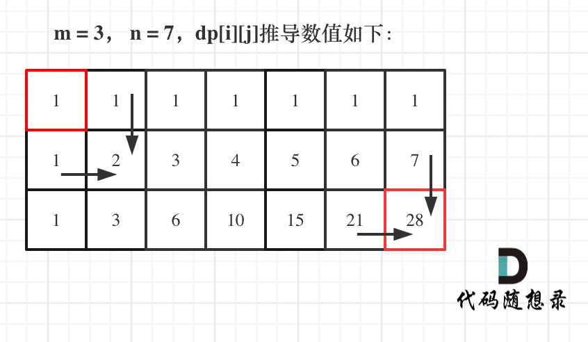
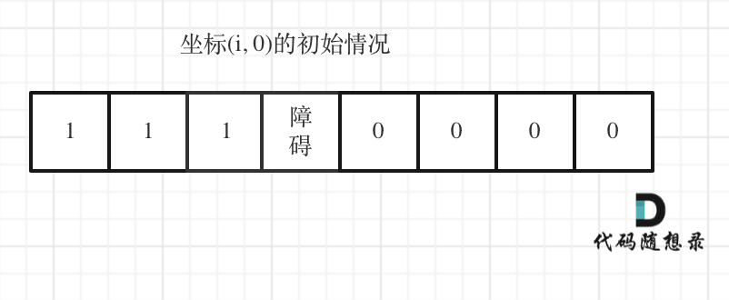
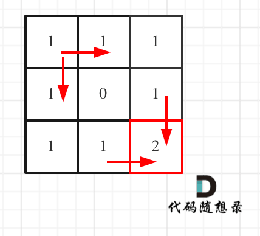
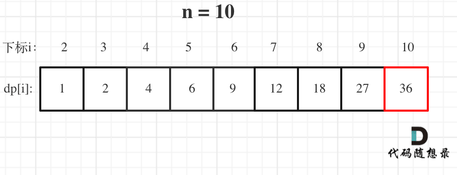
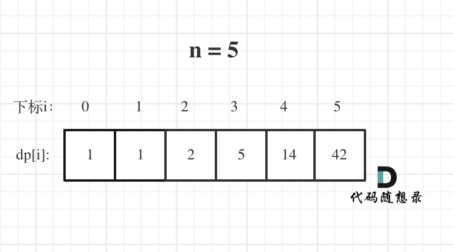

# 本週小結！（動態規劃系列二）

## 週一

[動态规劃：不同路徑](https://programmercarl.com/0062.不同路径.html)中求從出發點到終點有幾種路徑（path），只能向下或者向右移動一步。

我們提供了三種方法，但重點講解的還是動態規劃（dynamic programming, DP），也是需要重點掌握的。

**`dp[i][j]` 定義：表示從 `(0, 0)` 出發，到 `(i, j)` 有 `dp[i][j]` 條不同的路徑**。

本題在初始化（initialization）的時候需要點思考了，即：

`dp[i][0]` 一定都是 1，因為從 `(0, 0)` 的位置到 `(i, 0)` 的路徑只有一條，那麼 `dp[0][j]` 也同理。

所以初始化為：

```
for (int i = 0; i < m; i++) dp[i][0] = 1;
for (int j = 0; j < n; j++) dp[0][j] = 1;
```

這裡已經不像之前做過的題目，隨便賦個 0 就行的。

遍歷（traversal）順序以及遞迴公式（recurrence formula）：

```
for (int i = 1; i < m; i++) {
    for (int j = 1; j < n; j++) {
        dp[i][j] = dp[i - 1][j] + dp[i][j - 1];
    }
}
```




## 週二

[動态规劃：不同路徑還不够，要有障礙！](https://programmercarl.com/0063.不同路径II.html)相對於[動态规劃：不同路徑](https://programmercarl.com/0062.不同路径.html)新增了障礙。

`dp[i][j]` 定義依然是：表示從 `(0, 0)` 出發，到 `(i, j)` 有 `dp[i][j]` 條不同的路徑。


本題難點在於初始化，如果 `(i, 0)` 這條邊（edge）有了障礙之後，障礙之後（包括障礙）都是走不到的位置了，所以障礙之後的 `dp[i][0]` 應該還是初始值 0。

如圖：




這裡難住了不少同學，程式碼如下：

```
vector<vector<int>> dp(m, vector<int>(n, 0));
for (int i = 0; i < m && obstacleGrid[i][0] == 0; i++) dp[i][0] = 1;
for (int j = 0; j < n && obstacleGrid[0][j] == 0; j++) dp[0][j] = 1;
```


遞迴公式只要考慮一下障礙，就不賦值了就可以了，如下：

```
for (int i = 1; i < m; i++) {
    for (int j = 1; j < n; j++) {
        if (obstacleGrid[i][j] == 1) continue;
        dp[i][j] = dp[i - 1][j] + dp[i][j - 1];
    }
}
```

拿範例 1 來舉例如圖：


對應的 dp table 如圖：




## 週三

[動态规劃：整數拆分，你要怎麼拆？](https://programmercarl.com/0343.整数拆分.html)給出一個整數（integer），問有多少種拆分的方法。

這道題目就有點難度了，題目中 dp 我也給出了兩種方法，但透過兩種方法的比較可以看出，對 dp 陣列（array）定義的理解，以及 dp 陣列初始化的重要性。


**`dp[i]` 定義：分拆數字 `i`，可以得到的最大乘積為 `dp[i]`**。

本題中 `dp[i]` 的初始化其實也很有講究，嚴格從 `dp[i]` 的定義來說，`dp[0]`、`dp[1]` 就不應該初始化，也就是沒有意義的數值。

拆分 0 和拆分 1 的最大乘積是多少？

這是無解的。

所以題解裡我只初始化 `dp[2] = 1`，從 `dp[i]` 的定義來說，拆分數字 2，得到的最大乘積是 1，這個沒有任何異議！

```
vector<int> dp(n + 1);
dp[2] = 1;
```

遍歷順序以及遞迴公式：

```
for (int i = 3; i <= n ; i++) {
    for (int j = 1; j < i - 1; j++) {
        dp[i] = max(dp[i], max((i - j) * j, dp[i - j] * j));
    }
}
```

舉例當 `n` 為 10 的時候，dp 陣列裡的數值，如下：




一些錄友可能對為什麼沒有拆分 `j` 沒有想清楚。

其實可以模擬（simulation）一下哈，拆分 `j` 的情況，在遍歷 `j` 的過程中 `dp[i - j]` 其實都計算過了。

例如 `i = 10`，`j = 5`，`i - j = 5`，如果把 `j` 拆分為 2 和 3，其實在 `j = 2` 的時候，`i - j = 8`，拆分 `i - j` 的時候就可以拆出來一個 3 了。

**或者也可以理解 `j` 是拆分 `i` 的第一個整數**。

[動态规劃：整數拆分，你要怎麼拆？](https://programmercarl.com/0343.整数拆分.html)總結裡，我也給出了遞迴公式 `dp[i] = max(dp[i], dp[i - j] * dp[j])` 這種寫法。

對於這種寫法，一位錄友總結得很好，意思就是：如果遞迴公式是 `dp[i - j] * dp[j]`，這樣就相當於強制把一個數至少拆分成四份。

`dp[i - j]` 至少是兩個數的乘積，`dp[j]` 又至少是兩個數的乘積，但其實 3 以下的數，數的本身比任何它的拆分乘積都要大了，所以文章中初始化的時候才要特殊處理。

## 週四

[動态规劃：不同的二叉搜索樹](https://programmercarl.com/0096.不同的二叉搜索树.html)給出 `n` 個不同的節點（node）求能組成多少個不同二元搜尋樹（binary search tree, BST）。

這道題目還是比較難的，想到用動態規劃的方法就很不容易了！

**`dp[i]` 定義：1 到 `i` 為節點組成的二元搜尋樹的個數為 `dp[i]`**。

遞迴公式：`dp[i] += dp[j - 1] * dp[i - j];`，`j - 1` 為以 `j` 為頭節點（head node）左子樹（left subtree）節點數量，`i - j` 為以 `j` 為頭節點右子樹（right subtree）節點數量

dp 陣列如何初始化：只需要初始化 `dp[0]` 就可以了，推導的基礎，都是 `dp[0]`。

`n` 為 5 時候的 dp 陣列狀態（state）如圖：



## 總結

本週題目已經開始有點難度了，特別是[動态规劃：不同的二叉搜索樹](https://programmercarl.com/0096.不同的二叉搜索树.html)這道題目，明顯感覺閱讀量很低，可能是因為確實有點難吧。

我現在也陷入了糾結，題目一簡單，就會有錄友和我回饋說題目太簡單了，題目一難，閱讀量就特別低。

**但我還會堅持規劃好的路線，難度循序漸進，並以面試經典題目為準，該簡單的時候就是簡單，同時也不會因為閱讀量低就放棄有難度的題目！**

<div align="center"> </img></div>

=== END PROSE ===
