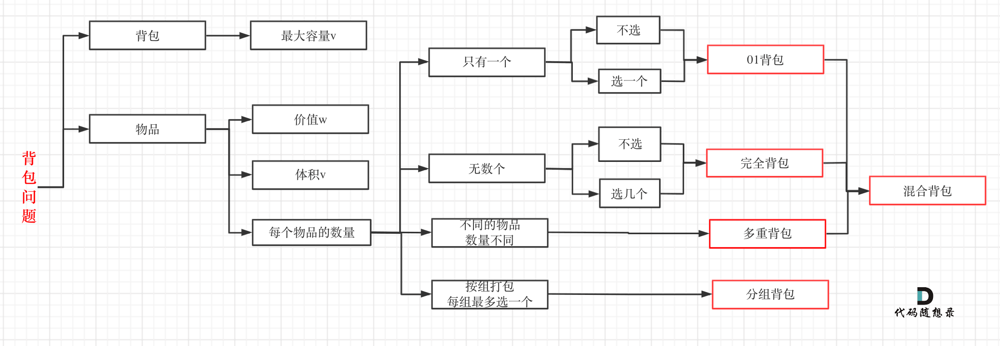
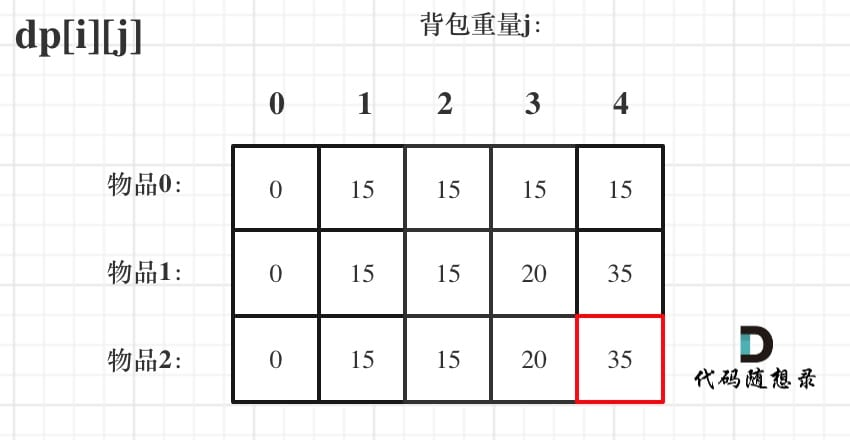
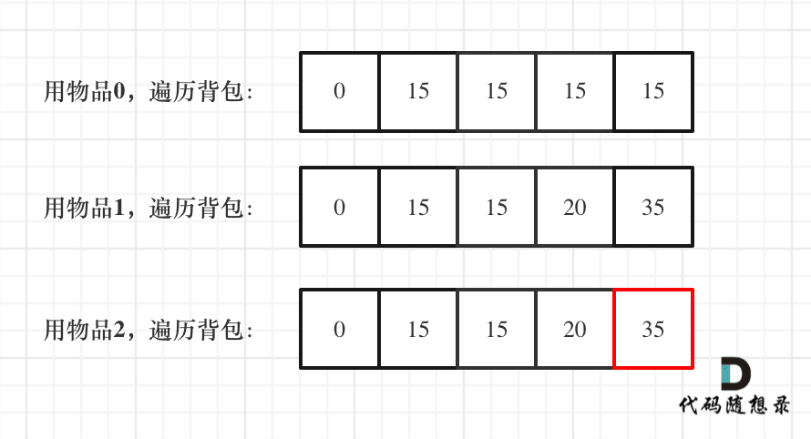

# 本週小結！（動態規劃（dynamic programming, DP）系列三）

本週我們正式開始講解背包問題（knapsack problem），也是動規裡非常重要的一類問題。

背包問題其實有很多細節，如果只是了解個大概，然後也能一氣呵成把程式碼寫出來，但稍微變化一下花樣就可能會陷入迷茫了。

開始回顧一下本週的內容吧！

## 週一

[動態規劃：關於01背包問題，你該了解這些！](../背包理論基礎01背包-1.md)中，我們開始介紹了背包問題。

首先對於背包的所有問題中，0/1 背包問題（0/1 knapsack problem）是最最基礎的，其他背包也是在 0/1 背包問題的基礎上稍作變化。

所以我才花費這麼大精力去講解 0/1 背包問題。

關於其他幾種常用的背包，大家看這張圖就瞭然於胸了：



本文用動規五部曲詳細講解了 0/1 背包問題的二維（2D）dp 陣列（array）的實作方法，大家其實可以發現最簡單的是推導公式了，推導公式估計看一遍就記下來了，但難就難在確定初始化（initialization）和遍歷（traversal）順序上。

1. 確定 dp 陣列以及下標（subscript）的含義

dp[i][j] 表示從下標為 [0-i] 的物品裡任意取，放進容量為 j 的背包，價值總和最大是多少。

2. 確定遞迴公式（recurrence formula）

dp[i][j] = max(dp[i - 1][j], dp[i - 1][j - weight[i]] + value[i]);

3. dp 陣列如何初始化

```CPP
// 初始化 dp
vector<vector<int>> dp(weight.size() + 1, vector<int>(bagWeight + 1, 0));
for (int j = bagWeight; j >= weight[0]; j--) {
    dp[0][j] = dp[0][j - weight[0]] + value[0];
}
```

4. 確定遍歷順序

**0/1 背包問題二維 dp 陣列在遍歷順序上，外層遍歷物品，內層遍歷背包容量 和 外層遍歷背包容量，內層遍歷物品 都是可以的！**

但是先遍歷物品更好理解。程式碼如下：

```CPP
// weight 陣列的大小就是物品個數
for(int i = 1; i < weight.size(); i++) { // 遍歷物品
    for(int j = 0; j <= bagWeight; j++) { // 遍歷背包容量
        if (j < weight[i]) dp[i][j] = dp[i - 1][j]; // 這個是為了展現 dp 陣列裡元素的變化
        else dp[i][j] = max(dp[i - 1][j], dp[i - 1][j - weight[i]] + value[i]);

    }
}
```

5. 舉例推導 dp 陣列

背包最大重量為 4。

物品為：

|       | 重量 | 價值 |
| ----- | ---- | ---- |
| 物品0 | 1    | 15   |
| 物品1 | 3    | 20   |
| 物品2 | 4    | 30   |

來看一下對應的 dp 陣列的數值，如圖：



最終結果就是 dp[2][4]。


## 週二

[動態規劃：關於01背包問題，你該了解這些！（滾動陣列）](../背包理論基礎01背包-2.md)中把 0/1 背包問題的一維陣列（one dimensional array）dp（rolling array）實作詳細講解了一遍。

分析一下和二維 dp 陣列有什麼區別，在初始化和遍歷順序上又有什麼差異？

最後總結了一道樸實無華的背包面試題。

要求候選人先實作一個純二維的 0/1 背包問題，如果寫出來了，然後再問為什麼兩個 for 迴圈（for-loop）的嵌套順序這麼寫？反過來寫行不行？再講一講初始化的邏輯。

然後要求實作一個一維陣列的 0/1 背包問題，最後再問，一維陣列的 0/1 背包問題，兩個 for 迴圈的順序反過來寫行不行？為什麼？

這幾個問題就可以考察出候選人的演算法功底了。

0/1 背包問題一維陣列分析如下：

1. 確定 dp 陣列的定義

在一維 dp 陣列中，dp[j] 表示：容量為 j 的背包，所背的物品價值可以最大為 dp[j]。

2. 一維 dp 陣列的遞迴公式

```
dp[j] = max(dp[j], dp[j - weight[i]] + value[i]);
```

3. 一維 dp 陣列如何初始化

如果物品價值都是大於 0 的，所以 dp 陣列初始化的時候，都初始為 0 就可以了。

4. 一維 dp 陣列遍歷順序

程式碼如下：

```CPP
for(int i = 0; i < weight.size(); i++) { // 遍歷物品
    for(int j = bagWeight; j >= weight[i]; j--) { // 遍歷背包容量
        dp[j] = max(dp[j], dp[j - weight[i]] + value[i]);

    }
}
```

5. 舉例推導 dp 陣列

一維 dp，分別用物品 0，物品 1，物品 2 來遍歷背包，最終得到結果如下：




## 週三

[動態規劃：416. 分割等和子集](../0416.分割等和子集.md)中我們開始用 0/1 背包問題來解決問題。

只有確定了如下四點，才能把 0/1 背包問題套到本題上來。

* 背包的體積為 sum / 2
* 背包要放入的商品（集合（set）裡的元素（element））重量為元素的數值，價值也為元素的數值
* 背包如何正好裝滿，說明找到了總和為 sum / 2 的子集（subset）。
* 背包中每一個元素是不可重複放入。

接下來就是一個完整的 0/1 背包問題，大家應該可以輕鬆做出了。

## 週四

[動態規劃：1049. 最後一塊石頭的重量 II](../1049.最後一塊石頭的重量II.md)這道題目其實和[動態規劃：416. 分割等和子集](../0416.分割等和子集.md)是非常像的。

本題其實就是盡量讓石頭分成重量相同的兩堆，相撞之後剩下的石頭最小，這樣就化解成 0/1 背包問題了。

[動態規劃：416. 分割等和子集](../0416.分割等和子集.md)相當於是求背包是否正好裝滿，而本題是求背包最多能裝多少。

這兩道題目是對 dp[target] 的處理方式不同。這也考驗了對 dp[i] 定義的理解。


## 總結

總體來說，本週資訊量還是比較大的，特別對於動態規劃（dynamic programming, DP）還不夠了解的同學。

但如果堅持下來，把我在文章中列出的每一個問題，都仔細思考，消化為自己的知識，那麼進步一定是飛速的。

有的同學可能看了看背包遞迴公式，上來就能刷個幾道題目，然後背包問題就這麼過去了，其實這樣是很不牢固的。

就像我們講解 0/1 背包問題的時候，花了那麼大力氣才把每一個細節都講清楚，這裡其實是基礎，後面的背包問題怎麼變，基礎比較牢固自然會有自己的一套思考過程。


<div align="center"> </img></div>
