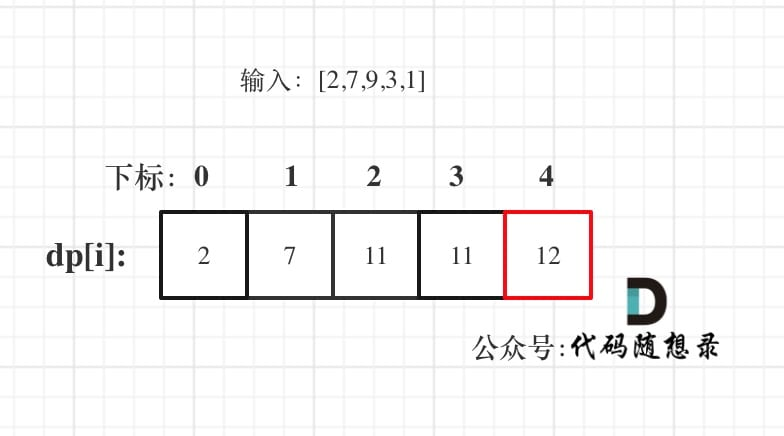
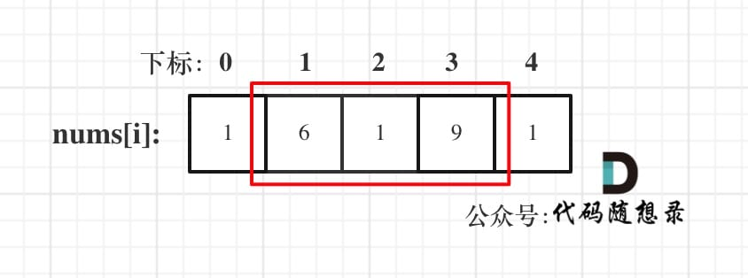
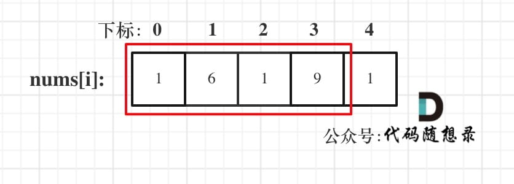
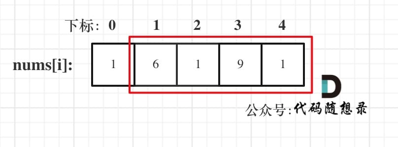
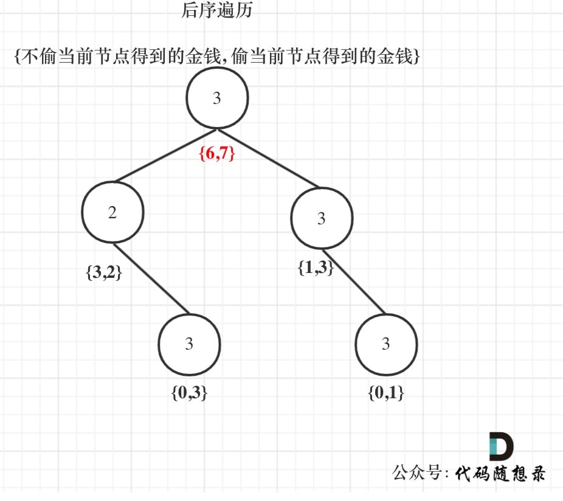

# 本週小結！（動態規劃（dynamic programming, DP）系列六）

本週我們主要講解了打家劫舍系列，這個系列也是 dp 解決的經典問題，那麼來看看我們收穫了哪些呢，一起來回顧一下吧。

## 週一

[動態規劃：開始打家劫舍！](../0198.打家劫捨.md)中就是給一個陣列（array）相鄰之間不能連著偷，如何偷才能得到最大金錢。

1. 確定 dp 陣列含義

**dp[i]：考慮下標（subscript）i（包括 i）以內的房屋，最多可以偷竊的金額為 dp[i]**。

2. 確定遞迴公式（recurrence formula）

dp[i] = max(dp[i - 2] + nums[i], dp[i - 1]);

3. dp 陣列如何初始化（initialization）

```
vector<int> dp(nums.size());
dp[0] = nums[0];
dp[1] = max(nums[0], nums[1]);
```

4. 確定遍歷（traversal）順序

從前到後遍歷

5. 舉例推導 dp 陣列

以範例二，輸入 [2,7,9,3,1] 為例。



紅框 dp[nums.size() - 1] 為結果。

## 週二

[動態規劃：繼續打家劫舍！](../0213.打家劫捨II.md)就是陣列成環了，然後相鄰的不能連著偷。

這裡主要考慮清楚三種情況：

* 情況一：考慮不包含首尾元素（element）



* 情況二：考慮包含首元素，不包含尾元素



* 情況三：考慮包含尾元素，不包含首元素



需要注意的是，**「考慮」 不等於 「偷」**，例如情況三，雖然是考慮包含尾元素，但不一定要選尾部元素！對於情況三，取 nums[1] 和 nums[3] 就是最大的。

所以情況二 和 情況三 都包含了情況一了，**所以只考慮情況二和情況三就可以了**。

成環之後還是難了一些的，不少題解沒有把「考慮房間」和「偷房間」說清楚。

這就導致大家會有這樣的困惑：「情況三怎麼就包含了情況一了呢？本文圖中最後一間房不能偷啊，偷了一定不是最優結果」。

所以我在本文重點強調了情況一二三是「考慮」的範圍，而具體房間偷與不偷交給遞迴公式去抉擇。

剩下的就和[動態規劃：開始打家劫舍！](../0198.打家劫捨.md)是一個邏輯了。

## 週三

[動態規劃：還要打家劫舍！](../0337.打家劫捨III.md)這次是在一棵二元樹（binary tree）上打家劫舍了，條件還是一樣的，相鄰的不能偷。

這道題目是樹狀動態規劃（dynamic programming, DP）的入門題目，其實樹狀 DP 就是在樹（tree）上進行遞迴公式的推導，沒有什麼神秘的。

這道題目我給出了蠻力（brute force）的解法：

```CPP
class Solution {
public:
    int rob(TreeNode* root) {
        if (root == NULL) return 0;
        if (root->left == NULL && root->right == NULL) return root->val;
        // 偷父節點
        int val1 = root->val;
        if (root->left) val1 += rob(root->left->left) + rob(root->left->right); // 跳過 root->left，相當於不考慮左孩子了
        if (root->right) val1 += rob(root->right->left) + rob(root->right->right); // 跳過 root->right，相當於不考慮右孩子了
        // 不偷父節點
        int val2 = rob(root->left) + rob(root->right); // 考慮 root 的左右孩子
        return max(val1, val2);
    }
};
```

當然超時了，因為我們計算了 root 的四個孫子（左右孩子的孩子）為頭節點（head node）的子樹（subtree）的情況，又計算了 root 的左右孩子為頭節點的子樹的情況，計算左右孩子的時候其實又把孫子計算了一遍。

那麼使用一個 map 把計算過的結果保存一下，這樣如果計算過孫子了，那麼計算孩子的時候可以複用孫子節點（node）的結果。

程式碼如下：

```CPP
class Solution {
public:
    unordered_map<TreeNode* , int> umap; // 記錄計算過的結果
    int rob(TreeNode* root) {
        if (root == NULL) return 0;
        if (root->left == NULL && root->right == NULL) return root->val;
        if (umap[root]) return umap[root]; // 如果 umap 裡已經有記錄則直接回傳
        // 偷父節點
        int val1 = root->val;
        if (root->left) val1 += rob(root->left->left) + rob(root->left->right); // 跳過 root->left
        if (root->right) val1 += rob(root->right->left) + rob(root->right->right); // 跳過 root->right
        // 不偷父節點
        int val2 = rob(root->left) + rob(root->right); // 考慮 root 的左右孩子
        umap[root] = max(val1, val2); // umap 記錄一下結果
        return max(val1, val2);
    }
};
```

最後我們還是給出DP的解法。

因為是在樹上進行狀態變遷（state transition），我們在講解二元樹的時候說過遞迴（recursion）三部曲，那麼下面我以遞迴三部曲為框架（framework），其中融合動規五部曲的內容來進行講解。

1. 確定遞迴函數（recursive function）的參數（parameter）和回傳值（return value）

```CPP
vector<int> robTree(TreeNode* cur) {
```

dp 陣列含義：下標為 0 記錄不偷該節點所得到的最大金錢，下標為 1 記錄偷該節點所得到的最大金錢。

**所以本題 dp 陣列就是一個長度為 2 的陣列！**

那麼有同學可能疑惑，長度為 2 的陣列怎麼標記樹中每個節點的狀態（state）呢？

**別忘了在遞迴的過程中，系統堆疊（stack）會保存每一層遞迴的參數**。

2. 確定終止條件（termination condition）

在遍歷的過程中，如果遇到 `null node` 的話，很明顯，無論偷還是不偷都是 0，所以就回傳

```
if (cur == NULL) return vector<int>{0, 0};
```

3. 確定遍歷順序

採用後序遍歷（post-order traversal），程式碼如下：

```CPP
// 下標 0：不偷，下標 1：偷
vector<int> left = robTree(cur->left); // 左
vector<int> right = robTree(cur->right); // 右
// 中

```

4. 確定單層遞迴的邏輯

如果是偷當前節點，那麼左右孩子就不能偷，val1 = cur->val + left[0] + right[0];

如果不偷當前節點，那麼左右孩子就可以偷，至於到底偷不偷一定是選一個最大的，所以：val2 = max(left[0], left[1]) + max(right[0], right[1]);

最後當前節點的狀態就是 {val2, val1}; 即：{不偷當前節點得到的最大金錢，偷當前節點得到的最大金錢}

程式碼如下：

```CPP
vector<int> left = robTree(cur->left); // 左
vector<int> right = robTree(cur->right); // 右

// 偷 cur
int val1 = cur->val + left[0] + right[0];
// 不偷 cur
int val2 = max(left[0], left[1]) + max(right[0], right[1]);
return {val2, val1};
```

5. 舉例推導 dp 陣列

以範例 1 為例，dp 陣列狀態如下：（**注意用後序遍歷的方式推導**）



**最後頭節點就是 取下標 0 和 下標 1 的最大值就是偷得的最大金錢**。


樹狀 DP 為什麼比較難呢？

因為平時我們習慣了在一維陣列（one dimensional array）或者二維（2D）陣列上推導公式，一下子換成了樹，就需要對樹的遍歷方式足夠了解！

大家還記不記得我在講解貪心專題的時候，講到這道題目：[貪心算法：我要監控二元樹！](../0968.監控二叉樹.md)，這也是貪心演算法（greedy algorithm）在樹上的應用。**那我也可以把這個演算法起一個名字，叫做樹狀貪心**

「樹狀貪心」詞彙從此誕生，來自「程式碼隨想錄」


## 週四

[動態規劃：買賣股票的最佳時機](../0121.買賣股票的最佳時機.md) 一段時間，只能買賣一次，問最大收益。

這裡我給出了三種解法：

蠻力解法程式碼：

```CPP
class Solution {
public:
    int maxProfit(vector<int>& prices) {
        int result = 0;
        for (int i = 0; i < prices.size(); i++) {
            for (int j = i + 1; j < prices.size(); j++){
                result = max(result, prices[j] - prices[i]);
            }
        }
        return result;
    }
};
```

* 時間複雜度（time complexity）：O(n^2)
* 空間複雜度（space complexity）：O(1)

貪心解法程式碼如下：

因為股票就買賣一次，那麼貪心法（greedy）的想法很自然就是取最左最小值，取最右最大值，那麼得到的差值就是最大利潤。

```CPP
class Solution {
public:
    int maxProfit(vector<int>& prices) {
        int low = INT_MAX;
        int result = 0;
        for (int i = 0; i < prices.size(); i++) {
            low = min(low, prices[i]);  // 取最左最小價格
            result = max(result, prices[i] - low); // 直接取最大區間利潤
        }
        return result;
    }
};
```

* 時間複雜度：O(n)
* 空間複雜度：O(1)

動規解法，版本一，程式碼如下：

```CPP
// 版本一
class Solution {
public:
    int maxProfit(vector<int>& prices) {
        int len = prices.size();
        vector<vector<int>> dp(len, vector<int>(2));
        dp[0][0] -= prices[0];
        dp[0][1] = 0;
        for (int i = 1; i < len; i++) {
            dp[i][0] = max(dp[i - 1][0], -prices[i]);
            dp[i][1] = max(dp[i - 1][1], prices[i] + dp[i - 1][0]);
        }
        return dp[len - 1][1];
    }
};
```

* 時間複雜度：O(n)
* 空間複雜度：O(n)

從遞迴公式可以看出，dp[i] 只是依賴於 dp[i - 1] 的狀態。


那麼我們只需要記錄 當前天的 dp 狀態和前一天的 dp 狀態就可以了，可以使用滾動陣列（rolling array）來節省空間，程式碼如下：

```CPP
// 版本二
class Solution {
public:
    int maxProfit(vector<int>& prices) {
        int len = prices.size();
        vector<vector<int>> dp(2, vector<int>(2)); // 注意這裡只開闢了一個 2 * 2 大小的二維陣列
        dp[0][0] -= prices[0];
        dp[0][1] = 0;
        for (int i = 1; i < len; i++) {
            dp[i % 2][0] = max(dp[(i - 1) % 2][0], -prices[i]);
            dp[i % 2][1] = max(dp[(i - 1) % 2][1], prices[i] + dp[(i - 1) % 2][0]);
        }
        return dp[(len - 1) % 2][1];
    }
};
```

* 時間複雜度：O(n)
* 空間複雜度：O(1)


建議先寫出版本一，然後在版本一的基礎上最佳化成版本二，而不是直接就寫出版本二。


## 總結

剛剛結束了背包問題（knapsack problem），本週主要講解打家劫舍系列。

**劫舍系列簡單來說就是 陣列上連續元素二選一，成環之後連續元素二選一，在樹上連續元素二選一，所能得到的最大價值**。

那麼這裡每一種情況 我在文章中都做了詳細的介紹。

週四我們開始講解股票系列了，大家應該預測到了，我們下週的主題就是股票！敬請期待吧！

**程式碼隨想錄溫馨提醒：投資有風險，入市需謹慎！**


<div align="center"> </img></div>
